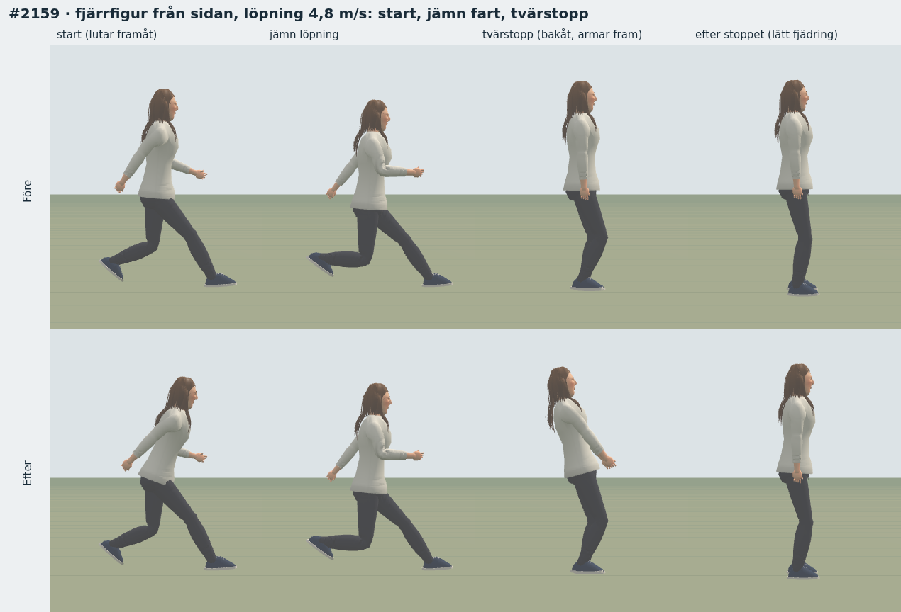
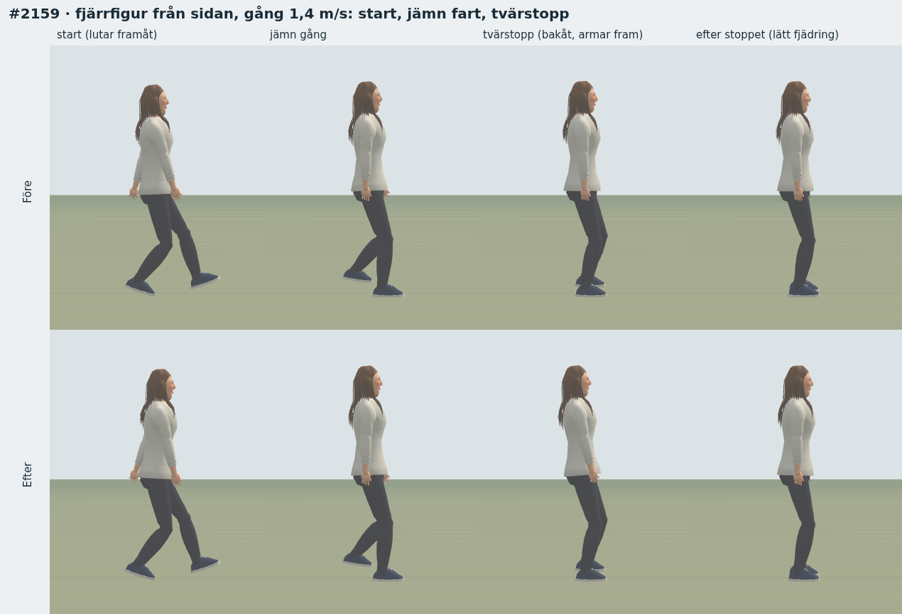

# #2159: the body leans into a start and against a sudden stop

Baseline `cea65011`. The before images serve that revision's whole source tree as `/before/` (through `git show`); the after images use
the working source. Both run the real remote consumer in lockstep: `Ghosts`/`Ghost.push` at 5 Hz → the #2139 playback → `Ghost.draw` →
`Avatar.update` → `poseOlof`. The path is straight: the figure stands for 1 s, sets off at once to 4.8 m/s (outdoor sprint) or 1.4 m/s
(walk), keeps that speed for 2.6 s, stops at once and stands. The sender changes speed instantly, as the local player does, and the
playback curve draws it. Each image is a native render of four 300 × 400 columns with a label strip, before on top and after below. The
camera looks from the figure's side, so the trunk's pitch reads directly. The columns are taken at the after row's own moments: the
largest forward lean at the start, a steady stretch, the largest back lean at the stop and the over-swing peak after it.

## Result

| sprint 4.8 m/s (trunk pitch hips → neck, rad, + forward) | before | after |
|---|---|---|
| start (peak) | 0.085 | 0.302 |
| steady run (mean) | 0.079 | 0.078 |
| sudden stop (peak back) | −0.001 | −0.261 |
| left hand ahead of the hips at the stop (m) | 0.019 | 0.208 |
| over-swing after the stop | −0.010 | 0.049 |

At a walk (1.4 m/s) the effect is deliberately much smaller: the start goes from −0.032 to 0.049 and the stop from −0.002 to −0.079.
At constant speed the term stays below 0.02 rad (sprint) and 0.013 rad (walk) on the jittery playback, and it is back under 0.01 rad
1.5 s after the stop. The page and console logged no errors. `Ghost.animate` cost stayed within the noise. Full numbers:
[browser.json](browser.json).

Reproduce: `python3 -m http.server 8234` in the checkout, then
`PLAYWRIGHT_MODULE=… THREE_DIR=… tools/browsertest.sh node tools/avataraccel2159browser.cjs http://127.0.0.1:8234 docs/verification/2159 cea65011`.
