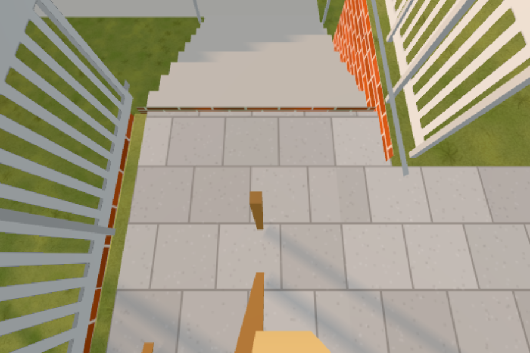
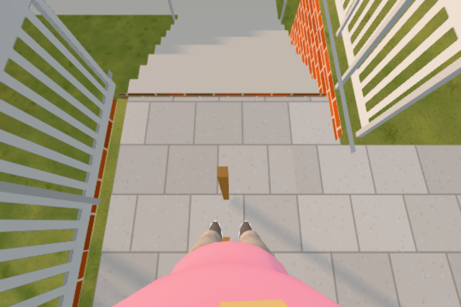
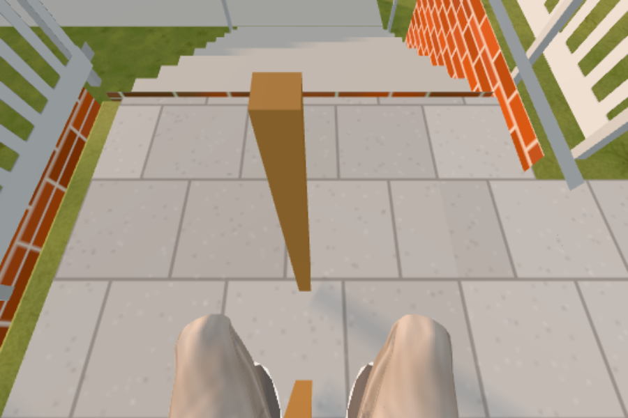
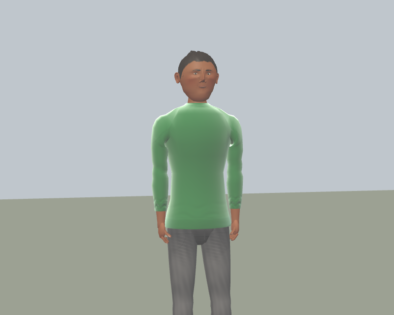
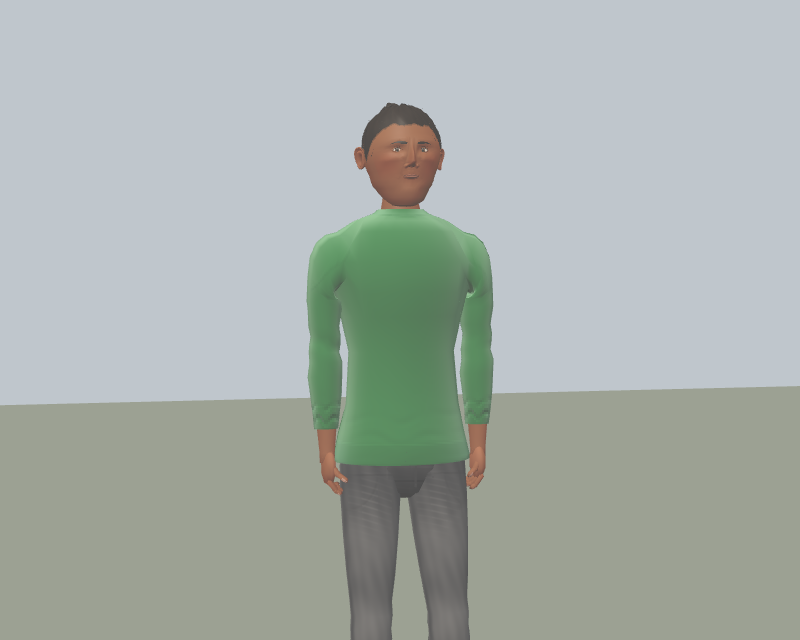

# #2211 — own body at spawn and garment contour

Base `51ab09eedd75a06f2bd0ae648b0c82bc994d4aaf`. Original-only avatars/gameplay: no applicable public downstream transfer.

## Result

The own body is visible before moving at spawn `(12.5, 0, 26.2)`, gaze −72°. Dynamic Ghost meshes now opt out of the static furnishing DetailCuller when created and when replaced after a look/outer-layer change. Existing Ghost visibility/LOD, camera/head/arm clipping, depth testing, mirror lifecycle and gameplay keep their existing owners.





A second shared cause produced a bright garment contour: the fabric sheen term was strongest exactly on the silhouette, including from summed indirect light. It now falls back to zero at N·V=0 while retaining the broad soft sheen inside the garment. The existing exponent, gain, fabric-kind strengths, cloth roughness/wear, skin/hair/metal terms and all blending remain unchanged. This applies to our own view and other Ghost avatars through the shared material.




The fabric pair is a component view of the **real Ghost/Avatar**, using the existing `tools/avatarhit.html` scene, same green remote look and sun/hemi as the #2215 image that exposed the contour. It is not a full-world app image. Both panels are native 800×640 and hold the exact same settled pose, geometry, camera and light. The before panel swaps only the old `fabricLight` GLSL into the final material. Both draw **2 calls / 18,048 triangles**, including the unchanged floor. All retained images were opened and inspected at their native aspect ratio.

## Diagnosis and scoped checks

1. Actual-app visibility diagnosis (`diagnosis.json`, `tools/self2211diagnose.cjs`): `g.mesh === g.avatar.mesh`, body and every ancestor visible, all ancestor masks 1, but the body mask was **128** (DetailCuller's hidden layer 7), with **0 body draws** and null skinned boundingSphere. Restoring its mask immediately produced a draw and a finite sphere (~0.89 m). Disabling native frustum culling/blending alone had not helped. A separate deterministic Avatar+DetailCuller reproduction (`before-detail.json`) kept mask 128 after moving only the avatar from the initial origin to spawn; a 0.7 m camera move restored mask 1. The initial self avatar was registered among static furnishings before its first actual position; only moving the eye invalidated that static decision.
2. `node --test tools/self2211test.mjs tools/avatarselfviewtest.mjs tools/avatarfabrictest.mjs`: **11/11 pass** (`node.txt`). Actual Ghost mesh collection at spawn without camera movement, replacement look, ordinary static-detail policy preserved; existing own-body rest/stand eligibility, shader mask composition and root placement; existing five fabric finishes and wear zones. The tests keep static furnishing culling intact instead of globally disabling it.
3. Own Chromium/SwiftShader checks through `tools/browsertest.sh`, port 8433: actual unchanged spawn and normal crouch with final product source (`final-browser.json`, `final-browser.txt`); same-pose real Ghost fabric before/after, no page errors. `source.json` pins source hashes and verifies all eight relevant served files match the isolated checkout. No production source edits during live evidence. The initial 900×600 before-start image comes from the root conductor's own same-issue app diagnosis on this same checkout/base/server; the worker inspected it and ran the subsequent actual-app diagnosis and final result captures.

The first visible own-body material comparison toggled normal blending without coverage, coverage alone, and uOutline/rim while holding the pose. All three were pixel-identical to the original (0 differing pixels: `material-pixels.json`). This ruled out those terms **in that own-body view**, not every garment term. The conductor then identified the additional torso/arm contour in #2215. A single targeted test with only `fabricLight` removed eliminated it (`fabric-diagnosis.json`); the final correction retains a soft sheen without the perimeter line. In the fixed green-cloth ROI, pixels above Rec.709 display luma 190 fall **1,613 → 2**, maximum **253.86 → 190.88** (`fabric-pixels.json`); this is an image diagnostic, not a universal appearance threshold.

The pale strip on trainers is separate authored sole geometry (`avatar.js`, colour `0xe9e6df`, 2.5 mm wider per side than the upper). It is intentionally retained; shoes and actual antialiasing/flyaway coverage are unchanged. No per-polygon or head-collider work is included.

## Reproduce and limits

```sh
node --test tools/self2211test.mjs tools/avatarselfviewtest.mjs tools/avatarfabrictest.mjs
PLAYWRIGHT_MODULE=/path/to/playwright tools/browsertest.sh node tools/self2211final.cjs http://127.0.0.1:8433 docs/verification/2211
```

The final runner uses the captured baseline GLSL in `fabric-diagnosis.json`. It reuses the established component scene rather than introducing another avatar profile. Actual-app frames are native 900×600, quality 0, DPR1 browser; the production renderer has its existing quality-scaled internal buffer/MSAA. No networking, mobile device run or frame-time benchmark is claimed. The wrapper supplied the shared browser slot; no systemd user scope exists on this host, so its memory ceiling is unavailable.

Cost: two static `noDetail` assignments at mesh creation/replacement; one additional scalar multiplication per fabric-lit fragment. No geometry, texture, attribute, uniform, program-per-look, audio allocation, draw call or network field is added. Static detail policy and Ghost far-LOD remain unchanged.

Phase times (UTC): inherited root diagnosis before 15:04; worker diagnosis 15:04–15:09, visibility implementation/Node 15:09–15:11, actual material diagnosis 15:11–15:13, focused fabric cause/correction 15:14–15:18, final frozen component/app evidence 15:18–15:20, documentation/handoff 15:20–15:23. Integration/publishing owner: root conductor, session `olw-win10-gpt-6-20261120`. Worker commits only; root reviews/publishes embedded images and closes after release gates.
