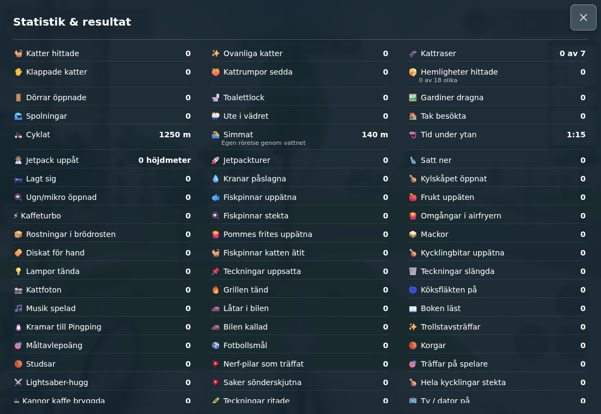
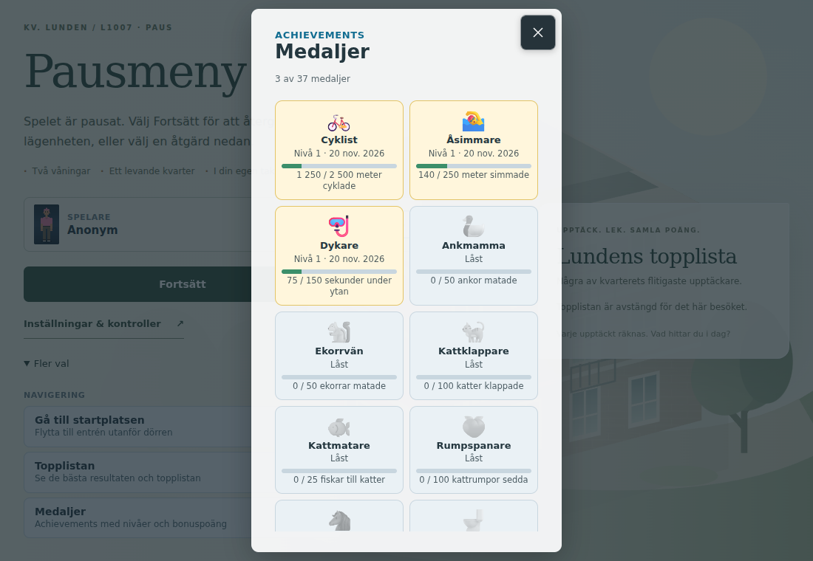

# Outdoor movement statistics and medals (#2230)

Base: `6c2e4f65`; production hashes are in [app-results.json](app-results.json),
test/Worker hashes and commands in [verification-source.json](verification-source.json).
No production source changed during the actual-app run. The containing commit supplies
the complete reviewed source and final docs. Root conductor owns integration/publication.

## Inventory and selected batch

[Issue inventory and plan](https://github.com/solwation/lunden-3d-apartment/issues/2230#issuecomment-7044153672)
and [separate scooter coordination](https://github.com/solwation/lunden-3d-apartment/issues/2229#issuecomment-7044158115)
were posted before implementation. Existing changelog and event producers were inspected:

| Playable family | Existing evidence | Decision for this batch |
| --- | --- | --- |
| Bicycle | Changelog 1664 (cadence/freewheel), `Player.bikeStep` | Add cycleMetres / Cyklist. Accepted horizontal path, before rescue. |
| Swimming/diving | Changelog 1498 (swim stroke), 1495 (underwater mussels), `swimStep` | Add swimMetres / Åsimmare and diveSeconds / Dykare. Current-only drift and bank/rescue movement excluded. |
| Other movement | Existing steps/stairs/flights/jetpackMetres medals | Preserve all; no overlapping counters. |
| Sports/combat | Changelog 814 (basket scoring), existing baskets/footballGoals/pvpHits | Preserve useful existing statistics; no additional medal family in this first coherent batch. |
| Animals | Existing feeding/petting/hunt medals and counters | Preserve; no new proximity or catch counter. |
| Home | Changelog 335/428/430, existing brews/washed/rubbishOut/tasks | Existing local statistics and chore medals remain; no new button-repeat rewards. |
| Weather/time/social/exploration | Changelog 1733/1665, walkRain/walkSnow/seconds/visited/hugs | Existing counters retained; no new route, chat, name or contact logging. |
| Scooter | #2229, owned by another orchestra | All scooter counters/medals/highest-jump list remain its separate responsibility. |

No extra leaderboard was added: these three cumulative measures already contribute to
the existing medal rankings. A highest-bike-jump record would be a different feature
and is not part of this batch. The selected counters store only three aggregate floats
in existing per-profile statistics. Existing save/reset cadence and profile ownership
apply. Worker receives floored totals through the existing catalog and network cadence;
no route/position history or extra storage key is added.

First thresholds 1000 m / 100 m / 60 s are gameplay guesses, with existing factor 1.5, cap 10,
and ordinary medal bonus-once rules. No ongoing points are paid for metres or seconds.
Rate catalog guesses are 720/180/60 per minute and 100000/10000/3600 on first sync;
these use the Worker's existing one-minute per-write slack, not a new strict clock.

## Checks

1. `node --test tools/movementstatstest.mjs cloudflare/medals.test.mjs cloudflare/boards.test.mjs`
   — **28 PASS**, 0 FAIL, 0.47 s. Actual imported Player methods exercise collision-approved
   cycle movement, idle/blocked/zero-dt/rescue cases, current-only swim drift, a real
   collision wall parallel to the current, surface/submerged/exit intervals. Counter
   guards reject invalid values/time/unknown modes and cap oversized increments.
   Catalog uniqueness/curve/cap and previous medal IDs survive. Actual Worker.fetch
   POST accepts all three floored counters, drops unknown route data/client medal
   claims and derives the three level 1 receipts in isolated in-memory storage.
   Its real clampCounters also checks first-sync and later growth caps/monotonicity.
   [Log](node-results.txt). Initial wall fixture had an unintended 6 cm gap and was
   corrected to an exact-radius wall parallel to the current; product tolerances
   were not changed. The final command passed.
2. `tools/browsertest.sh node tools/movementstatsbrowser.cjs http://localhost:8454 docs/verification/2230`
   — **17 PASS**, 0 page errors, 55.7 s. Chromium/SwiftShader, full actual World,
   no test scene, lowmem/phone/quality 0, native 1100×760, DPR 1. The served production
   hashes match the frozen checkout. Native statistics/menu buttons open the actual
   panels. Real World bicycle steps reach the actual stats binding (the parking
   geometry admits 2.7 cm before blocking); real swim/drift/dive paths reach it too
   (0.9 m own swimming, 1.55 s submerged, 0 m current credit). The real panel pause freezes
   body and all movement totals. Repeated medal check pays no second bonus;
   actual save contains the three aggregate totals. [Log](browser-results.txt).
3. All three native screenshots below were opened and visually reviewed: the new
   rows, names, levels and progress bars are readable and in frame. The before/after
   pair is zero versus controlled cumulative totals in the same finished app,
   not an old-production comparison. No source patching, image compositing or crop.

The native panels deliberately show **controlled cumulative UI totals 1250 m / 140 m / 75 s**
after the genuine producer checks. These values make level 1 and progress to level 2
reviewable; they were not organically earned during the 55.7-second visit.

[Historical zero-total comparison](https://github.com/solwation/lunden-3d-apartment/blob/c2753825c674a0f5ad4b80a77f522b785b693a30/docs/verification/2230/stats-before.png?raw=true)

## Limits and integration

Local Worker module execution with isolated memory is not a deployed Cloudflare
service test. Browser context was fresh; remote HTTP was blocked (the existing
production Worker origin was attempted and aborted). No live leaderboard/player
records were written. No physical device/GPU/FPS or long-session durability claim.
No geometry, renderer, shader, render pass or polling cadence was added.

Deploy the shared catalog to the Worker before Pages; an older Worker ignores new
counters while local medal progress still works. Preserve the separate #2229 blocks
when integrating common stats/catalog/main files. If #2229 reuses bikeStep for its
scooter, keep its travel event distinct from onCycleTravel; this delivery's event
currently belongs to the bicycle-only path. Generic creditMovement rejects the
unknown `scooter` kind. No existing medal or function was deleted.

No public port: these are personal gameplay achievements and a leaderboard Worker,
which the neutral downstream excludes. No public consumer exists.

Own browser and server on 8454 were stopped. Approximate phases: inventory/coordination
4 min, implementation/scoped tests5 min, browser 1 min, image/docs/diff review 3 min.
Green planned checks ended verification; no extra scene profile was run.

## Delivery

Client `c2753825c674a0f5ad4b80a77f522b785b693a30` matches all seven served
production hashes. Worker catalog `47a00242021213fde369dd909f65f00ab8d0a502`
was actually deployed first by [run44771336896](https://github.com/solwation/lunden-3d-apartment/actions/runs/44771336896),
version `fab50414-c44c-4a6f-b666-7c3d67e21b43` at16:15:11 UTC.
[Pages44772411503](https://github.com/solwation/lunden-3d-apartment/actions/runs/44772411503)
succeeded on the exact client revision. Earlier44771544197 built successfully but
attempt1 failed with GitHub HTTP502 and attempt2 with duplicate artifacts; separate
#2236 records the recovery procedure. No green result is attributed to either failure.

[Completion comment](https://github.com/solwation/lunden-3d-apartment/issues/2230#issuecomment-7044665500)
embeds the reviewed result images before closure. All three SHA-pinned images were
verified through GitHub Contents. The zero-total comparison is pruned from main after
publication and remains available through its pinned historical link; result images remain.
