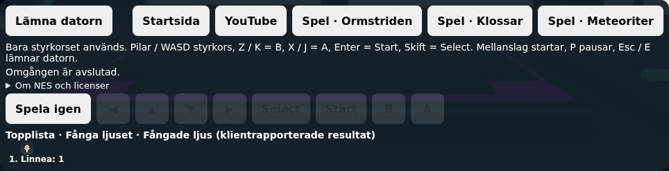

# NES leaderboards on the computers

A NES round ends with **Avsluta omgång**, leaving the computer, switching titles/apps or turning
off the computer. Pausing retains the round. The client reads the cartridge's RAM after every
emulated frame and submits the best positive result once. Each supported title has its own unit
and board. The heading identifies client-reported results in both the global and local views.

## Score and validation coverage

| Reviewed cartridge | Value | Verification |
| --- | --- | --- |
| Fånga ljuset | Targets caught | Real NES input with the bundled ROM. The native run caught one light in 220 frames, then paused and disposed without changing the result. |
| Thwaite 0.03 | Solo score | Exact release digest and RAM fixtures; multiplayer and practice scores excluded. |
| LAN Master | Consecutive levels cleared from the beginning | Exact release digest and RAM fixtures; a password jump earns no earlier levels. |
| Lawn Mower | Lawns cleared | Exact release digest and RAM fixtures; the built-in level-skip sample earns no score. |

All four reviewed cartridges have readable scores. Unknown digests and browsers without Web Crypto
have no score reader. The manifest test passed against all four selectable titles after #2238 landed in `7e4a0b10`.
It booted each actual ROM and checked the reader selected from its bytes. The
[existing four-title browser run](../2238/result.json) also recorded 319, 798, 476 and 479
emulated frames respectively, with rendered output and no page errors. The [source notes](../../development/storage.md#nes-score-sources-2239)
identify the ROM revisions and RAM fields.

The 27 native and Worker checks passed with
`node --test src/nes.test.mjs tools/nesscoretest.mjs cloudflare/games.test.mjs tools/arcadegamestest.mjs`.
The Worker returned HTTP 400 for missing/wrong hashes, excessive scores and excessive scoring rates
for each title, 404 for an unknown board and 429 after repeated writes from one IP. A failed POST
after a successful GET displayed the just-finished round from the local list. The existing Klossar,
Ormstriden and Meteoriter checks also passed.

Each of the four shipped ROM files was also booted in the real vendored emulator with no controller
input. After 1,800 emulated frames per title, every reader still returned no result.

## Browser result

The local browser fixture played Fånga ljuset on Speldatorn. Holding the right arrow caught one
light. Choosing **Avsluta omgång** sent the client-reported score to the local Worker's
`/games/nes-lightcatch` endpoint, which returned HTTP 200. The board showed Linnea's own row
with one point and identified the result as client-reported. A fresh browser context using Sara's
separate identity then received the same score on a new GET, without marking Linnea's row as its
own. The run reported no page errors and used 1,845 MiB peak memory.

Run an isolated static server and `node cloudflare/dev.mjs PORT` and then
`tools/browsertest.sh node tools/nesleader2239browser.cjs GAME FRESH_LOCAL_WORKER OUT`.

After the four titles reached the picker in `7e4a0b10`, the same browser fixture ran once more
with the final argument `titles`. In Speldatorn every real title button selected its game and showed
a visible client-reported leaderboard with the title and its unit. The local Worker answered HTTP
200 for each board's GET and the real emulator loaded its matching reader:

| Board and loaded reader | Displayed title | Displayed unit |
| --- | --- | --- |
| `nes-lightcatch` | Fånga ljuset | Fångade ljus |
| `nes-thwaite` | Thwaite | Poäng · en spelare |
| `nes-lan-master` | LAN Master | Klarade banor från start |
| `nes-lawn-mower` | Lawn Mower | Klarade gräsmattor |

The check included the initially selected Fånga ljuset and subsequent switches while each emulator
was running. No page errors occurred. The browser used 1,609 MiB peak memory.
