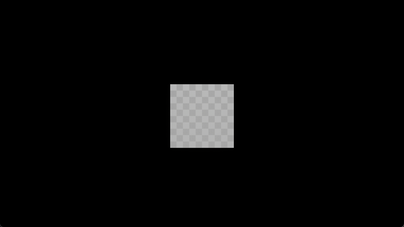

# Two-zone IoStore cook and client update

UE 5.8.4 (CL 58902052) cooked two small Win64 Shipping maps. Both had a player
start, directional light and cube. Asset Manager assigned ZoneA to chunk 1 and
ZoneB to chunk 2. The cook's chunk manifests listed one map in each zone chunk
and 497 entries in chunk 0. The [fixture generator](../../../tools/unreal-engine/python/chunk_spike.py)
supplies the two worlds. The [settings](../../../tools/unreal-engine/tests/prepare-chunk-spike.py)
keep the spike in a separate project.

## Measured results

We reused one absolute project path, one staging path and the shared engine DDC.
Each run started with fresh project Saved, Intermediate and DerivedDataCache
directories and a new staging directory and archive. We saved both maps once.
A and B read identical project inputs. For C the editor moved the ZoneA cube
250 cm right and saved that map. ZoneB, the descriptor and every ini file
remained byte-identical. Cook times were 30.92, 55.45 and 25.54 seconds.

| Container group | Files compared | A → B | B → C |
| --- | ---: | --- | --- |
| global | 2 | Both identical | Both identical |
| pakchunk0 | 3 | All identical | PAK changed, UTOC and UCAS identical |
| pakchunk1 (ZoneA) | 3 | All identical | UCAS and UTOC changed, PAK identical |
| pakchunk2 (ZoneB) | 3 | All identical | All identical |

The three changed files totalled **11,224,531 bytes**. The largest was the
11,222,667-byte chunk 0 PAK. Epic's UnrealPak listed the same 1,730 paths in
both versions of that PAK. Only the SHA-1 of `Lunden/AssetRegistry.bin` changed.
A manifest for this update must therefore include the new base PAK as well as
ZoneA's 1,472-byte UCAS and 392-byte UTOC. A client can retain the other eight
container files. The [full SHA-256 measurements](zone-cooks.json) cover each
project input and all eleven container files for every run.

## Updating an existing client

We copied A's full archive, ran it and replaced exactly those three files with
C's versions. We checked the resulting eleven hashes against C and preserved
A's Epic-signed `Engine/Binaries/Win64/UnrealGame-Win64-Shipping.exe`, SHA-256
`e083ad2f827b2fbab8eb4e04d6d1d541be3d42d4883aaddf26bab3df62195953`.
The same executable started the same default map with the project locator
`..\..\..\Lunden\Lunden.uproject` before and after the update. The 800 × 450
captures show the cube moving from the centre to the right. Each launch used
a fresh user directory. This establishes compatibility for the measured content
change and that exact program build.

| Baseline client | Same program after replacing three content files |
| --- | --- |
|  |  |

## Reproduction

Use an empty private directory on a Windows drive and the installed Epic 5.8.4
tools. Prepare a new fixture with Python 3. The project path should contain no
spaces because the Unreal Python commandlet tokenizes its script arguments.

```text
python tools/unreal-engine/tests/prepare-chunk-spike.py C:\Temp\LundenSpike\Lunden
```

From PowerShell, set the paths and create the two maps. Use the same variables
throughout the experiment.

```powershell
$root = 'C:\Temp\LundenSpike'
$project = "$root\Lunden\Lunden.uproject"
$script = "$root/Lunden/chunk_spike.py".Replace('\','/')
$editor = 'C:\Program Files\Epic Games\UE_5.8\Engine\Binaries\Win64\UnrealEditor-Cmd.exe'
$uat = 'C:\Program Files\Epic Games\UE_5.8\Engine\Build\BatchFiles\RunUAT.bat'
& $editor $project -run=pythonscript "-script=$script" -unattended -nullrhi -nosplash -nosound -nop4
if ($LASTEXITCODE -ne 0) { throw 'Map creation failed' }

New-Item -ItemType Directory "$root\cooks" | Out-Null
function Cook-Zones($name) {
    $run = (New-Item -ItemType Directory "$root\cooks\$name").FullName
    foreach ($generated in 'Saved','Intermediate','DerivedDataCache') {
        $dir = "$root\Lunden\$generated"
        if (Test-Path $dir) { Move-Item $dir "$run\before-$generated" }
    }
    & $uat BuildCookRun "-project=$project" -platform=Win64 -clientconfig=Shipping `
        -nocompileuat -nocompile -skipbuild -cook -stage -pak -iostore -manifests -package `
        -nodebuginfo -nobootstrapexe -archive "-stagingdirectory=$root\output\stage" `
        "-archivedirectory=$root\output\archive" -unattended -nop4 -utf8output
    if ($LASTEXITCODE -ne 0) { throw "BuildCookRun $name failed" }
    Move-Item "$root\output" "$run\output"
}
Cook-Zones A
Cook-Zones B
& $editor $project -run=pythonscript "-script=$script --change-zone-a" -unattended -nullrhi -nosplash -nosound -nop4
if ($LASTEXITCODE -ne 0) { throw 'ZoneA change failed' }
Cook-Zones C
$rel = 'output\archive\Windows\Lunden\Content\Paks'
node tools/unreal-engine/compare-cooks.mjs "$root\cooks\A\$rel" "$root\cooks\B\$rel"
node tools/unreal-engine/compare-cooks.mjs "$root\cooks\B\$rel" "$root\cooks\C\$rel"
```

A fresh invocation of the generator creates fresh Unreal asset identities.
Compare A, B and C within each run. This spike used two test maps. The
shipping L1007 pilot has a larger dependency graph and requires its own
measurements before adopting the same download sizes.
