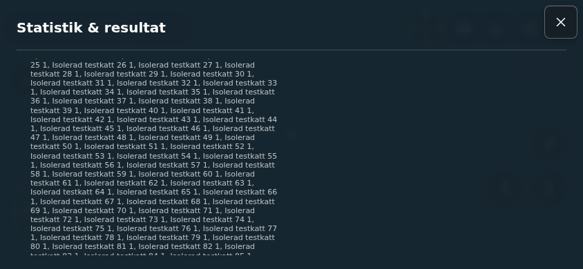
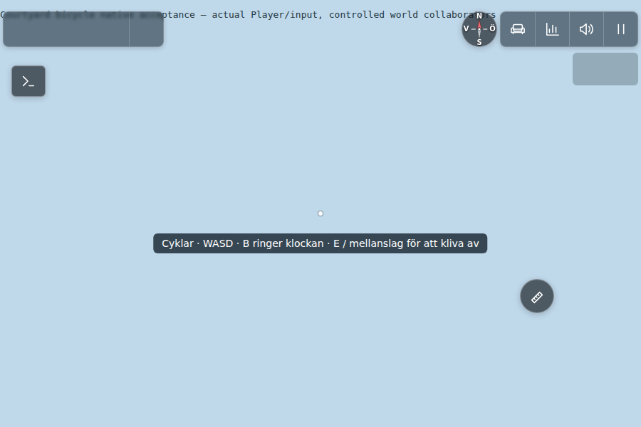

# Shared native fixture collaborators (#2252)

Base `ce2bc335`; [source.json](source.json) records the exact revision and frozen
production/helper/consumer hashes before execution. [Plan and dependency inventory](https://github.com/solwation/lunden-3d-apartment/issues/2252#issuecomment-7045548349).
Only the shared test defaults, their contracts and verification docs change.
Both browser scripts are byte-identical to the base, including every assertion
and tolerance. No `src/`, data, CI or player changelog change.

## Relevant dependency inventory

| Existing exercised excerpt | Missing collaborator | Shared inactive fixture default |
| --- | --- | --- |
| startMouse / mouse return | updateAppMenu | No-op for unrelated quit/install menu visibility; actual input handler and pointer lock remain verbatim. |
| Courtyard ray-focus target array | roofPicnic.targets() | Empty targets and a distinct seat sentinel. |
| Same ray-focus target array | mussels.targets() | Empty unrelated underwater targets. |
| Native W / click / touch action | measure.active | Inactive measurement mode. |

The tests already provide their actual Player/StatsPanel/touch/statistics/Courtyard
objects and controlled world/weapon collaborators. Existing shared defaults,
including the externally delivered scooters/screwdriver block, are preserved.
Existing real fitChoiceLabels/REACT/INVENTORY_KEYS imports are unchanged.
The four defaults never replace a richer collaborator supplied by a consumer.
Only these two tests' actual input/focus paths were inventoried; no global AST
or exhaustive application catalog was introduced.

## Checks and results

1. `node --test tools/mainfixturetest.cjs tools/mainfixturebindingstest.cjs`
   — **10 PASS, 0 FAIL**, 53 ms. Covers complete initialization, inactive/callable
   defaults, overrides before/after/repeated init, existing lazy DOM getters and
   overrides, script installation, preserved module-import map and import override
   behavior, plus the five existing gameplay-handler extraction contracts.
   [Raw TAP](contracts.txt). Helper and both browser scripts passed syntax checks.
   The historical `b2efbc5` --before extract has the unchanged SHA256 recorded in
   source.json; no historical browser suite was run.
2. `tools/browsertest.sh node tools/courtyardbicycletest.cjs http://localhost:8454 docs/verification/2252/courtyard`
   — **90 PASS, 0 FAIL, exit 0**. All five actual Courtyard bicycles complete
   native E/touch mount, joystick/keyboard acceleration, unowned-geometry
   preservation, culler checks, pause, session/world saving, safe exit/reload,
   wall/roof/dynamic-door/full-hull checks. Zero WebGL calls, page errors or
   swallowed keep warnings. [Raw log](courtyard.log), [actual result/part hashes](courtyard/result.json).
3. `tools/browsertest.sh node tools/statspaneltest.cjs http://localhost:8454 docs/verification/2252/statspanel`
   — **22 PASS, then exit 1**. Real pointer lock, free-mouse scrolling, keyboard
   isolation/focus, Tab/T/close/Escape and native touch scrolling/return pass.
   No ReferenceError/page-error was emitted. The final existing reset-confirmation
   step remains **unverified**: its button is hidden and the native click times
   out after 30 seconds. [Raw log](statspanel.log). The suite is **not green**.

The remaining reset failure is a separate pre-existing DOM-staging issue,
**[#2253](https://github.com/solwation/lunden-3d-apartment/issues/2253)**:
`index.html` puts the button under `[data-welcome-runtime hidden]` since
`854f7cb26`/#1997. This fixture blocks bootstrap and never calls finishWelcome,
so opening settings alone does not reveal that ancestor. No staging change or
assertion relaxation is included here; the missing-global cause is resolved.

## Native images and limits

Both images were produced by those existing commands and opened/reviewed at their
native size. They show component UI with controlled collaborators, **not a 3D
apartment/render result**. No extra image or renderer profile was started.

Own server 8454 served hashes matching the frozen checkout before both commands;
final hashes still match. Linux Chromium via the shared wrapper; no systemd scope
was available on this host. Each affected browser command ran once. No full app,
physical device/GPU/FPS, deployed Worker or long bicycletest profile is claimed.
Own browser processes exited and server 8454 was stopped. [Machine-readable outcomes](results.json).

No public transfer: these original gameplay/statistics fixtures have no consumer
in the neutral downstream. Root conductor of `orkester: olw-win10-gpt-6-20261120`
owns integration/publication and closure. Approximate phases: inventory/plan 2 min,
implementation/contracts 1 min, native runs under 1 min, failure review/docs 2 min.
Stopped after the prescribed commands and separate failure diagnosis, before the
ten-minute verification reassessment point; no further run was started.

## Delivery

Integrated as `9001212af04c40a3aeea78ec1b3bbe8cba6a484d`, preserving the
independent2232 welcome-background HTML/image change. Frozen browser evidence above
belongs to the recorded base; the shared helper and actual input/focus excerpts
are unchanged by that background change. [Pages44780248474](https://github.com/solwation/lunden-3d-apartment/actions/runs/44780248474)
is green on the integrated source. [Completion](https://github.com/solwation/lunden-3d-apartment/issues/2252#issuecomment-7045704748)
embeds both reviewed native component images before closure; SHA-pinned image
size/access verified via GitHub Contents. Statistics remains22PASS plus the
separate2253 reset-staging failure, never a claimed green complete suite here.
