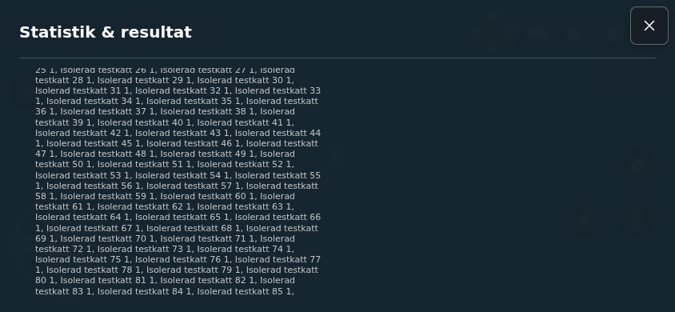

# Native statistics runtime DOM phase (#2253)

Base `9001212a`, exact revision and frozen hashes in [source.json](source.json).
The only test-code change is a conditional call to the real `finishWelcome()`
after loading the controlled modern fixture. Its DOM-only runtime phase reveals
`[data-welcome-runtime]`, hides pending instructions and clears welcome-pending.
The welcome module's imports do not construct settings or bootstrap the app.
The historical `--before` path skips this new import/call entirely.

[Plan and reset-path precheck](https://github.com/solwation/lunden-3d-apartment/issues/2253#issuecomment-7045692378).
The existing real confirm listener, isolated statistics and tasks.reset collaborator
were present; only the missing runtime DOM phase prevented the last native click.
No production source, data, CI, player news, assertion or tolerance changed.

Two scoped checks:

1. Syntax and five cheap source/guard checks passed. The entire old script is
   byte-identical after removing the two added setup lines. Every existing test
   action/assertion and final result-writing step is unchanged, including reset
   confirmation/cancellation. Historical extraction retains its previous SHA256,
   and executing the actual added statement with before=true never imports
   welcome. [Precheck record](precheck.json).
2. `tools/browsertest.sh node tools/statspaneltest.cjs http://localhost:8454 docs/verification/2253/statspanel`
   — **24 PASS, 0 FAIL, no page errors, actual exit 0**. This includes native mouse
   lock/return, keyboard isolation/scroll/focus, Tab/T/Escape/close, real touch
   scrolling/return and the final **real reset confirmation dismissed with
   isolated target=123/cats=37 and zero reset effects unchanged**.
   [Raw log](statspanel.log), [actual result/excerpt hashes](statspanel/result.json),
   [summary](results.json). Served source hashes matched the frozen checkout and
   remained unchanged through completion.

The image was generated in that same existing command and opened/reviewed at its
native 844×390. It shows the actual controlled statistics DOM/touch-scroll fixture,
not a rendered apartment or the native confirmation dialog. The reset/cancel
result is established by its unchanged live assertion, not by this image.

Linux Chromium through the shared wrapper; no systemd user scope available.
One native statistics browser command only. No bootstrap, apartment/WebGL,
physical-device/FPS, deployed-service, historical browser or extra image profile.
The 90 green courtyard checks from #2252 were not rerun. Own browser exited and
server 8454 was stopped. Approximate phases: reading/precheck 1 min,
implementation/parity 1 min, native command under 1 min, image/docs review 1 min.
Stopped after green checks, before ten minutes of verification.

No public transfer: this original gameplay/statistics fixture has no consumer in
the neutral downstream. Root conductor for `orkester: olw-win10-gpt-6-20261120`
owns integration, publication, image comment and closure; worker does not push/close.
