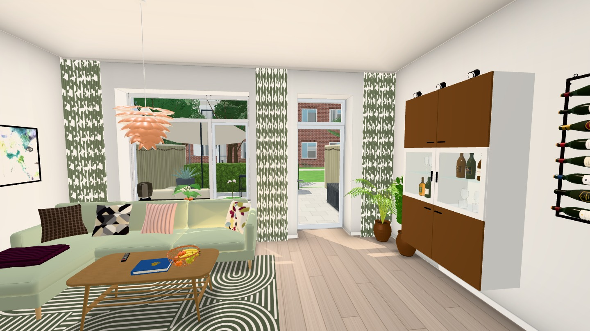
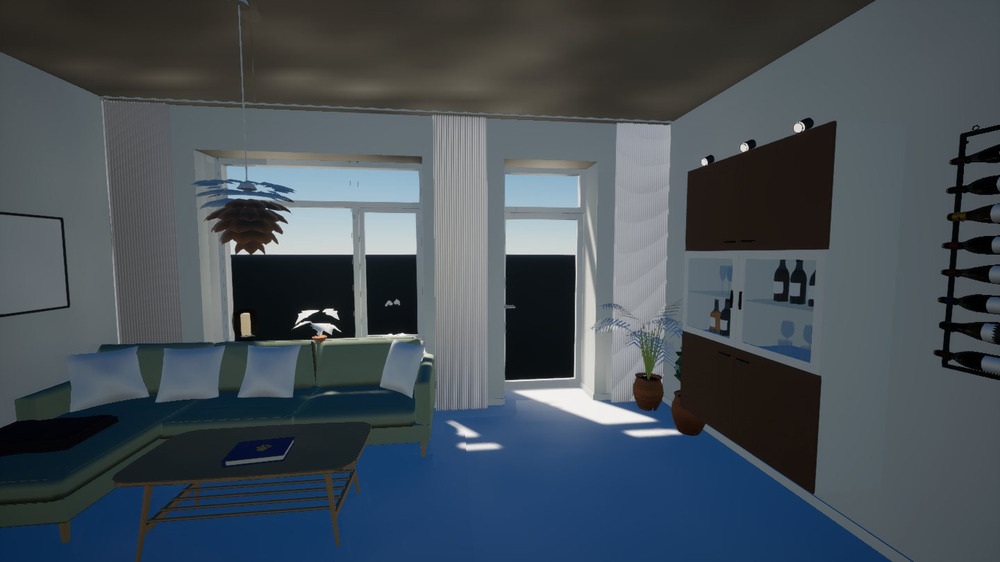
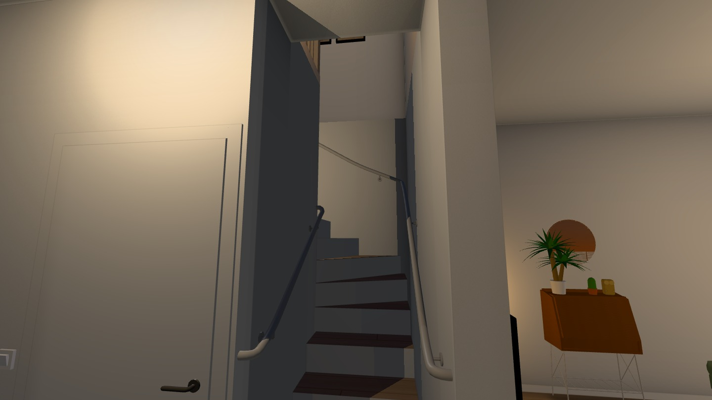
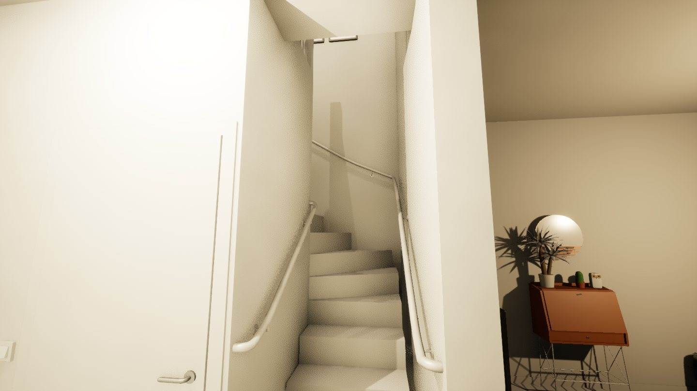

# L1007 in the world map L_Lunden (#2278)

Unreal Editor 5.8.4 on Windows 11, 2026-11-21, export and checkout `ff93015a`. Everything ran headless
(`-nullrhi`, or `-RenderOffScreen` for the pictures). How to rebuild: [unreal.md, World map L_Lunden](../../development/unreal.md#world-map-l_lunden-2278).

## Composition

`compose_world.py` built `/Game/Lunden/Maps/L_Lunden` from `tools/unreal-engine/world-levels.json`:

```text
LUNDEN_WORLD_LEVELS ["/Game/Lunden/Generated/l1007/Level_l1007", "/Game/Lunden/Generated/L1007World/Level_l1007_collision"]
run 1: saved: created; PlayerStart; GameMode -> BP_LundenPilotMode; sub-levels [] -> [both]   sha256 75857f8ac4314e43
run 2: unchanged, nothing saved                                                                sha256 75857f8ac4314e43
--check: unchanged                                                                             sha256 75857f8ac4314e43
```

## Measurements and route

[`world-result.json`](world-result.json) is the output of `tools/unreal-engine/tests/test_l1007.py` in Play In Editor
(Automation: 1 passed, 0 warnings, exit code 0). Expected values come from the export's `measurements.json`.

| Measurement | How | Got (cm) | Want (cm) | Error (cm) |
|---|---|---|---|---|
| Entréplan floor | trace down at (142, 225) | 0.00 | 0 | 0.000 |
| Övre plan floor | trace down at the fixture point (120, 120) | 325.00 | 325 | 0.000 |
| Outer walls, Entréplan W / E / N / S | horizontal traces from outside | 0.18 / 575.12 / 0.00 / 1269.86 | 0 / 575.3 / 0 / 1269.9 | ≤ 0.18 |
| Outer walls, Övre plan W / E | horizontal traces from outside | 0.20 / 575.14 | 0 / 575.3 | ≤ 0.20 |
| Stair foot (first riser) | trace along y = 713 at half a riser | 350.00 | 350 | 0.000 |
| First and last tread | trace down | 20.31 / 304.69 | 1 × and 15 × 20.31 | ≤ 0.04 |
| Upper landing | trace down at (347, 616) | 325.00 | 325 | 0.000 |
| Stair opening | trace down at the hole's centre | first hit at 162.50 (a tread) | below 325 | — |
| Visible floors, top | imported mesh bounds | 0.20 / 325.20 | 0 / 325 | 0.20 |
| Visible outer walls W / E | imported mesh bounds | 0.18 / 575.12 | 0 / 575.3 | 0.18 |

Route, character centre in cm: START (287.5, −1200, 94.9) → front door → hall, stopped at x = 183.56 against the
partition at 205.66 (22.1 cm capsule clearance) → kitchen → hallway → stair foot → 7 waypoints over all 15 treads →
upper landing (350.5, 616.0, 419.6) → Övre plan (252.5, 663.8, 419.6) → down the same treads → hallway → hall → out
of the front door to (139.0, −136.4, 94.65). The centre stays at 94.65–94.9 on Entréplan and 419.58 on Övre plan
(325 cm higher). The imported door leaves have no collision, so the closed front door does not block (#2285).

`import_world.py --check` reported the fixture within 0.000 cm over 9 markers, ids and stamps unchanged, and then failed
on the l1007 content fingerprint (`c38261dd…` against the stamp's `6f9231fb…`). The same failure occurs with
`L_Lunden` and `Generated/L1007World/` moved away. A fresh editor finds 0 simple boxes on the imported collision cube,
which held one box when the importer computed the stamp. This is an importer problem from before #2278.

## Pictures

Same cameras and lighting presets as the #2246 pilot ([shared camera list](../../../unreal/Lunden/Tests/views.json),
[`unreal-cameras.json`](unreal-cameras.json)). The web halves are the #2246 references (web scene `c72ecad6`; the
L1007 import fingerprint is unchanged since). `L_Lunden` has no lighting yet (#2283), so `capture_l1007.py` adds the
pilot's temporary sun, sky and room lamps. Surface materials are still the untuned glTF colours (#2282).

| Web | Unreal, L_Lunden |
|---|---|
|  |  |
|  |  |

Living room (day): walls, windows, curtains, sofa, cabinet and pendant sit as on the web. Outside is black because the
patio and courtyard are not sub-levels of the world map yet (the pilot streamed the patio zone; the courtyard is
#2280). Stairs (evening, lamps on): the winders, handrails, opening and bureau match the web and look the same as the
pilot picture of the same camera.
