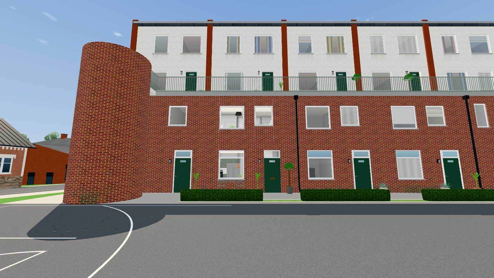
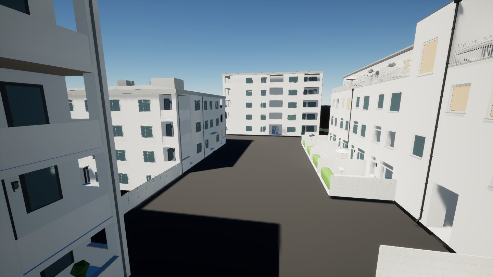

# Hus L, Hus A/B/C and the garage in the Unreal export (#2279)

Unreal Editor 5.8.4 on Windows 11, 2026-11-21, export of `28b1ad07` (exported before a rebase as `ff93f47e`; same
source hash, so `check-export.mjs` reports it current on `28b1ad07`). Everything ran headless (`-nullrhi`, or
`-RenderOffScreen` for the pictures). How it works: [unreal.md, Buildings](../../development/unreal.md#buildings-hus-l-hus-abc-and-the-garage-2279).

## Export

```text
node tools/unreal-engine/check-export.mjs
Unreal export is current: 7 files, 4233 nodes (4233 ids, each in one zone), 271 sources (exported from ff93f47e, HEAD ff93f47e)
after the rebase: … 271 sources (exported from ff93f47e, HEAD 036f7a5b)
```

- Zones: `l1007-entre` 4 nodes / 43 triangles, `hus-l` 1,197 / 235,635, `kvarteret` 349 / 282,367. The export fails if
  an object of the buildings' builders (exterior, visit, core-l, core-abc, garage, portik) lands in no zone; none did.
- `l1007.glb` (`90901e84…`), `l1007-uteplats.glb` (`032dd86a…`) and `fixture.glb` are byte-identical to the export
  before #2279 (`30e49f93`). The re-import skipped them with every package file byte-identical.
- Two exports from the same commit were byte-identical (checked at `61e12d99`, the first slice).
- Web page unchanged: no file in `src/` changed, and `tools/stamp.sh`'s content hash is `4b10f2b3839f` before
  (`30e49f93`) and after (`89a714a3`, `28b1ad07`).

## Measurements

[`exterior-result.json`](exterior-result.json) is the output of `tools/unreal-engine/tests/test_exterior.py` in Play In
Editor (Automation: 1 passed, 0 warnings, exit code 0). Each ray is cast by the exporter on the exported nodes and
traced in Unreal against the zone's imported actors; it must hit the same node within 1 cm, or nothing for the portik.

| House | Rays | Within 1 cm on the same node | Max error | What |
|---|---|---|---|---|
| L | 7 | 7 | 0.000 cm | street and courtyard façades (z −0.006 / 12.705 m), west and east gables (x −41.761 / 11.586 m), roof, stairwell west wall (x −18.95 m = `CORE.x0`), portik passage clear |
| A | 7 | 7 | 0.000 cm | north, east, west façades on `SITE.blocks` (z 28.8, x 9.42, x −9.76), south loggia rail, roof, stairwell floor, entrance glass |
| B | 7 | 7 | 0.000 cm | north, east, west façades (z 33.3, x −22.6, x −41.74), south loggia rail, roof, stairwell floor, entrance glass |
| C | 7 | 7 | 0.000 cm | north, east, west façades (z 12.6, x −51.4, x −70.6), south loggia rail, roof, stairwell floor, entrance glass |
| garage | 4 | 4 | 0.000 cm | floor (y −2.997), deck soffit (−0.35), park-side wall (z 33.16), west wall (x −60.14) from inside |

Intentional glass and passages: the three entrance glazings (A, B, C: the cores' `glass` holes) are hit on their glass
node in both, and Hus L's portik passes clear in both.

The first run, without the in-memory settings, failed 8 of 32 rays: 7.7 cm off on Hus L's street façade, the three
south loggia rails, the A/B entrance glass and the deck soffit not hit, and the garage wall ray passing the shell to
Hus B's façade. See [unreal.md](../../development/unreal.md#buildings-hus-l-hus-abc-and-the-garage-2279).

## Pictures

The shared `start` camera and a `courtyard` camera (x −3, z 22, 6 m up, yaw 100°, pitch −10°, day). The cameras match
within 0.01 cm and 0.001° ([`unreal-capture.json`](unreal-capture.json)). L_Lunden has no lighting of its own, so
capture_l1007.py's temporary rig lights the views. The zones are streamed into `L_Lunden` in memory with Nanite off.
Brick and other web textures are not mapped for these zones yet, so the façades show the plain imported colours.
The courtyard ground (#2280) is not exported either, so the garage deck shows through.

| Web | Unreal |
|---|---|
|  |  |
|  |  |

START: Hus L's street façade with the round stair drum, the loftgång and its rail, the neighbours' doors, windows,
lamps, downpipes and entrance plants sit as on the web, with L1007's door in the middle. The street in front is
build_l1007.py's provisional slab (the hedges are vegetation, #2281). Courtyard: Hus A's loggias (left), Hus B, Hus C
ahead and Hus L's courtyard façade with the neighbours' patios and roof terraces (right) sit as on the web.

With Nanite on, the same START capture draws the simplified fallback:
[unreal-start-nanite-fallback.jpg](unreal-start-nanite-fallback.jpg).
