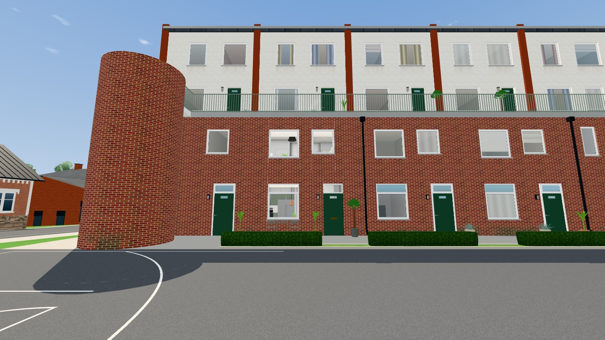
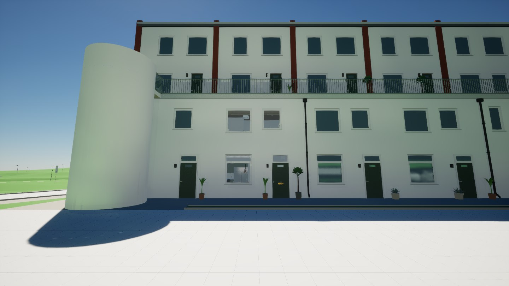
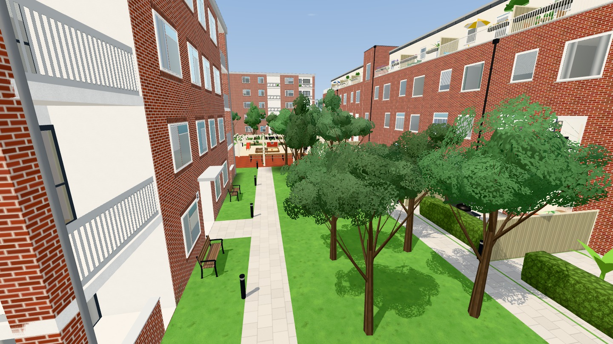
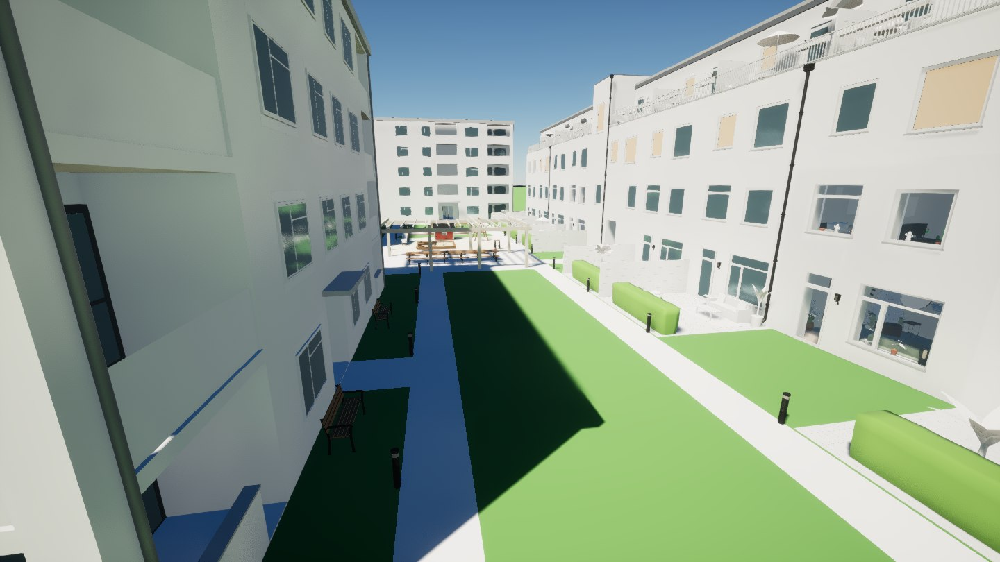
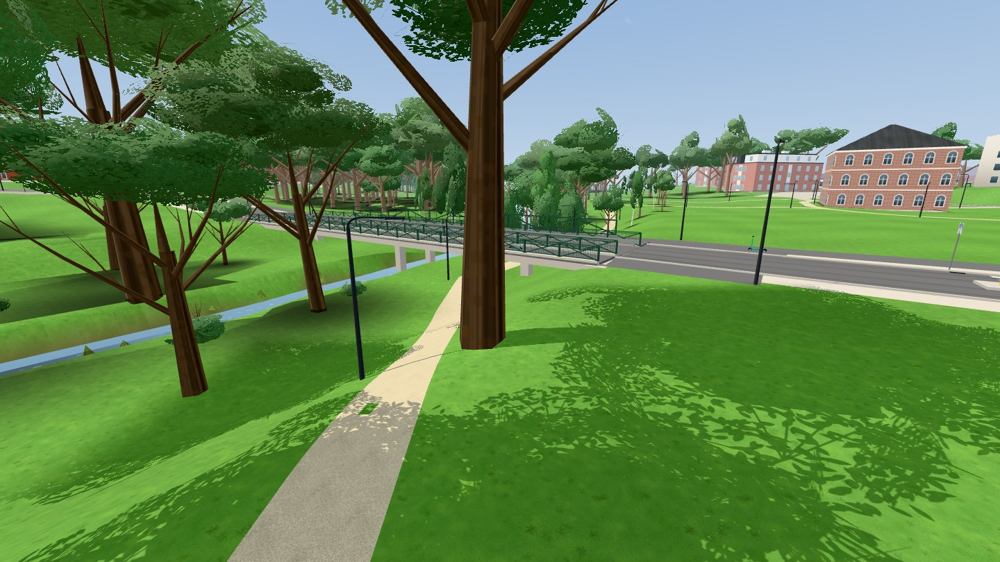
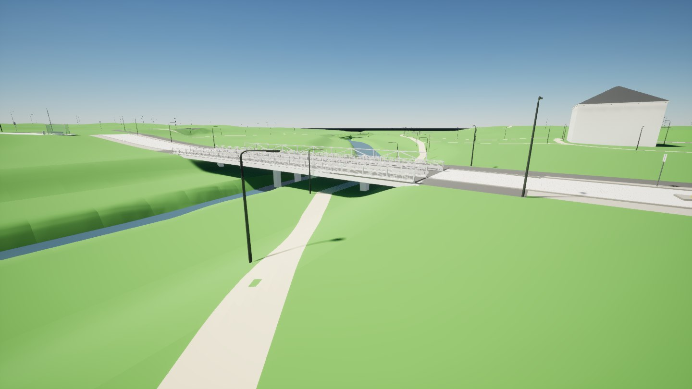

# Terrain, streets, courtyard and Höje å in Unreal (#2280)

Unreal Editor 5.8.4 on Windows 11, 2026-11-21, export of `b8c74df1` plus this change, pushed as `d5862d76` (same export sources as the
pushed commit; `check-export.mjs` reports it current). Everything ran headless (`-nullrhi`, or `-RenderOffScreen` for
the pictures). How it works: [unreal.md, Ground](../../development/unreal.md#ground-terrain-streets-courtyard-and-höje-å-2280).

## Export

```text
node tools/unreal-engine/check-export.mjs
Unreal export is current: 9 files, 4790 nodes (4790 ids, each in one zone), 272 sources
```

- New zones: `gard` 25 nodes / 62,456 triangles / 5.6 MB, `omgivning` 532 nodes / 313,107 triangles / 15.1 MB.
  Import: `gard` 26 actors, 45 assets, 4.5 MB; `omgivning` 533 actors, 130 assets, 18.0 MB (UE 5.8.4, 9 s together).
- `l1007.glb`, `l1007-uteplats.glb`, `fixture.glb`, `l1007-entre.glb`, `hus-l.glb` and `kvarteret.glb` are
  byte-identical to the export before #2280 (`dd4b91a6`); the re-import skipped them with every package file byte-identical.
- Left in no zone on purpose (`SITE_SKIP`): vegetation (#2281), backdrop houses and land beyond the terrain, the east
  campus car parks, school yards, the football site, the boule balls, `… far` stand-ins, fallen leaves, L1007's
  outdoor furniture.
- Web page unchanged: no file in `src/`, `data/`, `index.html` changed; `tools/stamp.sh`'s content hash is
  `4b10f2b3839f` before (`dd4b91a6`) and after.
- `node tools/unreal-engine/notices.mjs --check`: `unreal/Lunden/THIRD_PARTY_NOTICES.md is current` (its
  "Terrain: Copernicus DEM GLO-30" section is unchanged).

## Ground height

[`site-result.json`](site-result.json) is the output of `tools/unreal-engine/tests/test_site.py` in Play In Editor on
the composed `L_Lunden` (Automation: 1 passed, exit code 0; no level streamed in memory). Each point is traced
vertically against `build_site.py`'s collision level, whose meshes are full copies of the imported ones (each copy's
bounds equal its visible actor's within 0.000 cm, 31 of 31).

| Points | Reference | Unreal vs reference | Unreal vs the export's own hit (same node) |
|---|---|---|---|
| 10 `elevation` points (x −254 … 274 m, z −300 … 0 m) | `data/elevation.json` (src/elevation.js `gridGround`) | 1.000 cm each | 0.000 cm |
| courtyard centre, east, west | the web's drawn terrain (model y 0 on the garage box) | 0.000 cm | 0.000 cm |
| Höje å: shore path, bank, river bed, shore path west of the bridges | the web's drawn terrain (the carved valley) | ≤ 0.004 cm; 3.055 cm on the gravel path (the path lies on the terrain) | ≤ 0.005 cm |

The 1 cm at the elevation points is the web's own: it draws the terrain 1 cm under the elevation grid
(`terrainSurface = terrainY − 0.01`). In the courtyard and the river valley the web departs from the elevation data by
design: the courtyard is Entréplan's level on the garage box (`SITE.terrain.ref`; the grid's DSM reads −0.20 … +0.52 m
there) and the river is carved 2.3–4.7 m under the grid's 30 m cells (`SITE.river`). Unreal matches the web there
within the same 5 cm; the elevation values are in the result file beside each point.

## Route

The production character (`BP_LundenPlayer`, run key held) walked START → the street → the east leg of Sankt Lars väg
→ up the ramp (0.9 m) → the landing → the courtyard (to x −20 m) → back down the ramp → Sankt Lars väg south to the
park level (−3 m) → across the road → down the shore path → the Höje å valley (−5.5 m) → the bank by the water: 23
checkpoints, feet within 0.0–3.2 cm of the web's walking surface everywhere except on the sloping shore path (10.6 and
13.9 cm: the flat-based capsule rests on the uphill edge of the cross slope), never below the route's lowest point.

Other routes on the same map after removing the provisional ground of #2278 and #2279:

- `test_exterior_route.py` (#2279, START → street → portik → Hus L stairwell → garage): passed (16 checkpoints; the street west of L1007 and by the portik at 8 cm, on world.js's raised green strip in front of Hus L, within its 12 cm; the portik floor on world.js's ground plate)
- `test_l1007.py` (#2278, START → front door → stairs → back out): passed (out to the street at feet 0.8 cm, on the paving)

## Pictures

Three cameras (1440 × 810, 72° vertical, 21 June 14:00, clear): the shared `start` view, `courtyard` (from the ramp
landing x 12.5, z 26, 4 m up, web yaw 80°, pitch −14°) and `river` (the shore path's top x 52, z 92, web yaw 125°,
pitch −14°, towards the road bridge). Web: the desktop Ultra scene (`tools/unreal-engine/capture-web-views.cjs` with
these views, SwiftShader in WSL). Unreal: `tests/capture_exterior.py` on the composed `L_Lunden` (no level streamed in
memory) with capture_l1007.py's temporary light, Nanite off in memory for the exterior and ground zones (the full
meshes, as #2279); the cameras match within 0.01 cm and 0.001° ([`unreal-capture.json`](unreal-capture.json)).

| Web | Unreal |
|---|---|
|  |  |
|  |  |
|  |  |

START: the street, pavement and the raised green strip in front of Hus L sit as on the web; the paving and asphalt
are white because their keys keep Interchange's untextured default (`std_ffffff_r100_m0_tex`; surface looks are
#2282). Courtyard: the walks, lawns, benches, bollards, pergolas, sandbox and playhouse lie where the web has them
between Hus A and the patios of Hus L; the trees and hedges' foliage are vegetation (#2281). Höje å: the valley's
carved banks, the water surface, the road bridge with its rails and piers, the gravel shore path, lamp posts and
Sankt Lars väg follow the web; the trees (#2281) and the backdrop houses (later) are left out on purpose.
