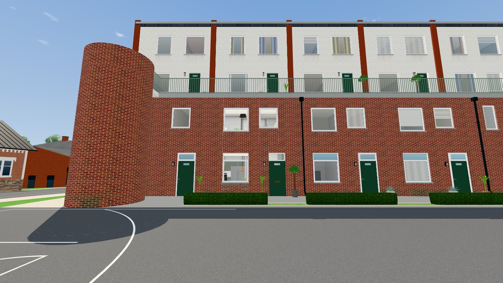
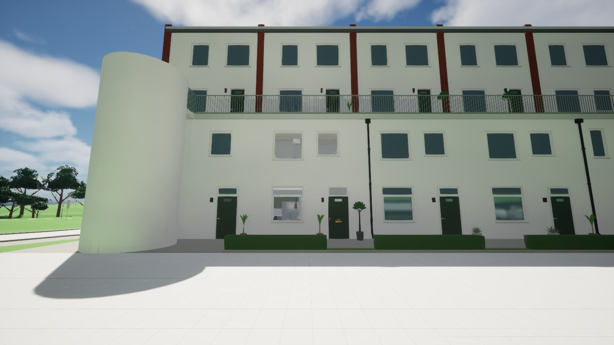
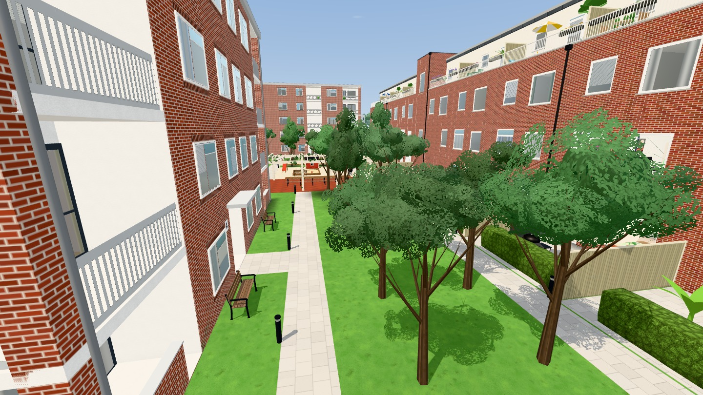
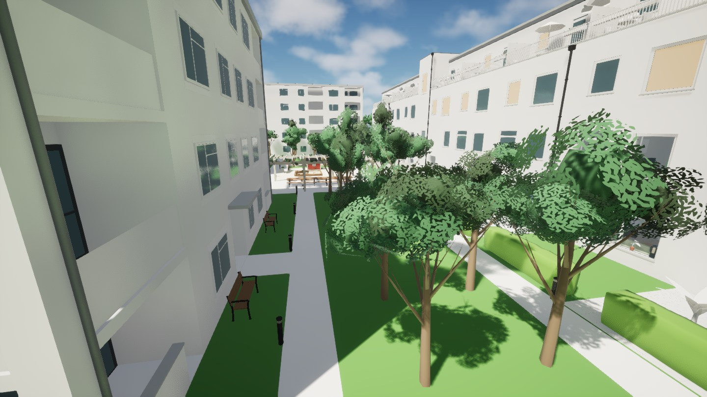
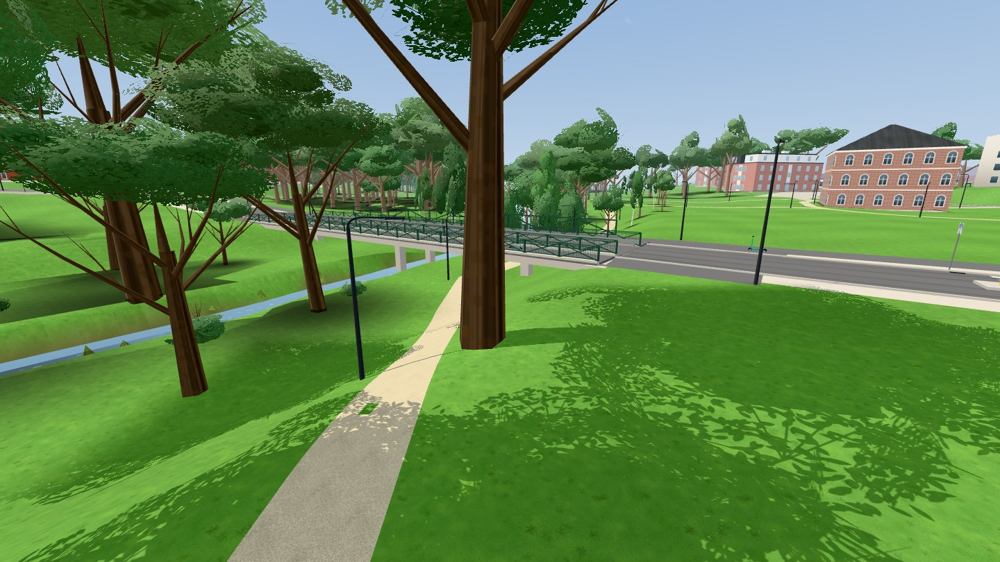
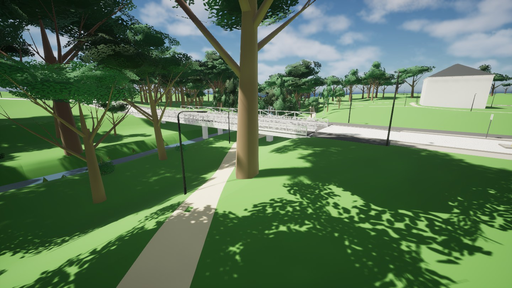

# Trees, shrubs and hedges in Unreal (#2281)

Unreal Editor 5.8.4 on Windows 11 (i9-10900K, 32 GB, RTX 3080), 2026-11-21, export of `2bcbc176` (this change on
`a20b426a`; `check-export.mjs` reports it current). Everything ran headless (`-nullrhi`, or `-RenderOffScreen` for
pictures and frame times). How it works: [unreal.md, Vegetation](../../development/unreal.md#vegetation-trees-shrubs-and-hedges-2281).

## Export

```text
node tools/unreal-engine/check-export.mjs
Unreal export is current: 10 files, 8954 nodes (8954 ids, each in one zone), 272 sources (exported from 2bcbc176, HEAD 2bcbc176)
```

- New zone `vegetation`: 4,164 nodes, 341,074 triangles, 2.5 MB; import 4,165 actors, 13 assets (six shared meshes).
- The other nine GLBs are byte-identical to the export of `3c071946` before this change, and the re-import skipped them
  with every package file byte-identical.
- `measurements.json` `vegetation`: 507 trees (all of `treeFeet`; none beyond the terrain), 105 lobes of the understory
  and pavement shrubs that belong to no tree, 9 hedges (Hus L's seven patio hedges in `hus-l`, L1007's in
  `l1007-uteplats`, the entrance boxwood).
- Web page unchanged: no file in `src/`, `data/` or `index.html` changed; `tools/stamp.sh`'s content hash is
  `4b10f2b3839f` before and after.
- `node tools/unreal-engine/notices.mjs --check`: current (no new third-party content: the meshes are the web's own,
  the materials are built by Python; no vegetation pack or licence).
- `python3 tools/unreal-engine/tests/test_materials.py`: `MATERIAL_COVERAGE_OK` (material-map.json is unchanged).

## Positions and height classes

[`vegetation-result.json`](vegetation-result.json) is the output of `tests/test_vegetation.py` in Play In Editor on the
recomposed `L_Lunden` (Automation: 1 passed, exit code 0; no level streamed in memory):

| What | Count | Unreal against the web | Height class |
|---|---|---|---|
| Trees: trunk instance at the web's foot | 507 | ≤ 0.008 cm | 507 of 507 (2 m classes; heights within 0.63 cm, every tree with the web's number of crown lobes) |
| Hedges in `hus-l` (imported actors) | 7 | ≤ 0.006 cm | 7 of 7 (0.25 m classes) |
| L1007's patio hedge (copy in the vegetation level) | 1 | 0.004 cm | 1 of 1 |
| Entrance boxwood (foliage instance) | 1 | 0.66 cm (box 0.487 m high in Unreal, 0.500 m on the web: the built mesh's bounds) | 1 of 1 |

Foliage instances: crown lobes 3,129, trunks 812, birch trunks 15, courtyard lobes and vines 205, shore growth 1,
boxwood 1: 4,163, one per exported mesh node (the GLB's 4,164 nodes less the zone root).

## Pictures

Three cameras (1440 × 810, 72° vertical, 21 June 14:00, clear): the shared `start` view (the street in front of Hus L
with the entrance boxwood), `courtyard` and `river` (#2280's two views). Web: the desktop Ultra scene
(`tools/unreal-engine/capture-web-views.cjs` with these views, SwiftShader in WSL). Unreal: `tests/capture_vegetation.py`
on the composed `L_Lunden` lit by its own sky (#2283's `BP_LundenSky` at the same date and hour, no temporary light),
Nanite off in memory for the imported zones (#2298); the cameras match within 0.01 cm and 0.001°
([`unreal-capture.json`](unreal-capture.json)).

| Web | Unreal |
|---|---|
|  |  |
|  |  |
|  |  |

Courtyard: the trees stand where the web has them with the same branching trunks and lobed crowns; the leaf cards'
cut-out is drawn procedurally (the web's canvas atlas does not travel) and every tree gets its own tone between the
season's dark and light leaf colour. Hus L's patio hedges (right) are the `hus-l` import. Höje å: the river park's trees,
understory and the weeping specimens by the bridges match the web tree for tree. START: the entrance boxwood and the
entrance plants (from `hus-l`) in front of Hus L; the street trees to the left. Differences: the trunks are paler than the
web's (the bark texture does not travel; Interchange keeps the key's base colour), the boxwood and hedges have no leaf
clump texture (#2282 / later), and façades, paving and grass are untextured (#2282).

## Courtyard frame time

Budget (#2246): at least 60 FPS at 2560 × 1440 *High* on the RTX 3080. Measured on the same PC offscreen: Epic's
editor binary running the **uncooked** game (`UnrealEditor-Cmd <map> -game -d3d12 -RenderOffScreen -ForceRes`, no
visible window), Direct3D 12, Lumen GI and reflections, virtual shadow maps, `sg.*` High (2) or Epic (3), 100 %
screen percentage, no vsync, CSV profiling (`-csvGpuStats -csvNoProcessingThread`), summarised by
`tools/unreal-engine/profile_report.py` (15 s warm-up, then 15 s measured). The map
(`tests/prepare_vegetation_profile.py`, a scratch copy under `Generated/VegetationPerf/`) streams every sub-level of
world-levels.json like `L_Lunden`, including #2283's lighting with its sky on the PC's clock (21 Nov, late morning), and
views the courtyard through a fixed camera at the `courtyard` picture's position (4 m up on the ramp landing, looking
west down the courtyard). The A/B map leaves out only the vegetation level. An uncooked game carries editor overhead,
so a packaged build is at least as fast; other agents' processes shared the PC during the runs.

| Resolution | Quality | Map | Frames | Mean FPS | 1% low FPS | Mean frame ms | P99 ms | Game thread ms | Render thread ms | GPU ms |
| --- | --- | --- | ---: | ---: | ---: | ---: | ---: | ---: | ---: | ---: |
| 2560 × 1440 | High | with vegetation | 1736 | 115.72 | 95.4 | 8.642 | 9.84 | 2.02 | 8.641 | 8.298 |
| 2560 × 1440 | High | without the vegetation level | 1769 | 117.9 | 96.81 | 8.482 | 9.913 | 2.024 | 8.481 | 8.159 |
| 2560 × 1440 | Epic | with vegetation | 1262 | 84.11 | 68.44 | 11.889 | 13.736 | 2.139 | 11.888 | 11.565 |
| 2560 × 1440 | Epic | without the vegetation level | 1306 | 87.05 | 70.6 | 11.487 | 13.554 | 2.158 | 11.486 | 11.178 |

The courtyard view with all 4,163 foliage instances runs at 115.7 FPS (1% low 95.4) at 1440p High, within the 60 FPS
budget, and costs about 0.16 ms (High) and 0.40 ms (Epic) per frame against the same view without the vegetation level.
[Machine-readable results](performance.json).

## Not done here

- Grass: the web has no grass geometry; its lawns are the ground meshes with `src/grass.js`'s seasonal detail texture,
  imported by #2280's zones on Interchange's green instance. A lawn look is a `material-map.json` rule (#2282's file).
- Collision on the trunks (the web blocks the player on `treeFeet`), the seasons (bare winter crowns, autumn colours),
  wind driven by the weather (`Power` is a fixed 0.5 until then), the courtyard perennials' sway, the bark texture.
