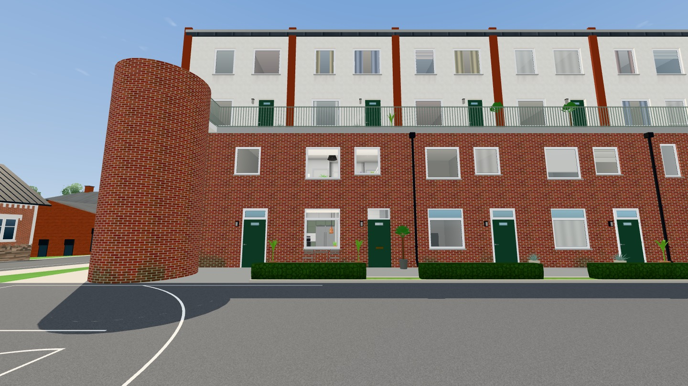
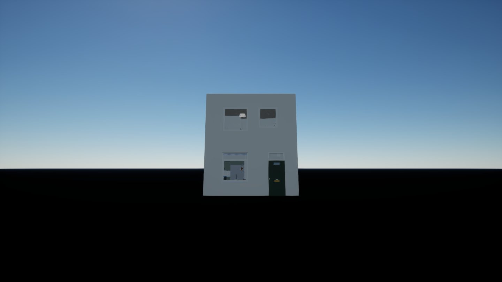
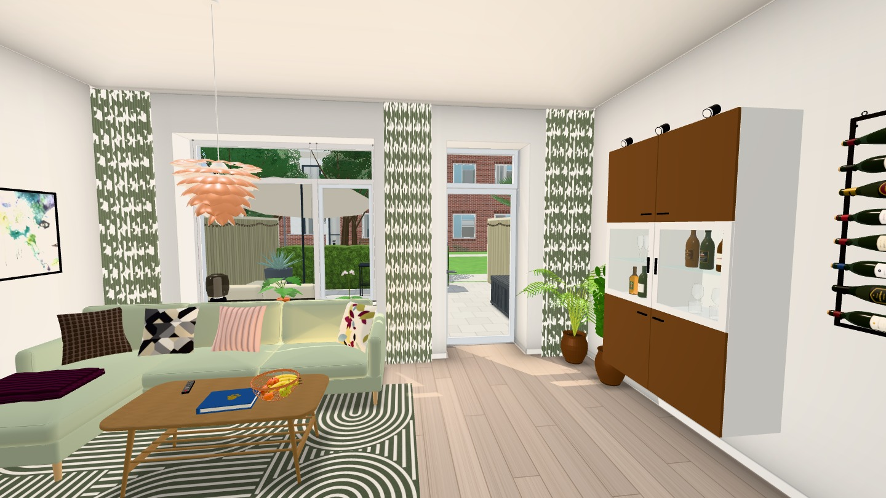
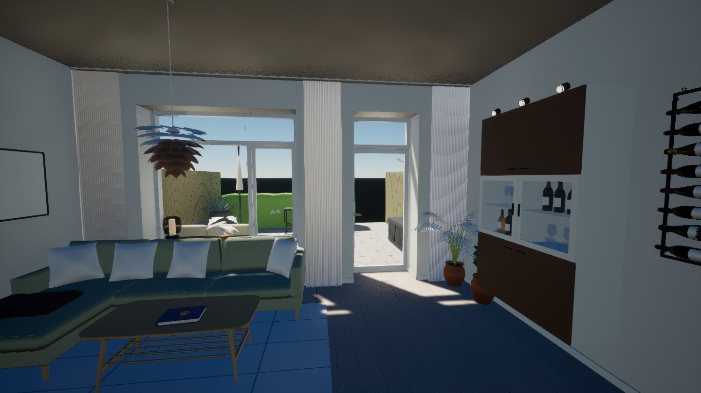
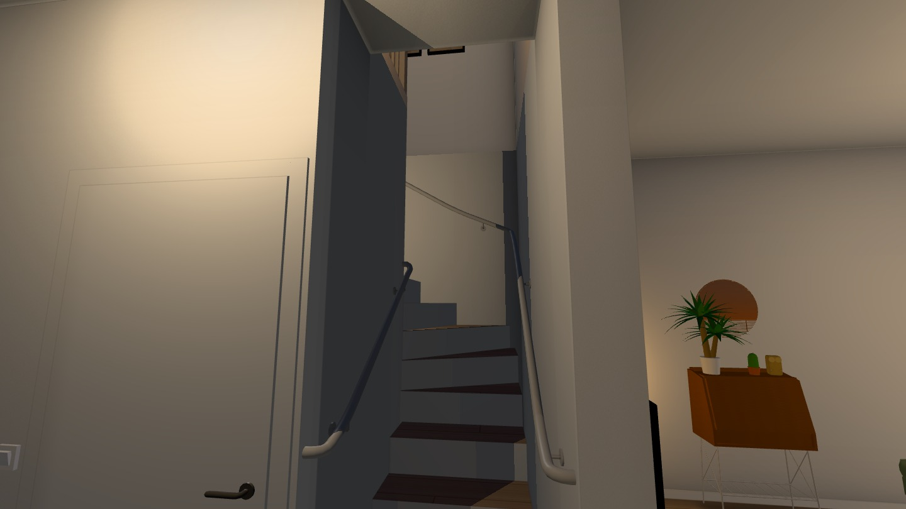
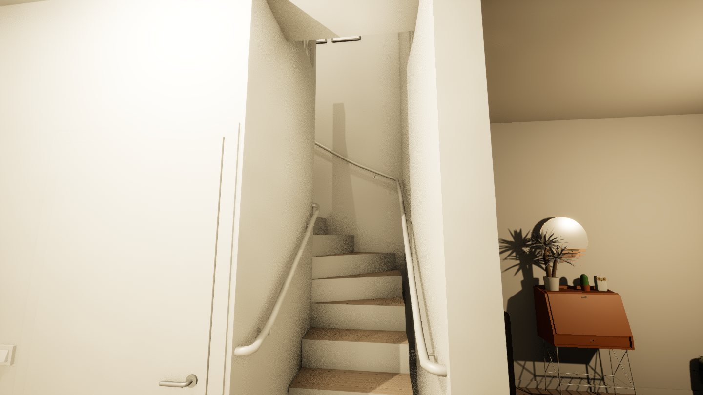
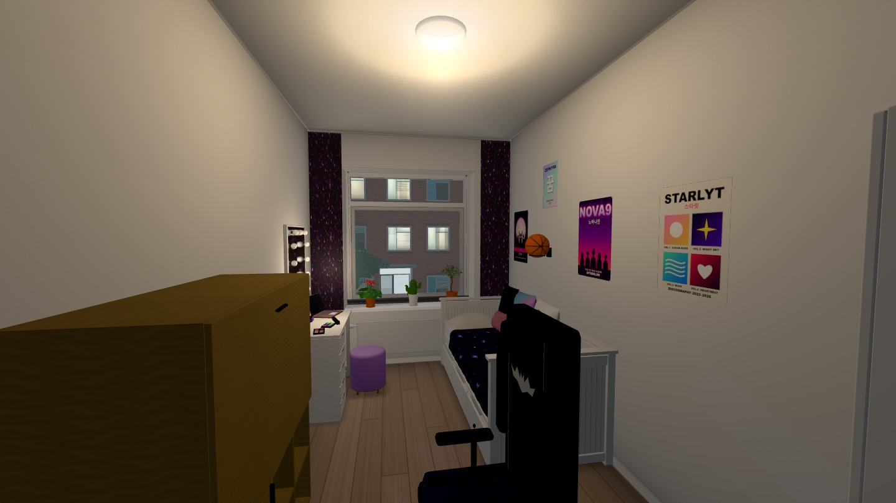
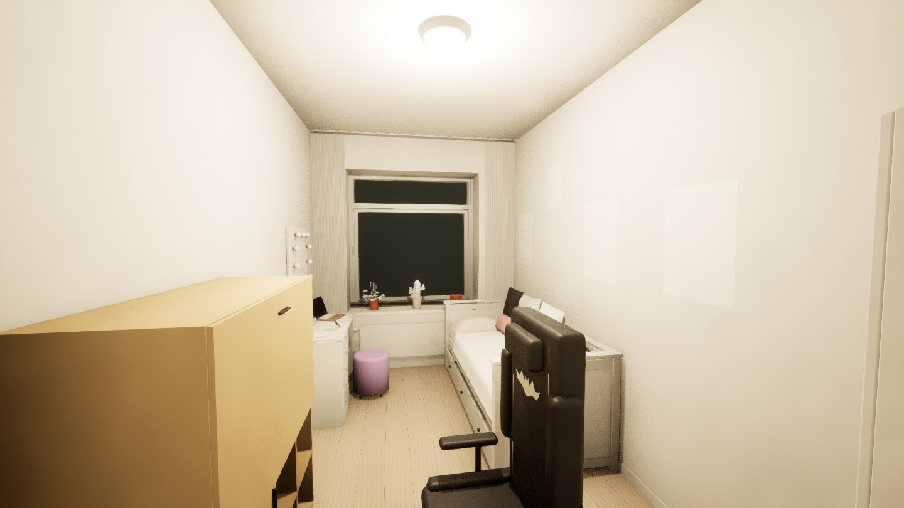
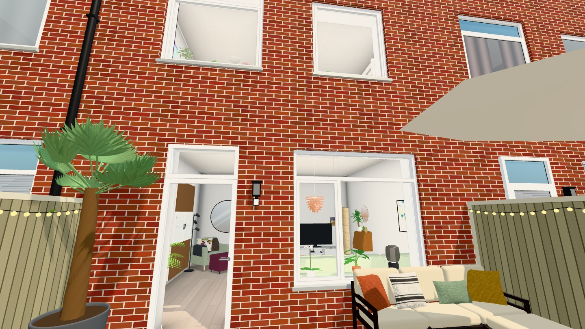
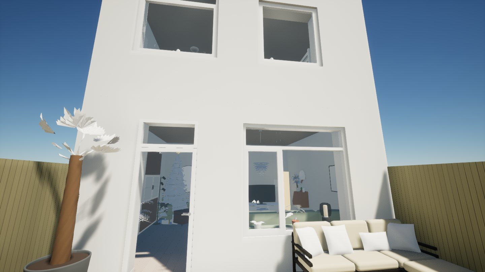

# Surface materials in Unreal (#2282)

UE 5.8.4 on the development PC (RTX 3080, D3D12), 2026-11-21. Export and import of
`5f0929ad` with the #2282 material map. How the materials are built and mapped:
[Surface materials](../../development/unreal.md#surface-materials-2282).

## Key coverage

`python3 tools/unreal-engine/tests/test_materials.py <export> --table` on the fresh export:
740 building and ground nodes (`wall`, `structure`, `door`, `window` in `l1007` and
`l1007-uteplats`) carry 82 material keys. 9 keys are mapped by 15 rules (the shared tile
key by six of them, five with a `mesh` selector) and 73 stay on Interchange's instance with
a stated reason; none is unmapped. The [per-key table](key-coverage.txt) lists every key,
its node count and its material or reason.

| Surface | Material | Web source |
| --- | --- | --- |
| Walls | `M_LundenWallPaint` | `COLORS.wall`, NCS S 0500-N |
| Ceilings | `MI_LundenCeilingPaint` | `COLORS.ceiling` |
| Doors | `MI_LundenDoorPaint` | `COLORS.door` |
| Frames, architraves, trims | `MI_LundenFramePaint` | `COLORS.frame` |
| Stair risers / rails | `MI_LundenRiserPaint`, `MI_LundenRailPaint` | `COLORS.riser`, `COLORS.rail` |
| Parquet floors and treads | `MI_LundenParquetEkChalk` | `FINISH.parquet` (plank size *guess*) |
| Hall floor | `MI_LundenTileHallFloor` | `FINISH.hallTile` 30 × 60 |
| Wet-room floors | `MI_LundenTileWetFloor` | `FINISH.wetTile` 15 × 15 |
| Wet-room wall tiles | `MI_LundenTileWall` | `FINISH.wallTile` 20 × 40 |
| Kitchen splashback | `MI_LundenTileSplash` | `FINISH.splash` 10 × 20 half bond |
| Patio paving | `MI_LundenPatioPaving` | `PATIO.paving` 40 × 40 half bond (*guess* look) |
| Patio screen walls | `MI_LundenScreenWall` | `SCREEN_WALL` boards (*guess* look) |
| Window and door glazing | `MI_LundenWindowGlass` | `COLORS.glass` |

Prepared without a key yet: `MI_LundenFacadeBrick`, `MI_LundenAsphalt`, `MI_LundenRoofSeam`
(exterior and ground zones, #2279/#2280). Every material's `source` and `assumption` are in
`material-map.json` and in the asset metadata (`Lunden.Source`, `Lunden.Assumption`);
`build_materials.py --check` read all 21 back (`LUNDEN_MATERIALS_CHECK_OK 21 materials`).

## Headless checks

- `prepare_nanite_materials.py --check l1007 l1007-uteplats`: l1007 1,855 Nanite meshes,
  73 raster meshes, 464 Nanite materials, 0 packages changed; l1007-uteplats 41 / 0 / 22 / 0;
  `LUNDEN_NANITE_OK`.
- `import_world.py` import: 506 material slots mapped in l1007, 3 in l1007-uteplats,
  `LUNDEN_IMPORT_OK`. `import_world.py --check`: fixture and l1007-uteplats fingerprints
  match; l1007 differs (pre-existing, #2297: 34 translucent raster-fallback furniture meshes
  report other vertex/triangle counts after an editor restart; no project material is involved).

## Packaged Development run

`RunUAT BuildCookRun -clientconfig=Development -map=/Game/Lunden/Maps/Pilot_L1007`
(cook, stage, pak, IoStore, archive) from this checkout: `BUILD SUCCESSFUL` in 78 s, cook
`Success - 0 error(s), 1 warning(s)` (the warning is `LogSockets: GetAddressInfo … SE_HOST_NOT_FOUND`),
3,096 packages. Epic's stock `UnrealGame.exe` (Development, CL 58902052) then ran the archive
offscreen with D3D12 SM6 at 1280 × 720 for about 50 s after
`Took 0.63 seconds to LoadMap(/Game/Lunden/Maps/Pilot_L1007)` with both zone levels streamed in.
The game log has 0 lines with `missing usage flag` and 0 with `Default Material`/`DefaultMaterial`, and no
`LogMaterial` warning or error. The only `Warning`/`Error` lines are four optional profiler DLLs
that are not installed (`aqProf.dll`, `VtuneApi*.dll`, `WinPixGpuCapturer.dll`).

## Image pairs in the pilot light

Cameras from the [shared list](../../../unreal/Lunden/Tests/views.json), rendered by
`capture_pilot.py` with the pilot's sun, sky and lamps ([camera record](unreal-capture.json)).
The web halves are the #2246 references. `capture_pilot.py` re-saved a local, uncommitted copy of
`Pilot_L1007` (player binding); the cook above used that copy. The blue cast on shaded floors and walls comes from
the pilot's sky light and was there with the untextured floor too (see #2246); lighting is #2283.

| View | Web | Unreal with #2282 materials |
| --- | --- | --- |
| START, 14:00 |  |  |
| Living room, 14:00 |  |  |
| Staircase, 22:00 |  |  |
| Upper floor, 22:00 |  |  |
| Patio, 14:00 |  |  |

Visible now: parquet planks on the floors and stair treads, slab joints on the patio,
olive boards on the screen walls. Still the web's flat look: the outer walls (the façade
brick is in the exterior zones, #2279) and the fittings left on Interchange's instances.
