# Lighting, sky and weather in the Unreal world map (#2283)

Unreal Editor 5.8.4 on Windows 11, 2026-11-21, export of this change (`check-export.mjs`: current, 9 files, 4,790
nodes). Everything ran headless (`-nullrhi`, or `-RenderOffScreen` for the pictures). How it works:
[unreal.md, Lighting, sky and weather](../../development/unreal.md#lighting-sky-and-weather-2283).

## Sun and moon against the web (acceptance: ≤ 1°)

`tests/test_lighting.py` (Play In Editor, Automation: 1 passed, 0 warnings, exit 0) set `BP_LundenSky` in the game
world to ten dates and clock times, ran `UpdateSky` and wrote [`lighting-result.json`](lighting-result.json).
`node tools/unreal-engine/check-sun.mjs` computed the same instants with the web's own `src/daycycle.js`
`sunDirection` and `src/moon.js` `moonState` ([full output](check-sun.txt)):

| Date | Clock | Sun elevation web / Unreal | Sun azimuth web / Unreal (plan, from +X) | Angle between |
|---|---|---|---|---|
| 2026-06-21 | 07:00 | 17.982° / 17.982° | −73.446° / −73.446° | 0.0000° |
| 2026-06-21 | 14:00 | 56.387° / 56.387° | 53.533° / 53.533° | 0.0000° |
| 2026-06-21 | 22:00 | −1.298° / −1.298° | 169.669° / 169.669° | 0.0000° |

`PASS: 20 directions, worst difference 0.0000° (tolerance 1°)`: the three acceptance times on the shared camera
list's date (21 June 2026) plus winter solstice morning/noon/afternoon, an equinox, both of the web's summer-time switch
days (day of year 87 and 300) and a January night, for the sun and the moon. The graph is the web's formula
transcribed, so the difference is rounding. In every case the `Sun` light pointed along −`SunDirection` within
0.00001°.

## Weather toggles, lamps and the clock

From the same test run:

- `ToggleRain` → Rain 1, Snow 0; `ToggleSnow` → Rain 0, Snow 1; `ToggleRain` → Rain 1, Snow 0; `ToggleRain` → both 0.
  `MPC_LundenWeather`'s Rain and Snow followed each time.
- Lamps: 36 export ids (21 `lamp`, 15 `room`), 36 `BP_LundenLamp`s tagged `lamp:<id>`, none missing, extra,
  doubled or more than 0.5 cm from the export's position. `TurnOn` / `Toggle` / `Toggle` / `TurnOff` switched
  `IsOn` and the light's visibility on, off, on, off.
- Clock: with `UseClock` on, BeginPlay took the PC's date (2026-11-21) and local time; at `TimeScale` 600 Tick
  advanced it by 20.07 game minutes in 2 real seconds.

`build_lighting.py`: a second run logged `assets unchanged, nothing saved` and `Level_lighting unchanged`;
`--check` passed. `compose_world.py` (LFS lock on `L_Lunden.umap`) added `Level_lighting` after #2280's rows, a
second run logged `unchanged, nothing saved` with the same SHA-256 (`190e8f7899783ce0`; the committed map), and `--check`
passed.

## Pictures: day, evening, rain and snow

The shared cameras (`unreal/Lunden/Tests/views.json`, 21 June 2026, 14:00 day and 22:00 evening with the lamps on).
Unreal: `tests/capture_lighting.py` on `L_Lunden` with its own lighting (no temporary rig): `BP_LundenSky` set to the
date and hour, `UpdateSky`, the lamps switched with their events. The cameras matched within 0.01 cm and 0.001°
([`unreal-capture.json`](unreal-capture.json)). Exposure is manual as in the #2246/#2279 pairs (bias 0 by day,
−0.7 in the evening). In memory only: Nanite off on the imported meshes (the commandlet capture otherwise draws the
simplified fallback, #2298/#2279) and the sky light captured once per shot (a real-time sky capture is refreshed by
the main view, which a commandlet does not render; the game keeps the real-time capture). Web: the same cameras
captured from this commit with `capture-web-views.cjs` (desktop Ultra, headless Chromium with SwiftShader).

| Web | Unreal |
|---|---|
| 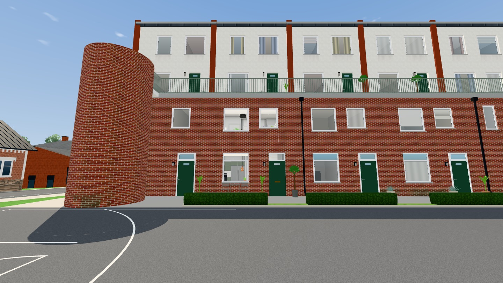 | 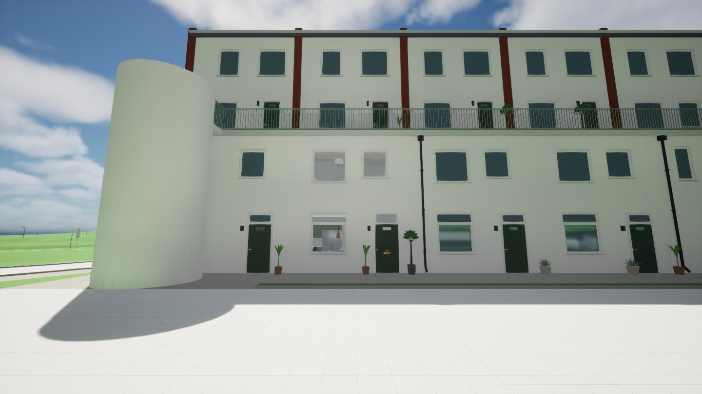 |
| 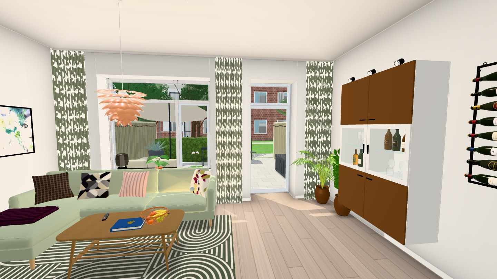 | 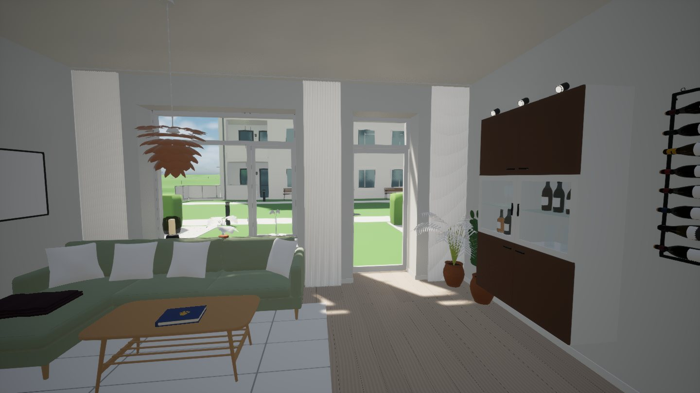 |
| 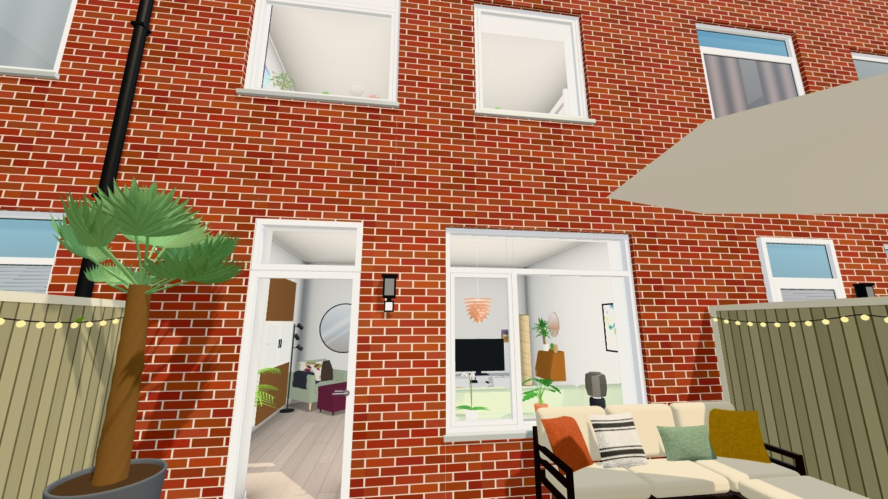 | 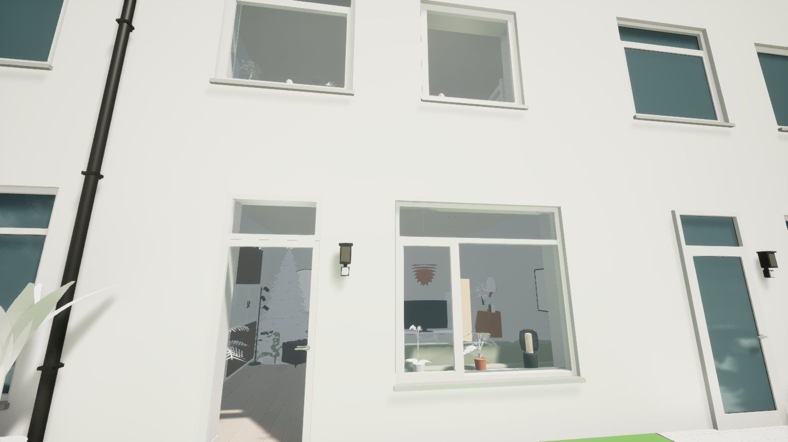 |
| 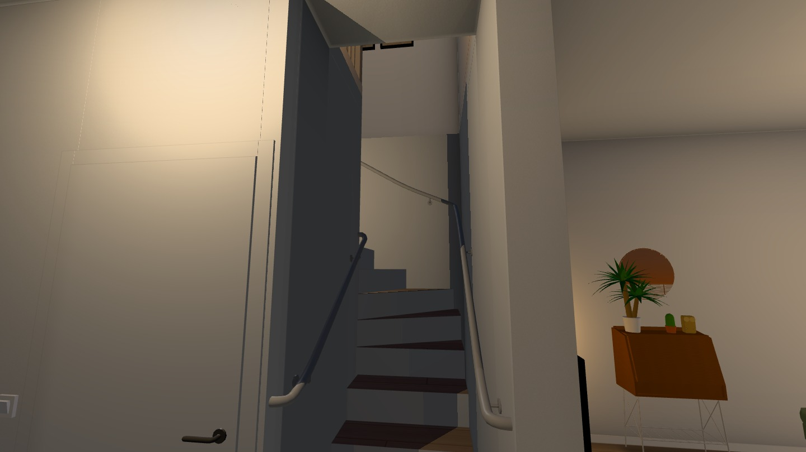 | 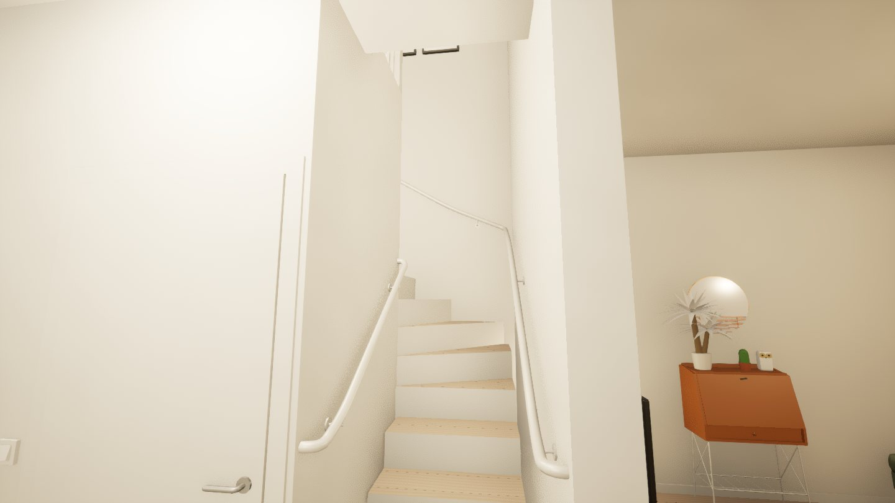 |
| 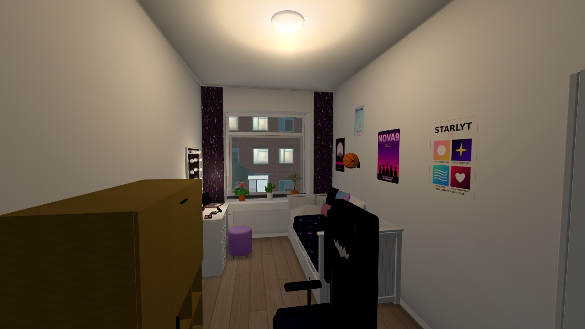 | 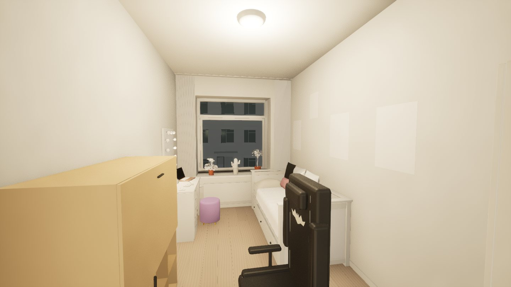 |

Day: the sun stands where the web puts it (the stair drum's shadow falls the same way at START, the patio façade is
in sun), the shade side reads light as on the web, the sky is blue with clouds. Evening: the sun is 1.3° below the
horizon and the rooms are lit by their lamps; Unreal's rooms are brighter and whiter than the web's warm, darker
lamplight (lamp candela is a *guess*, see unreal.md). Materials (brick, parquet, textiles) and the hedges are other
issues' work and still plain.

Rain and snow (Unreal only: the web's frozen `&weather=` capture draws no streaks):

| Outside | Through the windows |
|---|---|
| 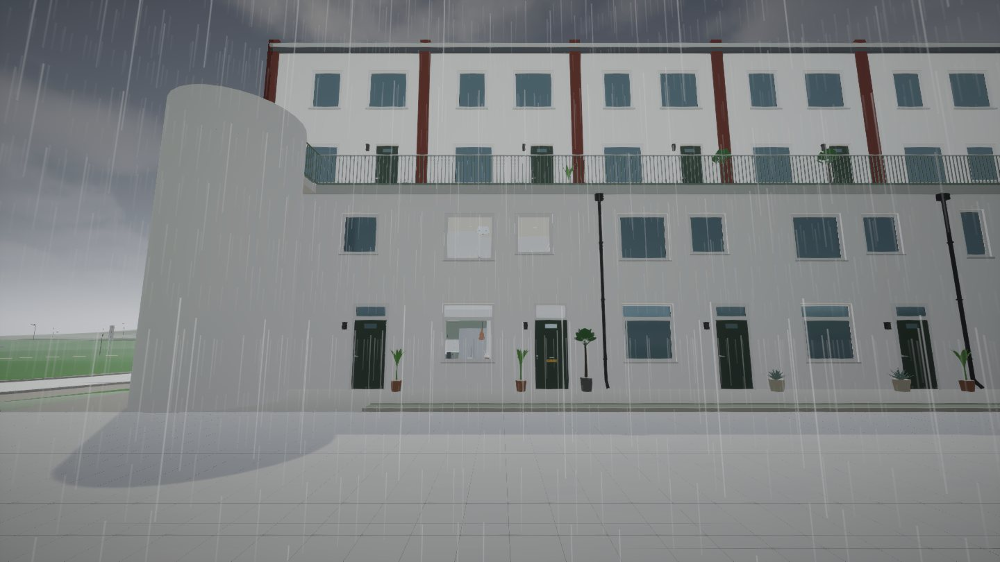 | 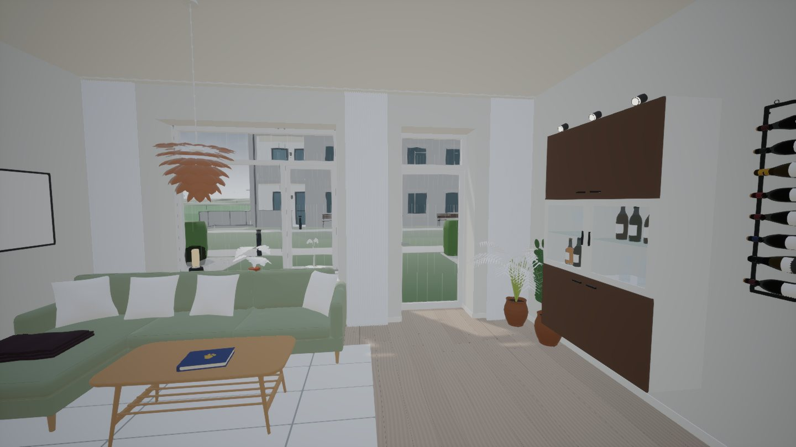 |
| 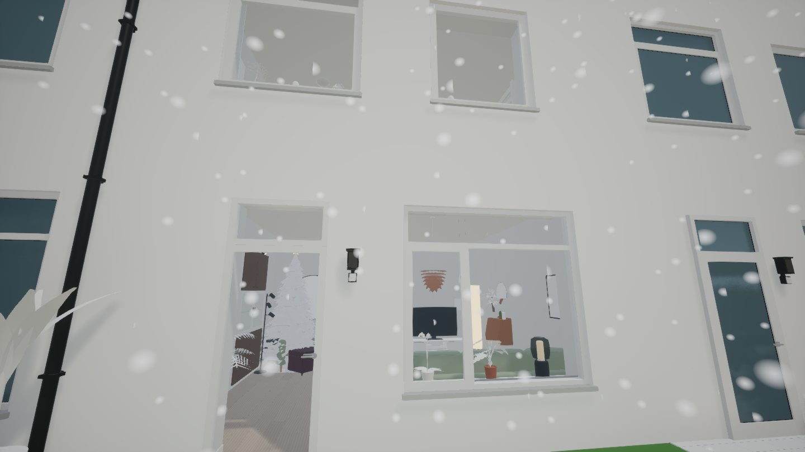 | 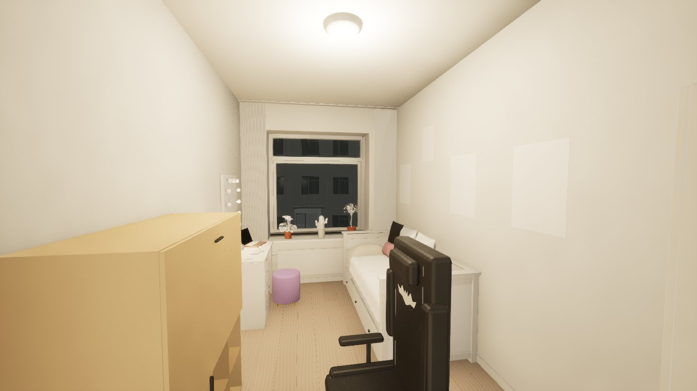 |

Rain greys the sky and dims the sun (`WEATHER.sunCut`), streaks fall outside and are seen through the living-room
glass but not inside the room, and the street is darker and glossier (wet). Snowflakes drift on the patio. At 22:00
the streaks are dim, as the light outside is.
