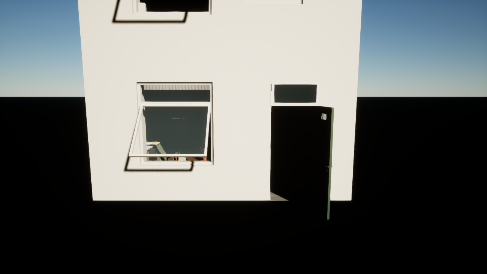

# #2285 verification: doors, windows, switches and taps

Source: export of 68becc86 + this issue's exporter change (98a0c0bf); Unreal 5.8.4 in the Windows worktree
`lunden-ue-wt/opus-2285`, headless (`-nullrhi` builder, PIE test without a window on the desktop).

- **Export:** all eight GLBs byte-identical with and without the #2285 exporter change; `check-export.mjs`: current,
  9 files, 4790 nodes.
- **Builder:** `build_interaction.py` → `LUNDEN_INTERACTION_LEVEL … {"swing": 10, "sliding": 2, "wardrobe": 6,
  "sash": 6, "switch": 13, "tap": 6}`, `LUNDEN_INTERACTION_OK`.
- **PIE test:** `test_interaction` → `LUNDEN_INTERACTION_TEST_OK 18 doors, 6 sashes, 13 switches, 6 taps`, Result
  Success. Every value: [interaction-result.json](interaction-result.json) (hinge/pivot, yaw, sash angle, slider box and
  sash check point per door and window, opened and closed, with `ChangeCount`; the wardrobe pairs; E on the front
  door; the Hall switch with both Hall lamps and the Badrum lamp; the kitchen tap's water).
- Since 84650a1d the level is part of `L_Lunden`, and `test_interaction` runs there: the Hall switch turns #2283's real
  `lamp:<id>` actors in `Level_lighting` on and off (no stand-ins). On the composed map `test_l1007` and
  `test_exterior_route` (16 checkpoints) pass too.

## Picture

`tests/capture_interaction.py` (GPU, `-RenderOffScreen`, nothing saved): `Level_l1007_interaction` from 6.2 m north of
the facade, with the front door `door_l0_x80_z0` set to its interactable's `OpenRotation` (yaw −90, swung out to the
north) and the sashes `window_l0_x385_z7` and `window_l1_x385_z7` to theirs (flaps 40° out at the bottom). Temporary
sun from the north so the facade is lit; no lighting sub-level, no surroundings.
