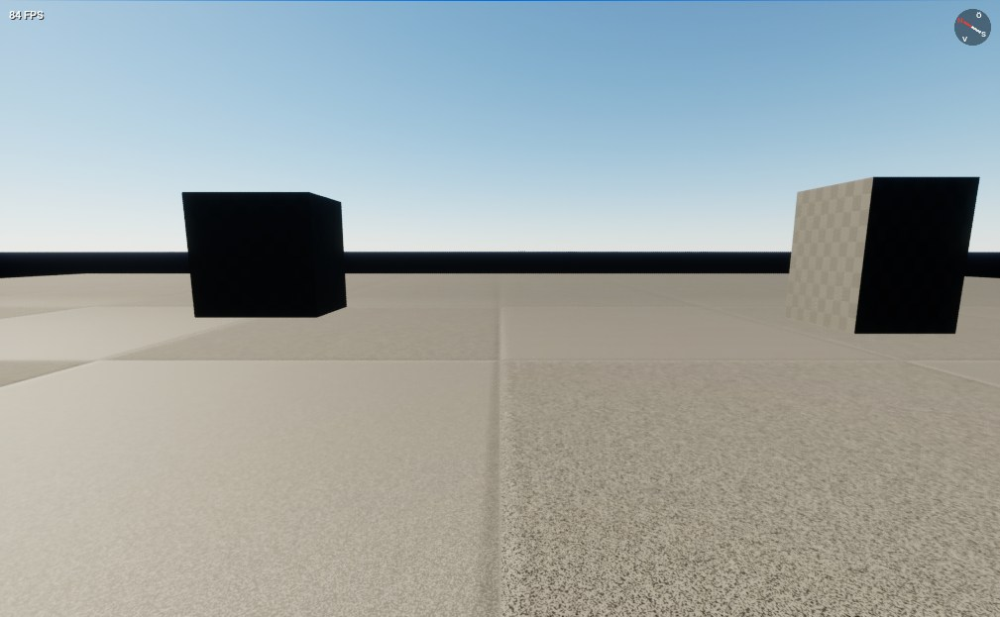
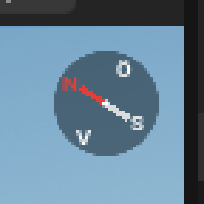
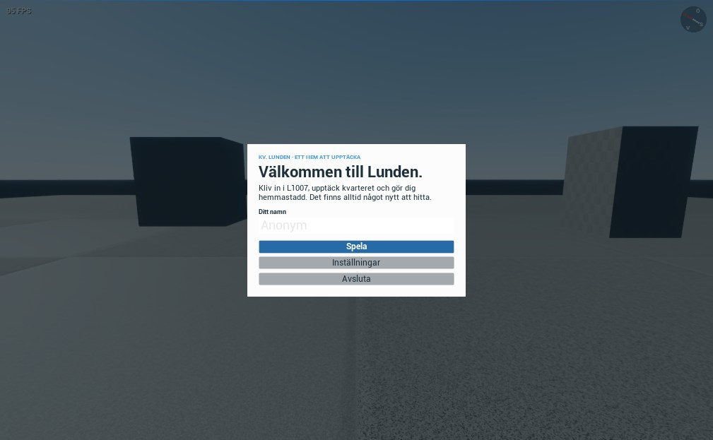
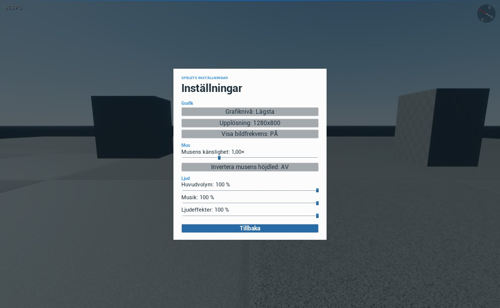
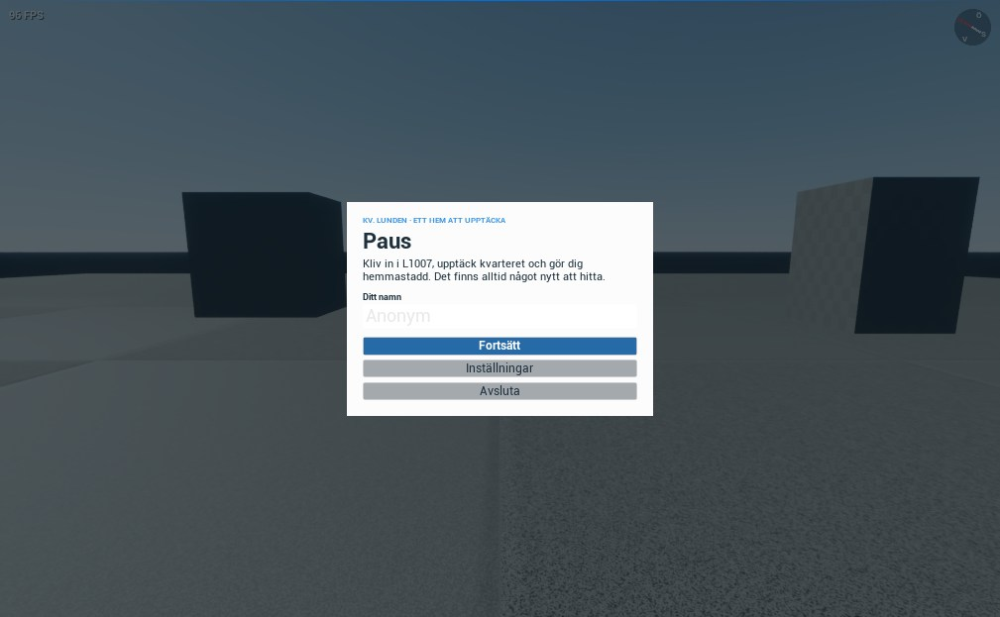

# #2286 — menu, settings and compass (Unreal)

UE 5.8.4, 2026-11-21, conductor session `orkester: solwation-w11-opus-5.5-20261121`. Design and commands:
[unreal.md "Menu, settings and compass (#2286)"](../../development/unreal.md#menu-settings-and-compass-2286).

## Play In Editor (`tests/test_ui.py`, passed)

`run-tests.ps1 -Filter Editor.Python.Lunden.test_ui`: 1 passed, 0 failed, editor exit 0. A temporary level with
`BP_LundenGameMode`, the save slot isolated with `save_isolation` (#2311). Output: [ui-result.json](ui-result.json).

| Check | Result |
| --- | --- |
| Wiring | `BP_LundenPlayerController` carries one `BPC_LundenUI`; it made the HUD and the menu; under automation `StartMenuWanted` is false, the menu stays closed and the game unpaused (so other areas' PIE tests are not paused by a start menu) |
| Compass, 9 view yaws (Unreal −90, 0, 90, 180, −148, −32, 37.3, 123.4, −170.5) | the HUD's bearing equals the web's `compassBearing` for the same view within 0.01° (58° nordost looking at plan north, 0° norr at Unreal yaw −148); the rose turns by −bearing; the N letter sits where the web draws it (0.05 px) |
| Same rows against the web's own code | `compass-rule.test.mjs` (Node, `src/compass.js`, `src/config.js` `DAY.planNorth`, `coordinates.mjs`): all 9 bearings and names equal, export planNorth 58 = `DAY.planNorth` |
| Start menu | `Open(start)`: visible, game paused, mouse cursor on, title "Välkommen till Lunden." |
| Clicks (each button's `OnClicked` broadcast, as Slate does on a click) | Inställningar → settings page, Tillbaka → main page, Spela → closed, unpaused, cursor off; the typed name "  Testspelare 2286  " is saved trimmed; all 8 buttons bound |
| Esc (`IA_LundenMenu` injected for one frame) | while playing: the pause menu opens ("Paus", paused); on the settings page: back to the main page; on the main page: closed and unpaused |
| Graphics level | one click steps the scalability level by one (0 → 1) and saves `graphics.quality` |
| Resolution | saved as applied (`1280x960`; -nullrhi lists no monitor modes, so the click keeps the current size) |
| Frame rate | `hud.fps` false hides the FPS text (Collapsed) |
| Mouse speed slider 2.0 | `BP_LundenPlayer.LookDegrees` = 2 × 0.0745° = 0.14897°, saved `mouse.sensitivity` |
| Inverted mouse | saved `mouse.invertY` true, `IMC_LundenInvertY` active on the player's input subsystem |
| Volumes | `audio.master` 0.4 and `audio.music` 0.65 saved; `audio.effects` untouched (default) |
| Restart (second PIE session; the editor's level set to 4 and size to 1024×768 first) | level 1 (Låg), 1280×960, look speed 0.14897°, invert context on, FPS hidden, name kept, every settings label identical to before the restart |

Also: `build_ui.py --check` and `build_player.py --check` passed; `test_player` (with save isolation) passed after the
player rebuild with the `UI` row. Before #2311's isolation an earlier `test_player` run inherited this test's save and
measured −0.1490°/count on MouseY: the saved speed ×2 and the inverted pitch of `IMC_LundenInvertY` act on real mouse
counts through `IMC_LundenPlayer`'s look graph (the higher context consumes MouseY as intended).

## Pictures (`tests/capture_ui.py`, PIE with a GPU, `-RenderOffScreen`)

Screenshots (`shot showui`) of the PIE viewport on a temporary lit level, cropped to the game view. The web comparison
is numeric (table above): the same view gives the same bearing and direction name in both.

| Picture | Shows |
| --- | --- |
|  | playing, looking at plan north (Unreal yaw −90): the FPS text top left (Tick ran: 50 frames counted) and the compass top right at 58° |
|  | the compass 4× (nearest neighbour): red north needle and N up-left, Ö up-right, S down-right, V down-left, as the web's rose at bearing 58° |
|  | the start menu over the paused game: Spela, name field (hint Anonym), Inställningar, Avsluta |
|  | the settings page: graphics level, resolution, frame rate, mouse speed, inverted mouse, three volume sliders, Tillbaka |
|  | the pause menu (Esc): title Paus, Fortsätt |

## Not verified here

- A packaged (Development or Shipping) run with real mouse and keyboard and a process restart. PIE covers the same
  Blueprints, the save slot and the start-time apply; real key and click routing through Slate (Tab/arrow focus,
  Enter, Esc inside the menu's `OnKeyDown`) needs a person or a desktop session and was not exercised headless.
- Resolution cycling over real monitor modes (`-nullrhi` reports none).
- Audible volume: no sounds exist yet (#2287); the master override on `/Engine/EngineSounds/Master` is applied but not heard.
- A `menuButtons` row (#2291): the list is empty; the first row will build and exercise that path.
