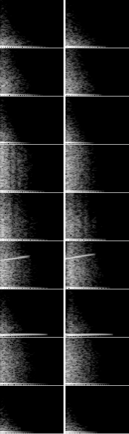

# #2287: footsteps, wind and outdoor sound as MetaSounds in Unreal

*`orkester: solwation-w11-opus-5.5-20261121`, 2026-11-21. UE 5.8.4, headless (commandlet and PIE tests). Export of
`f296c954` (#2300's, for the surface data and tree feet), web numbers from `audio-params.json` written by
`export-audio.mjs` (current at `03319087`).* What was built is described in
[unreal.md](../../development/unreal.md#footsteps-wind-and-outdoor-sound-2287).

## Checks

| Check | Result |
| --- | --- |
| `export-audio.mjs --check` (the versioned numbers match the web's modules) | "audio-params.json is current" ✓ |
| `build_audio.py`, again, then `--check` | built 20 assets; second run "unchanged, nothing saved", the `.uasset` bytes unchanged; check passed ✓ |
| `test_audio` 1: assets | 9 step MetaSounds in `SC_LundenEffects`, wind and bed in `SC_LundenAmbience`, class tree Master > Effects > Ambience and Master > Music, the three `volumes` rows on those classes, `BPC_LundenAudio` on `BP_LundenPlayer` ✓ |
| `test_audio` 2: the Blueprint's transcribed formulas against the web's own answers | `pickStep` 1,152 of 1,152 equal; `windPower` 6, `windStrength` 21, `gustAt` 18, `windSoundParams` 324 (worst relative difference 5·10⁻⁷), `riverBabbleParams` 18, `trafficLevel` 32, `cityHumParams` 16, `distToPolyline` 6 all within 10⁻⁴ ✓ |
| `test_audio` 3: the player on #2300's nine surface control points, 2.5 strides of ground covered | 2 steps each (also at `strideRun` while Shift is held). The MetaSound matches the web's `pickStep`: parquet and upstairs parquet `wood`, tile `hard`, patio slabs `hard`, stair tread `stair`, gravel `gravel`, grass `grass`, road `hard`, garage `hard`; wet road `wet`, autumn grass and gravel `leaves`. The room zone matches `reverbZone` at every point (soft, bright, soft, courtyard, concrete, courtyard, courtyard, open, concrete) ✓ |
| `test_audio` 4: wind and bed at 9 m/s, 08:00, June, on the grass (outdoors) and the parquet (indoors) | outdoors = the web's outdoor model; indoors = that model × `WIND_SOUND.indoor` (gain × 0.18, low-pass ≤ 420 Hz) and × `AMBIENT_BED.indoor` (river × 0.12, city × 0.3); tree nearness = the web's formula on the exported trees (10⁻⁴) ✓ |
| Silent render (`test_audio_render.py`, final gain 0) and `audio-render-compare.py` against the web's `synthFootstep` | see below ✓ (shapes); level offset reported |
| `test_player` | passes unchanged with the component on the player ✓ |
| `build_ui.py` (two runs) for the new classes, `--check`, `test_ui` | check passed; `test_ui` passes: master and music saved, restored after a restart ✓ |
| `build_player.py` with the `Audio` row, then `--check` | `StepSurface` and `Rest` unchanged, `Audio` added; check passed ✓ |

Files: [`audio-result.json`](audio-result.json) (`test_audio`: every step row and the bed values) and
[`audio-render.json`](audio-render.json) (the render's metrics).

## Render against the web

`test_audio_render.py` played each step MetaSound once and recorded the main submix while
`au.LinearGainScalarForFinalOutut` was 0, so nothing reached the speakers. `audio-render-compare.py` computes
`synthFootstep` sample by sample with the same numbers (variation 1, one noise draw):

| Profile | Level web / Unreal (dBFS RMS) | Length web / Unreal (ms, to −40 dB) | Centroid web / Unreal (Hz) |
| --- | --- | --- | --- |
| wood (parquet) | −34.9 / −44.1 | 118 / 111 | 81 / 76 |
| hard (tile, paving) | −34.9 / −44.4 | 103 / 106 | 98 / 97 |
| grass | −43.0 / −53.2 | 158 / 160 | 69 / 63 |
| gravel | −40.3 / −49.4 | 142 / 135 | 124 / 120 |
| stair | −34.9 / −43.7 | 212 / 211 | 132 / 134 |
| wet | −37.5 / −47.1 | 159 / 156 | 315 / 350 |
| leaves | −44.3 / −54.2 | 144 / 144 | 787 / 642 |
| snow | −44.5 / −55.0 | 150 / 168 | 340 / 186 |
| snowCold | −43.6 / −52.7 | 151 / 166 | 741 / 794 |

Spectrograms: rows in name order (grass, gravel, hard, leaves, snow, snowCold, stair, wet, wood), web left, Unreal
right, 0–4 kHz upwards, 0.3 s across, 60 dB under each sound's own peak. The same shapes appear on both sides: the
low thud of parquet and grass, the noisier gravel, the stair's 190 Hz ring and the cold snow's squeak line.

- **Level:** Unreal is 9.6 ± 0.5 dB lower for every profile alike, so the relative levels between surfaces agree
  within ±1 dB. The offset comes from the engine's output: −3 dB Windows platform headroom
  (`BaseWindowsEngine.ini PlatformHeadroomDB`) and the centre pan of a mono source; the rest is not traced. It is a
  global level, left for the user's play test. The web's own master gain 0.8 is not applied either.
- **Shape:** the length is within 6 % (snow +12 %, snowCold +10 %) and the centroid within −8 … +11 %, except snow
  −45 % and leaves −18 %. Those two differ because Unreal approximates the crackle with a triangle between one random
  trough per step and 1, where the web draws a new trough on every flicker. One take per side, with a random variation
  of up to ±12 %.
- **Wind and bed** (2 s each): wind −41.2 dBFS outdoors (centroid 2,030 Hz: the leaf rustle near the trees) and
  −58.6 dBFS indoors (centroid 428 Hz, the 420 Hz ceiling): 17 dB quieter and duller inside. The bed is −53.4 dBFS
  outdoors and −67.5 dBFS indoors.

## Not tested

- Listening on real speakers or headphones. The issue's comparison of a short recording of the same route in the web
  and in Unreal is the user's play test.
- The sound-class volumes at run time. `test_ui` shows that the sliders are saved and restored, and `build_ui.py`
  builds the mix overrides on the new classes. The resulting class volume is not read back, because no PIE test runs
  with an audio device (only the render does).
- The `ActivateReverbEffect` result. With `-nosound` there is no audio device, so the test checks the zone the
  component switches to, not the engine's active reverb.
- A packaged game and the composed `L_Lunden`. The step and zone tests ran in a temporary level on slabs at the control
  points' heights; the surface comes from the exported data, not the floor meshes.
