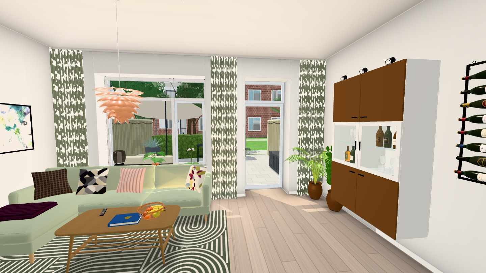
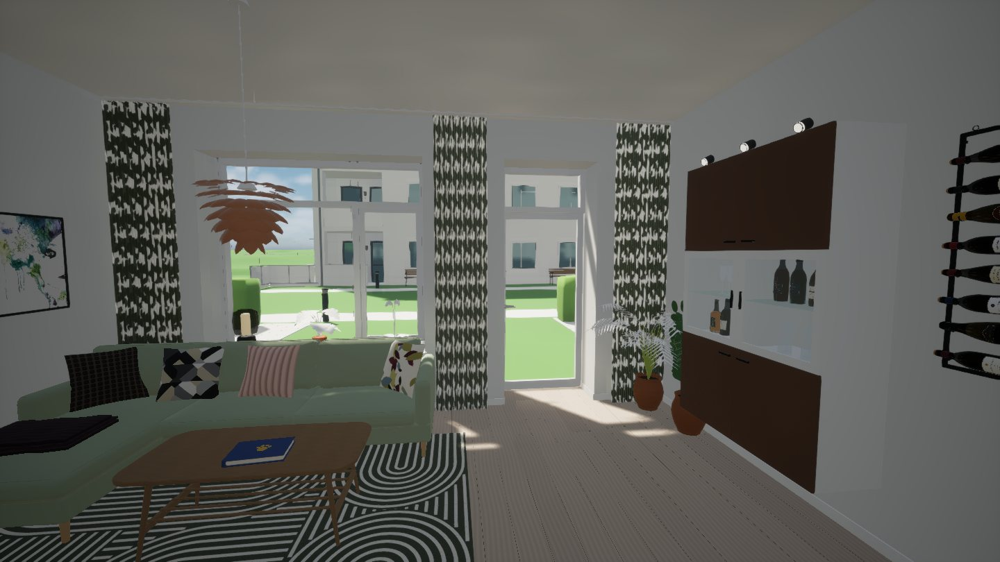
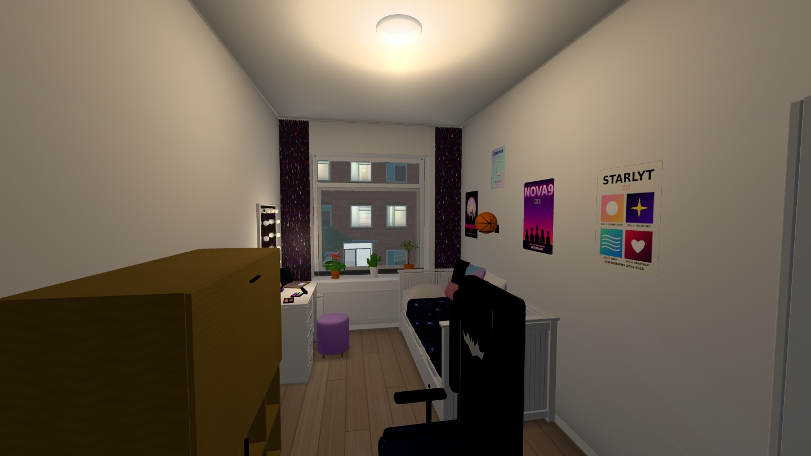
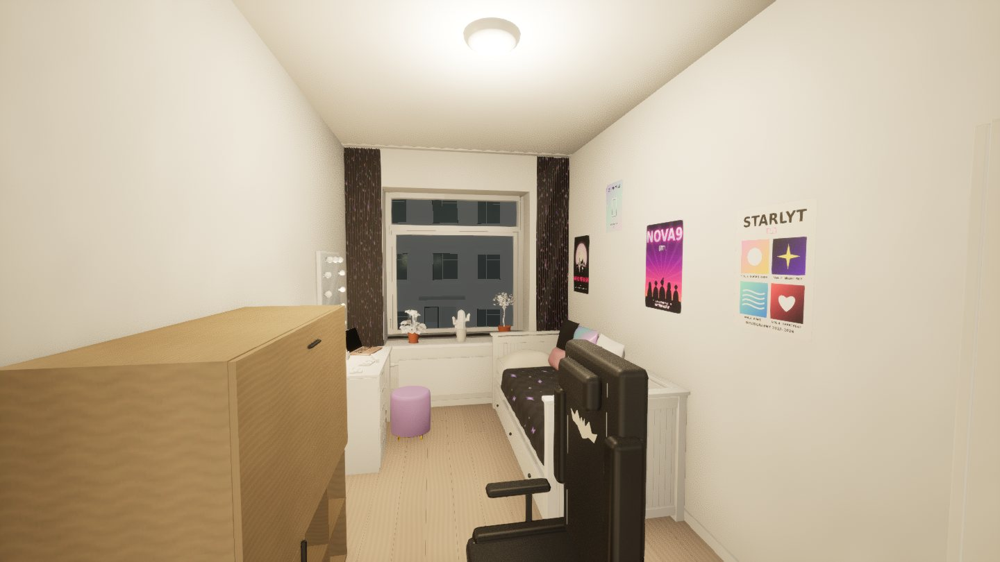
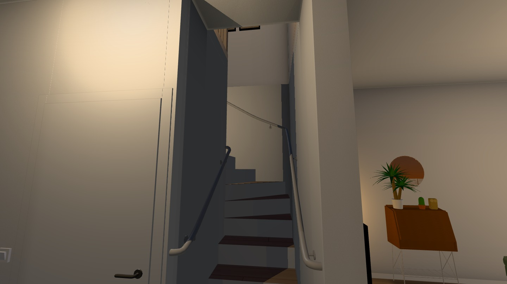
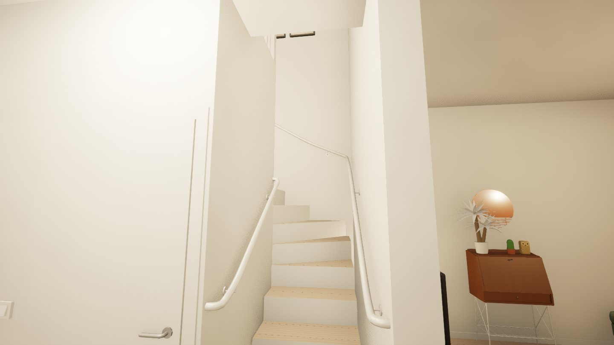

# #2289 verification: L1007's furniture and pictures in Unreal

UE 5.8.4, Windows worktree `lunden-ue-wt/opus-2289`, export of `6f1771af` plus the mesh-centre fix of `9d13c0d1`
(all zones; `l1007.glb` 108.3 MB). What was built and why: [unreal.md, Furnishing and pictures](../../development/unreal.md#furnishing-and-pictures-2289).

## Checks

| Check | Result |
|---|---|
| Export determinism: two exports of the working tree | `l1007.glb`, `l1007-uteplats.glb`, `measurements.json` byte-identical (sha256 `84366313…` for `l1007.glb`); the full export after the centre fix left all 8 GLBs byte-identical |
| `check-export.mjs`, `test_materials.py`, `coordinatestest.mjs` | current; `MATERIAL_COVERAGE_OK` (0 unmapped keys); 38 passed |
| `tests/test_furnishing.py` (headless editor, [result](furnishing-result.json)) | `LUNDEN_FURNISHING_TEST_OK`: 171 of 171 furniture / appliance / lamp nodes placed (97 furniture, 48 appliances and cupboards, 26 lamps; 162 in `Level_l1007`, 9 on the patio), max **0.005 cm** and **0.0007°** off the web, scale exact; 87 textures on 230 mesh actors, centres max 0.0069 cm off, each with the key's instance and a Texture2D of the exported size |
| Pictures | all 10 files in `textures/` hang on their meshes (the stair wall's atlas on 4 frames, "Till mamma" through its matted canvas) and are named in `THIRD_PARTY_NOTICES.md` (`notices.mjs --check` current) |

The acceptance criteria: every exported piece of furniture within 1 cm and 1° (0.005 cm, 0.0007°); every picture on
the web's walls in L1007 in the same place in Unreal (the 10 picture files plus the web's canvas pictures, posters and
prints, 230 textured meshes within 1 cm); the pictures credited in `THIRD_PARTY_NOTICES.md`.

## Pictures

Rendered by `tests/capture_lighting.py` (#2283) on `L_Lunden` with the map's own lighting (no temporary sun or sky),
the shared cameras of `unreal/Lunden/Tests/views.json` on 21 June 2026: living room at 14:00, Övre plan and the stairs
at 22:00 with the lamps on. Nanite is off in memory for the capture (#2298). The web pictures are #2283's, taken from
the same cameras; the web is unchanged by #2289.

| Web | Unreal |
|---|---|
|  |  |
|  |  |
|  |  |

Living room: the rug's arcs, the cushions, the striped and spotted curtains, the watercolour over the chaise and the
sofa's fabric now carry the web's images; before #2289 they were flat colours
([#2283's picture](../2283/unreal-living-room.jpg)). Övre plan: the K-pop posters, the daybed's star bedding and the
curtains. Stairs: the secretary's teak and labels.

## Not checked or not ported

- Normal, bump, roughness, alpha and emissive maps, the web's shader tweaks, and animated canvases (TV, smart display:
  their first frame) do not travel. The sofa and armchair fabric reads darker than on the web (their material also uses vertex
  colours; whether Interchange's instance multiplies them was not investigated).
- The patio (`l1007-uteplats`) is imported and checked, but is not a line of `world-levels.json`, so it is not in
  `L_Lunden` (the view through the patio door shows the courtyard instead of the patio furniture).
- The copper fruit bowl and Tilly's basketball are built by `main.js` with their game logic (`src/fruit.js`,
  `src/basket.js`), not by `buildWorld`, so the export does not include them; reported to the conductor.
- The capture rebuilt `/Game/Lunden/Lighting/` locally because its spec hash differed from the current export (not
  committed; reported to the conductor).
