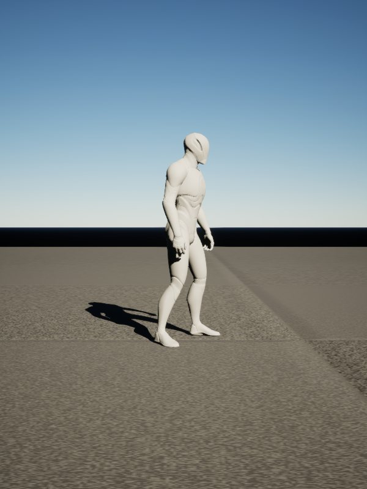
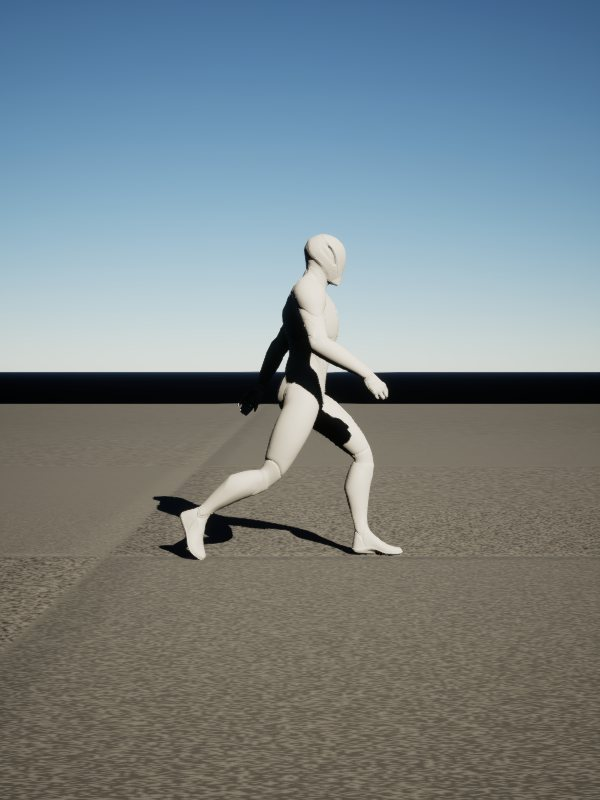
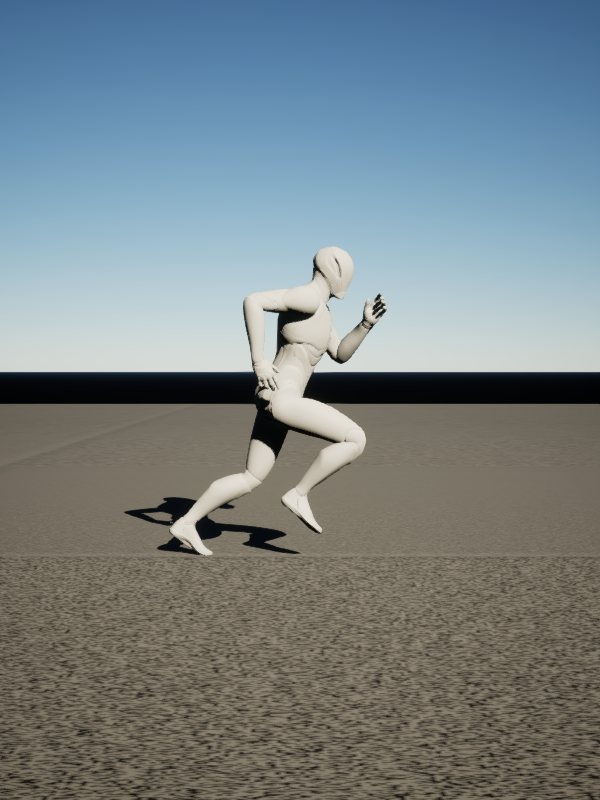
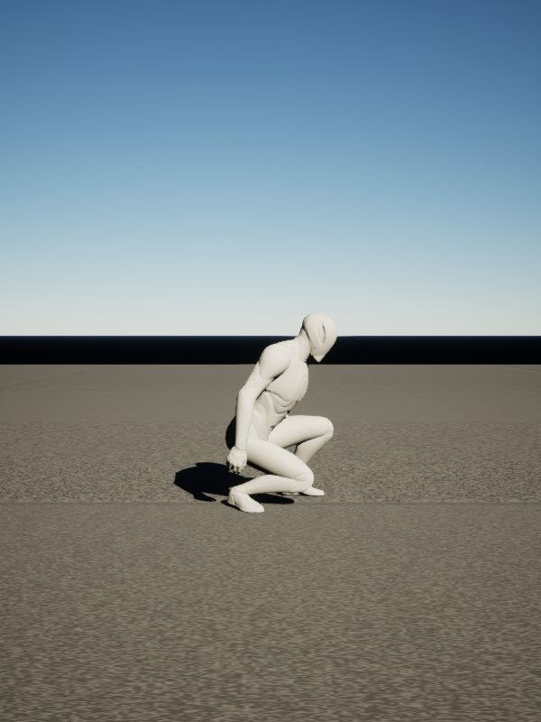
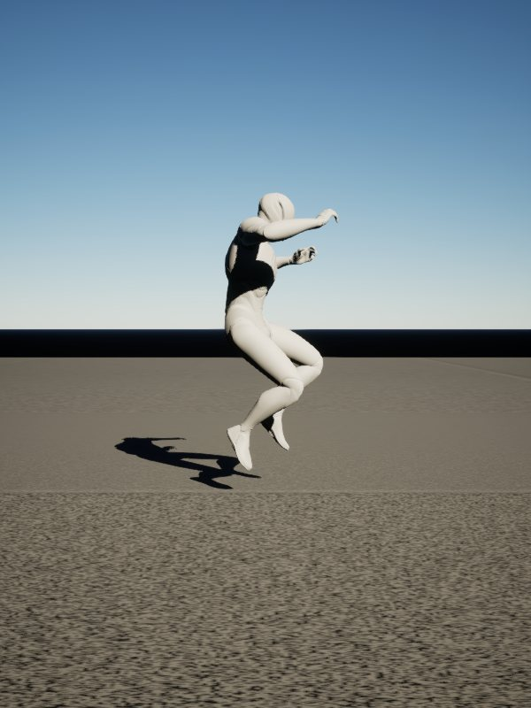
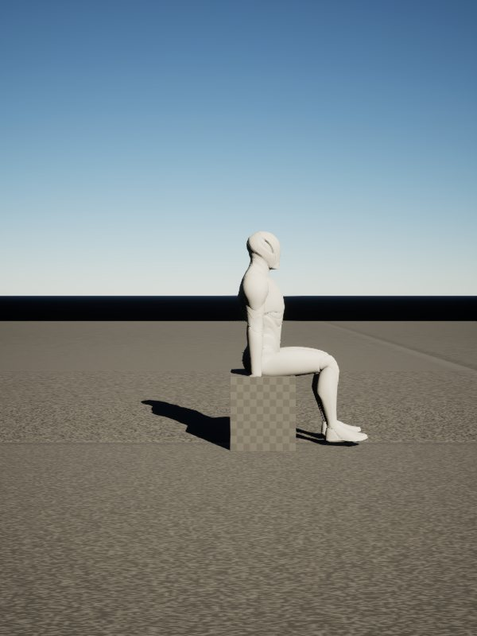
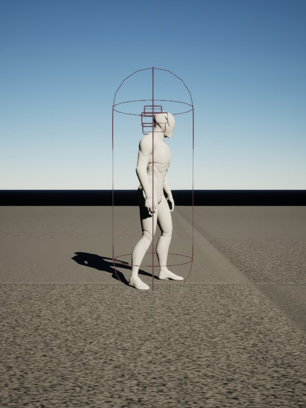
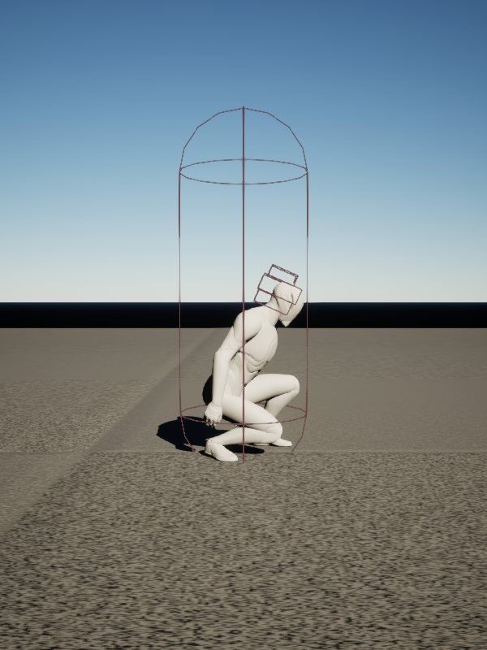

# #2290 Avatars: skeleton and movement in Unreal

Built and checked on UE 5.8.4 from main `0ecb8b41` (builder spec `88e58b41979f`). Everything ran headless
(`-nullrhi`, or `-RenderOffScreen` for the pictures). How it works:
[unreal.md, Avatars](../../development/unreal.md#avatars-skeleton-and-movement-2290).

## Checks

| Check | Result |
| --- | --- |
| `node tools/unreal-engine/avatar-contract.mjs --check` | the contract file matches `src/config.js` (710 rays, seed `lunden-6`, tall 1) |
| `build_avatar_rig.py` rebuild, then an unchanged run, then `--check` | built 16 assets; `unchanged, nothing saved`; `check ok`; nothing the game loads reaches a package outside `Avatar/` |
| `test_avatar_rig` (PIE), hit zones | 642 rays through the three head boxes agree with the web's `rifleBoxHeadContact` within 0.005 cm (limit 1 cm), standing, half and fully crouched, seated and lying; 68 rays that graze an edge match the web 1.5 cm to either side; body capsule ends = `playerBodySegment` within 0.006 cm |
| `test_avatar_rig`, states | `SetMotion` reaches `ABP_LundenAvatar` for stand, walk (160), run (320), crouch, crouch-walk (80), jump and sit; crouch lowers the pelvis 54.0 cm (`hipDrop` 54), the crouched feet stay on the floor, the head leans 14 cm forward, seated and crouched knees are 42 and 46 cm ahead of the pelvis |
| `test_avatar_rig`, feet | moved at the web player's speeds, a planted foot's median ground speed is 10.8 cm/s at walk 160 (limit 24), 36.7 at sprint 320 (limit 48), 5.6 at crouch-walk 80 (limit 12) |

Automation report: 1 passed, 0 failed, 0 not run. Raw values: [test-result.json](test-result.json) (zones per state,
states, feet) and [capture.json](capture.json) (pictures).

The head boxes in contract heights (standing, cm above the feet): lower 151–159, middle 159–169, top 169–176; the
fully crouched figure's lowest head point is 86.6 cm (`rifleHeadBaseY`), the same boxes turned 24° forward about
the crouched hip.

## Pictures (`tests/capture_avatar_rig.py`, PIE with a GPU, `-RenderOffScreen`)

Side on, the figure facing right, on a temporary grey level with a sun and sky light (not `L_Lunden`); the grey
Mannequin material stands in for #2291's looks. Web comparison: the same poses side on in
[#1916's avatar-side.png](https://github.com/solwation/lunden-3d-apartment/blob/7fa7fdeb/docs/verification/1916/avatar-side.png)
(stand, walk, run, crouch, sit on a 45 cm seat).

| Stand | Walk (160 cm/s) | Run (320 cm/s) | Crouch |
| --- | --- | --- | --- |
|  |  |  |  |

| Jump | Sit (45 cm seat) | Hit zones standing | Hit zones crouched |
| --- | --- | --- | --- |
|  |  |  |  |

The hit-zone pictures draw the three head boxes and the body capsule (hidden in game). Standing, the Mannequin's
head stands about 7 cm ahead of the boxes' centre (its idle stance leans forward of the feet); crouched, the head is
slightly ahead of and below the leaned boxes. The zones follow the contract, not the mesh, by design.

## Not verified here

- Other players and the mirror: #2292 spawns `BP_LundenAvatar` for peers and #2291 builds the mirror; both drive it
  through `SetMotion`, which these checks exercise directly.
- Looks, height scaling and look codes (#2291); `HeightScale`/`WidthScale` were only checked at 1.
- The walk's cadence against the web's: the template walk is a 3 m/s stride, so at 1.6 m/s it steps longer and slower
  than the web figure (`AVATAR_GAIT.stepHz` 2.3 steps/s); the feet do not slide.
- A packaged (cooked) build with the avatar; the builder's dependency check covers what it would load.
