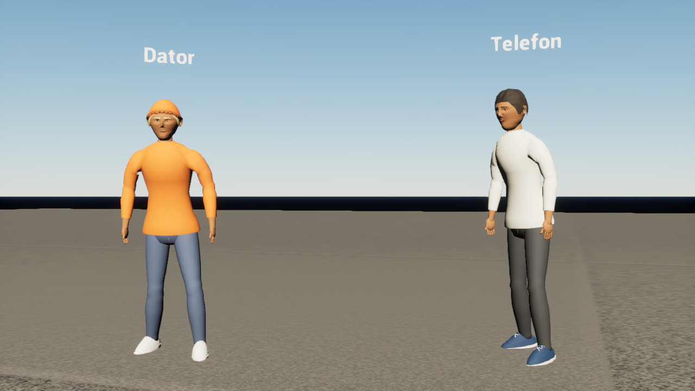
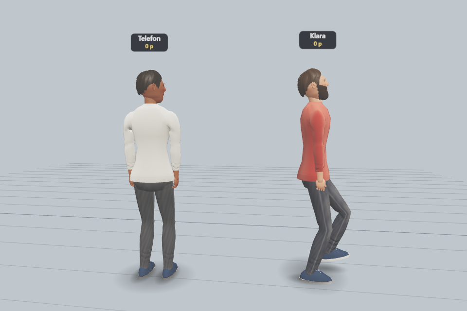
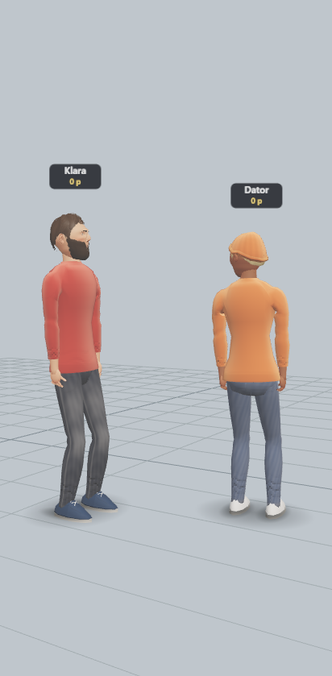

# Närvaro i Windows och på webben

Bilden kommer från UnrealEditor-Cmd 5.8.4-58902052 på Windows 11. I samma lokala rum sprang Windows-spelarens produktions-Blueprint med två webbklienter, Dator och Telefon. PIE mätte båda fjärravatarernas position inom 5 cm och riktning inom 1°. Bildprovet jämförde pixlarna över respektive överkropp före och efter att den riktiga skelettmeshen visades. Två positionsuppdateringar, frånvaro och återkomst behöll spelarnas identiteter. Bilderna använder syntetiska spelarprofiler.

På den fysiska testmaskinen kördes Unreal och båda Chromium-profilerna i Windows. Telefonprofilen hade pekinmatning och 412 × 839 CSS-pixlar. För vardera webbilden doldes en avatarkropp i taget i en separat referensrendering. På telefonen ändrades 11 200 respektive 12 373 pixlar i de två bålområdena. Alla tre bilder kommer från samma godkända rumskörning.

Launcherkomponenterna PlayerBridge och PlayerRoom kördes från samma källfiler med .NET 10 i WSL, tillsammans med den lokala Workern. Webbläsarna anslöt till Workerns uttryckliga IPv4-loopbackadress. Windows App Control blockerade den lokalt byggda osignerade testassemblyn. På GitHubs Windows-runner verifierades Windows-launcherns WebSocket och filtransport mot de båda webbprofilerna. [Windows-körning](https://github.com/solwation/lunden-3d-apartment/actions/runs/44931631131)

Tiozonsexporten verifierades före och efter kopieringen till Windows. Båda nätverkskomponenterna, fjärravataren, händelselyssnaren, de två StringTable-tillgångarna och produktionsspelaren byggdes och sparades. Spelarens kontroll i ny editorprocess passerade. Alla tre testerna i `Editor.Python.Lunden.test_network` passerade med noll varningar, och samtliga 411 Worker-tester passerade i Node.
