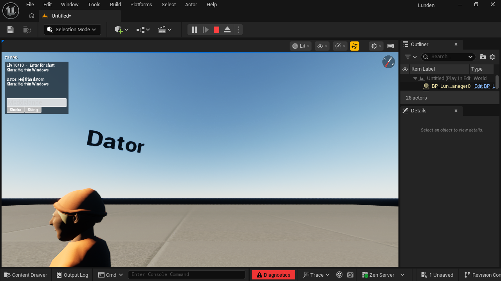
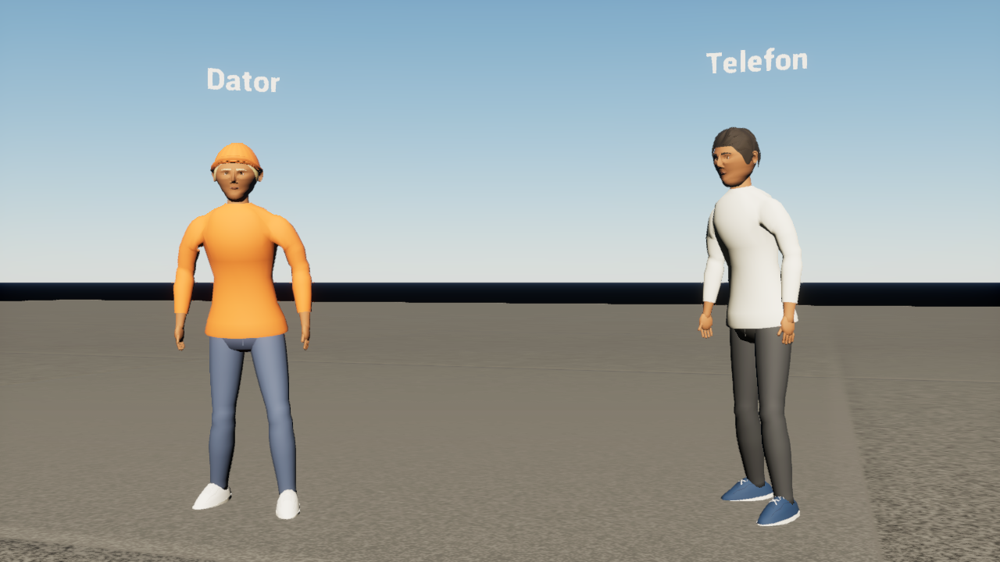
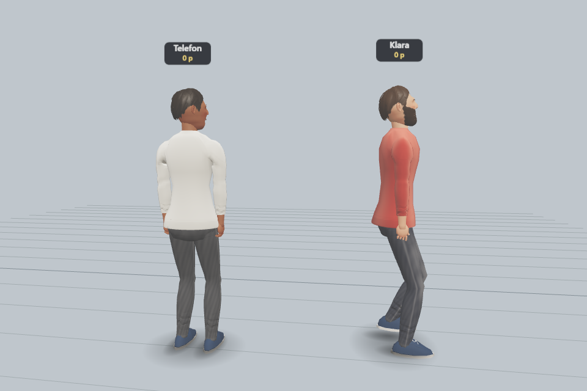
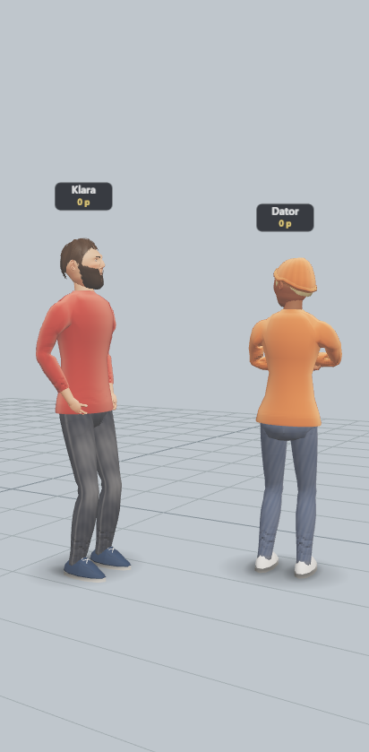

# Chatt, dörrar och liv i det delade spelrummet

Bilden är tagen i Unreal Engine 5.8.4 på Windows med den riktiga spelaren och HUD:en i Play In Editor. Dator skrev ”Hej från datorn” i Chromium. Klara svarade ”Hej från Windows” i Unreal. Båda raderna kom via samma lokala Worker och launcher som spelarnas rörelser. Profilnamnen och meddelandena skapades för provet.

| Funktion | Verifiering |
| --- | --- |
| Chatt | Dators skrivindikator nådde Windows. HUD:en tog emot datorns rad och skickade Windows-svaret, som båda Chromiumprofilerna läste. Launcher- och Workerproven kontrollerade filtrering av hela ord och hur ofta nya rader får skickas. |
| Dörrar | Dator öppnade svängdörren `w1`. Windows och telefonprofilen såg den öppen. En ny pekprofil fick dörrens läge i rummets välkomstmeddelande. Windows stängde dörren och båda webbsidorna såg den stängas. Det separata PIE-provet kontrollerade att en mottagen ändring gav exakt ett lägesbyte och inget utgående dörrmeddelande. |
| Avatarposer | Spelarens Blueprint formaterade sex poser med samma fixtur som launchern. Webbens ordinarie rumsvalidering gav samma resultat för 100, 175 och 200 cm långa avatarer, hukande, sittande och äldre tillstånd utan extra utseendefält. Workerns befintliga versionsprov passerade också. |
| Fall och återupplivning | Windows-spelaren föll 4 och 7 meter. Livet gick från 10 till 5 och tillbaka till 10 efter rummets besked. Det sista fallet gav en enda mörkläggning och uppvakning. Webbens fallanrop gav samma utfall för telefonprofilen. |

Den fysiska Windowsmaskinens xUnit-prov passerade med 1 av 1 godkänt. Det körde .NET 10-launchern, Unreal och båda Chromiumprofilerna mot samma lokala Worker. Bilderna nedan togs i samma körning innan den nya telefonprofilen anslöt. Vid positionskontrollen låg de andra avatarerna inom 5 cm från sina förväntade lägen.

Webbexporten gav 150 dörrader. De 144 som webben registrerar för delning fick samma rums-id i den äldre mätfilen och i en ny export av L1007, Hus L och kvarteret. Sex garderobsdörrar behöll sitt lokala läge.

`Editor.Python.Lunden.test_network_shared` passerade på Windows med noll varningar. Två byggen i följd av chattwidgeten kontrollerade att en sparad widget kan byggas om. De 83 Workerproven i `cloudflare/players.test.mjs`, `cloudflare/chat.test.mjs` och `cloudflare/headboxes.test.mjs` passerade i WSL. Körkommandon för treklientsprovet finns i [bryggans provanvisningar](../../../tools/unreal-engine/wire/README.md#chat-doors-and-life).
