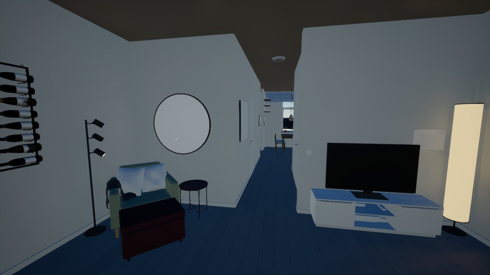
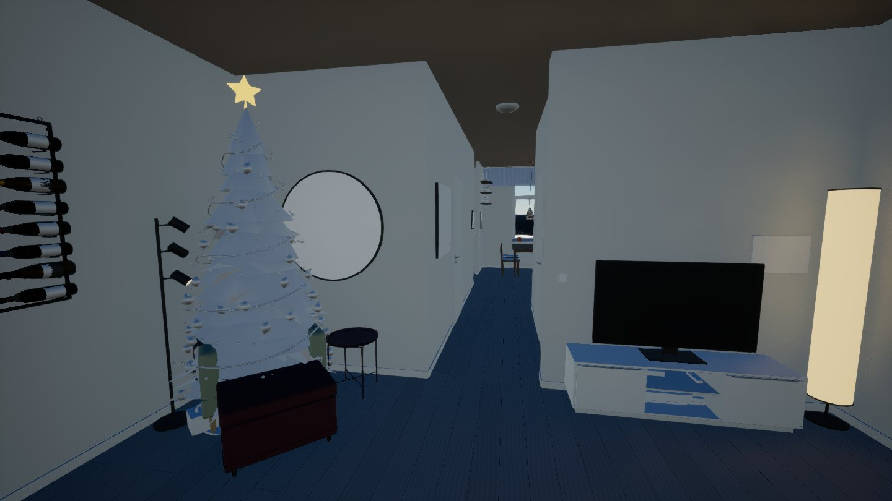

# #2295 — the Christmas tree only in season (Unreal)

UE 5.8.4, export of `c6dbf4c9` (zones `l1007`, `fixture`), importer version 3, 2026-11-21. Design and commands:
[unreal.md "Seasons (#2295)"](../../development/unreal.md#seasons-2295).

| Summer (2026-07-15): no tree | Christmas Eve (2026-12-24): the tree |
|---|---|
|  |  |

Both views come from `tests/capture_seasons.py`: `L_Lunden` with the temporary light of `capture_l1007.py`, a
temporary `BPC_LundenSeasons` running `ApplySeason` for the date, and the capture hiding what the game hides
([capture.json](capture.json)). In December the armchair and the plants in the corner stand inside the tree; the web
hides them while the tree stands, which is not ported (G20).

Checks:

- `season-rule.test.mjs` (Node): the nine rows of `tools/unreal-engine/tests/season-dates.json` agree with the web's
  own `inChristmas`, and the export's window for `furn_xmastree_l0_x82_z846` (1201..106) equals `XMAS_TREE.season`.
- `test_seasons` (PIE on `L_Lunden`, passed): the tree and its 165 parts carry the season tags; BeginPlay on
  2026-11-21 (local date) left the tree hidden without collision, as the web; `ApplySeason` for each row (summer,
  30 Nov, 1 Dec, 24 Dec, 31 Dec, 1 Jan after the wrap, 6 Jan, 7 Jan, 29 Feb 2028) hid or showed all 166 actors with
  matching collision, `InSeason` gave the same answer and untagged furniture stayed visible
  ([seasons-result.json](seasons-result.json)).
- `test_player` (PIE, passed) and `build_player.py --check` after adding the `Seasons` controller row;
  `build_seasons.py` second run `unchanged, nothing saved` (same SHA-256), `--check` passed, a rebuild over an
  existing asset compiles without errors.
