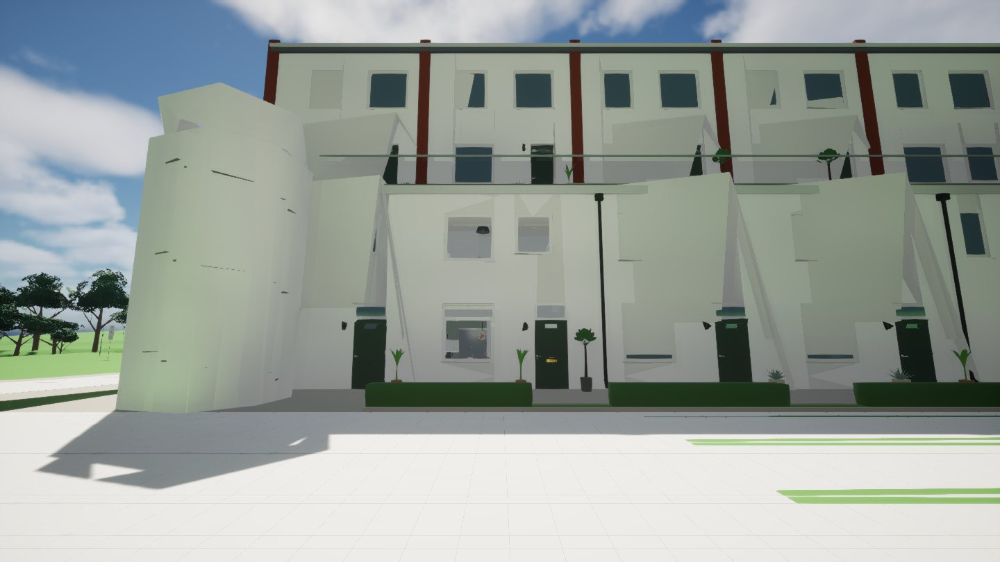
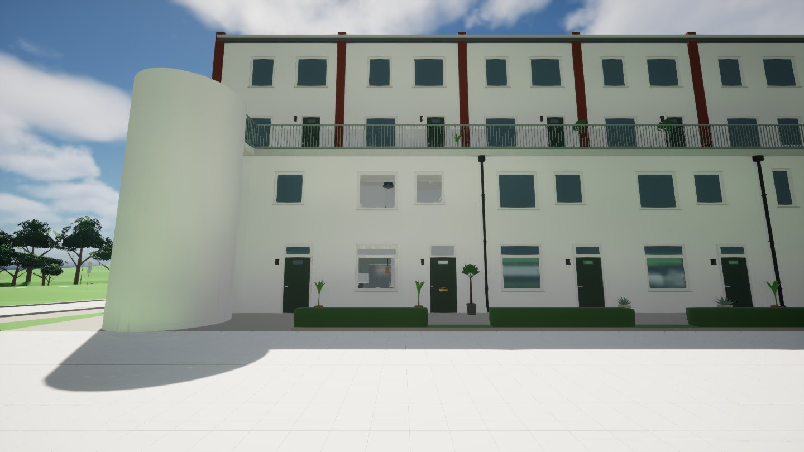

# #2298 verification: full Nanite fallback for collision, traces and pictures

UE 5.8.4, Windows worktree, headless (`run-python.ps1` / `run-tests.ps1` with `-nullrhi`; the pictures with
`-AllowCommandletRendering -RenderOffScreen`). Export of `03dda558`, all nine zones. How it works:
[unreal.md, Full Nanite fallback](../../development/unreal.md#import-into-unreal-verified-2026-11-20).

## Traces (`test_exterior.py`, Nanite left on)

`test_exterior.py` no longer switches Nanite off in memory; it still makes complex collision double-sided in memory
(#2299).

| Import | Result |
|---|---|
| version 4 (AUTO fallback) | 31/32: `husl_street_facade` hit `mesh_l0_xm1668_z455_y665_2` at y −8.25 instead of −0.6, **7.652 cm** |
| version 5 (full fallback) | **32/32** on the same node, max error **0.000 cm** (Automation 1 passed, exit 0): [`exterior-result.json`](exterior-result.json) |

The rays include the south loggia rails of Hus A, B and C and the garage shell, which the simplified fallback had
missed in #2279's first run.

## Fallback geometry after a restart

A scratch script in a fresh editor compared each imported Nanite mesh's fallback (render LOD 0) with its source mesh:
of 3,352 Nanite meshes in eight zones, 83 have fewer fallback than source triangles (1,648,021 of 1,662,244 in total).
For all 83, a raster build of the same mesh (Nanite off in memory, not saved) has exactly the same count, so the
difference is the build's removal of degenerate triangles, not a simplification. `prepare_nanite_materials.py --check
hus-l kvarteret l1007` passed with the persisted fallback settings. `import_world.py --check` on all nine zones gave
`LUNDEN_CHECK_OK` (every fingerprint matches, 54 collision boxes in l1007).

## Cost

| | Version 4 | Version 5 |
|---|---|---|
| fallback triangles, all zones | 655,533 | 1,648,081 |
| package bytes under `Generated/` (hus-l / kvarteret / l1007) | 119.59 / 34.48 / 270.67 MB | 119.77 / 34.52 / 271.01 MB |
| import time (l1007 / hus-l / kvarteret) | 43 / 17 / 5 s | 110 / 44 / 31 s |

The render data is kept in the DDC and the cook, not in the editor packages. The cooked size was not measured.

## World map

The derived levels were rebuilt from the version 5 import: `build_l1007.py`, `build_exterior.py` (373 actors, 283
copies), `build_site.py` (31 meshes, 129,582 triangles), `build_lighting.py`, `build_interaction.py` and
`build_vegetation.py` (4,163 instances). No versioned asset changed. `compose_world.py --check`: `L_Lunden` unchanged
(sha256 `28f801d35df1ecdf`), nothing saved and no lock taken. In Play In Editor with the save file isolated (#2311):

- `test_l1007`: 1 passed, every measurement within 0.20 cm, `LUNDEN_L1007_WORLD_OK` (the first run on an import
  whose collision cube carries its box, #2297).
- `test_exterior_route`: 1 passed, `LUNDEN_EXTERIOR_ROUTE_OK 16 checkpoints` (START → portik → stairwell → våning −1
  → garage under Hus L).

## Pictures (START, the map's own lighting, `capture_lighting.py`)

| Nanite on (full fallback) | Nanite off in memory (`set_nanite_settings`) |
|---|---|
|  |  |

With Nanite on, a one-shot commandlet capture still draws the stair drum and the façades as coarse loose panels,
although the fallback now has every triangle. This is probably Nanite's own coarse clusters before streaming, which a
single captured frame does not wait for. That cause is an inference and was not measured. The capture scripts therefore
keep switching Nanite off in memory, now with `set_nanite_settings(..., True)`; the 3,357 meshes took about 36 s for the
whole run. Then the drum, the façade and the loftgång rail are complete.
