# Evening light, dusk lamps, clouds, stars and the moon's phase in Unreal (#2307)

Unreal Editor 5.8.4 on Windows 11, 2026-11-21, headless (`-nullrhi` for the builds and the test, `-RenderOffScreen`
for the pictures). The export was made from this change (`export-scene.js` now gives every lamp its web intensity,
range, colour and `auto` flag, and `site.sky` the dusk, moon-disc and cloud numbers). How it works:
[unreal.md, Lighting, sky and weather](../../development/unreal.md#lighting-sky-and-weather-2283).

## The web's rules, checked against the web's own code

`tests/test_lighting.py` (Play In Editor, Automation: 1 passed, 0 warnings, exit 0) wrote
[`lighting-result.json`](lighting-result.json); `node tools/unreal-engine/check-sun.mjs` recomputed every value with
`src/daycycle.js`, `src/moon.js`, `src/cloudshadow.js` and `LIGHTING.auto` ([output](check-sun.txt)):

- `PASS: 20 directions, worst difference 0.0000°`: the sun and the moon as in #2283.
- `90/90 sky, cloud and dusk-lamp values as the web's` (within 0.001):
  - **Stars and moon phase.** Per date and clock time, `Night` = 1 − daylight and the moon disc's `MoonPh` =
    (sin e, −cos e, lit fraction) from `moonState`'s elongation: 10 cases × 4 values.
  - **Clouds.** `CloudCover` is 0 under a clear sky. It is 1 under rain and 0.85 under snow (overcast × 0.7, `weather.js`),
    the web's `skyCloudState` threshold scaled 0…1. `DuskLight` = daylight × (1 − 0.6 × overcast) (`main.js`).
  - **Dusk lamps.** Lamps A and C follow the dusk and B does not. They go through eight steps on 21 June 2026: a first
    reading at 14:00, C switched on by hand, 21:30 (daylight 0.385, between the web's 0.3 and 0.4: no change), 22:00
    (0.125: dark, A and C on), A switched off by hand, 21:30 (still dark: A stays off), 21:15 (0.547: light, A and C
    off) and 21:15 in rain (0.219: dark again). All 24 on/off states match `Lights.updateAuto` played through the same
    steps. At the 22:00 step A was 0.025 on after three frames and 1.0, full intensity and visible, after 1.3 s: the 1 s fade.

`build_lighting.py`: the first run on an untouched checkout logged `assets unchanged, nothing saved` (the script hash
is intact after the LF change, #2309). After the change, a second run logged `assets unchanged, nothing saved` and
`Level_lighting unchanged`, with the same `BP_LundenSky` SHA-256 (`481a66fe5b1276e5…`), and `--check` passed.

## Pictures and measurements

Both sides use the shared cameras (`unreal/Lunden/Tests/views.json`) and the shots of
`tools/unreal-engine/tests/lighting-shots.json`. Web: `capture-web-lighting.cjs` (desktop Ultra, headless Chromium with
SwiftShader, [`web-capture.json`](web-capture.json)). Unreal: `capture_lighting.py` on `L_Lunden` with its own
lighting ([`unreal-capture.json`](unreal-capture.json)). Exposure is manual as in #2283: bias 0 at 14:00 and −0.7
otherwise. `lamps: all` = every lamp on (the web's `&lights`). `dusk` = only the small lamps the dusk rule turns on:
19 on both sides, all 21 except the cooker hood's work light and the Christmas tree (`auto: false`).

The numbers come from `tests/crop-stats.cjs` ([`crop-stats.txt`](crop-stats.txt), crops in [`crops.json`](crops.json)):
mean relative luminance of the linear colour, Unreal ÷ web, and warmth (R/B of the mean colour).

| Shot | Crop | Web luminance, R/B | Unreal ÷ web | Unreal R/B |
|---|---|---|---|---|
| Upper floor 22:00 | left wall / right wall / ceiling | 0.227 / 0.213 / 0.208, 1.25–1.31 | 1.19 / 1.12 / 1.16 | 1.29–1.34 |
| Upper floor 22:00 | whole picture | 0.168, 1.33 | 1.15 | 1.34 |
| Living room 22:00 | left wall / right wall / ceiling | 0.208 / 0.149 / 0.265, 1.29–1.36 | 0.59 / 1.32 / 0.78 | 1.11–1.44 |
| Living room 22:00 | whole picture | 0.165, 1.50 | 0.76 | 1.37 |
| Living room 22:00, dusk lamps | whole picture | 0.107, 1.44 | 0.71 | 1.29 |
| #2283, upper floor 22:00 | whole picture | 0.168, 1.33 | 3.31 | 1.23 |

With candela = 1 × the web intensity, the evening rooms are within −24 % … +19 % of the web's level (picture mean)
and as warm. Before, at #2283's 3.5 × (2 cd for every small lamp), the upper floor was 3.3 × as bright and whiter.
The calibration is a *guess* compared against these pairs, not derived: the web lights its rooms with four pool lights
plus a shader wash. The living room's left wall is darker in Unreal (0.59 ×), because the web's pendant throws a
brighter pool up the wall. The right wall is lighter (1.32 ×) under the cabinet spots.

| Web | Unreal |
|---|---|
| 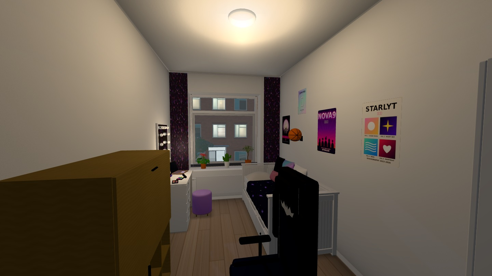 | 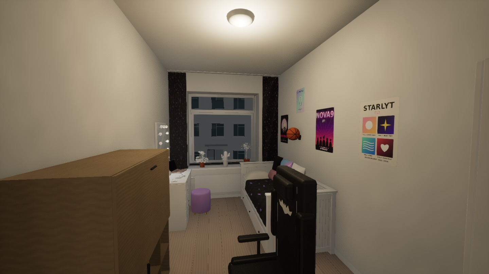 |
| 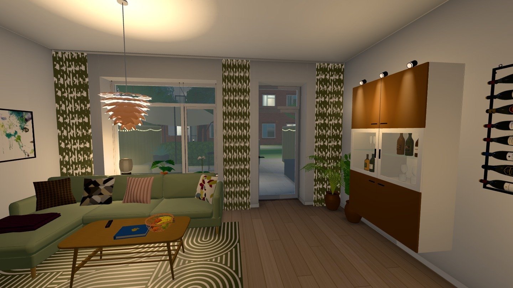 | 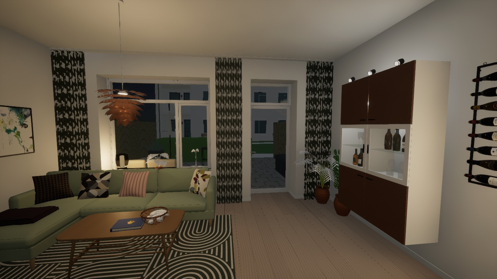 |
| 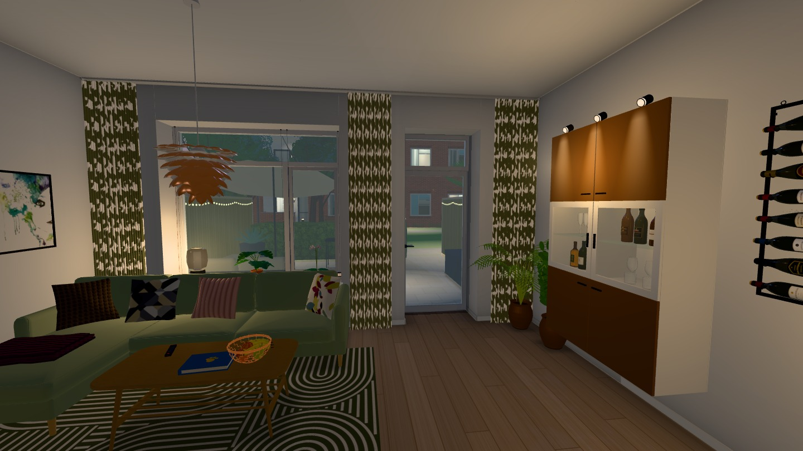 | 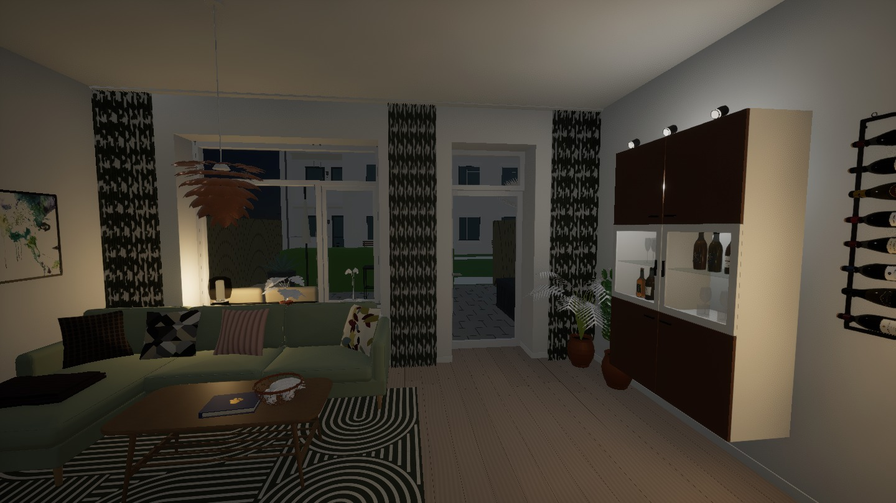 |
| 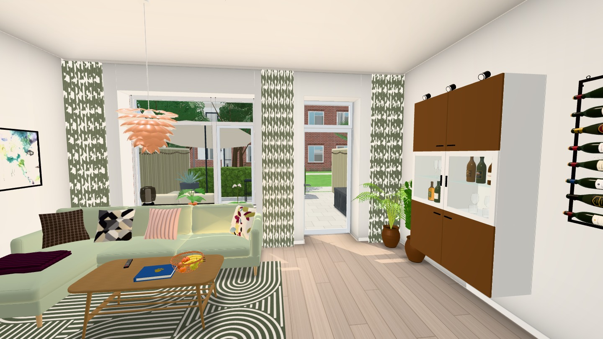 | 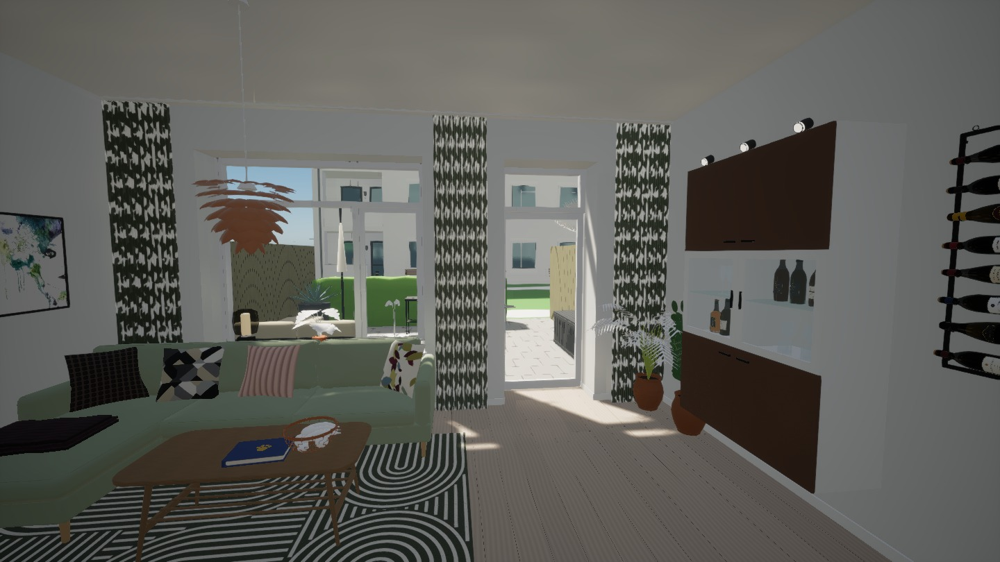 |

**Dusk lamps** (third row): at 22:00 on 21 June the daylight is 0.125. The ceiling lamps are off, and the floor lamp,
the cabinet spots and the other small lamps are on, on both sides.

**Day** (last row, for reference): the Unreal living room is darker than the web's at 14:00 (whole picture 0.27 ×;
#2283 measured 0.36 ×, with Epic's default clouds in the sky). That is the daylight calibration, which this issue
does not change: see "Not done".

### Night sky with stars and the moon, clear and overcast day

| Web | Unreal |
|---|---|
| 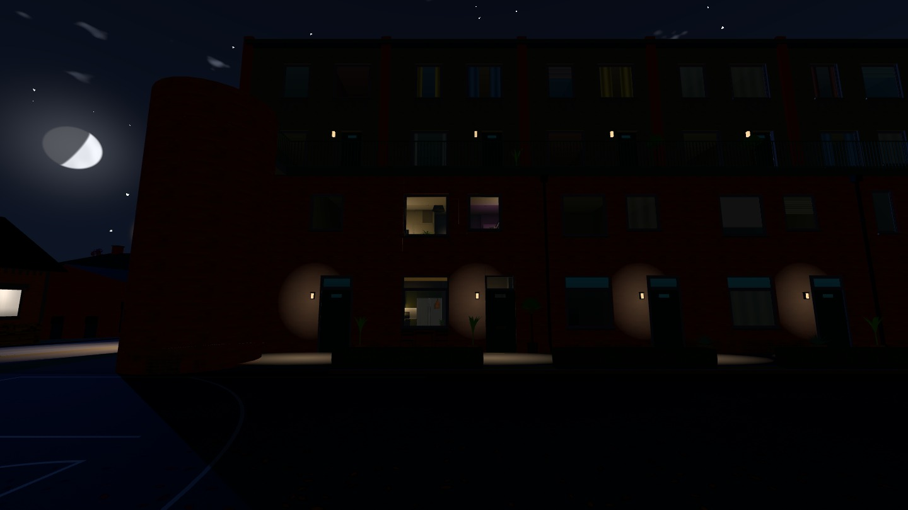 | 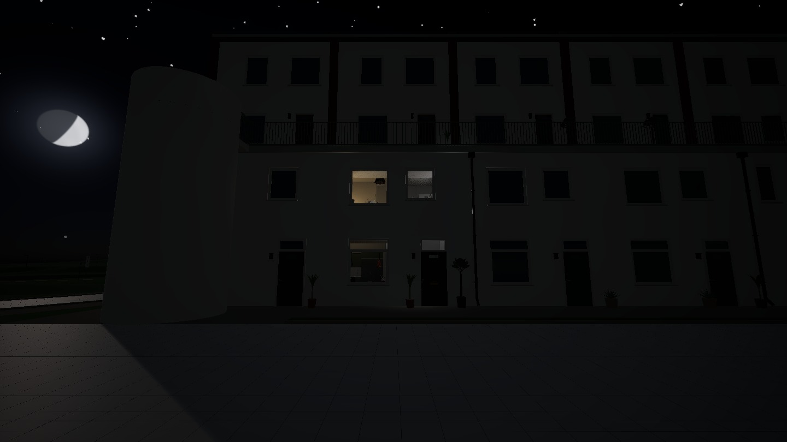 |
| 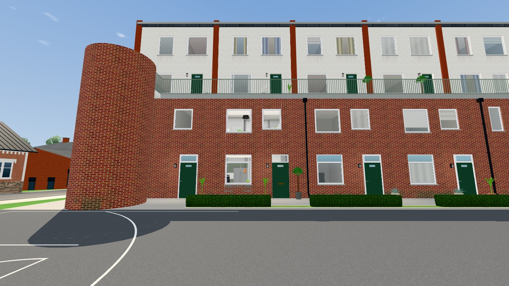 | 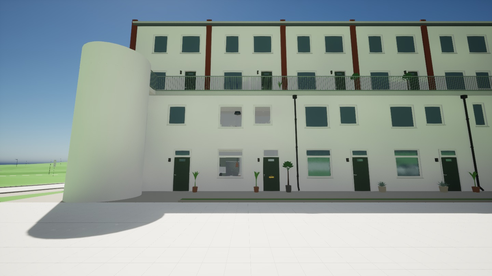 |
| 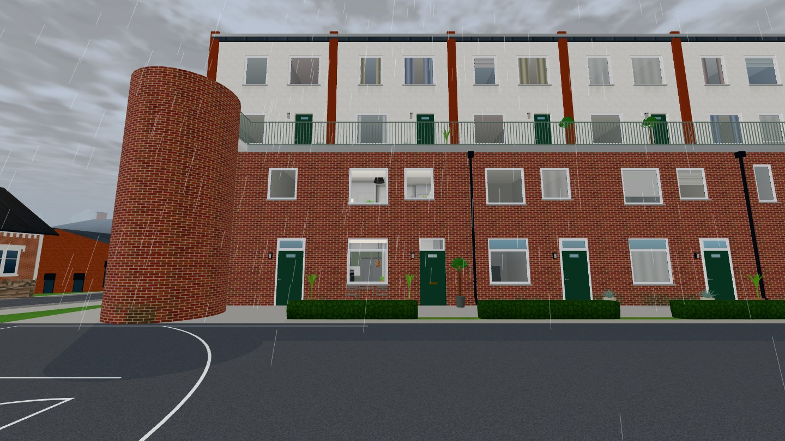 | 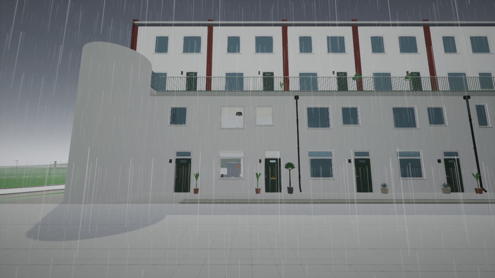 |

**Night** (16 November 2026, 18:15): the moon stands at the same place in both pictures, 43 % lit from the lower
right with its unlit part in faint earthshine, and stars cover the sky above the horizon. The stars are a hash pattern
like the web's, not the same stars, because GPU sine precision differs.

**Clouds:** the clear sky is free of clouds as on the web (Epic's default coverage drew broken clouds, see #2283's
pictures). Under rain the deck is closed and grey. The Unreal overcast sky is darker than the web's light grey (sky
crop 0.38 ×; clear blue sky 0.57 ×). Neither picture shows the stars and moon under rain, as the web's do not.

The white façades and street are the importer's material state of this checkout (no brick or asphalt material yet,
as in #2283's pictures), not lighting.

## Not done

- The daytime interior is darker than the web's (living room at 14:00: 0.27 ×), and the overcast sky is darker
  (0.38 ×). Both belong to the day calibration (sun, sky light, ambient), which this issue does not change.
- The stars and the moon are dimmed by one cloud-cover value for the whole sky. The web hides each one behind its own
  cloud. The two are the same in the weathers Unreal has (clear, rain, snow).
- The game's auto exposure is not compared. The pictures use manual exposure, as in #2283.
