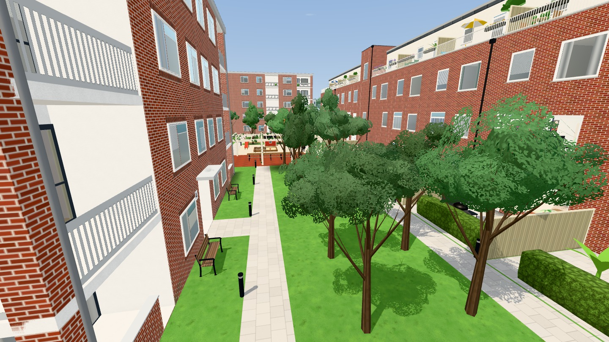
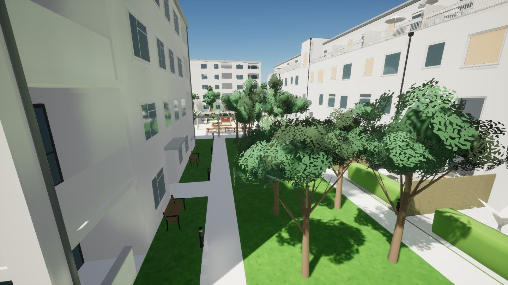
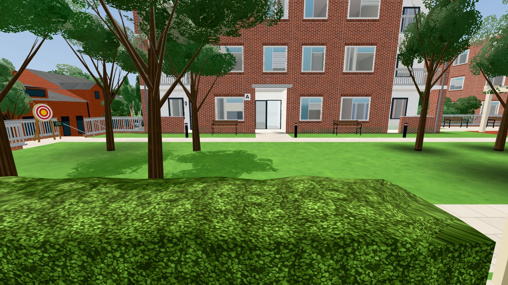
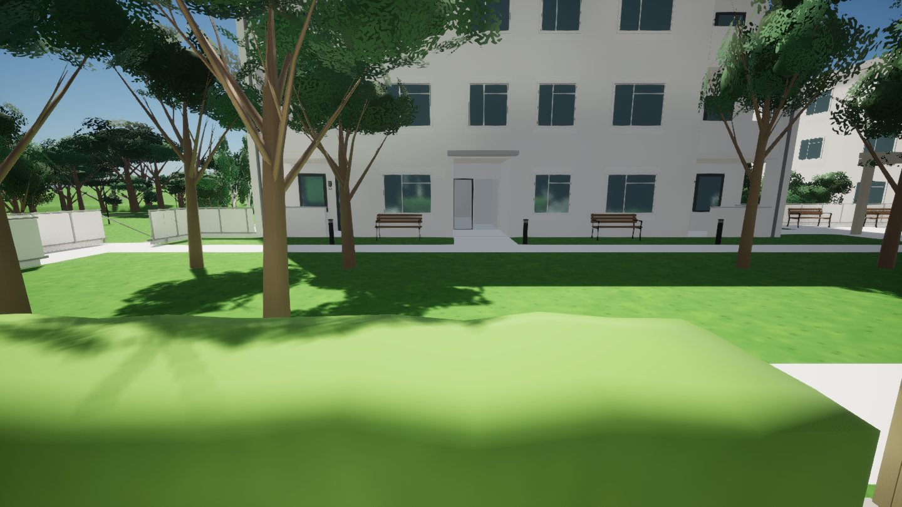

# #2308 verification: grass and trunk collision for the vegetation

Unreal Editor 5.8.4 on Windows 11 (i9-10900K, RTX 3080), 2026-11-21. The export is from `8750af3c` plus this change.
Every GLB is byte-identical to the export before; only `measurements.json` gained `materials[].map` and the trunk data.
Everything ran headless: `-nullrhi`, or `-RenderOffScreen` for the pictures and frame times. How it works:
[unreal.md, Vegetation](../../development/unreal.md#vegetation-trees-shrubs-and-hedges-2281).

## Grass

The export names each material's colour map. Two material keys carry `src/grass.js`'s `shared-grass-detail` map:
`std_609548_r100_m0_tex` (`GRASS.summer`: the lawns of `gard`, `omgivning` and `l1007-entre`) and
`std_5f8a3e_r100_m0_tex` (the street lawns of `src/streetlife.js`). `material-map.json` maps them to
`MI_LundenGrassLawn` and `MI_LundenGrassStreet` of the new master `M_LundenGrass`. The master redraws the canvas map
in the lawns' metre UVs: blade strokes, the dry and lush patches of `src/grassdetail.js`, and the dark bases of the
tussocks.

- `node tools/unreal-engine/tests/grass-material.test.mjs`: `GRASS_MATERIAL_OK 2 grass instances match src/config.js
  GRASS`. Every size and grey level is derived from `GRASS`, so the numbers are not copied by hand.
- `python3 tools/unreal-engine/tests/test_materials.py <export>`: `lawn keys (map shared-grass-detail): 2, each on a grass
  material with its own colour`, `MATERIAL_COVERAGE_OK`.
- `build_materials.py`: `M_LundenGrass`, `MI_LundenGrassLawn` and `MI_LundenGrassStreet` created; the 21 other
  materials were kept (spec hash unchanged). The import mapped the lawn slots: `gard` 6, `omgivning` 10.
- The default for `std_78a64b_r95_m0_vc_tex` had said "lawn strip beyond the patio". That key is L1007's patio hedge
  (`PATIO.hedge`), so the reason now says so.

Pictures: 1440 × 810, 72° vertical, 21 June 14:00, clear. Web: `capture-web-views.cjs`, desktop Ultra, SwiftShader.
Unreal: `capture_vegetation.py` on `L_Lunden` with its own sky. The courtyard camera is #2281's. The patio view
looks south from L1007's patio over the courtyard lawn.

| Web | Unreal |
|---|---|
|  |  |
|  |  |

Before this change the lawns were Interchange's flat green, as in
[#2281's courtyard picture](../2281/unreal-courtyard.jpg). They now show the web's blotchy dry and lush patches and its
tussocks. The fine blade strokes fade into their mean colour where a blade is smaller than a pixel. Remaining
differences: the web's lawn is darker and more saturated in its renderer, and the brick façades and the hedge's clump
texture are still missing (#2282 and later; not grass). The detail calibration is a *guess* (`Lunden.Assumption`).

## Trunk collision

The web stops the walker at a trunk only outside the home block (`src/farwalk.js`). Each such trunk is a diamond of
half-width `WALK.trunk[kind]`; trunks inside `OUTDOOR` do not block. The export carries that rule
(`vegetation.trunkCollision`) and each tree's half-width, or null (`trees[].blocks`): 448 of 507 trees block (big 371,
tree 54, birch 11, young 9, weepingBirch 2, willow 1). `build_vegetation.py` places a hidden `BlockAll` cube on each
blocking foot, turned 45°.

`test_vegetation.py`, Play In Editor on `L_Lunden` with the save file isolated: `LUNDEN_VEGETATION_TRUNKS 448 blocking
trunks with the web's diamond, 0 problems`. Every cube sits on its foot within 1 cm with the web's half-width within
1 mm, and no home-block trunk has a cube. The positions and height classes of all 507 trees and 9 hedges still pass
(`LUNDEN_VEGETATION_OK`). Walk samples: the character walks diagonally at a diamond face, which must stop it at the
face plus the capsule radius within 5 cm: [`trunk-result.json`](trunk-result.json).

| Trunk | Kind | Web | Expected stop | Unreal |
|---|---|---|---|---|
| `mesh_tree-trunks-0-0_l0_x10306_z12841_ym44` | big | blocks, 0.45 m | 53.8 cm before the foot | stopped 53.9 cm before the foot |
| `mesh_tree-birches-0-1_l0_x845_z13803_ym129` | birch | blocks, 0.2 m | 36.1 cm before the foot | stopped 36.2 cm before the foot |
| `mesh_tree-trunks-0-0_l0_x1149_z11415_ym153` | tree | blocks, 0.3 m | 43.2 cm before the foot | stopped 43.3 cm before the foot |
| `mesh_tree-birches-0-1_l0_x161_z13387_ym62` | weepingBirch | blocks, 0.3 m | 43.2 cm before the foot | stopped 43.3 cm before the foot |
| `mesh_tree-trunks-0-0_l0_x914_z11668_ym236` | willow | blocks, 0.3 m | 43.2 cm before the foot | stopped 43.3 cm before the foot |
| `mesh_tree-trunks-0-1_l0_x1252_zm1973_y195` | young | blocks, 0.15 m | 32.6 cm before the foot | stopped 32.7 cm before the foot |
| `mesh_tree-birches-0-0_l0_x1727_z4226_y141` | birch | does not block (home block) | walks past | walked past |
| `mesh_tree-birches-0-0_l0_x1783_z4099_y134` | birch | does not block (home block) | walks past | walked past |

## Courtyard frame time

The same setup as #2281: the `L_Perf_courtyard` scratch map from `tests/prepare_vegetation_profile.py` with every
sub-level of world-levels.json, run as the uncooked game: `UnrealEditor-Cmd … -game -d3d12 -RenderOffScreen
-ForceRes`, 2560 × 1440, `sg.*` High (2), 100 % screen percentage, no vsync, CSV profiling summarised by
`profile_report.py` (15 s warm-up, then 15 s measured). Other agents' processes shared the PC:
[`performance.json`](performance.json).

| Run | Frames | Mean FPS | 1% low FPS | P99 ms | GPU ms |
|---|---:|---:|---:|---:|---:|
| 1 | 1705 | 113.6 | 51.18 | 12.37 | 7.77 |
| 2 | 1827 | 121.78 | 100.43 | 9.40 | 7.82 |
| #2281, before this change | 1736 | 115.72 | 95.4 | 9.84 | 8.30 |

The mean stays within #2246's budget of at least 60 FPS. The first run's 1% low came from a few slow frames, which the
second run did not repeat; the GPU time is the same.

## Regression (`L_Lunden` with the patio; `compose_world.py --check`: unchanged, sha256 `bb2fe18270393eda`, no lock taken)

`test_site` (`LUNDEN_SITE_OK 17 control points within 5.0 cm, 23 route checkpoints`: the route passes the river
park's trunks), `test_exterior_route` (16 checkpoints), `test_l1007` (`LUNDEN_L1007_WORLD_OK`) and `test_facades`
(16 façade points, 2 passages) all passed with the trunk cubes in place.

## Not done here (follow-ups)

The bark texture (the trunks are paler than the web's), the seasons (bare winter crowns and autumn colours through
`BPC_LundenSeasons`' date rule, and the seasonal lawn colour), the courtyard perennials' sway, and a wind that follows
#2283's weather instead of the fixed `Power` 0.5 (*guess*).
