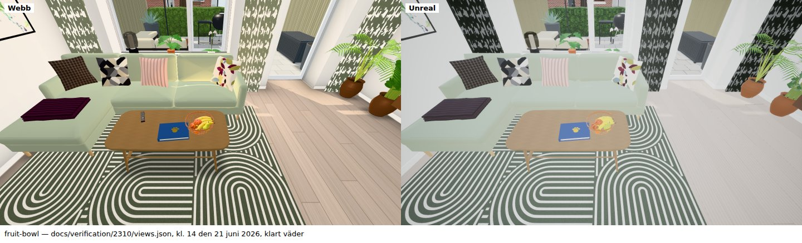
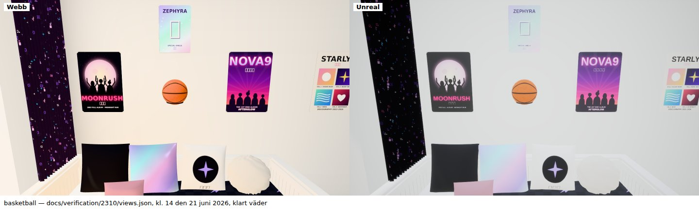

# #2310: the fruit bowl and the basketball in Unreal

`main.js` builds the fruit bowl (`src/fruit.js`) and the basketball (`src/basket.js`) next to the world, not in
`buildWorld`. Since 13d99cf2, `tools/unreal-engine/export-scene.js` builds them with the same classes and arguments as
`main.js`, so they come from the web's own data and are not placed by hand. The same mechanism carries the patio's
string lights and parasol (#2373, 8cfe9bd8).

## Placement (`test_furnishing.py`, UE 5.8.4)

Windows checkout at main f050524b, imported from the export of c22d059e. Since then only the curtain export (#2322)
has changed, and the bowl and ball code is the same.

| Node | Levels | Distance to the web position | Angle | Scale |
|---|---|---|---|---|
| `furn_fruitbowl_l0_x332_z1052` | Level_l1007, Level_l1007_interaction, L_Lunden | 0.00005 cm | 0° | 0 % |
| `furn_basketholder_l1_x31_z1108` | the same | 0.000007 cm | 0° | 0 % |
| `furn_basketball_l1_x33_z1108` | the same | 0.000007 cm | 0° | 0 % |

- The ball's mesh carries `std_ffffff_r75_m0_tex_t5cedb03ee4` with the exported 256 × 128 texture.
- The whole test passed: 175 of 175 items within 0.005 cm, and 231 of 231 textured meshes. Its one warning comes from
  `BP_LundenFacade` (facade lighting), not from these items.

## Pictures

Same camera on the web and in Unreal (`views.json` here; both capture tools read it through `LUNDEN_CAPTURE_VIEWS`):
21 June 2026 at 14:00 in clear weather, desktop Ultra on the web. Unreal used `tests/capture_l1007.py` on the composed
`L_Lunden`, with the map's own light (#2306) and the game's exposure.

| Pair | Web | Unreal |
|---|---|---|
|  | `web-fruit-bowl.jpg` | `unreal-fruit-bowl.jpg` |
|  | `web-basketball.jpg` | `unreal-basketball.jpg` |

Both items stand where the web puts them. The fruit keeps its colours, since #2321.

**Differences in these pictures:**
- The curtains are darker in Unreal: #2322.
- The living-room daylight is paler in Unreal (whiter floor and sofa): no open issue. #2390 covers only the outdoor
  daylight.
- The fruit bowl's copper wire is faint and see-through in Unreal; the web's is solid copper. It uses the generic
  `std_c8845e_r22_m90_ds`, not a copper material of its own: no open issue.
- The bedroom wall is a cool grey in Unreal; the web's is warm cream. There is a soft light halo round the basketball
  on the wall: no open issue.
