# Daylight indoors, the sky's brightness and a locked exposure in Unreal (#2313)

Unreal Editor 5.8.4 on Windows 11, 2026-11-21, headless (`-nullrhi` for the builds and the test, `-RenderOffScreen`
for the pictures). The export was made from this change: `export-scene.js` now also gives `site.sky.light` the web's
hemisphere strengths `hemiOvercast` / `hemiClear`. How it works:
[unreal.md, Daylight indoors, the sky's brightness and the exposure](../../development/unreal.md#lighting-sky-and-weather-2283).

## Checks

- `build_lighting.py`: the first run rebuilt the lighting assets (`BP_LundenSky` SHA-256 `62e41ed09694ec90…` →
  `757d3e139f7d28aa…`), a second run logged `assets unchanged, nothing saved` and `Level_lighting unchanged` with the
  same hash, and `--check` passed; the test and the pictures below are of that build. After a comment-only edit of the
  script (its hash is in the assets' stamp) the same three runs gave `7f790b5947471d71…`, `unchanged` and `check passed`.
- `tests/test_lighting.py` (Play In Editor): `passed 1 (with warnings 0), failed 0`, exit 0. It wrote
  [`lighting-result.json`](lighting-result.json); `check-sun.mjs` ([output](check-sun.txt)): `90/90 sky, cloud and
  dusk-lamp values as the web's` and `PASS: 20 directions, worst difference 0.0000°`. The #2283/#2307 rules are unchanged.

## Method

Both sides use the shared cameras and the shots of `tools/unreal-engine/tests/lighting-shots.json`, as in
[#2307](../2307/README.md). Web: `capture-web-lighting.cjs` ([`web-capture.json`](web-capture.json)). Unreal:
`capture_lighting.py --exposure=game` on `L_Lunden` ([`unreal-capture.json`](unreal-capture.json)): the exposure the game
uses (scene captures do not take the world's post process, so the script applies the same bias: −1.97 EV at 14:00
clear, −2.46 at 22:00, −2.55 under rain and at night). Numbers from `tests/crop-stats.cjs`: mean relative luminance of
the linear colour in matching crops ([`crops.json`](crops.json)), Unreal ÷ web, and warmth R/B of the mean colour.
Full output: [`crop-stats.txt`](crop-stats.txt) (after), [`crop-stats-before.txt`](crop-stats-before.txt) (main before
this change, #2283's manual bias 0 at 14:00 and −0.7 otherwise), [`crop-stats-histogram.txt`](crop-stats-histogram.txt)
(after, but #2283's histogram auto exposure, [`unreal-capture-histogram.json`](unreal-capture-histogram.json)).

## Result: Unreal ÷ web, mean luminance of the whole picture (sky crop for the sky rows)

| Shot | Before | After (locked) | Histogram auto exposure | In acceptance |
|---|---|---|---|---|
| Living room 14:00, clear | 0.26 | **1.01** | 0.99 | yes |
| START sky 14:00, rain | 0.37 | **1.00** | 0.75 | yes |
| Living room 22:00, all lamps | 0.75 | **0.83** | 1.34 | yes (#2307 value) |
| Upper floor 22:00, all lamps | 1.16 | **1.21** | 1.16 | yes (#2307 value) |
| Living room 22:00, dusk lamps | 0.69 | 0.88 | 2.23 | no |
| START sky 14:00, clear | 0.56 | 1.20 | 0.69 | no |
| START sky, night with moon | 0.51 | 0.59 | 25.2 | no |
| START whole picture: clear / rain / night | 1.43 / 1.25 / 1.21 | 2.35 / 2.28 / 1.38 | 2.18 / 2.17 / 30.0 | no |

Warmth (R/B): the 22:00 living room 1.28 against the web's 1.50 (before 1.37), the upper floor 1.26 against 1.33, the
day living room 1.03 against 1.17. The START whole-picture rows are not a fair measure yet: the façades and the
paving render near-white in Unreal where the web has brick and grey stone, so these frames are about twice as light
whatever the light does.

**Auto exposure compared and rejected.** Metering each view on its own, the histogram exposure (EV100 −4 … 3, #2283)
lifts the dark scenes: the dusk-lamp living room 2.2 ×, the night street 30 × and its sky 25 × the web, and it darkens
the bright skies (0.69, 0.75). The web has no eye adaptation, so the exposure is locked to the web's rule
(`LIGHTING.sky` exposure 1.0 overcast/night → 1.5 clear day).

## How the values were set (all *guess*, calibrated on these pairs)

- `HEMI_SHARE` 0.72 and `EXPOSURE_BIAS` −2.55 EV: the 14:00 living room and START. The ambient cubemap is not
  scaled by the exposure, so the fill share and the bias are independent knobs.
- `SKY_LUMINANCE` 9 (clear) → `SKY_OVERCAST` 1 and `FOG_GREY` 10: START's sky crop, clear and under rain (rain sky
  sRGB 157,159,162 against the web's 156,155,160).
- The fill carries the web's exposure and the hemisphere's night colour (`HemiNight` 0.56). Without them (an
  intermediate build with `CANDELA_PER_WEB` 1) the 22:00 living room measured 0.94 but grey-white, R/B 1.11, lit mostly
  by the fill.
- `CANDELA_PER_WEB` 2.8 (was 1 at #2307's brighter exposure): two trials with the lamps at 1 × (bias offset 0,
  [`crop-stats-trial-bias0.txt`](crop-stats-trial-bias0.txt): living room 0.47, upper floor 0.67) and ≈ 3.39 × (+1.76 EV,
  [`crop-stats-trial-bias1.76.txt`](crop-stats-trial-bias1.76.txt): 0.95, 1.37). A linear fit puts both rooms within
  0.8 … 1.25 for 2.66 … 2.98; 2.8 is the middle and measured 0.83 and 1.21.

## Pairs

| Web | Unreal (after) |
|---|---|
| 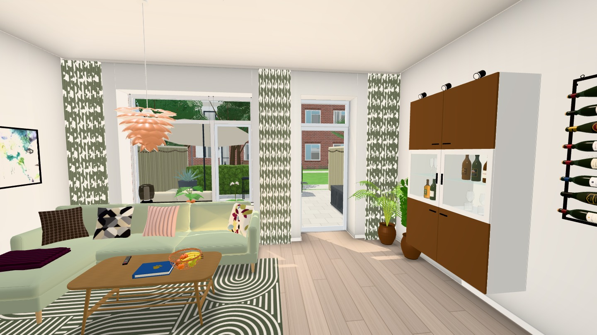 | 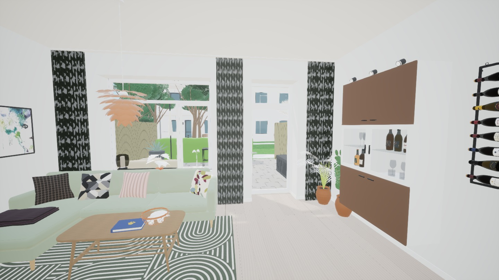 |
| 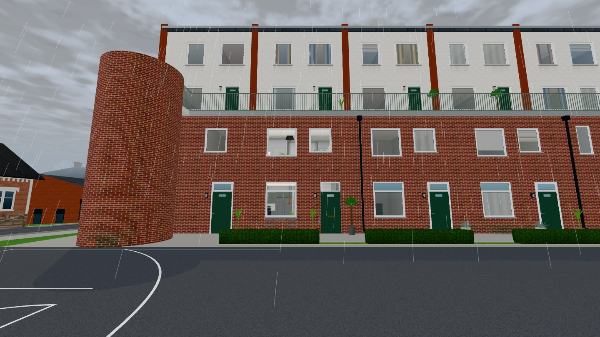 | 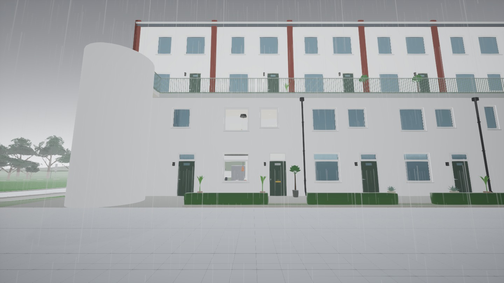 |
| 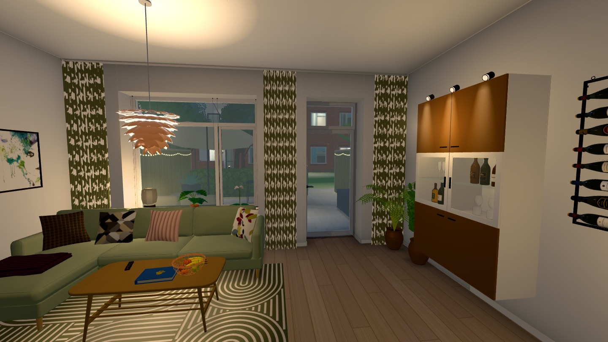 | 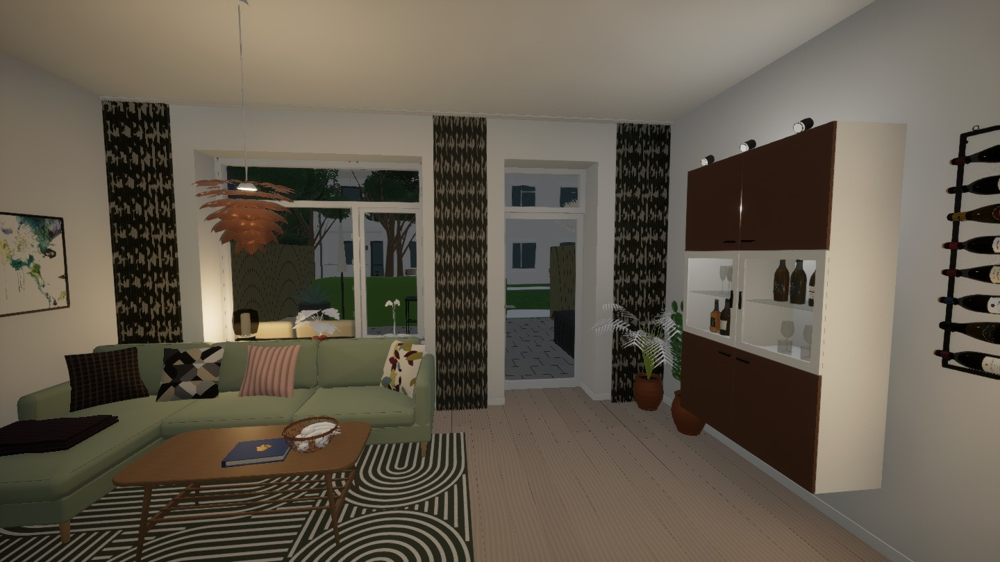 |
| 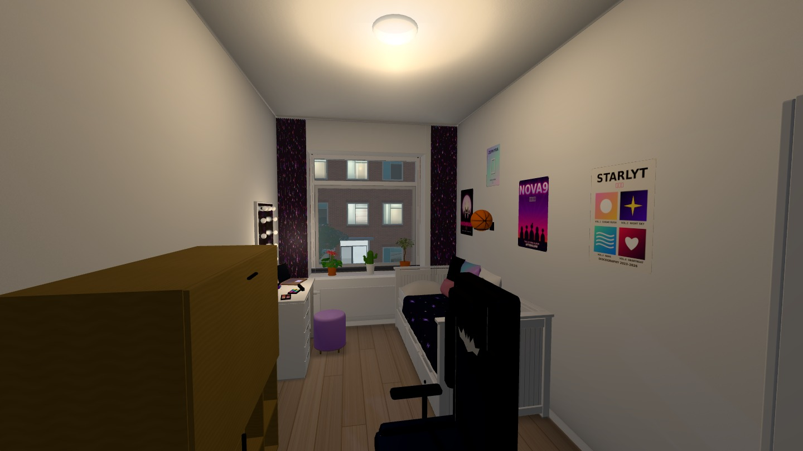 | 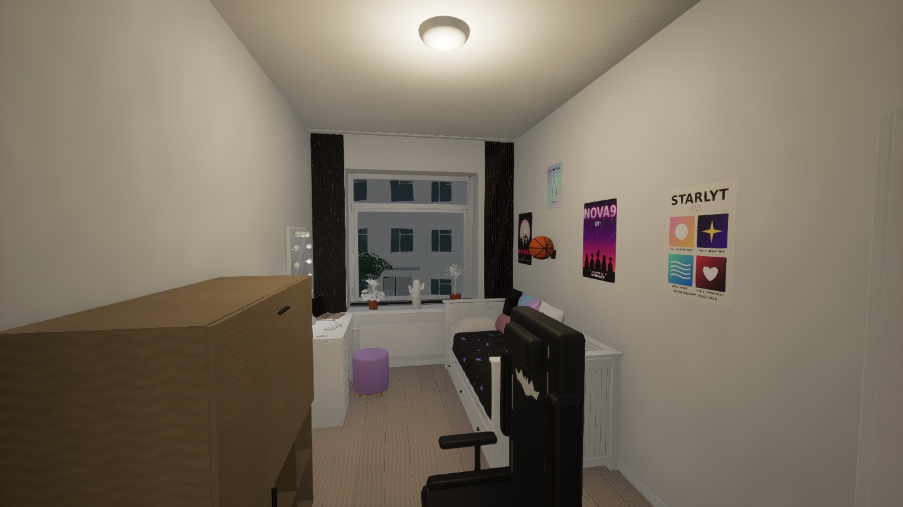 |
| 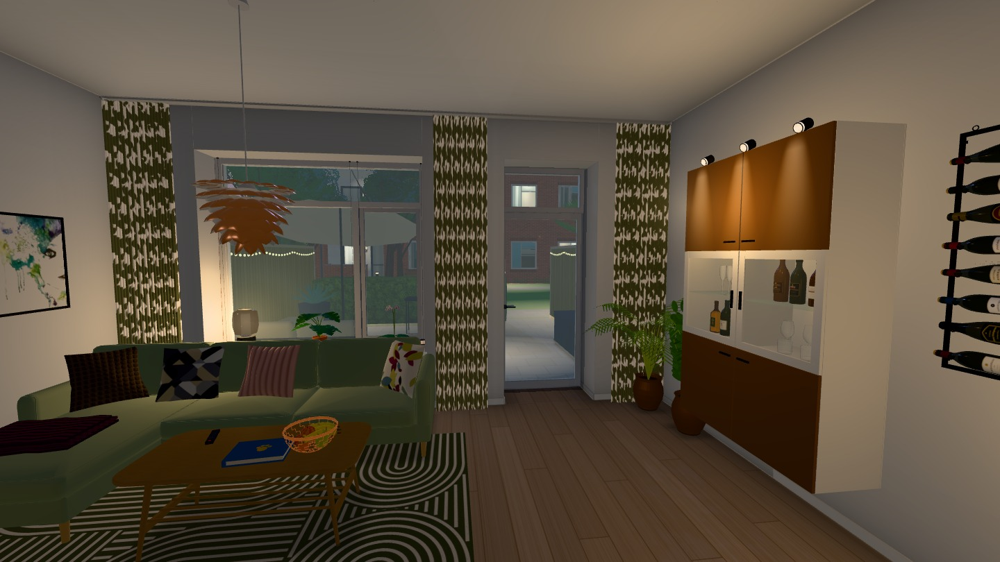 | 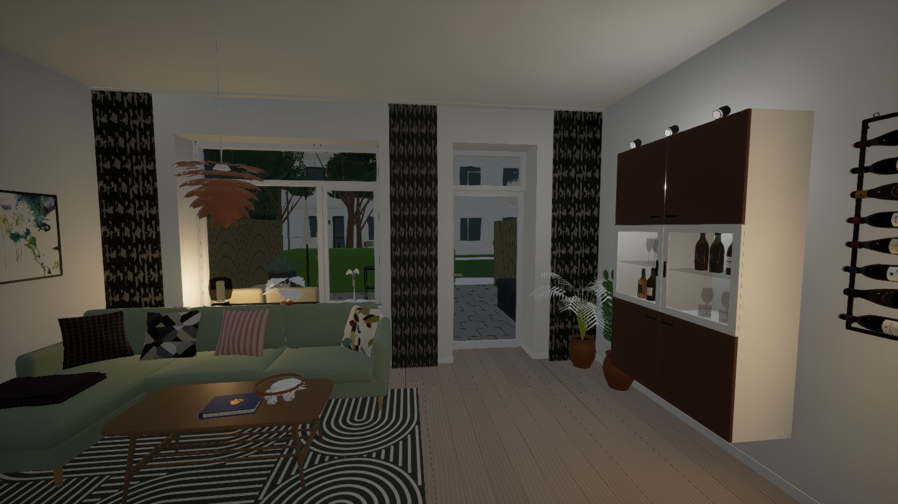 |
| 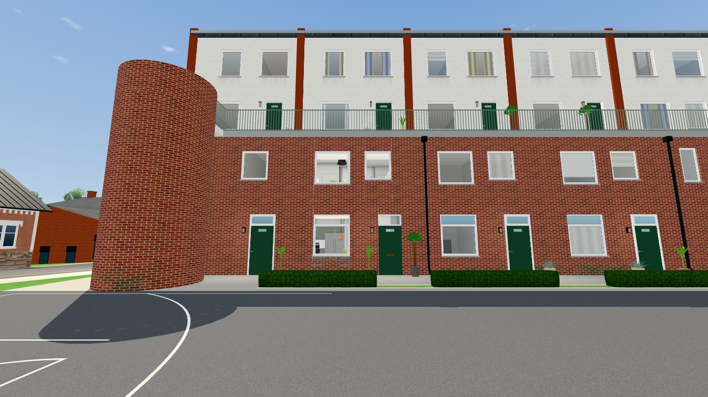 | 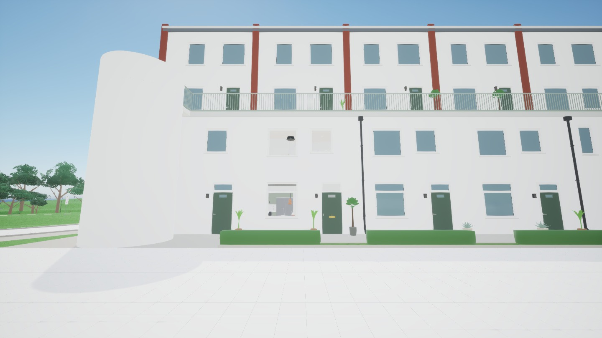 |
| 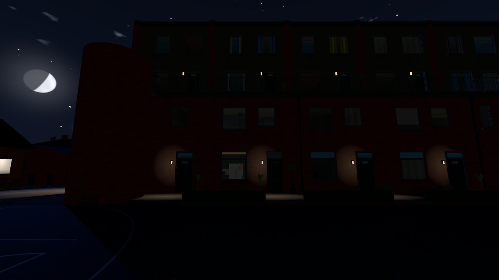 | 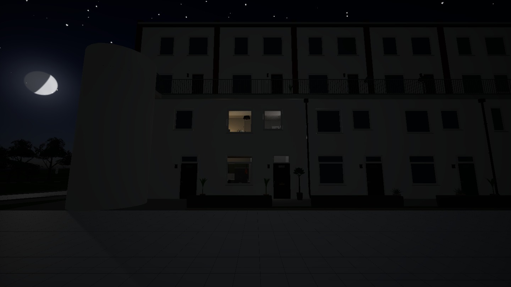 |

Before this change (main, #2283's manual exposure):

| Unreal before: living room 14:00 (0.26 ×) | Unreal before: START sky under rain (0.37 ×) |
|---|---|
| 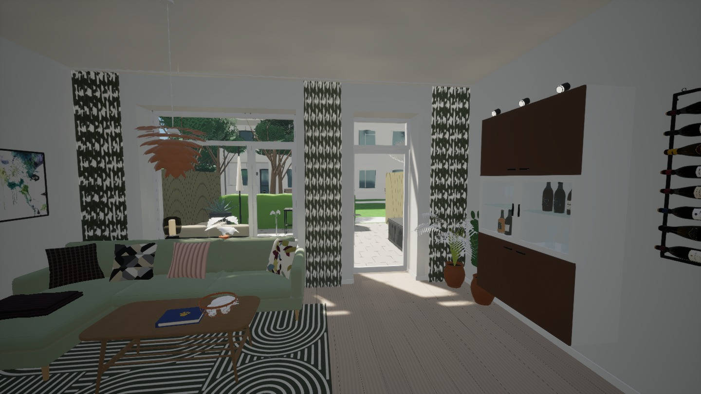 | 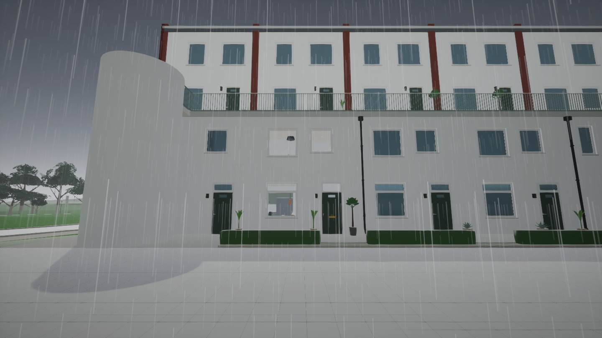 |

Not matched here: the curtains, floor and façade materials differ between the two (Unreal's curtains render dark
grey, the web's green and white); the lamps' pools are shaped differently (the web's pendant lights the left wall more,
0.68 ×, the cabinet spots the right wall less, 1.43 ×).
