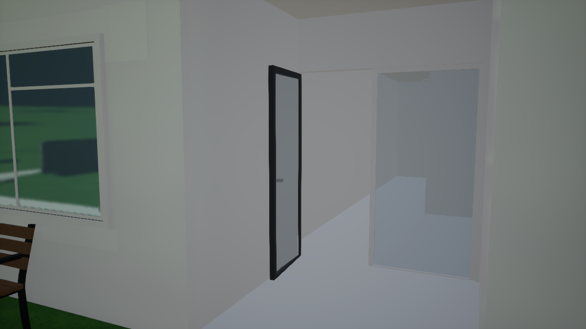
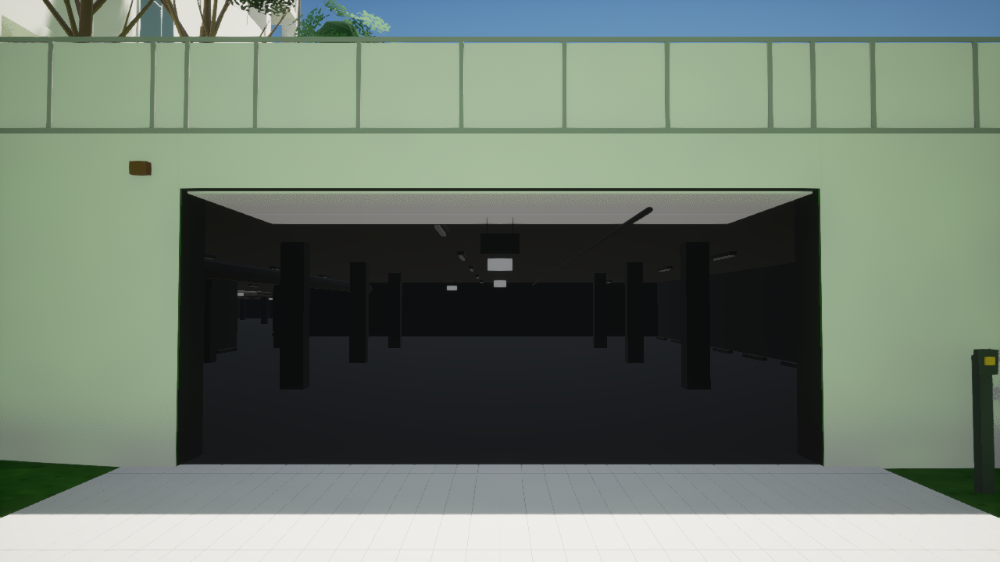
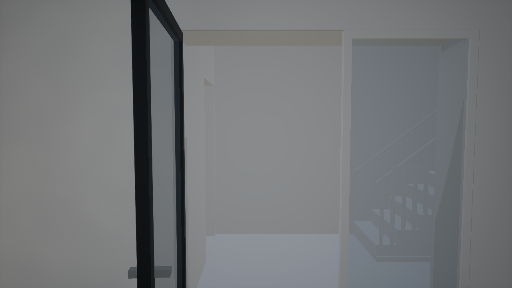

# #2314 verification: the entrances of Hus A, B and C, Hus L's stairwell doors and the garage door

Source: `main` at 03319087 + this issue's change; export of the same sources (`check-export.mjs`: current, all nine
GLBs byte-identical to the export before the change, only `measurements.json` gained the door rows), installed with
`sync-import.ps1 -ExportFrom … -ImportOnly` (every zone skipped as unchanged). Unreal 5.8.4 in the Windows worktree
`lunden-ue-wt/opus-2312`, headless (`-nullrhi` builders and PIE tests, `-RenderOffScreen` captures; no window on the
desktop).

## Pictures

Hus A's entrance `door_husa_l0_x222_z3090` opened through its interactable (swung out into the recess, as on the web).

The garage door `door_garage_l0_xm7050_z4400` opened from the drive: the door lies under the ceiling and the entrance
hall is open.

Hus L's stairwell door from the portik `door_husl_l0_xm1612_z948` (the equivalent opening in Hus L) opened.

`tests/capture_entrances.py` on the composed `L_Lunden` with its own lighting sub-level (21 June 14:00, clear; no
temporary sun), each door set to its interactable's open pose in memory, nothing saved.

## Checks

- **Export:** `measurements.json` `doors` has 7 new rows: Hus L's two stairwell doors, the entrances of Hus A, B and C
  (`swing`, with `parts`: 6 nodes each) and the garage door (`overhead`, 5 sections). Hinges and leaf centres match the
  imported nodes (the builder checks each leaf's centre against hinge + width / 2 within 6 cm).
- **Builders:** `build_exterior.py` → 493 collision actors, `35 door leaf parts left to their interactables`;
  `build_interaction.py` → `Level_hus-l_interaction {"swing": 3}`, `Level_kvarteret_interaction {"swing": 3,
  "overhead": 1}`, `LUNDEN_INTERACTION_OK`. A second run saves neither class (`listener unchanged`, `class unchanged`;
  both `.uasset` files byte-identical), `build_interaction.py --check` → `LUNDEN_INTERACTION_CHECK_OK spec a6587f8dc279`.
  `compose_world.py` saved `L_Lunden` with the two copies in place of the imported levels; `compose_world.py --check`:
  unchanged.
- **`test_interaction`** (PIE on `L_Lunden`): `LUNDEN_INTERACTION_TEST_OK 18 doors, 6 sashes, 13 switches, 6 taps, 6
  doors outside L1007, 1 garage door, 49 lift buttons, 130 change events`, passed. Every new door: hinge within 1 cm
  and yaw within 1° of `measurements.json` opened and closed by id; the garage door's pivot and check point within 1 cm
  and its angle 90° / 0°; E from outside opened each of the 7 doors once and E aimed at the open leaf (for the garage
  door: from inside, looking up at it) closed it once; the change event heard 130 calls for 130 changes. Every value:
  [interaction-result.json](interaction-result.json) (`doors`, `overhead`, `outsideWithE`, `event`).
- **`test_exterior_route`**: `LUNDEN_EXTERIOR_ROUTE_OK 22 checkpoints`, passed. The route opens Hus L's stairwell door
  by id and walks on to the garage under Hus L as before. Then from outside: at Hus A's closed entrance the character
  stops at y 3065.4 (the leaf line is 3090), and after the door opens it walks through to the lobby (3286.5); at the
  closed garage door it stops at x −7064.6 (door −7040), and after the door opens it walks into the entrance hall
  (−6742.8), both on their floors. [exterior-route-result.json](exterior-route-result.json).
- **`test_facades`**: `LUNDEN_FACADES_OK 16 façade points, 2 passages`, passed (4/4 points per house; the portik and the
  drive up to the garage door passable).

## Houses checked

Hus A, B and C: the entrance (the same corehouse.js door): affected, all three fixed. Hus L: the portik's stairwell door
(closed but without collision), the loftgång's stairwell door (blocking, not usable) and the portik's small room door
(not usable): affected by the same gap, all fixed. Not changed: the flats' doors in the A/B/C stairwells and the
garage's steel, cage and park doors (still as exported; see docs/development/unreal.md, "Doors outside L1007").
