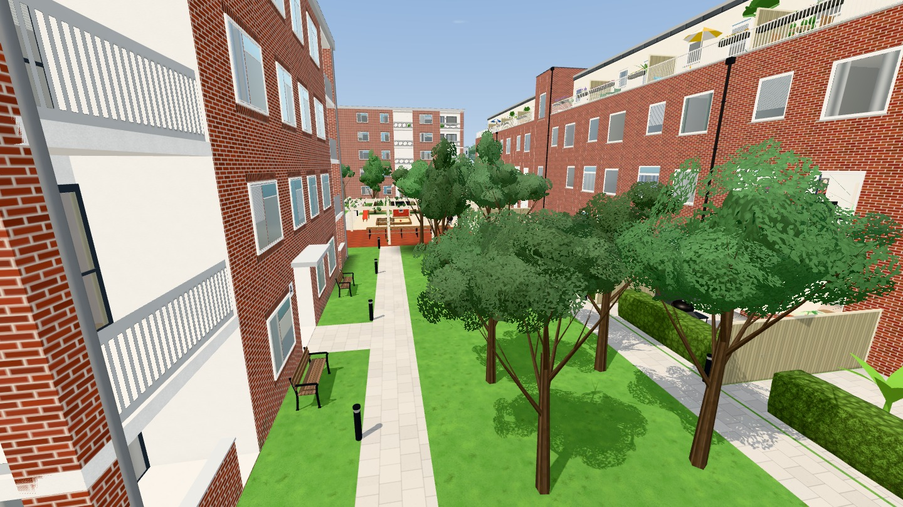
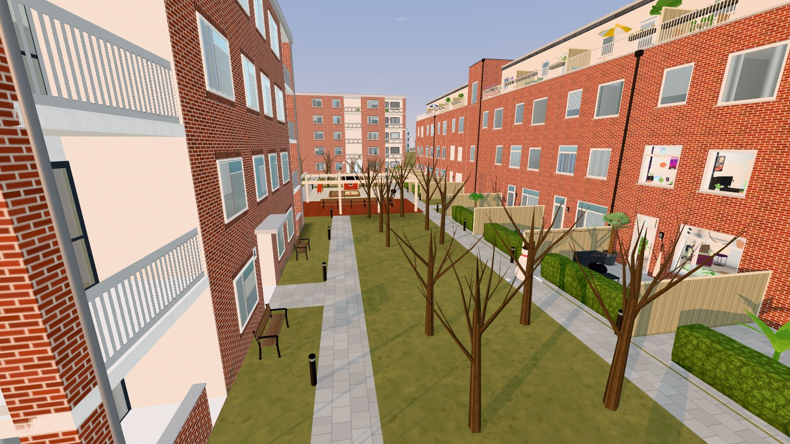

# Courtyard bark, seasons and wind (#2317)

## Web references

The camera is the ramp landing used for the [original courtyard profile](../2281/README.md). Both images use desktop
Ultra at 1440 × 810, a vertical field of view of 72°, clear weather and 14:00. The camera eye is (12.5, 5.62, 26) m
in web coordinates, with yaw 80° and pitch −14°. The two foreground trunks and the strip of lawn to the left of the path
are visible in both frames.

| 21 June 2026 | 15 January 2026, bare ground |
| --- | --- |
|  |  |

The clear Unreal capture sets snow to zero. On the web, forcing clear weather still leaves snow on the ground in
January because the snow-cover driver falls back to its calendar. To compare the visible lawn, the winter web capture
used the game's `?snow=0` control and verified that the renderer received zero cover. The median sRGB values in the
same lawn rectangle (505 ≤ x < 538, 722 ≤ y < 748) were **110, 174, 63** in June and **117, 111, 48** in bare January.
A January control using the default snow cover returned **233, 231, 238**.

To repeat the shots, set `LUNDEN_CAPTURE_VIEWS` to a JSON array containing the `courtyard` entry in
[the shared site views](../2325/views.json). Run `tools/unreal-engine/capture-web-views.cjs` with the local site
URL, an output directory and the ISO date. For January, append `?snow=0` to the site URL. The same camera array feeds
`tools/unreal-engine/pilot-scene.mjs` for the Unreal captures.

## Material checks

The ten-zone CI export at `bf9718ae` passed `tests/vegetation-look.test.mjs` against the production web constants.
It contains 12 evergreen courtyard perennials with their own material, separate deciduous crown and stationary vine
material keys, and four bark textures. Each bark type has a 64 × 128 colour image and a packed roughness image.
All 8,192 roughness texels of each species matched the corresponding web reference. The two colour maps contained 882
distinct RGB values for ordinary bark and 166 for birch.

The foliage HLSL was compiled and run in WSL on Vulkan (llvmpipe). Twelve months were sampled at 0, 5 and 13 m/s.
The calm samples produced zero displacement, and the two nonzero wind vectors moved the foliage along their
respective axes. The winter crown mask removed the central card while the perennial retained full cover. All twelve
grass tints also matched their configured blend between the summer and autumn colours. Card density, colour spread
and sway amplitude remain visual calibration (*guess*).

## Wind in Unreal PIE

The composed `L_Lunden` ran in UE 5.8.4 on Windows with D3D12 and offscreen rendering. All 12 courtyard perennials
used the wind material with world-position offset enabled. The season component published months 1, 6 and 10, and
the sky published ground-plane wind vectors of (0, 0), (0, 5) and (−13, 0) m/s for the three test settings.

The test framed a live perennial from above and read its 128 × 128 depth silhouette. In still air the three samples
each contained 1,256 plant pixels, with no pixel changing. At 13 m/s the five samples contained 1,251, 1,309,
1,248, 1,194 and 1,283 plant pixels. **691 pixels** changed between the two most different windy frames. The test
also found all 4,163 foliage instances and checked 507 trees and nine hedges in the composed map. No extra level
was streamed by the test. Automation passed with one warning about a timed-out HTTP connectivity check. [PIE measurements](perennial-motion.json).
