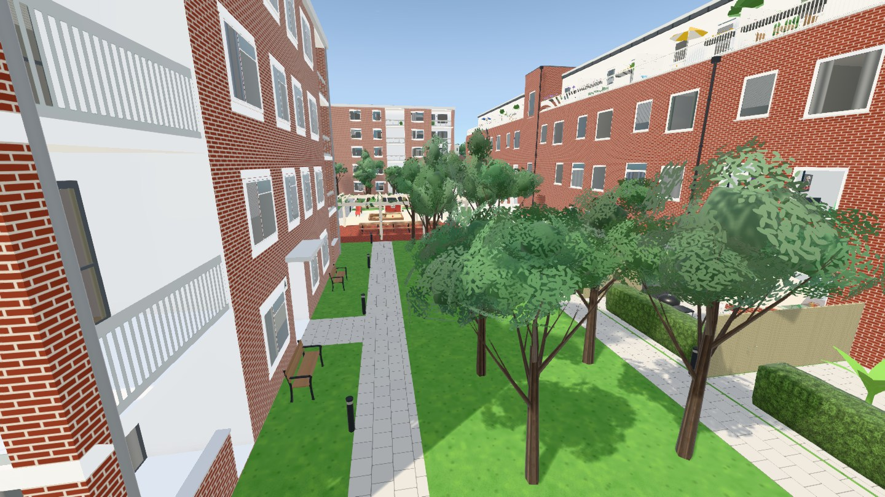
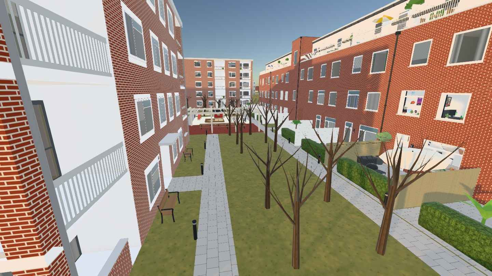

# Courtyard bark, seasons and wind (#2317)

## Web and Unreal picture pairs (21 June and 15 January)

The camera is the ramp landing used for the [original courtyard profile](../2281/README.md). All images use
1440 × 810, a vertical field of view of 72°, clear weather and 14:00. The camera eye is (12.5, 5.62, 26) m
in web coordinates (`[1250, 2600, 562]` cm in Unreal), with yaw 80° (Unreal −170°) and pitch −14°. The two foreground
trunks and the courtyard lawn are visible in every frame.

| Season | Web | Unreal |
| --- | --- | --- |
| 21 June 2026 |  |  |
| 15 January 2026, bare ground |  |  |

The clear Unreal capture sets snow to zero. On the web, forcing clear weather still leaves snow on the ground in
January because the snow-cover driver falls back to its calendar. To compare the visible lawn, the winter web capture
used the game's `?snow=0` control and verified that the renderer received zero cover (a January control using the
default snow cover returned **233, 231, 238**).

Median sRGB values in the lawn and foreground trunk across the two seasons:

| Region | Web 21 June | Unreal 21 June | Web 15 January (`?snow=0`) | Unreal 15 January |
| --- | --- | --- | --- | --- |
| Sunlit foreground lawn (`1050 ≤ x < 1150, 740 ≤ y < 785`) | **110, 172, 63** | **122, 186, 80** | **117, 109, 48** | **121, 119, 65** |
| Left lawn strip (`505 ≤ x < 538, 722 ≤ y < 748`) | **111, 175, 63** | **67, 124, 45** (in building/tree shadow) | **117, 111, 48** | **109, 111, 61** |
| Foreground trunk bark (`860 ≤ x < 866, 680 ≤ y < 750`) | **71, 51, 24** | **89, 74, 56** | **90, 53, 19** | **95, 67, 41** |

- **Bark:** the trunks draw the exported 64 × 128 grooved bark colour and roughness maps instead of `#2281`'s pale
  untextured fallback.
- **Crowns:** in June (`Month = 6`) the deciduous trees carry full green lobed crowns (`MI_LundenLeaf`); in January
  (`Month = 1`) the winter mask strips the deciduous crown cards down to the bare branching trunks while the evergreen
  hedges and courtyard perennials retain their foliage.
- **Lawn (`M_LundenGrass`):** rebuilt with `#2317`'s seasonal `Month`/`Autumn` blend and `#2408`'s collection parameter
  GUID hash (`spec 618ef0cf991fdcf4`). In June (`autumnMix[5] = 0`) the sunlit lawn is bright summer green
  (**122, 186, 80** vs web **110, 172, 63**); in January (`autumnMix[0] = 0.8`) it shifts to the web's brown-green
  winter tint (**121, 119, 65** sunlit and **109, 111, 61** on the left strip, vs web **117, 109, 48** and
  **117, 111, 48**).

To repeat the shots, set `LUNDEN_CAPTURE_VIEWS` to a JSON array containing the `courtyard` entry in
[the shared site views](../2325/views.json). Run `tools/unreal-engine/capture-web-views.cjs` with the local site
URL, an output directory and the ISO date. For January, append `?snow=0` to the site URL. On Windows, run
`tools/unreal-engine/tests/capture_vegetation.py <scene.json> <out dir> courtyard <YYYY-MM-DD>`.

## Material and builder checks

The ten-zone CI export at `bf9718ae` passed `tests/vegetation-look.test.mjs` against the production web constants.
It contains 12 evergreen courtyard perennials with their own material, separate deciduous crown and stationary vine
material keys, and four bark textures. Each bark type has a 64 × 128 colour image and a packed roughness image.
All 8,192 roughness texels of each species matched the corresponding web reference. The two colour maps contained 882
distinct RGB values for ordinary bark and 166 for birch.

The foliage HLSL was compiled and run in WSL on Vulkan (llvmpipe). Twelve months were sampled at 0, 5 and 13 m/s.
The calm samples produced zero displacement, and the two nonzero wind vectors moved the foliage along their
respective axes. The winter crown mask removed the central card while the perennial retained full cover. All twelve
grass tints also matched their configured blend between the summer and autumn colours. Card density, colour spread
and sway amplitude remain visual calibration (*guess*).

Headless Unreal builder and PIE verification on UE 5.8.4 (`c129f7f8`):
- **LFS lock handover (`#420`):** Codex's grass builder code was already on `main` (`d06802bf`) and its built asset was
  preserved in `~/.local/state/orkester-20261121/2317/M_LundenGrass.codex.uasset` and `lunden-ue-wt/codex-here-2317`,
  so lock `ID:64983092` was replaced by `ID:64999212` to rebuild `M_LundenGrass.uasset` with `#2408`'s collection GUID
  hash.
- `build_materials.py` and `build_materials.py --check`: `M_LundenGrass` updated (`spec 618ef0cf991fdcf4`), 49 kept;
  `LUNDEN_MATERIALS_CHECK_OK 50 materials` (all 50 of 50 materials pass).
- `build_seasons.py --check`: `LUNDEN_SEASONS /Game/Lunden/Seasons/BPC_LundenSeasons: check passed, spec 8505653ea5a25798`
  (`LUNDEN_SEASONS_OK`).
- `build_vegetation.py --check`: `M_LundenFoliage`, `MI_LundenLeaf` and `MI_LundenPerennial` unchanged
  (`LUNDEN_VEGETATION_CHECK_OK`).
- `run-tests.ps1 -Filter Editor.Python.Lunden.test_seasons`: 1 passed (0 warnings, 0 failed, exit code 0);
  `LUNDEN_SEASONS_TEST 190 seasonal actors, 14 dates agree with the web` (`LUNDEN_SEASONS_TEST_OK`).
- `run-tests.ps1 -Filter Editor.Python.Lunden.test_vegetation`: 1 passed (0 warnings, 0 failed, exit code 0);
  `LUNDEN_VEGETATION_OK 507 trees and 9 hedges within 10.0 cm and in their height class; 4163 foliage instances`.

## Wind in Unreal PIE

The composed `L_Lunden` ran in UE 5.8.4 on Windows with D3D12 and offscreen rendering. All 12 courtyard perennials
used the wind material with world-position offset enabled. The season component published months 1, 6 and 10, and
the sky published ground-plane wind vectors of (0, 0), (0, 5) and (−13, 0) m/s for the three test settings.

The test framed a live perennial from above and read its 128 × 128 depth silhouette. In still air the three samples
each contained 1,256 plant pixels, with no pixel changing. At 13 m/s the five samples contained 1,251, 1,309,
1,248, 1,194 and 1,283 plant pixels. **691 pixels** changed between the two most different windy frames. The test
also found all 4,163 foliage instances and checked 507 trees and nine hedges in the composed map. No extra level
was streamed by the test. Automation passed with one warning about a timed-out HTTP connectivity check.
[PIE measurements](perennial-motion.json).

## Courtyard frame time

Measured on the same setup as [`#2281`](../2281/README.md) and [`#2308`](../2308/README.md): the
`L_Perf_courtyard` scratch map (`tests/prepare_vegetation_profile.py`) streaming all 16 sub-levels of
`world-levels.json`, run as the uncooked game (`UnrealEditor-Cmd … -game -d3d12 -RenderOffScreen -ForceRes`) at
2560 × 1440, `sg.*` High (2), 100 % screen percentage, no vsync, CSV profiling summarised by
`tools/unreal-engine/profile_report.py` (15 s warm-up, then 15 s measured; [`performance.json`](performance.json)):

| Resolution | Quality | Frames | Mean FPS | 1% low FPS | Mean frame ms | P99 ms | Game thread ms | Render thread ms | GPU ms |
| --- | --- | ---: | ---: | ---: | ---: | ---: | ---: | ---: | ---: |
| 2560 × 1440 | High | 1158 | **77.19** | **63.06** | 12.954 | 14.868 | 3.654 | 12.953 | 12.220 |

Both mean FPS (**77.19 FPS**) and 1% low FPS (**63.06 FPS**) stay above `#2246`'s budget of at least 60 FPS at
2560 × 1440 High (the composite world now also streams `#2324`'s `Level_facade_lighting` and `#2323`'s `Level_fond`
in addition to the earlier sub-levels).

## Remaining visible differences in these pictures

Every visible difference between the web and Unreal courtyard pairs maps to an open issue:
- **Courtyard walks and entrance paving are grey in Unreal where the web is cream-white:** `#2392` (open).
- **The low January sun (14:00) is warm orange on Hus A's loggia and Hus L's brick on the web, neutral white in Unreal:**
  `#2398` (open).
- **The neighbour patio parasol on the right is open in January in Unreal, folded on the web:** `#2403` (open).
- **The patio furniture cushions remain outdoors in January in Unreal, stored away on the web:** `#2387` (open).
- **Patio hedges are slightly cooler/paler green and brick mortar joints are lighter in Unreal:** `#2411` (open) and
  `#2393` (open).
- **L1007's patio palm leaves (bottom right) are paler green in Unreal:** `#2389` (open).
- **The snowman on the neighbour's patio in `web-january.jpg` and winter snow/frost cover (disabled via `?snow=0` on the
  web for the bare-lawn comparison):** `#2359` (open, Later group G20) and `#2331` (open, Later group G05 weather
  reactions).
- **The left lawn strip (`505 ≤ x < 538, 722 ≤ y < 748`) is shaded by the building and tree crowns in Unreal in June,
  while sunlit lawn areas differ slightly in outdoor daylight brightness:** `#2410` (open).
