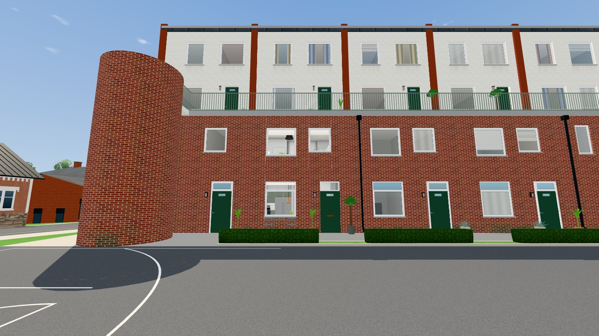
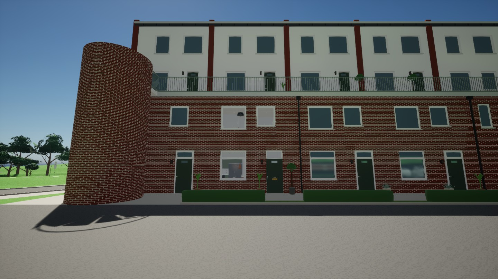
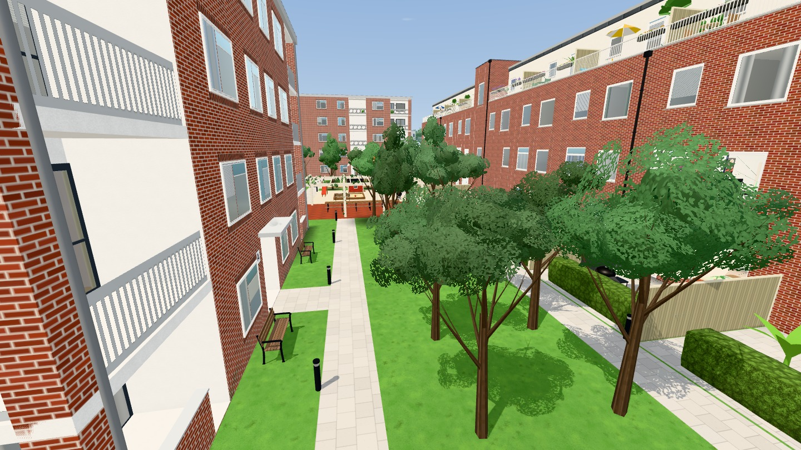
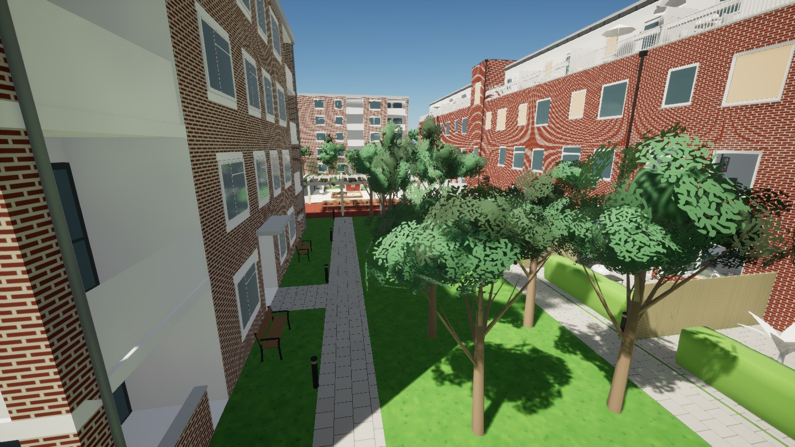
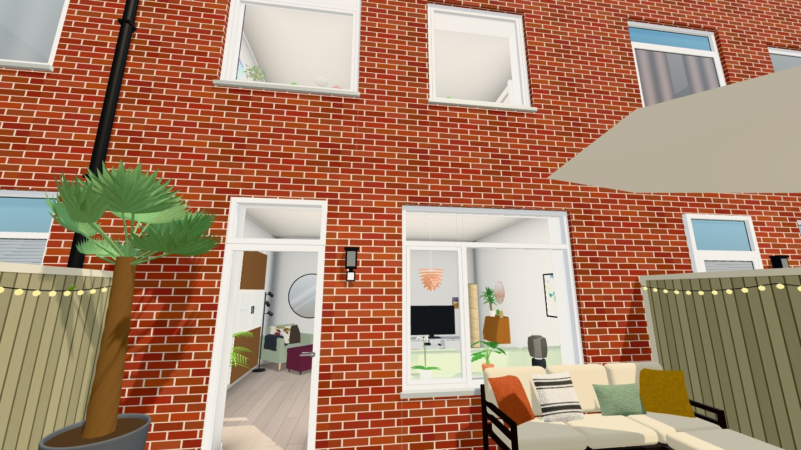
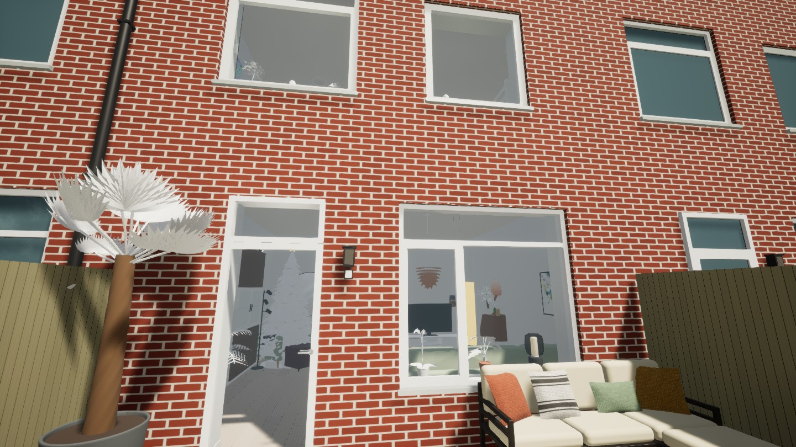
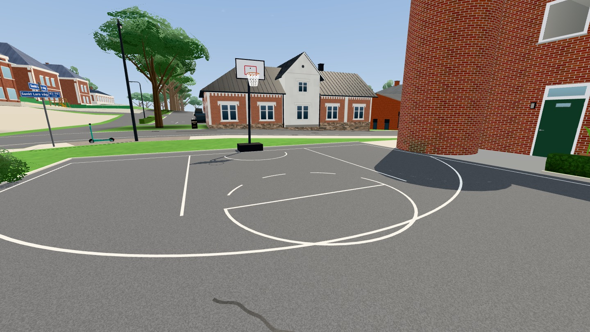
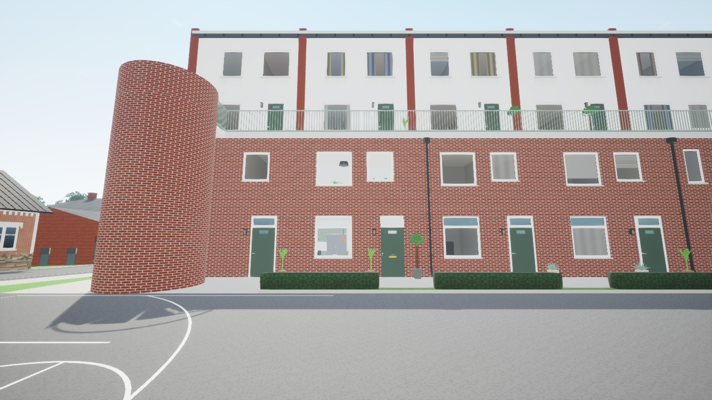
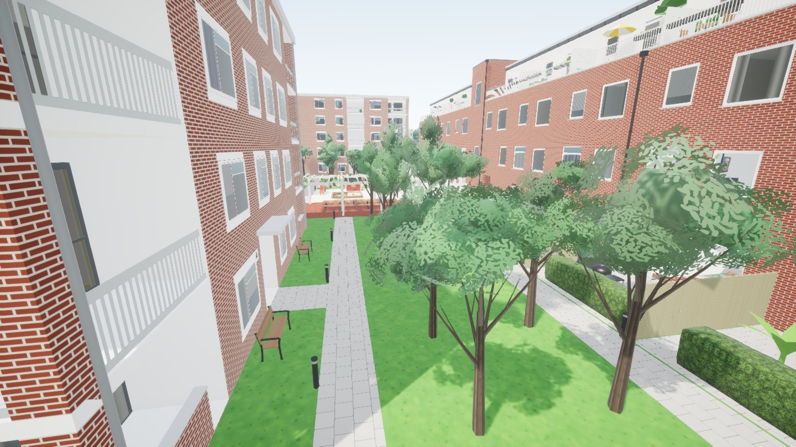
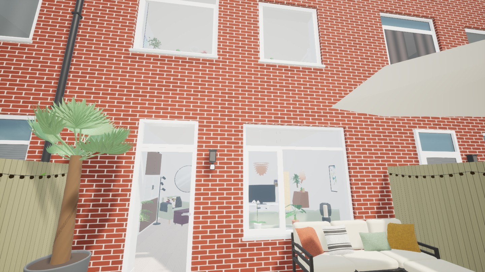

# #2318 verification: brick, roofs, asphalt and paving in Unreal

Unreal Editor 5.8.4 on Windows 11, 2026-11-21. The export is from `7e3faf58` plus this change. Every GLB is
byte-identical to the export before (SHA-256 of all nine zone files unchanged); only `measurements.json` gained
`materials[].looks`. Everything ran headless (`-nullrhi`, or `-RenderOffScreen` for the pictures). How it works:
[unreal.md, Patterned surfaces](../../development/unreal.md#surface-materials-2282).

## Why the façades were white

Hus L's brick is `MeshStandardMaterial({ map: brickTexture(), … })`: white times a canvas. The export key
`std_ffffff_r100_m0_tex_ds` leaves the canvas out, so Interchange's instance kept the white. Hus A/B/C, the courtyard's
retaining walls and the felt roofs went the same way. The site's asphalt shares the key `std_ffffff_r100_m0_tex` with the
hall and wet-room tiles, so it reached the last tile rule and was drawn as white wall tiles. `MI_LundenFacadeBrick`
(#2282) existed, but no rule used it, and `test_materials.py` accepted the fallback.

## The check now fails on a fallback

The export lists every web material behind a key (`looks`): the web's own surface class (the weather layers' tag:
`wetSurface`, `wetGround`, `snowGround`), the colour map's name and its first-use order (`mapIndex`), and for a shared
key the nodes showing each look. `test_materials.py` derives the brick, roof, asphalt and paving looks from that data
alone and requires each mesh showing one to reach a material whose `surface` names the same class.

Before the rules (this export, `material-map.json` of `7e3faf58`): 19 errors, for example

```text
ERROR: brick look of key std_ffffff_r100_m0_tex_ds on hus-l/mesh_l0_xm1668_z455_y665 reaches the import default (draws no brick)
ERROR: asphalt look of key std_ffffff_r100_m0_tex on l1007-entre/mesh_site-asphalt_l0_x288_zm875_y1 reaches MI_LundenTileWall (draws no asphalt)
ERROR: roof look of key std_8b9095_r90_m0_tex_ds on kvarteret/mesh_l1_xm3059_z3497_y1307 reaches the import default (draws no roof)
```

After:

```text
patterned surfaces (#2318): brick 4 mesh(es), roof 3 mesh(es), asphalt 4 mesh(es), paving 8 mesh(es) from 15 look(s); each on a material that draws its surface
MATERIAL_COVERAGE_OK
```

An export without `looks` fails too (`the export predates #2318, export again`).

## Unreal

- `build_materials.py`: 8 instances created (`MI_LundenFacadeBrickAHus`, `MI_LundenBrickHistoric`, `MI_LundenAsphaltPatch`,
  `MI_LundenRoofFeltHusL`, `MI_LundenRoofFeltAHus`, `MI_LundenStreetPaving`, `MI_LundenCourtBrickPaving`,
  `MI_LundenCobbles`), 4 updated (`MI_LundenFacadeBrick`, `MI_LundenAsphalt`, `MI_LundenRoofSeam`, and
  `MI_LundenPatioPaving`, which only gained its `surface` tag), 20 kept: `LUNDEN_MATERIALS_OK 12 written, 20 kept`.
  `--check`: `LUNDEN_MATERIALS_CHECK_OK 32 materials`.
- `sync-import.ps1` (all nine zones imported again, because the material map changed; every derived build; compose and
  import checks): `LUNDEN_SYNC_IMPORT_OK`, `LUNDEN_CHECK_OK`. Material slots mapped per zone: hus-l 839, l1007 494,
  omgivning 17, gard 8, kvarteret 3, l1007-uteplats 3, l1007-entre 2.

## Houses checked

| House | Brick | Roof | Result |
|---|---|---|---|
| Hus L | `std_ffffff_r100_m0_tex_ds`: façades, drums, gables, loft, reveals (one node) | `std_616870_r90_m0_tex` felt | affected, fixed |
| Hus A, B, C | `std_ffffff_r95_m0_tex`: the Å-husen's bodies, piers and parapets (one node for all three) | `std_8b9095_r90_m0_tex_ds` felt | affected, fixed |
| Hus L pilasters | `std_8a3b2a_r95_m0`: plain brick colour on the web too | | not affected (no canvas) |
| Courtyard retaining walls, school wall | `std_ffffff_r95_m0_tex_ds`, school wall by mesh | | affected, fixed |
| Old S:t Lars buildings | painted window-grid tile, no surface class | `std_43494e_r70_m15_tex_ds` standing seam | roof fixed; façade left (see below) |

## Pictures

1440 × 810, 72° vertical, 21 June 14:00, clear. Web: the desktop Ultra scene (`capture-web-views.cjs`), reused unchanged
from [#2281](../2281/README.md) (START), [#2308](../2308/README.md) (courtyard) and [#2289](../2289/README.md)
(patio): no web source changed since. Unreal: `tests/capture_vegetation.py` on the composed `L_Lunden`, lit by its own
sky (no temporary light); START and the patio are the shared `views.json` cameras, the courtyard is #2281's camera
([`unreal-capture.json`](unreal-capture.json)).

| Web | Unreal |
|---|---|
|  |  |
|  |  |
|  |  |

Hus L, the stair drum and Hus A now show red brick in half bond with light joints at the web's brick size, and the
street in front of START is asphalt instead of white wall tiles. The courtyard's paths show the slab joints, the brick
pavers at its far end are red.

Differences visible in these captures:

- Hus L's courtyard façade at a grazing angle shows moiré arcs: `M_LundenTiled` draws joints without filter-width
  antialiasing in the captured build. The full-resolution original Unreal PNG already shows the arcs.
- The basketball court's lines in front of START are missing: `src/basket.js` builds them in `main.js`, outside
  `buildWorld`. The follow-up export below carries the same painted mesh into the game.
- White plants (#2321), the neighbours' flat windows and the lit window panels (#2324), the missing neighbour houses
  on the left of START (#2323), the hedges' texture and Hus A's balcony slats (#2325).
- Calibration is *guess* (each entry's `assumption`): per-brick jitter as one variation, no bump relief or moss, the
  herringbone as running bond, square setts for the cobbles, no asphalt tracks or roof mottle. The old S:t Lars bays'
  painted window grid stays on Interchange's instance (it has no surface class, and plain brick would lose its windows).


## Court paint and mortar filtering

The export now takes the painted mesh from the web's `Hoop` at its original transform and splits it across
`l1007-entre` and `omgivning`. The straight lines, dashes and arcs use the web's pale paint and its clearance above
the asphalt. The solid free-throw semicircle had reversed winding on the web. Its 64 triangles now face up.

Run `node tools/unreal-engine/tests/court-markings.test.mjs` on the export. It checks the original area, material and
upper-side hits for all 272 source triangles against both GLBs and the underlying road. Across the two zones the paint
covers 3.98286 m² and lies 0.800 cm above the exported asphalt.

The web capture at `659b1f93` shows the solid free-throw semicircle in front of the dashed half and the hoop.
Desktop Ultra, 1440 × 810, clear, frozen at 14:00 on 21 June 2026. The camera is at START
(web x 2.875, z −12, eye height 1.62 m), turned toward the court at yaw −113°, pitch −13°, vertical FOV 72°.



The original 1440 × 810 Unreal courtyard PNG shows the same moiré as the JPEG. The tiled material had a fixed-width
mortar transition in UV coordinates, so subpixel mortar lines repeatedly appeared and disappeared across a receding
wall. The three running-bond brick instances now integrate brick and mortar coverage over each pixel's UV footprint,
with alternating rows offset by half a brick. Other material instances retain their existing shading.

A headless Mesa GLES run of the shader expression (HLSL ported mechanically to GLSL) checked 132 fine, coarse and
grazing-angle samples for each of the three brick instances against an 8,192-sample-per-axis reference. Across 396
samples the largest absolute mortar-coverage error was 0.00246 on a 0–1 scale, including 8-bit readback. Windows verification requires rebuilding the tiled master and three
brick instances, importing the two ground zones and recapturing the three views. The three original web/Unreal pairs predate both changes.

## Windows rebuild after the mortar filter (`ff2d5f92`)

On Windows at `27be8ee5`, `build_materials.py` rebuilt `M_LundenTiled` and the three brick instances. Their spec
hashes now match the map: `M_LundenTiled` 7174e719714b5d84, `MI_LundenFacadeBrick` 855fc6adf225e0c1,
`MI_LundenFacadeBrickAHus` afc40cbb7cf25df8 and `MI_LundenBrickHistoric` d246425d8b45026c.

`test_materials.py` passes on a full export of `27be8ee5`. That includes the `fond` zone, whose brick and roof
looks #2323 wired. Result: brick 6 meshes, roof 10, asphalt 4, paving 8 from 23 looks, 64 vertex-coloured keys, and
`MATERIAL_COVERAGE_OK`.

The pictures could not be taken again. On `main`, the Windows import chain stops before a complete world exists,
because other issues' versioned assets are not yet built:

- `import_world.py` and `build_materials.py` need `/Game/Lunden/Seasons/MPC_LundenVegetation`. That asset is
  referenced since `16269409` (#2317), but it is not in the repository.
- `build_lighting.py` cannot save its cloud material copy.
- `build_vegetation.py` cannot save `M_LundenFoliage`.
- `build_interaction.py` cannot save `BP_LundenInteractionListener`.

`capture_world.py` renders only a complete composed world, so the pictures above are still those from `bf6382b7`,
taken before the filter.

## Pairs with the mortar filter (`98e30542`)

These pictures were taken again on Windows in a fresh checkout at `e72c5f55`, with a complete sync and all world
levels composed in `L_Lunden`. They show the rebuilt filtered brick (`ff2d5f92`) and the rebuilt foliage
(#2383). The script is `capture_vegetation.py` with its own sky, and the cameras are the same as above
([`unreal-capture-filtered.json`](unreal-capture-filtered.json)). The web halves are the ones above.

| Web | Unreal, filtered mortar |
|---|---|
|  |  |
|  |  |
|  |  |

Hus L's courtyard façade no longer shows the moiré arcs. Hus A, the stair drum and Hus L have red half-bond brick with
light joints. The street in front of START is asphalt and shows the court lines.

Differences that remain:

- The patio string lights are dark (#2373).
- Through the patio door and window, the living room is paler and more washed out in Unreal than on the web. No open
  issue covers this.
- The patio palm's fronds are a paler green in Unreal. No open issue covers this.
