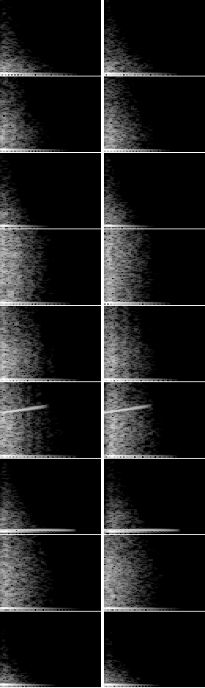

# #2320: footstep level, rain and the open window's wind in Unreal

*`orkester: solwation-w11-opus-5.5-20261121`, 2026-11-21. UE 5.8.4 on Windows, based on `554cd47e` with Codex's
`6f954b65`, `276fe7c6` and `bb481c5a`. Web numbers from `audio-params.json` (`export-audio.mjs --check`: current).*
Nothing was played aloud: every recording comes from the main submix while `au.LinearGainScalarForFinalOutut` was 0.
The build is described in [unreal.md](../../development/unreal.md#footsteps-wind-and-outdoor-sound-2287).

## Where the 9.6 dB went

The #2287 recordings were 9.6 ± 0.5 dB below the web's `synthFootstep` (before the web master). The engine source
explains 9.0 dB of it:

| Stage | Web Audio | Unreal 5.8.4 before | Source |
| --- | --- | --- | --- |
| Mono source played without position | copied to both channels at 1.0 (`speakers` up-mix) | 0.5 per channel, −6.0 dB (`MonoChannelUpmixMethod` unset, so Linear) | `AudioMixerChannelMaps.cpp`, `AudioSettings.h` |
| Positioned mono source, straight ahead | `PannerNode` `equalpower`: 0.707 per channel | Linear pan: 0.5 per channel (`PanningMethod` unset) | `AudioMixerDevice.cpp` |
| Platform headroom | none | −3.0 dB (`BaseWindowsEngine.ini PlatformHeadroomDB=-3`) | `AudioMixerSource.cpp` `UpdateVolume` |
| Master | 0.8 (`AUDIO_MASTER_GAIN`) | applied only to the steps and rain | `src/audio.js` `initAudio` |

The remaining 0.6 dB is within one take's random variation and crackle trough. Instead of the measured +9.6 dB
*guess* trim, `DefaultEngine.ini` now sets the web's laws (`FullVolume`, `EqualPower`, headroom 0), and the builders
apply the web's master 0.8 to every path: steps (`StepVolume` 0.304), the wind bed, the river/city bed, `RainGain` and
the window voices. No calibration *guess* is left.

## Checks

| Check | Result |
| --- | --- |
| `build_audio.py`, again, then `--check` | built 22 assets; second run "unchanged, nothing saved"; `LUNDEN_AUDIO_CHECK_OK 22 assets, spec 2e8ef090ada5` ✓ |
| `test_audio` (`-nosound`) | passed: pure functions, steps, beds and the rain-surface cases ✓ |
| `test_window_audio` (`-nosound`) | passed: 6 real sashes, two independent openings, calm and windy ✓ |
| `test_window_audio` with the silent live mixer (`-RenderOffScreen`, final gain 0) | passed, `live mixer=True`: voice identity and position ✓ |
| `test_audio_render` (`-RenderOffScreen`, final gain 0) and `audio-render-compare.py` | every row within ±2 dB (table below) ✓ |

## Render against the web

Steps: three takes per profile on each side, level = power mean of the takes (one take varies with the random
variation and crackle trough; a single take of snow came out at −2.3 dB in an earlier run). Rain and window: 1.3 s
of steady sound, the web side computed with the parameters the Unreal component used
([`render-params.json`](render-params.json)): 9 m/s, June, 08:00; rain 1.0 on the grass and on the parquet; one sash
voice 1 m ahead of the camera on the road, where no room reverb plays.

| Sound | Level web / Unreal (dBFS RMS) | Difference | Centroid web / Unreal (Hz) |
| --- | --- | --- | --- |
| step wood (parquet) | −36.8 / −37.5 | −0.63 dB | 81 / 75 |
| step hard (tile, paving) | −36.6 / −36.6 | +0.02 dB | 98 / 103 |
| step grass | −44.9 / −45.7 | −0.77 dB | 69 / 63 |
| step gravel | −42.5 / −42.6 | −0.15 dB | 139 / 126 |
| step stair | −36.8 / −36.5 | +0.28 dB | 131 / 132 |
| step wet | −39.8 / −40.3 | −0.54 dB | 332 / 353 |
| step leaves | −46.0 / −46.0 | +0.05 dB | 725 / 635 |
| step snow | −46.6 / −46.9 | −0.34 dB | 297 / 214 |
| step snowCold | −45.7 / −45.4 | +0.32 dB | 760 / 833 |
| rain outdoors (grass, under trees) | −32.9 / −33.5 | −0.58 dB | 4,392 / 4,275 |
| rain indoors (parquet, roof layer, 900 Hz) | −48.9 / −48.5 | +0.39 dB | 657 / 654 |
| open sash, 1 m ahead | −38.1 / −38.1 | +0.00 dB (left = right) | 665 / 661 |

Spectrograms (first take): rows in name order (grass, gravel, hard, leaves, snow, snowCold, stair, wet, wood), web
left, Unreal right, 0–4 kHz upwards, 0.3 s across, 60 dB under each sound's own peak. The shapes are unchanged
from #2287. Full metrics: [`audio-render.json`](audio-render.json).

Unreal-only levels at the same render (no web reference in the tool): wind bed −36.2 dBFS outdoors and −49.6 indoors,
river/city bed −46.4 outdoors and −60.1 indoors.

## Findings

- With `-nullrhi` the game viewport is never drawn, so the listener stays where it was and the window voice came out
  19 dB low and panned hard left. The render now uses `-RenderOffScreen` (no window). The 2D sounds are unaffected.
- Snow steps are built and level-matched, but `SnowCover` and `Temperature` wait for #2331, so they do not sound yet.
- Not ported here: hail and thunder sounds (the web's `Weather` and `sfx.thunder`); weather reactions are #2331.
