# #2321 verification: vertex colours in Unreal

UE 5.8.4, Windows worktree `lunden-ue-wt/opus-2321` (base `a1c78bf1` plus the #2321 change), export of `816b695d`
(CI artifact `unreal-export-330cb3f718226f5f`, all nine zones). What was built and why:
[unreal.md, Vertex colours](../../development/unreal.md#vertex-colours-2321).

## Cause

Interchange imports the export's `COLOR_0` onto every StaticMesh (probed: `has_vertex_colors` true on the patio's
plants, sofa and grill), but its glTF master `M_Default` multiplies the vertex colour only in `MF_BaseColor`'s
base-colour-texture branch (static switch `bHasBaseColorTexture`). An untextured key whose web colour lives in the vertex
colours (`_vc` on a white or light base colour) therefore rendered as its base colour: white plants, fruit and bridge
railings. The textured furnishing keys (#2289's images: upholstery, garage signs) were already multiplied. Hus L's entrance
plants and the hedges were green because their colour is the key's base colour (`std_3f7a3a_r80_m0_ds`,
`std_78a64b_r95_m0_vc_tex`), not the vertex colour.

A first version also re-parented the 6 textured instances; the patio cushions then came out darker and redder than
before (the vertex colour multiplied twice). The importer now leaves instances with `bHasBaseColorTexture` on
Interchange's master, and the cushions match the [#2289 picture](../2289/unreal-patio.jpg) again.

## Checks

| Check | Result |
|---|---|
| `test_materials.py` on the export of `816b695d` | `MATERIAL_COVERAGE_OK`; 56 vertex-coloured keys (all zones), each on a material that draws the vertex colour |
| `test_materials.py`, negative cases | without `vertexColor` in the map: 56 errors, exit 1; a rule sending `std_ffffff_r42_m0_vc` (the fruit) to `MI_LundenDoorPaint`: "rule material … does not multiply the vertex colour in", exit 1 |
| `test_materials.py` on the export of `28666779` (after #2318/#2323/#2324) | 62 vertex-coloured keys, no vertex-colour error; 9 errors of #2318's patterned-surface check on the new `fond` zone, also without this change (reported to the conductor) |
| `build_materials.py` | `M_LundenGltfVertexColor`, `M_LundenGltfUnlitVertexColor` created, every other material kept |
| `sync-import.ps1` (all zones re-imported, derived levels, `compose_world.py --check`, `import_world.py --check`) | `LUNDEN_SYNC_IMPORT_OK`; per zone `LUNDEN_IMPORT_VERTEX_COLOR`: l1007 22 + 2 textured, l1007-uteplats 4 + 1, hus-l 9, kvarteret 8 + 3, gard 7, omgivning 6, vegetation 2, fixture and l1007-entre 0 (58 re-parented, 6 textured kept = 64 zone instances); the check found every one drawing its vertex colour |

## Zones and houses checked

- **L1007** (`l1007`, `l1007-uteplats`): sill and pot plants, fern, orchid, palm lily, cactus, bonsai, geranium, patio
  palm, fruit bowl, vents, Weber grill, Christmas tree, string shelf; pictured below.
- **Hus L** (`hus-l`): entrance fittings, vents, kitchen fronts of the visit flats, terrace decor, neighbour glass;
  re-parented and checked by the import counts and `--check`, not pictured.
- **Hus A/B/C and the garage** (`kvarteret`): the stairwell cores' vertex-painted walls (`bas_353535_…_vc`), the
  garage signs and floors (textured, kept on Interchange's branch); checked by the import counts and `--check`, not
  pictured.
- **Courtyard, surroundings, vegetation** (`gard`, `omgivning`, `vegetation`): benches, sand, bikes, boule, bridge
  steel and concrete, bus stop, drains, shrubs; the courtyard's large leaf plant and the Höje å bridge railings are
  pictured.

## Pictures

Six cameras, 1440 × 810, 72° vertical, 21 June 2026, clear: the shared `living-room`, `patio` (14:00), `stairs` and
`upper-floor` (22:00, lamps on) of `unreal/Lunden/Tests/views.json`, and #2280's `courtyard` and `river` (14:00). Web:
`capture-web-views.cjs` (desktop Ultra, SwiftShader) with those views. Unreal: `tests/capture_vegetation.py` on the
composed `L_Lunden` with its own sky and lamps, Nanite off in memory ([`unreal-capture.json`](unreal-capture.json)).
Before #2321: the [#2289](../2289/README.md), [#2281](../2281/README.md) and [#2308](../2308/README.md) pictures.

| Web | Unreal |
|---|---|
| 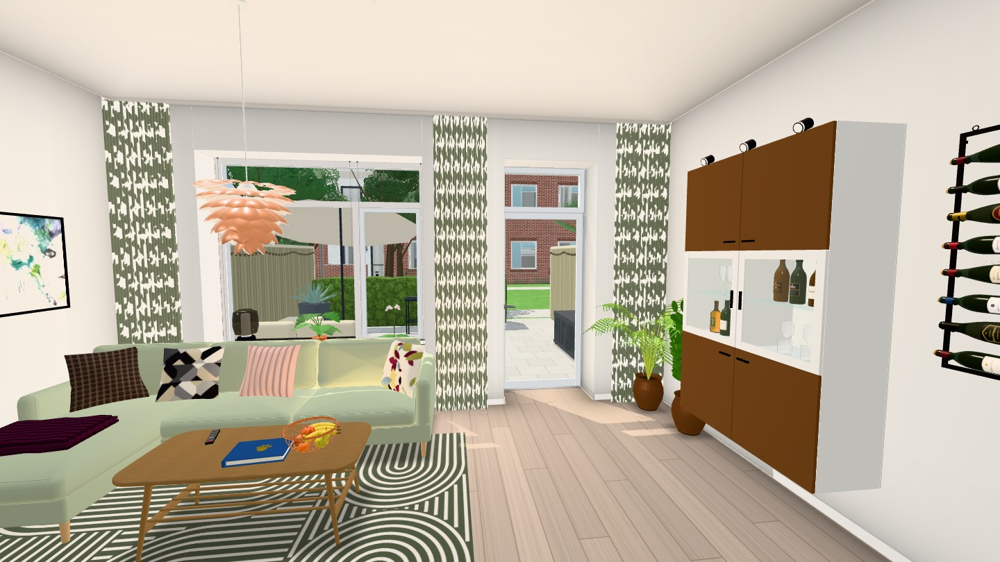 | 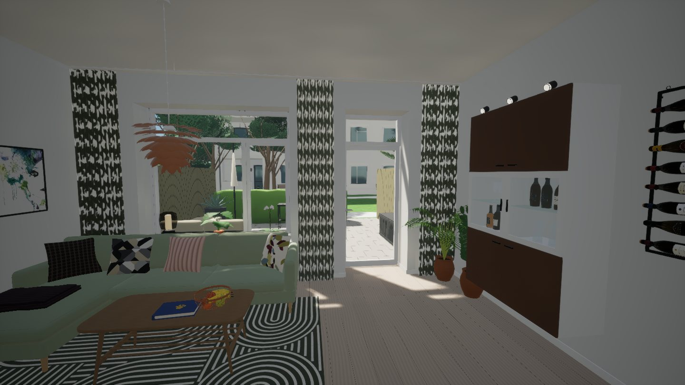 |
| 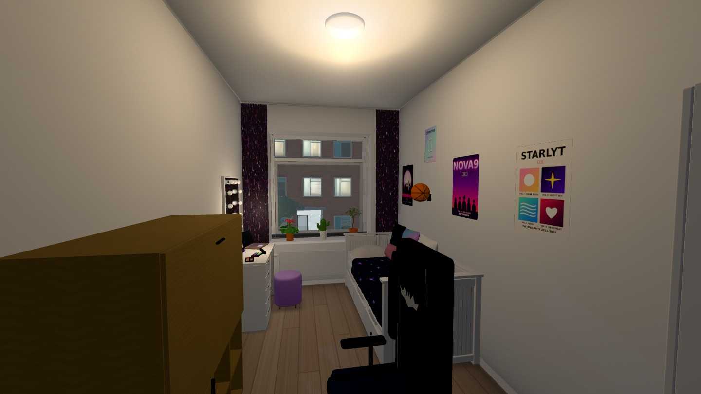 | 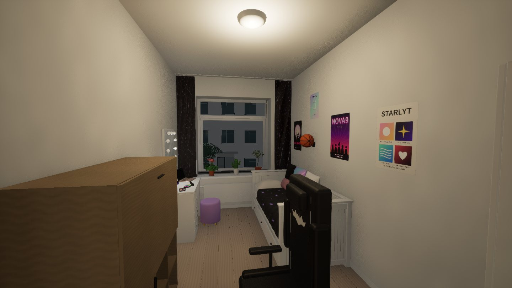 |
| 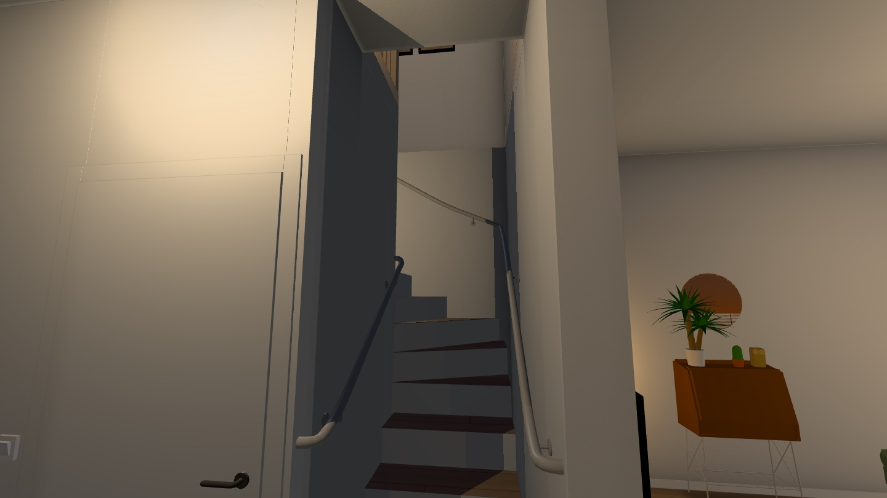 | 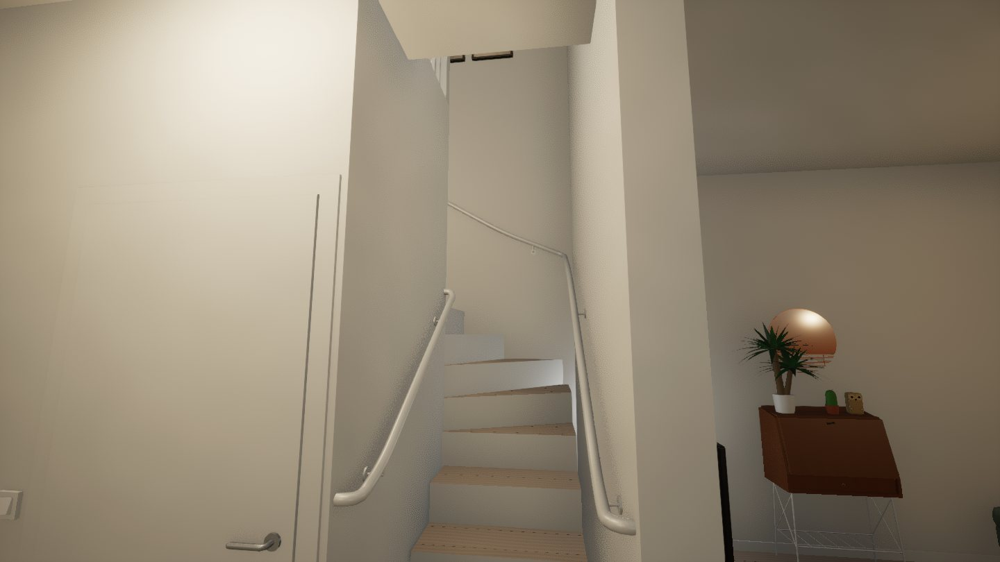 |
| 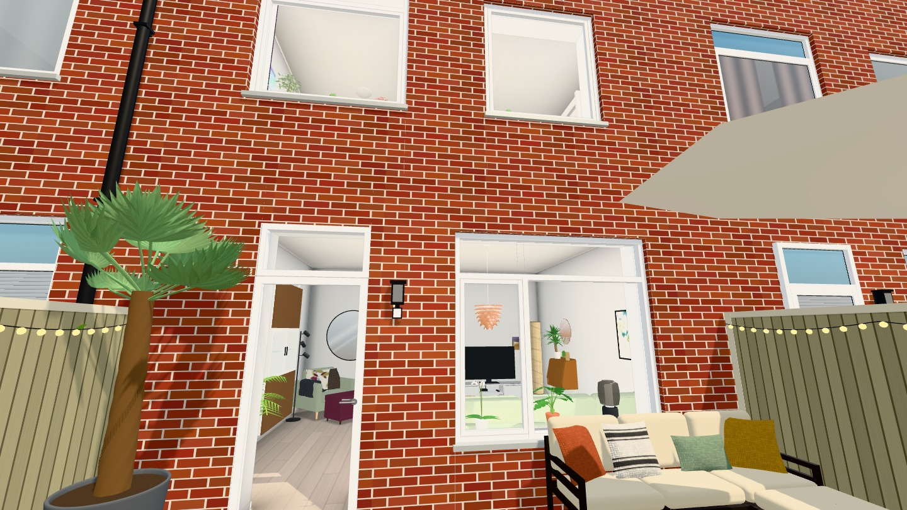 | 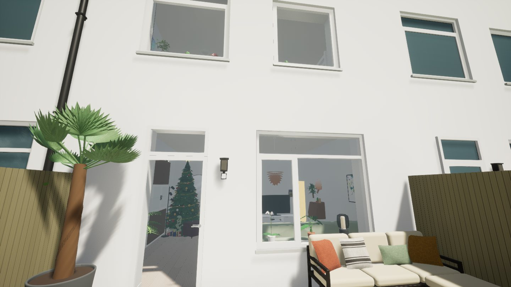 |
| 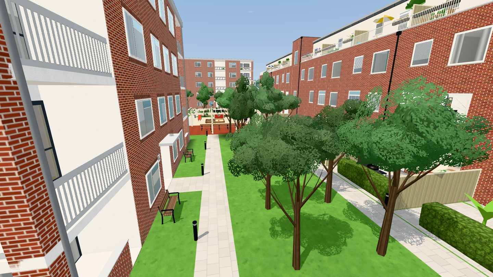 | 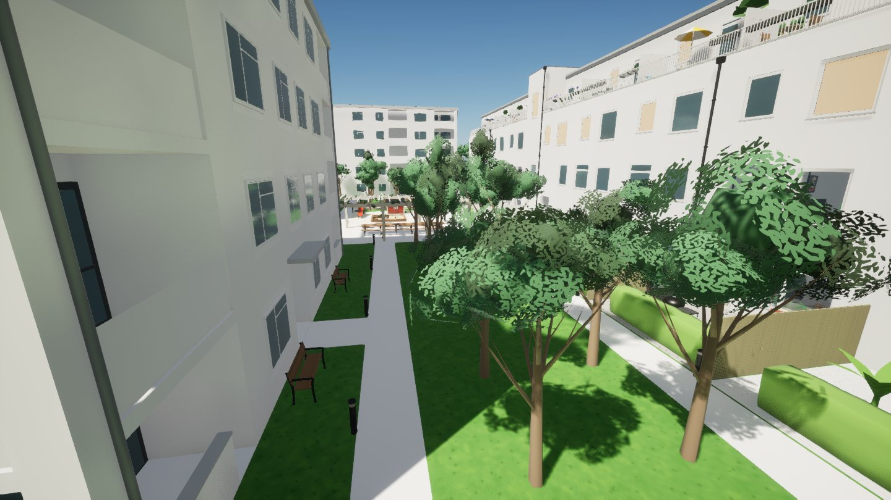 |
| 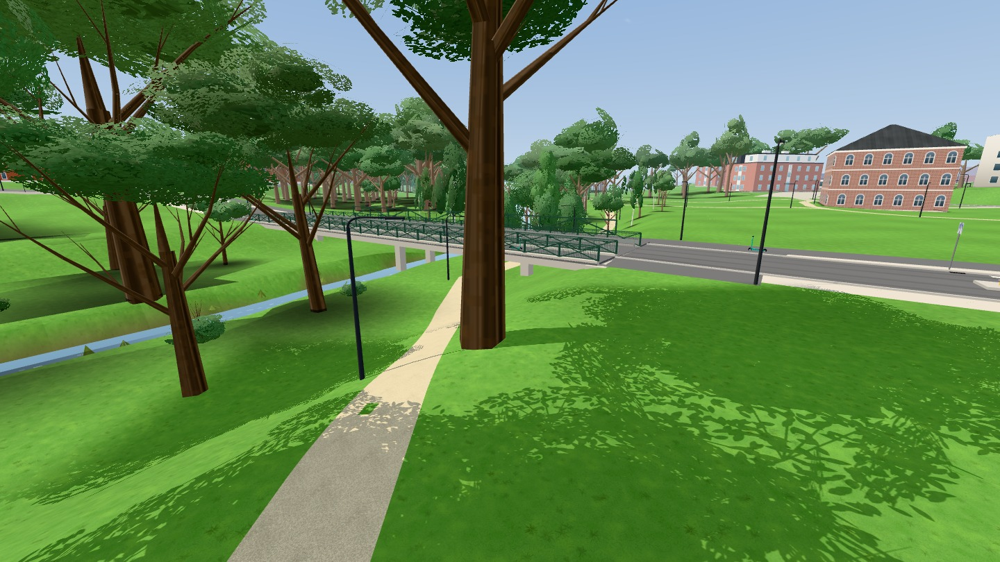 | 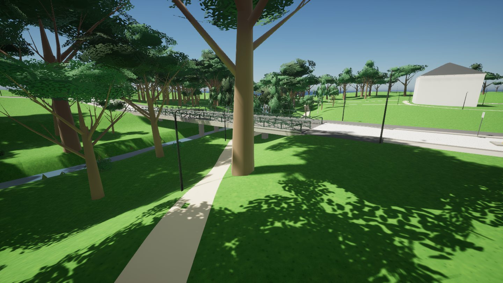 |

Living room: the fern and the patio's plants are green, the fruit in the bowl red, yellow and orange. Övre plan: the
geranium's red flowers, the cactus and the bonsai on the sill. Stairs: the palm lily and the cactus on the secretary.
Patio: the palm's fronds. Courtyard: the large leaf plant at the bottom right. Höje å: the bridge's dark green railings.

The door handles are not a vertex-colour case: `src/doorfittings.js` makes them brushed steel (`0xc9cdd0`, metalness
0.72) with vertex colour 1 (only the key slots are dark). They read black on the web at night because the web's metals
reflect no environment (in daylight, the patio door's handle is steel on both sides); Unreal's steel-grey handle is
the material's own colour and is left as it is.

Other differences in these pictures belong to open issues: white façades, paving and asphalt (#2318), dark and flat
neighbour windows (#2324), the river's missing blue water, hedge leaf texture and balcony slats (#2325), pale trunks
(#2317), the white campus box (#2323), darker furnishing images such as curtains and rug (#2322), the Christmas tree in
June (#2326), metal reflections and the procedural parquet (#2362). Two have no open issue yet and were reported to
the conductor: the patio's parasol and string lights (built by `main.js`, not exported) and, at 22:00 on the stairs,
the stair shaft's walls and treads, which are much darker on the web than in Unreal.
