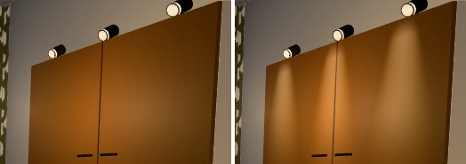

# Gardinernas genomlysning i L1007

Webbens ordinarie kameror visar det gröna bladtrycket i vardagsrummet vid kl. 14 och 22 och det mörklila, flerfärgade trycket på övre plan kl. 22. Bilderna är beskärningar av 1440 × 810 pixlar från samma klara junidag. Kvällsprovet tänder rumslamporna. Det sparade kameraunderlaget innehåller även rummets ljusläge och den linjära emissionsfärgen för vart och ett av de sex tygerna. [Kameror och materialprov](web-capture.json)

| Kamera | Vänster, överkant, bredd, höjd i originalpixlar | Webbens ungefärliga linjära luminans i #2322:s mätfält |
|---|---:|---:|
| [Vardagsrum kl. 14](web-living-room-day.png) | 576, 146, 187, 453 | 0,445 |
| [Vardagsrum kl. 22](web-living-room-evening.png) | 576, 146, 187, 453 | 0,098 |
| [Övre plan kl. 22](web-upper-floor-evening.png) | 403, 146, 245, 421 | 0,013 |

Mätfälten är de smala rutorna i `tools/unreal-engine/tests/furnishing-crops.json`. Bildutsnitten är större så att tyg, veck och fönster går att känna igen.

De tolv materialplatserna i L1007:s GLB använder var och en samma sRGB-tryck och UV för basfärg och emission. De sex materialens basbilder och UV-transformer var byte-identiska med den tidigare lokala exporten från 9311c48b inom samma Chromium-version. Den nya mätningen knyter lamporna till rummen genom webbens taklampor och smålampornas verkliga rumsplacering. Sovrum 1–4 har 4, 4, 4 respektive 2 ljuskällor, köket 4 och vardagsrummet 6.

I de tre nya webbkamerorna stämde alla 18 avlästa materialfärger med exportens dags- och lampvärden. Det största avståndet i linjär RGB var 3,18 × 10⁻¹⁷. Ytterligare 432 prov täcker dagsljus, molnighet, strömgränsen och lampornas tillstånd för alla sex tygerna. Webbens visuellt uppskattade tygparametrar används direkt (*guess*).

Med en L1007-export går kontrollerna att upprepa från projektroten.

```sh
node tools/unreal-engine/tests/curtain-light.mjs unreal/Lunden/Import --blueprint --web-capture docs/verification/2322/web-capture.json
```

## Resultat i Unreal 5.8.4

Bildparen visar webben till vänster och Windows-renderingen till höger. Kamerornas position, vinkel, synfält och datum är desamma. Bildutsnitten har kodats om från de färdiga bildytorna. Tabellen använder projektets `crop-stats.cjs`, som avkodar båda sidor i Chromium och mäter relativ linjär Rec. 709-luminans. Siffrorna beskriver renderingen; skärmens ljusstyrka i cd/m² ingår inte i mätningen.

| Bildpar och tid | Luminans webb | Luminans Unreal | Unreal/webb | Medel-sRGB webb | Medel-sRGB Unreal |
|---|---:|---:|---:|---|---|
| [Vardagsrum, kl. 14](paired-living-room-day.png) | 0,4473 | 0,4135 | 0,924 | 169,5 / 168,0 / 145,9 | 169,1 / 168,4 / 148,2 |
| [Vardagsrum, kl. 22](paired-living-room-evening.png) | 0,0988 | 0,0983 | 0,995 | 86,6 / 75,8 / 49,5 | 88,4 / 77,0 / 51,3 |
| [Övre plan, kl. 22](paired-upper-floor-evening.png) | 0,0132 | 0,0116 | 0,879 | 37,2 / 20,5 / 24,8 | 36,9 / 21,2 / 24,8 |

På vardagsrumsgardinen syns olivgröna blad på ljus botten. I sovrum 4 har det mörka trycket åter en lila ton. Kamerorna laddade alla 16 delnivåer i `L_Lunden`. Klockan 14 stod solen 56,387° över horisonten vid 8 lux och lamporna var släckta. Klockan 22 var solen nere och 37 lampor lyste. Kamerans exponeringskompensation var −1,965 respektive −2,463 EV enligt #2313. Den slutliga GPU-körningen gav tre bilder och noll commandletfel.

**Material och kalibrering.** I alla tolv riktiga materialinstanser pekade basfärg och emission på samma sRGB-textur. Den tidigare råa överföringen av webbens emissionsfaktor gav luminanskvoterna 0,44 / 0,21 / 0,44. För att mäta skillnaden mellan motorerna renderade vi de tre kamerorna med emissionsfaktorn multiplicerad med 0, 1, 2, 4, 8, 16, 32 och 64 på samtliga paneler. Vid 16× låg vardagsrummet nära ljushetsmålet men det lila trycket nådde bara 0,58 på kvällen. Vid 64× nådde det lila trycket 1,15 men fick för mycket grönt. Vi interpolerade sedan de observerade röda, gröna och blå kanalmedlen och prövade den färdiga materialinställningen i en ny Windows-rendering.

Dagsljusets RGB-skala är (15, 12,5, 8) och lampljusets är (11,5, 13,5, 15). Det lila sovrumstrycket använder (55, 27, 66) i lampljus. Dessa omräkningar för Unreals exponering är visuella skattningar (*guess*). De fyra tyger som saknar egna kameramätningar får den gemensamma skalan. Samtliga sex rumsstyren och tolv materialinstanser prövades i editorn med dagsljus, moln, strömgräns och säsongsgömda lampor. Provet växlade var och en av de 24 rumslamporna. Bygge nummer två rapporterade `changed=False`.

Kör materialprovet efter en full UE-import med `run-python.ps1 tools/unreal-engine/tests/test_curtain_light.py`. För att upprepa bildprovet, välj `living-room-day,living-room-evening,upper-floor-evening` i de befintliga webb- och GPU-kameraskripten och lägg originalen i samma katalog med prefix `web-` respektive `unreal-`. Kör därefter:

```sh
node tools/unreal-engine/tests/crop-stats.cjs <bildkatalog> tools/unreal-engine/tests/furnishing-crops.json --check-curtains
```

Grinden kontrollerar projektets luminansintervall 0,8–1,25. Som kulörkontroll ska både R/G och B/G i varje mätfält ligga inom 10 % av webbens kanalproportioner (*guess*).

### Övriga material vid gardinprovet

| Mätfält | Unreal/webb kl. 14 | Unreal/webb kl. 22 | Kvar i #2322 |
|---|---:|---:|---|
| Matta | 1,094 | 0,450 | Dagens luminans klarar intervallet. Kvällsljuset är för svagt och båda bilderna är kallare. |
| Soffbord | 1,839 | 0,612 | För ljust på dagen och för mörkt på kvällen. Kvällens R/B är 2,42 i Unreal och 6,31 på webben. |
| Vitrinskåpets övre dörr | 2,144 | 0,622 | Vid gardinprovet var träfronten för ljus på dagen och för mörk på kvällen. Kvällens R/B var 1,37 mot 3,50 på webben. Skåpets separat uppmätta ljusfält och senare resultat redovisas nedan. |
| Soffa | 1,136 | 0,796 | Dagvärdet klarar intervallet. Kvällsvärdet ligger strax under 0,8. Tyget har mindre färgskillnad mellan rött och blått i båda utsnitten. |

Pendellampans koppar och vitrinskåpets glas saknar avgränsade mätfält i dessa bilder.

## Vitrinskåpets ljusfält

Webbens tre främre spottar ritar var sitt 50 × 100 cm stort ljusfält över luckorna. De två LED-listerna i glasfacken använder samma 128 × 256 pixlar stora sRGB-mask på 56 × 63,4 cm. Exporten mäter de fyra hörnen på varje originalyta efter att möbeln har placerats, sparar dess linjära färg och behåller hela masken. Dessa ytor följer samma automatiska eller manuella lampa som punktljuset.



Båda bilderna visar utsnittet x = 955, y = 173, bredd 260 och höjd 185 i den ordinarie vardagsrumskameran (1 440 × 810). Klockan är 22. Punktlampan, rummets övriga belysning och exponeringen är desamma. Luckans linjära medelluminans steg från 0,0960 till 0,1584 när bildfälten åter visades. Mitt i de tre främre käglorna steg den från 0,0596 / 0,0666 / 0,0457 till 0,2446 / 0,2607 / 0,2170. Fälten mättes i 6 × 10 pixlar runt (1010, 260), (1067, 244) och (1145, 221). Med släckta lampor klockan 14 gav de båda webbrenderingarna byteidentiska bilder.

### Skåpsljuset i Unreal 5.8.4

I den inlästa Windows-världen hamnade ljusfältens 20 hörn inom 0,02 cm från webbens exporterade positioner. Prov med lampan på, av, en del av nattoningen och helt eller delvis bortkopplad ström kontrollerade både de fem synliga fältens material och skåpets punktljus. Med de fem fälten tillfälligt dolda gav punktlampan på 7,95 cd en linjär luminans på 0,0957 över luckan mot webbens 0,0960. Ljuskällorna i resten av rummet behöll sina ordinarie inställningar.

De fyra valnötsluckorna är enfärgade i webbmodellen och delar ett material med linjär RGB (0,1559, 0,0704, 0,0331). Webbens material får ingen av rummets reflektionskartor. I Windows-provet gav en svart diffus yta med den importerade spegelreflexen fortfarande medel-sRGB (57, 58, 60) i dagsljus. När vi satte spegelreflexen till noll på dessa fyra luckor blev motsvarande värde (4, 4, 4). Luckornas lokala material ärver den importerade glTF-instansen med dess ursprungliga råhet 0,6. Den diffusa tonens RGB-faktorer (1,12, 0,94, 0,32) och skåpsljusets HDR-skala är visuella skattningar (*guess*) från de två kamerorna.

Bildparen visar samma utsnitt som webbprovet ovan. Webben är till vänster och Unreal till höger. De tre lysande käglorna går att särskilja över framdörrarna klockan 22. Mittkäglan är ljusare i Unreal. Med enbart det breda punktljuset och de fem fälten dolda hade den redan luminansen 0,1373 i sitt centrum mot webbens 0,0666. De två inre ljusfälten kontrollerades med koordinater, material och lampans tillstånd i editorn. De har inga egna bildmätfält i denna kameravinkel.

| Bildpar och mätfält | Luminans webb | Luminans Unreal | Unreal/webb | Medel-sRGB webb | Medel-sRGB Unreal |
|---|---:|---:|---:|---|---|
| [Lucka kl. 14](paired-cabinet-day.png) | 0,0655 | 0,0661 | 1,009 | 106,7 / 61,6 / 19,7 | 107,6 / 61,6 / 19,3 |
| [Lucka kl. 22](paired-cabinet-evening.png) | 0,1584 | 0,1565 | 0,988 | 149,4 / 98,7 / 42,6 | 152,8 / 96,7 / 40,3 |
| Vänster kägla kl. 22 | 0,2446 | 0,2353 | 0,962 | 176,1 / 125,4 / 69,0 | 172,7 / 123,2 / 71,2 |
| Mittkägla kl. 22 | 0,2607 | 0,3157 | 1,211 | 184,1 / 125,8 / 64,8 | 194,0 / 142,1 / 78,8 |
| Höger kägla kl. 22 | 0,2170 | 0,2248 | 1,036 | 167,4 / 118,5 / 62,7 | 170,0 / 120,3 / 68,7 |

Skåpluckans R/G och B/G höll sig inom 5 % av webbens värden i båda vyerna. Kvällens luminanskvoter för matta, soffa och soffbord var 0,476, 0,798 respektive 0,613. På dagen var de 1,094, 1,136 och 1,839. Vardagsrumsgardinens kvoter var 0,924 på dagen och 1,048 på kvällen. Vitringlasets reflektion och pendelns koppar saknar egna bildmätfält.

Verifiera ljusfälten från en L1007-export och mät sedan de ordinarie webb- och Windows-vyerna för vardagsrummet.

```sh
node tools/unreal-engine/tests/cabinet-washes.mjs unreal/Lunden/Import
node tools/unreal-engine/tests/crop-stats.cjs <bildkatalog> tools/unreal-engine/tests/cabinet-crops.json --check-cabinet
```

Efter en Windows-import kontrollerar `run-python.ps1 tools/unreal-engine/tests/test_cabinet_washes.py` även koordinaterna, de fyra ursprungliga träytorna och lampans styrning i den sparade världen.
