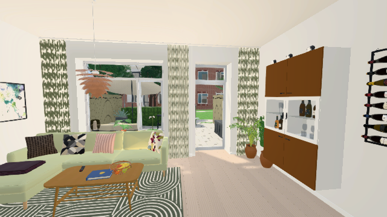
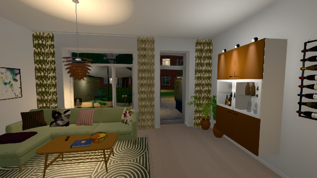
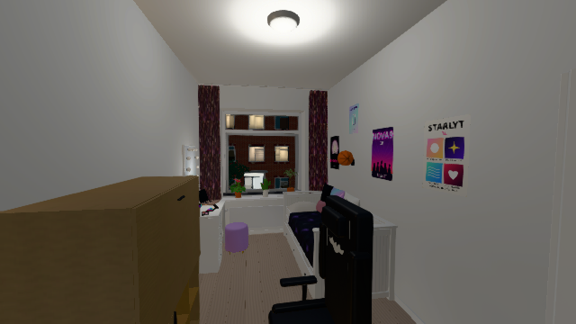

# Materialfärger och källans ljusfält — slutverifiering 2026-11-27

Samtliga **elva ursprungliga materialfält och tre befintliga skåpsfält passerar** luminans0.8–1.25. Gardiner och skåpfront passerar även befintliga relativa R/G- och B/G-gränser0.9–1.1. Dessa kulörgränser och nativeprofiler är uttryckliga **guess**; hela originalbilderna har granskats separat. Detta är godkännande inom Linuxprofilen nedan, inte en full Windows-/PIE-/paketeringskontroll.

Källcommit `c1de028da70d1947c59cd017826e4409baff511a`. Verklig Unreal5.8.4-process `20261127T153328715827-2373640` avslutades0, completed/passed efter **324.88s**. Yttre wrapper143 redovisas separat (#2473). Alla247 authored-paket var SHA-/mode-exakta och skrivskyddade. Tio aktuella steg, tolv verifierat bundna tidigare steg, faktiskt PBR-/materialarv,15 verkliga lamp-/fade-/strömchecks och tre nytagna bilder passerade. Fadeprovet kontrollerar riktiga controller/MPC-värden; det är inte ett bildprov av alla mellanlägen.

## Oförändrade mätfält

| Vy | Fält | Native/web Y | Relativ R/G | Relativ B/G |
|---|---|---:|---:|---:|
| living-room-day | rug | 0.8217 | 0.9784 | 1.0239 |
| living-room-day | curtain | 0.8708 | 1.0050 | 0.9738 |
| living-room-day | coffee-table | 1.0595 | 1.0095 | 0.9550 |
| living-room-day | cabinet-front | 1.0031 | 1.0054 | 0.9710 |
| living-room-day | sofa | 1.0367 | 1.0140 | 0.9547 |
| living-room-evening | rug | 0.9366 | 0.9336 | 1.1060 |
| living-room-evening | curtain | 0.8650 | 0.9998 | 0.9485 |
| living-room-evening | coffee-table | 0.8016 | 1.0180 | 0.6751 |
| living-room-evening | cabinet-front | 0.8648 | 1.0550 | 0.9104 |
| living-room-evening | sofa | 1.0210 | 0.9647 | 1.0251 |
| living-room-evening | spot-1 | 0.9979 | 1.0095 | 1.1547 |
| living-room-evening | spot-2 | 1.0831 | 0.9826 | 1.1999 |
| living-room-evening | spot-3 | 1.1570 | 1.0041 | 1.1625 |
| upper-floor-evening | curtain | 0.8675 | 1.0289 | 0.9006 |

De tre spotcentrum har luminanskrav, inte ett nytt eller efterhandsändrat kulörkrav. Kvarvarande skillnad i käglornas färg är en dokumenterad approximation i samma skåpprofil; den minsta faktiskt provade färgändringen valdes. Alla fem möbelfamiljer har samma övergripande kulör vid helbildsgranskningen.

## Råa slutbilder

| Vy | Webb | Unreal |
|---|---|---|
| Vardagsrum14 |  |  |
| Vardagsrum22 |  |  |
| Övre plan22 |  |  |

Bilderna är råa,640×360, utan omskalning/retusch/omkodning. PNG-skrivaren kan lämna utfyllnad efter IEND; råbytes och SHA bevaras. Kameror, materialreadbacks och verklig runtime finns i `capture.json` och de tre `*-materials.json`.

## Källöverföring och avgränsade profiler

Alla verkliga ShadePools-fält överförs: tre lampor/fem ytor, kopparkällans golv, Silvias golv/tak och papperslampans golv/tak. Källa, masker, UV-hörn, linjära full-on-färger och lamp-ID bevaras. Native räknar `sRGBTransfer(mask * fullOnRGB * K * Power) * opacity` och adderar efter tonemapping. Rätt quad, djup och höjd begränsar fälten. Endast ursprungliga mattans uppåtvända yta får det källbundna2mm-undantaget; övre plan kan inte ärva det. Ingen extra koplanär yta används. Originalmattans PBR är återställd.

Native-enheternas färgskillnader hanteras med deklarerade **guess**-profiler, inte en påstådd universell färgrymdsfix:

| Del | Slutvärde |
|---|---|
| Namngiven ek/teak/trim | RGB×(1.34,1.27,1.15), SpecularFactor0; tar även bort legitima direkta glansreflexer |
| Synlig enfärgad soffram `std_a7b39a_r95_m0` | RGB×(1.30,1.22,1.04), ärvd specular |
| Gardin dag / vanlig kväll | (19.32,17.41,15.04) / (13.37,16.89,24.68) |
| Övre lila gardin kväll | (80,130,180), exakt faktiskt provat värde |
| Vitrinträ dag / natt | (1.265,1.259,1.267) / (.755,.560,.155), verklig MPC Daylight-interpolation |
| Vitrinwash / kantprofil / punktljus | (7.35,4.95,3.9) / .55 / ×3.65 |

Profiler ärver originalinstansernas texturer, UV, alfa, råhet och övriga statiska parametrar. Runtime-MID:er tillhör riktiga controlleraktörer. Tillys skrivbord och den tidigare felriktade texturerade soffprofilen återställs endast när denna builders egen stämplade child har exakt rätt originalkälla.

**Orsaksutredning:** importerad sRGB-flagga/UV och den officiella `M_Default → MF_Default_Body → MF_BaseColor`-grafen multiplicerar RGB-textur×faktor×vertex en gång. Ingen dubbelgamma, extra RGB-clamp eller dubbel vertexfärg har belagts. De första soffjusteringarna träffade fel material: fyra pixelstrålar i det låsta fältet träffar `furn_sofa_l0_x410_z1126__5`, den enfärgade ramen, medan den tidigare profilen ändrade fyra andra texturerade meshar. Den bevisade felriktningen är rättad; kvarvarande native/rendererskillnader approximeras öppet. Se `sofa-factor-source-audit.json` och [utvecklingsbeskrivningen](../../../development/unreal.md#furnishing-and-pictures-2289).

## Rättad referensproveniens, inte ändrade gränser

#2485 dokumenterar ett befintligt fångstfel. Den äldre hela kvällsbilden togs efter kamerabyte innan punktljuspoolens fade var klar. Den kunde därför inte styra stabil ljussättning. Lampans k och skåpets wash-opacity slås på direkt; den ofärdiga andelen gäller det valda punktljuset. Den oberoende tidigare publicerade #2369-bilden registrerar skåpets faktiska ankarpunkt[.992,1.92,10.55] med share1.

Hela kvällsreferensen ersätts uttryckligt med den stabila bilden, SHA `1a6d7cd06c97fbb1729662cece73490a808745d2511124f8dc0a987f0e810c0b`. Gamla SHA `caf943bc12f03f8f6b42e2701fa5f1dd7ad41f66bae7cca077afa1eac3183f89` och gamla underkända mått behålls historiskt. Dag/övre bilder, samtliga11 ursprungliga rektanglar och alla trösklar är oförändrade. Kontraktet låstes före de nya skåpprovens urval, SHA `1f559812415bdc9a6bbfcd5030957bae510b208833318c45021d3a89545d47b6`; tidigare nativebilder hade redan granskats, vilket kontraktet uttryckligen uppger. De gamla resultaten skrivs inte om till passeringar.

Fyra verkliga no-save-paletter provades med oförändrad veneer/ljuskälla/exponering: (7.35,4.95,3.9), (7.35,4.95,4.2), (7.35,5.2,4.2), (7.8,5.2,4.2). Samtliga passerade den korrekta skåpgrinden; den minsta ändringen390 valdes efter originalbildsgranskning och bekräftades därefter av den sparade produktionens nya V5-körning. Dagsljusets faktiska veneer var oförändrad. `cabinet-trial-v2-selection.json` och de separata stats/readback-filerna bevarar både korrekt och gammal diagnostisk jämförelse.

Äldre fel är fortfarande fel: första kombinerade byggkörningen fick native1 på Blueprint-kompileringsordning; nästa native255 på komponentgetter; V3 native0 men underkänd övre gardin/spot; V4 native0 men underkänd kulör mot stabil källa. Det första privata skåpprovet stoppade på en ej instansredigerbar intern Blueprint-egenskap och en ogiltig MID-parent; inga provbilder eller godkännande kom därifrån. Rättat privat prov ändrade bara fem befintliga MID:ers Radiance och återläste återställningen, native0/237.07s. Historiska Windows- och Linuxdelresultat i [huvuddokumentet](../README.md) bevarar sin ursprungliga status.

## Profil, återanvändning och begränsningar

Linux CPU-Vulkan SM5, VFOV72, faktisk FXAA-metod1, Lumen av, konventionella skuggor3/1024/tre kaskader, SeparateTranslucency på och Nanite avstängt i minnet. `r.PostProcessAAQuality` finns inte för denna getter: dess returnerade0 är fallback, inte uppmätt kvalitet. Säsongsfixturen använder riktiga synlighetsregler utan fysik-/kollisionstillämpning. Windows fullprofil, spelprestanda, PIE och paketering omfattas inte.

Full verklig lokal export har sourceCommit `461a0b2202901365b599cccaab6f49d0d1181425`, sourceHash `a2f25406e223b2e73540384644a4cff47bd38a59e9309c14b95eec07b423eeeb`, manifestSHA `493c43651cc59178069fd39f0cc4c9c4cc876c88e4a86582f8c2f03f67f32d64`. De sista ändringarna gäller Pythonbuilders/prov; ingen ny eller omstämplad webbexport påstås. Tio GLB:er var byteidentiska med samma lokala tidigare producent. Den stoppade V4-världens5095 Generated-filer och247 authored-paket är hash-/mtime-bundna. Endast skåpsbuildern skiljer mot V4; tidigare fungerande import/interaktion/gardiner återanvänds med sina faktiska käll-/körbevis, och skåp/rug/compose/import/Nanite/PBR/fade/bilder kördes faktiskt igen före ny sync-stämpel. `sync-capture-steps.json`, `sync-capture-guards.json`, `resume-final-closure.json` och `outcome.json` skiljer dessa bevis åt. Äldre schemafält benämnda native3 i closurefilen binder uttryckligen verklig V4-källaEA och dess processresultat; filens note anger detta.

## Helbild och separat kvarvarande arbete

Vänsterväggens ljusform #2372, soffans särskilda gula fält #2447, glas/vitringlas #2459, emissiva kupoler/inre skärmar #2460, kameravända lamphalor/övre varma takfält #2481, yttre Silviakoppar #2482 och höga nakna väggen över BESTA #2484 är öppna. Skuggornas kvalitet och lågupplöst raster i den deklarerade profilen är avsiktliga profilavvikelser. Tillys återställda originalfärg, golvets särskilda upprepade mörka raster och utsidans gröna/bruna kvällsfärg genom vardagsrumsglaset kräver separata konkreta uppföljningar före stängning; de är inte lösta av de fem huvudfamiljernas färgprofiler.

Originalets Unreal-port och personliga möbler ger ingen tillämplig downstream-produktändring. Webbens rendering/spel och Cloudflare ändras inte. Fil-/råbildhashar finns i `artifact-files.json`; README ingår inte i den oföränderliga rådatamanifesten.
