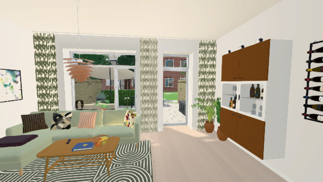
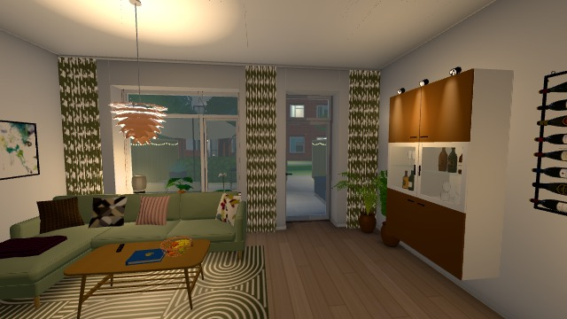
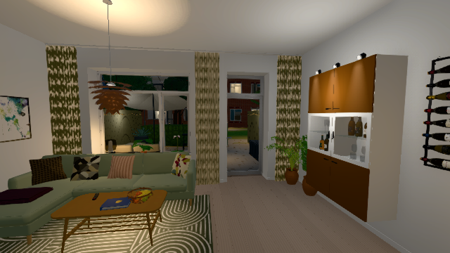
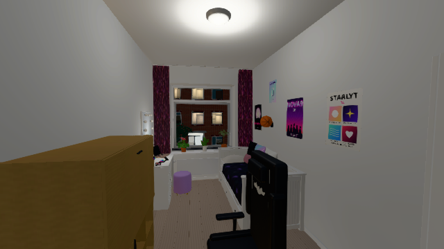

**Historical failed checkpoint, superseded by the [final Linux result](../linux-final/README.md).** The statement that the issue remains open below describes that earlier checkpoint, not current status. Its numeric failures and original references are preserved unchanged. Failed diagnostic images were removed from main in the resolving commit; pinned history links below remain accessible. The later whole-night reference correction is documented in #2485 and the final result.

# #2322 Linux material checkpoint — not final acceptance

Native source `2e7e18fb65ce5de612046a9ad40ecd6342790dcc`. The actual engine run `20261127T143627028203-1096651` completed with exit 0 and passed the log/runner check. The outer exec was interrupted with 143 separately (#2473); its launcher record is incomplete. External postflight confirms all 247 authored packages are byte-exact and read-only. No Windows full-profile, PIE or packaging result is claimed.

The full clean local export is bound to `461a0b22`, sourceHash `a2f25406e223b2e73540384644a4cff47bd38a59e9309c14b95eec07b423eeeb`; all ten GLBs are byte-identical to the previous local export. Twelve actually successful early steps from the stopped previous run were reused only after exact source-dependency checks and the 5,094-file Generated closure matched. Remaining builders, compose/import/Nanite checks, sync stamp, release gate, original PBR/pool tests, fifteen actual controller/MPC fade checks and three captures ran. The earlier run failed at a cabinet Blueprint member getter and is not called a native pass.

**#2322 remains open:** ten of eleven locked material luminance crops pass, but the upper curtain is still too dark/red (0.682 Y; R/G-relative 1.644, B/G-relative 1.419). Cabinet spot-1 is also too dark (0.700; spots 2/3 are 0.836/0.875). Day/evening curtain and cabinet hue guards now pass. Numerical luminance alone is not full material/whole-image acceptance.

The source ShadePools compositor preserves all three actual lamps/five quads, original mask and the source order K × linear RGB before sRGB transfer, then opacity/display addition. Original PBR/texture/UV/alpha chains remain inherited. Wood, upholstery, curtain and cabinet day/night parameters are explicit **guess** calibrations for this Linux diagnostic profile, not a proven sRGB/double-multiplication repair. The upper room's opal lamp is Sovrum 4; the exported paper-lamp pool is Sovrum 2 and cannot be used to claim the former's ceiling field was fixed. Original-only Unreal/personal furnishings: no public downstream transfer applies.

Profile: CPU Vulkan SM5, conventional 1024 shadows, 3 cascades, Lumen off, Nanite disabled transiently, SeparateTranslucency enabled. `r.AntiAliasingMethod=1` is actual FXAA. The `r.PostProcessAAQuality` query logs that the CVar does not exist; its returned zero is a fallback, not measured quality zero. Locked old AA0 labels remain immutable and are corrected here.

| View | Material | Native/web Y | Y gate |
|---|---|---:|---|
| living-room-day | rug | 0.822 | PASS |
| living-room-day | curtain | 0.871 | PASS |
| living-room-day | coffee-table | 1.059 | PASS |
| living-room-day | cabinet-front | 1.003 | PASS |
| living-room-day | sofa | 0.842 | PASS |
| living-room-evening | rug | 0.944 | PASS |
| living-room-evening | curtain | 0.870 | PASS |
| living-room-evening | coffee-table | 0.928 | PASS |
| living-room-evening | cabinet-front | 1.113 | PASS |
| living-room-evening | sofa | 0.813 | PASS |
| upper-floor-evening | curtain | 0.682 | FAIL |

| View | Locked web original | Native diagnostic result |
|---|---|---|
| Day |  |  |
| Evening |  |  |
| Upper evening |  |  |

Raw 640×360 originals, no resizing or edits. Same eleven immutable rectangles; same original references. A newer fully settled evening reference is a separately declared robustness check, never a silent reference replacement. Further upper-curtain/spot calibration and whole-image review are pending; this is not an integration-ready handoff.
