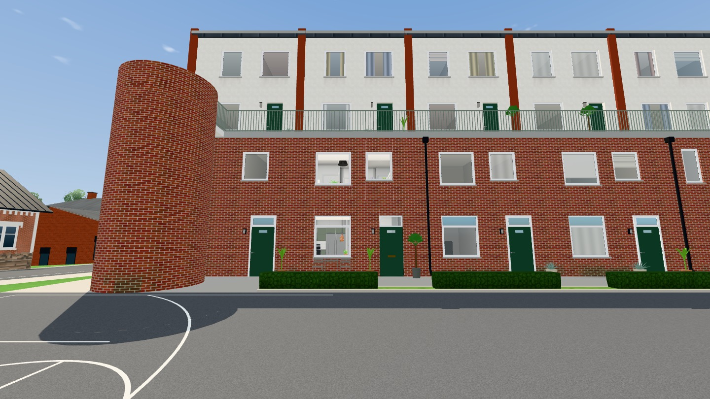
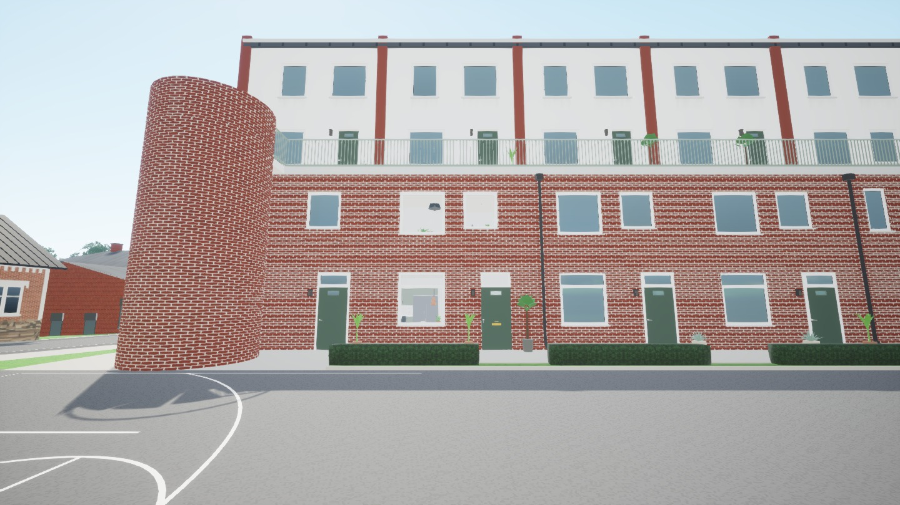
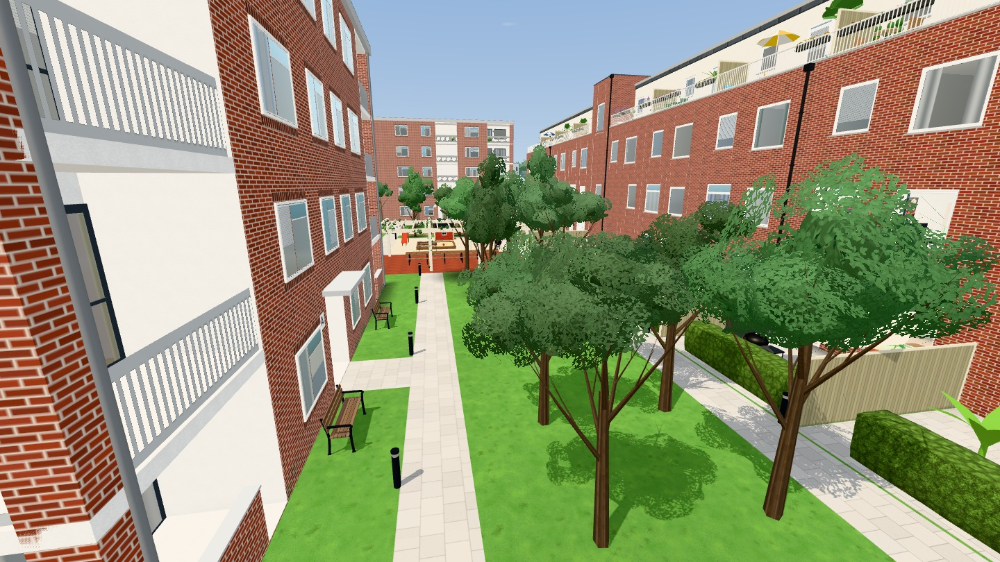
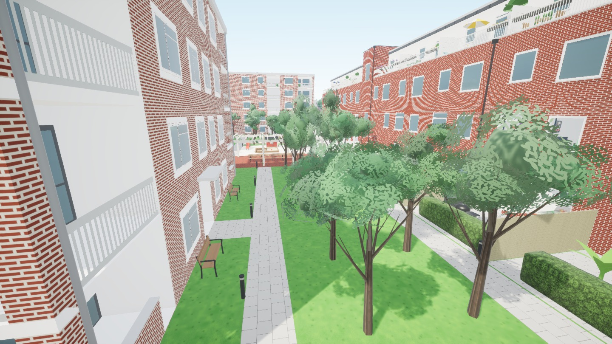
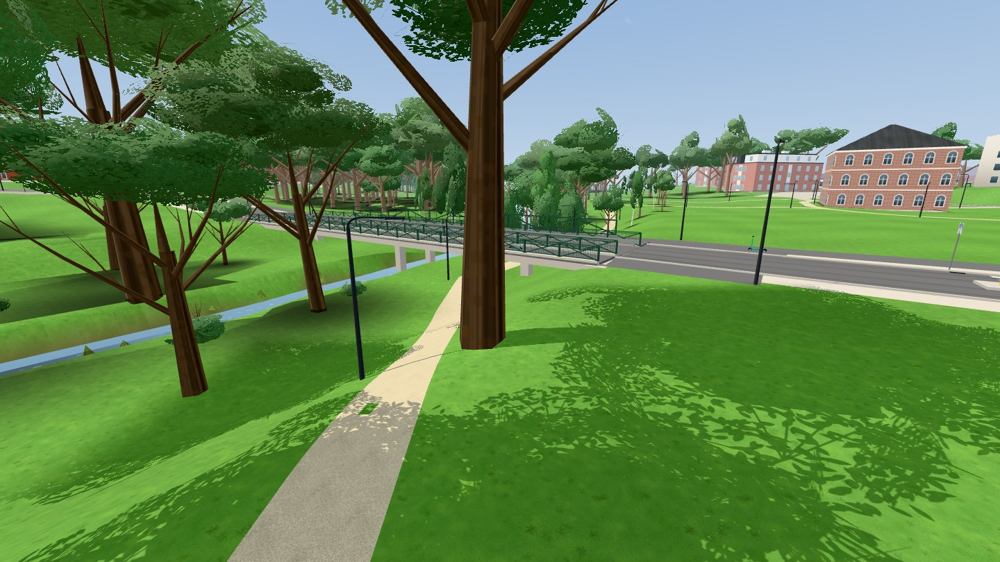
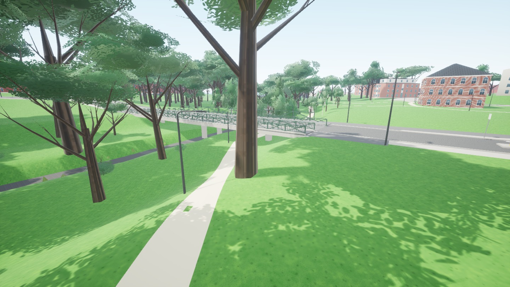
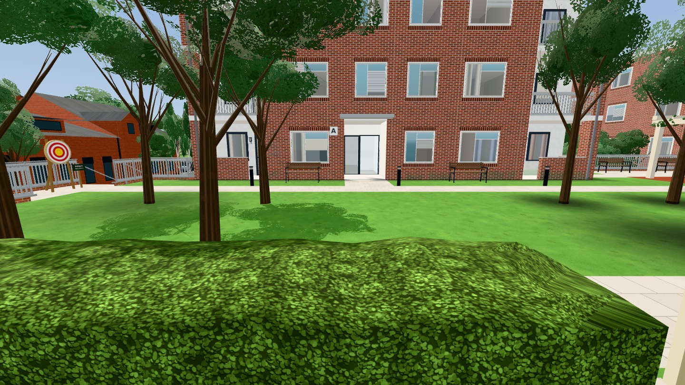
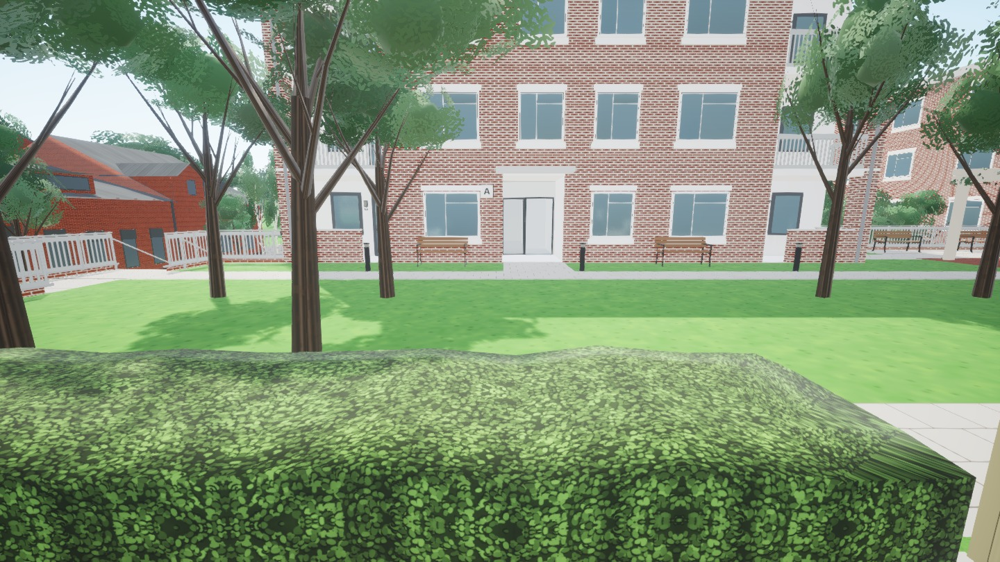

# Backdrop houses round the quarter in Unreal (#2323)

Unreal Editor 5.8.4 on Windows 11, 2026-11-21, headless (`-nullrhi` for the builds and checks, `-RenderOffScreen` for
the pictures and the frame times). Export: the Actions artifact `unreal-export-1c833b85e6ff1552` of `27be8ee5`
(the zone `fond` from `6fb81700`, its materials from `4fa06e88`). How it works:
[unreal.md, Backdrop houses](../../development/unreal.md#backdrop-houses-2323).

## Checks

- `sync-import.ps1 -ExportFrom …`: all eleven zones imported, `fond` with 43 actors, 56 assets and 14 material slots
  mapped by `4fa06e88`'s rules; `build_l1007`, `build_exterior`, `build_site` passed. The later steps could not run on
  this checkout of `main` (see *Not verified here*); `build_vegetation` and `build_interaction` were run by hand.
- `world-levels.json` lists `/Game/Lunden/Generated/fond/Level_fond`; `compose_world.py`, under the map's lock, added it
  to `L_Lunden` (`cb0ca795`, with #2291's mirror level that was listed but not yet in the map). A second run left the
  map unchanged (sha256 `0f856ba0056a1fcd`) and `--check` passed.
- `tests/check_fond.py` (new, commandlet): `LUNDEN_FOND_OK 41 of 41 backdrop nodes at the web's place, worst 0.8 cm`.
  Every mesh node of `fond.glb` is an actor of `Level_fond` named by its id, and its visible bounds centre equals the
  web's world-box centre in the id within 5 cm ([`fond-result.json`](fond-result.json)).

## Pictures

Four cameras, 1440 × 810, 72° vertical, 21 June 14:00, clear ([`views.json`](views.json): the shared `start`, #2281's
`courtyard` and `river` and #2308's `patio-lawn`). Web: `capture-web-views.cjs` with these views, desktop Ultra,
SwiftShader ([`web-capture.json`](web-capture.json)). Unreal: `tests/capture_vegetation.py` on `L_Lunden` with its own
sky ([`unreal-capture.json`](unreal-capture.json)). Before this issue the same views showed grass, trees or a dark
band where the houses stand: [START](../2281/unreal-start.jpg), [Höje å](../2281/unreal-river.jpg),
[patio](../2308/unreal-patio-lawn.jpg).

| Web | Unreal |
|---|---|
|  |  |
|  |  |
|  |  |
|  |  |

- **START, left:** the old brick house with its grey roof and white gable crowns and the brick house behind it, as on
  the web.
- **Patio, looking south:** the red brick house with the grey roof behind the white fence (left).
- **Höje å:** the campus building with its arched windows and hip roof, the brick houses further back and the land
  beyond the terrain up to the horizon. The dark band at the horizon is gone: it was the missing edge land
  (`src/edgebackdrop.js`, now in `fond`). The white building with arched windows that the issue called the campus was
  the nearer Villa in `omgivning`; `4fa06e88` gave it its own atlas.
- **Courtyard:** the backdrop is hidden behind Hus A/B/C and Hus L from this camera, as on the web.

## Courtyard frame time

#2281's setup: the `L_Perf_courtyard` scratch map (`tests/prepare_vegetation_profile.py`) with every sub-level,
`UnrealEditor-Cmd … -game -d3d12 -RenderOffScreen -ForceRes`, 2560 × 1440, `sg.*` High, 100 % screen percentage, no
vsync, CSV profile summarised by `profile_report.py` (15 s warm-up, 15 s measured). The A/B map leaves out only
`Level_fond`. Runs alternated with and without the backdrop ([`performance.json`](performance.json)).

| Run | Mean FPS | 1% low FPS | Frame ms | Render thread ms | GPU ms |
|---|---:|---:|---:|---:|---:|
| with `fond`, 1 | 75.54 | 27.68 | 13.24 | 13.24 | 11.32 |
| without, 1 | 70.20 | 21.73 | 14.25 | 14.23 | 11.33 |
| with `fond`, 2 | 52.79 | 33.71 | 18.94 | 18.94 | 11.25 |
| without, 2 | 61.55 | 33.86 | 16.25 | 16.25 | 11.50 |

**The backdrop costs no measurable GPU time:** 11.25–11.32 ms with it, 11.33–11.50 ms without. The frame is held
by the render thread, which varied between 13 and 19 ms from run to run in both conditions while other agents' editors,
browser tests and a game shared the PC (CPU 36 % busy between the runs). Two of four runs, one of each kind, were
above 60 FPS. #2246's budget is therefore not shown on this shared PC, and the cause is not `fond`: #2308 measured the
same view at 7.8 ms GPU and 8.2 ms render thread, and the map without `fond` is as slow now, so the slowdown comes
from elsewhere. A measurement on an idle PC is still needed.

## Equivalent houses

Not a house layout change: `fond` holds only the surroundings. Hus L, A, B and C stay in `hus-l` and `kvarteret`, whose
GLBs were byte-identical with the export before `fond` (#2323's export check). The backdrop houses on all four sides
(west, north, east with the campus, south) and the edge were checked by `check_fond.py`; the pictures show the west
(START, patio), east (Höje å) and the edge land.

## Not verified here

- `build_lighting.py`, `build_facade.py` and parts of the clean build fail on this `main` for reasons outside #2323
  (reported separately). The pictures and frame times therefore leave out #2324's `Level_facade_lighting` (dropped from a
  local copy of `world-levels.json`, never committed) and use the lighting level from an earlier build in this checkout. The day views
  do not depend on the façade lights.
- Evening views of the backdrop (#2324's lit windows) and the windows' fake rooms are #2324's.
