# Grannfönster och fasadlyktor i Hus L, A, B och C (#2324)

Webbreferenserna är tagna i den ordinarie [desktopscenen vid e72c5f55](https://github.com/solwation/lunden-3d-apartment/commit/e72c5f55c57ba0b574ee4ee94958ea96adb574cf) med klart väder den 16 november 2026. Samma kameror mäter eftermiddag kl. 14.00 och kväll kl. 18.15 från 1,62 m ögonhöjd, med 72° vertikalt synfält och 1440 × 810 pixlar. Klockan är fryst och spelet avgör vilka lampor som tänds. Fasaderna använder webbens fyra färdigtonade ljusmasker från entréer och loftgångar.

## Vad bilderna kontrollerar

START visar Hus L:s entrélykta, loftgång och grannrum från gatan. Hus L:s 14 grannrutor med kvällsljus vetter mot gården. En extra kvällsvy från gården visar därför både en tänd och en släckt ruta. Hus A, B och C har en kamera per byggnad vid båda klockslagen. Kameran vid Hus C står mellan södra fasaden och pergolan så att pergolans balkar och egna ljusslinga hamnar bakom kameran. En lykta och två närliggande rutor med olika kvällsscheman gör ljusväxlingen synlig på respektive fasad.

| Hus | Entré- eller loftgångslykta i Unreal-cm (X, Y, Z) | Tänd provruta vid skymning | Släckt provruta vid skymning |
| --- | --- | --- | --- |
| L, START | (209, −10, 190), loftgång (199, 146, 850) | gårdssidan nedan | (−170, 7, 473) |
| A | (−762, 3069, 495) | (−156, 2875, 440) | (−444, 2875, 440) |
| B | (−3960, 3519, 495) | (−3354, 3325, 440) | (−4033, 3523, 455) |
| C | (−6576, 3479, 195) | (−6249, 3673, 440) | (−5923, 3673, 440) |
| L, gård | (−679, 1090, 1141) | (−410, 1263, 795) | (−726, 1263, 785) |

Koordinaterna är avrundade mittpunkter från `site.facadeLighting` i den fullständiga exporten. I A/B/C räknades rutor med positiv RGB i webbens faktiska instansfärger. Kl. 14 var alla 649 släckta. Kl. 18.15 var 91 av 252 tända i A, 56 av 197 i B och 47 av 200 i C. Antalen omfattar de tre husens schemalagda rutor, inklusive rutor utanför bild. Hus L har en separat materialgrupp med 14 av 115 rumsrutor. Dess ljusemission växlade från 0 till 0,6. Både entréernas och loftgångarnas ljusmasker gick från 0 till 0,26 på väggen och 0,45 på marken.

Tabellen visar linjär relativ luminans i [de låsta bildutsnitten](../../../tools/unreal-engine/tests/facade-crops.json). Varje ruta anger kl. 14.00 / 18.15. Dagsljus och gardiner bidrar även när rummets kvällsbelysning är släckt.

| Vy | Lyktans lins | Fönster med kvällsljus | Fönster utan kvällsljus |
| --- | --- | --- | --- |
| L, START | 0,20758 / 0,59105 | — | 0,19970 / 0,00117 |
| A | 0,24033 / 0,47333 | 0,21936 / 0,44293 | 0,20212 / 0,00169 |
| B | 0,25354 / 0,45520 | 0,16971 / 0,70930 | 0,27638 / 0,00120 |
| C | 0,25969 / 0,73279 | 0,54929 / 0,71688 | 0,24280 / 0,00176 |
| L, gård | — / 0,17772 | — / 0,37356 | — / 0,00242 |

I START-vyn gav väggen under entrélyktan 0,09867 / 0,02936 och loftgångslyktans lins 0,33917 / 0,41396.

**START-bilderna.** Den tidigare dagsbilden är tagen i juni. Novemberbilden vid 14-tiden ligger nedan. För kl. 18.15 återanvänds [START-bilden från #2307](../2307/web-start-night.jpg). Dess fyra angivna utsnitt gav exakt samma uppmätta sRGB-medelvärden och linjära luminans som i den nya tagningen när ljusmaskerna stabiliserats. För jämförelseskriptet kan den kopieras till resultatkatalogen som `web-facade-l-dusk.jpg`.

## Bildpar med Unreal 5.8.4

Bildparen använder samma kameror, synfält, datum och spelexponering. Hus L:s extra gårdsbild visar en tänd och en släckt ruta samtidigt. Där skymmer Unreals trädkrona delar av den lilla lyktan bakom räcket. Entré- och loftgångslyktan i START samt täckningen för Hus A, B och C har egna utsnitt.

| Hus och tid | Webb | Unreal |
| --- | --- | --- |
| L, START, 14.00 |  | 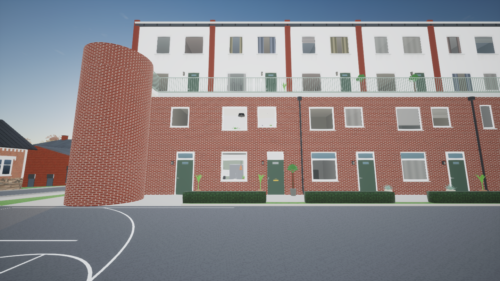 |
| L, START, 18.15 |  | 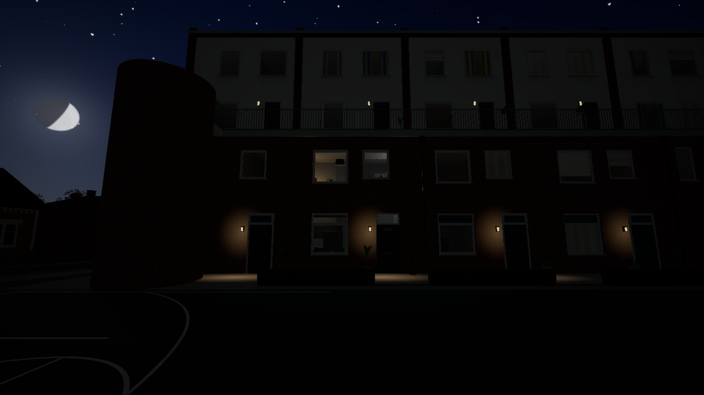 |
| A, 14.00 |  | 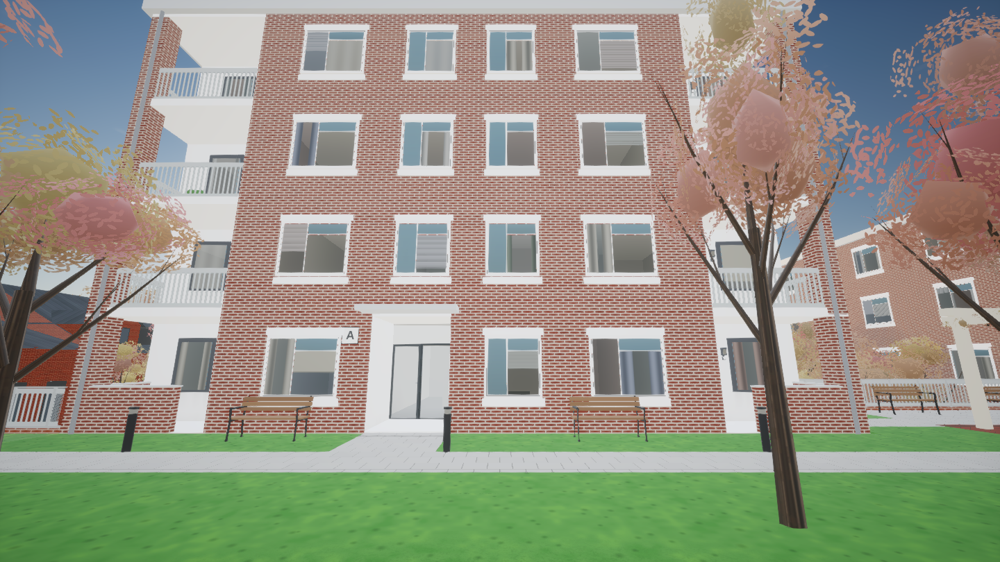 |
| A, 18.15 |  | 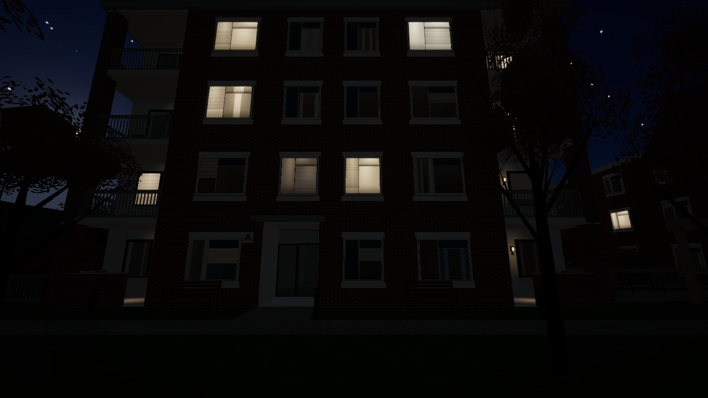 |
| B, 14.00 | 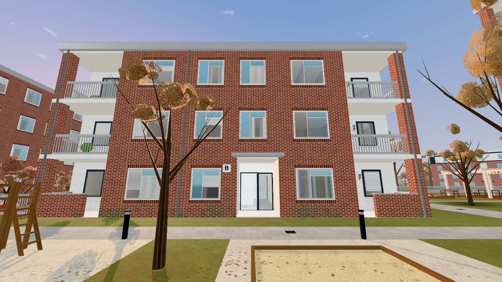 | 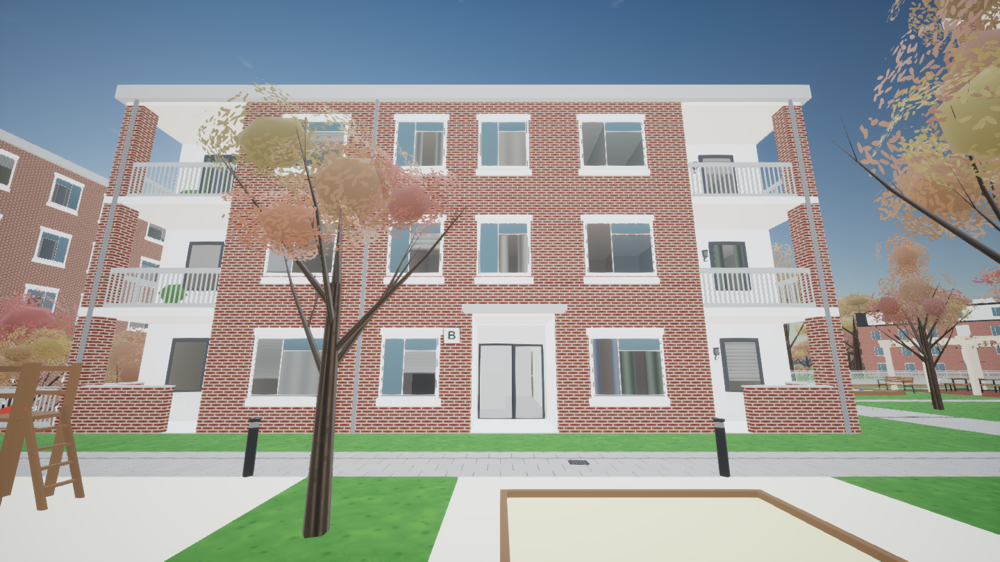 |
| B, 18.15 | 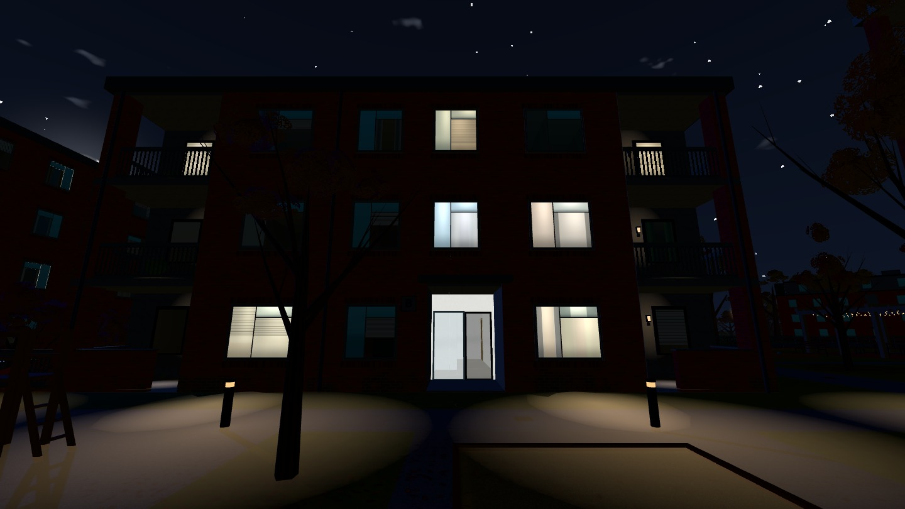 | 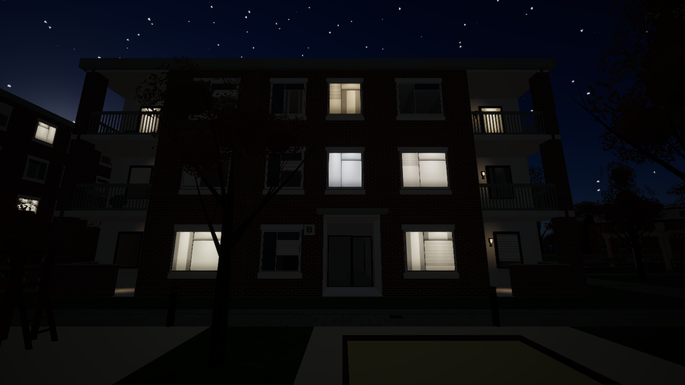 |
| C, 14.00 |  | 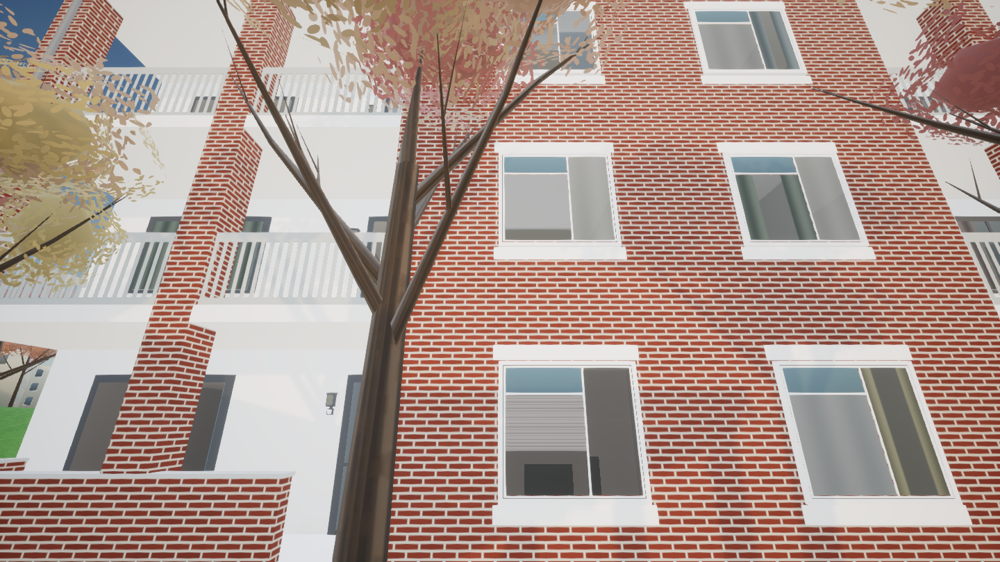 |
| C, 18.15 | 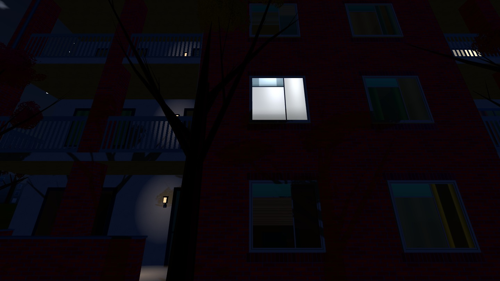 | 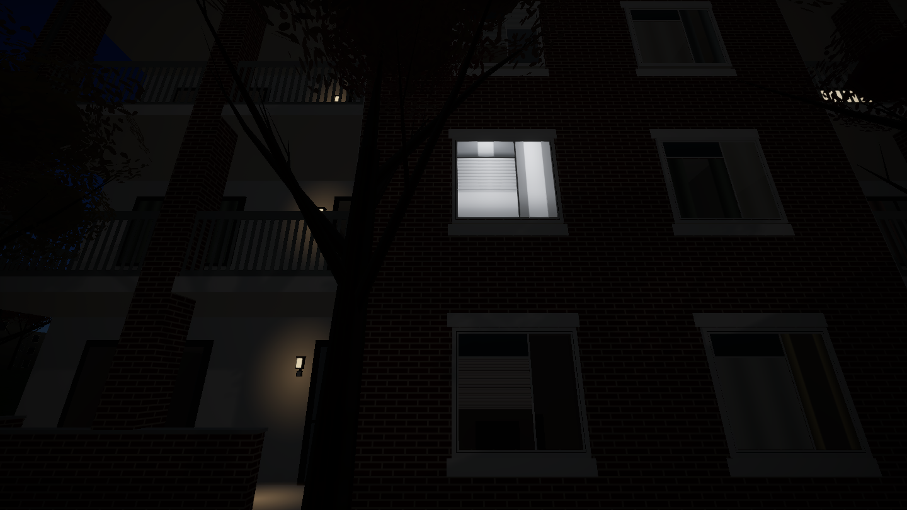 |
| L, gård, 18.15 |  | 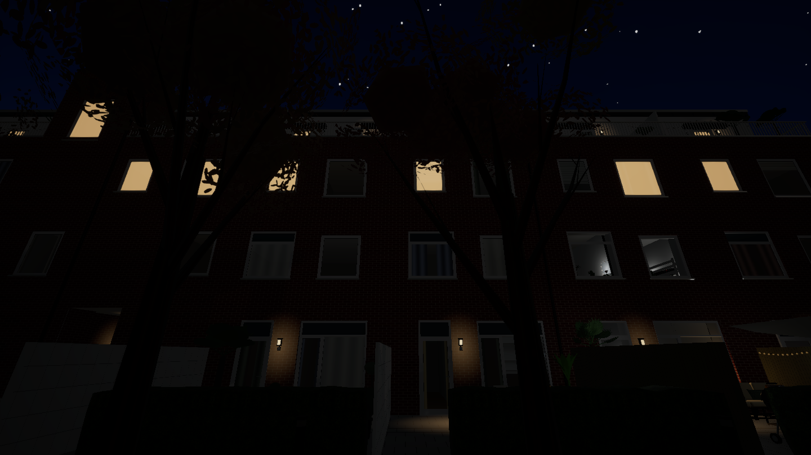 |

## Uppmätt ljus i Unreal

Unreals fasadradians är en uppskattning (*guess*). Den första Windows-renderingen gav bara 14–15 procent av webbens kvällsluminans i lyktorna på Hus A, B och C. Fasadmaterialen använder spelets uppmätta exponering (−1,965 EV kl. 14 och −2,55 EV kl. 18.15) för att omvandla webbens färger till emitterat ljus. För det additiva ljuset över vägg och mark ligger förstärkningen på 2,65, uppskattad från väggens radiella profil i två Windows-renderingar. I START-vyn gick den tidigare släckta entrélyktans lins från 0,00035 i [bilden före fasadbygget](../2307/unreal-start-night.jpg) till 0,47355. Den matchade webblinsen gav 0,59105. Utsnittet på väggen under lyktan gav 0,03130 mot webbens 0,02936.

| Unreal, dag / kväll | Lyktans lins | Fönster med kvällsljus | Fönster utan kvällsljus |
| --- | --- | --- | --- |
| L, START | 0,24446 / 0,47355 | — | 0,16788 / 0,00167 |
| A | 0,31723 / 0,40741 | 0,19926 / 0,49168 | 0,17340 / 0,00185 |
| B | 0,35259 / 0,40213 | 0,15356 / 0,61836 | 0,33307 / 0,00229 |
| C | 0,30414 / 0,62448 | 0,46053 / 0,51011 | 0,18448 / 0,00203 |
| L, gård | — / 0,01567 | — / 0,46755 | — / 0,00298 |

[Mätfilen från Chromium](facade-crop-stats.json) innehåller sRGB, linjär luminans och R/B för båda spelbilderna i alla 29 utsnitt. Loftgångslyktan i START gav 0,38770 mot webbens 0,41396 kl. 18.15. I gårdsvyn skymmer blad flera pixlar på lyktan. Det förklarar varför den lilla mätytan där är mörkare trots att lampan är tänd. Framför Hus A och B har webben också ljuspölar från de låga gångpollarna. De fyra exporterade fasadmaskerna kommer från entréer och loftgångar. Pollarna har [ett eget material i gårdsbyggaren](../../../src/courtyard.js).

## Upprepa jämförelsen

[De gemensamma kamerorna och klockslagen](../../../tools/unreal-engine/tests/facade-views.json) använder START från projektets ordinarie kameralista. Följande kommandon använder samma uppsättning för webben och för UE. Ange katalogen för den aktuella fullständiga exporten i `export_dir` och använd en separat resultatkatalog `out`.

```sh
mkdir -p "$out"
export LUNDEN_CAPTURE_SHOTS="$PWD/tools/unreal-engine/tests/facade-views.json"
node tools/unreal-engine/pilot-scene.mjs "$export_dir/measurements.json" "$out/scene.json"
# Med webbprojektet serverat lokalt och Playwright och three tillgängliga som i Unreal-guiden
tools/browsertest.sh node tools/unreal-engine/tests/capture-web-lighting.cjs "$local_url" "$out"
```

På Windows används den byggda, kompletta `L_Lunden`. Kör `tests/test_facade_lighting.py` via projektets headless-körare. Kopiera sedan `tests/test_facade_dusk.py` till projektets `Content/Python/`, kör `run-tests.ps1 -Filter Editor.Python.Lunden.test_facade_dusk` och ta bort testkopian. Kör därefter den ordinarie GPU-bildkörningen `tests/capture_lighting.py <scene.json> <utkatalog> --exposure=game`. Varje bild använder sin egen tid och sitt datum ur `scene.json`. Körningen registrerar kameran, solens riktning, spelets exponering samt `WallOn` och `WallLevel` ur den verkliga fasadkontrollern. Använd samma filnamn med prefixet `unreal-` för de exporterade PNG-bilderna och lägg dem intill webbilderna för mätning. [Headless-bildkörningen](../../development/unreal.md)

```sh
tools/browsertest.sh node tools/unreal-engine/tests/crop-stats.cjs "$out" tools/unreal-engine/tests/facade-crops.json
```

## Windowsprov

Den kompletta importen omfattade tio zoner. Provningen läste tillbaka alla 1 397 fasadplan (rum, schemalagda rutor och lyktglas), fyra ljusmaskers trianglar, sparade material, fönsterspecifika värden och kollision. En andra byggning av fasaden gav samma filer och kompositionskontrollen lämnade huvudkartan oförändrad. UE:s sparade dekorationsplan använder kollisionsprofilen `NoCollision` även när nivån laddas om.

Sju manuella Tick-steg följde webbens skymningsspärr och upptoning. Fyra separata anrop till `SettleFacade` läste de nya klock- och strömvärdena utan mellanliggande Tick. I det riktiga PIE-provet på huvudkartan gav novemberdagen kl. 14.00 nattfaktor 0,000206 och `WallOn/WallLevel` 0/0. Kl. 18.15 blev de 1/1, vid strömavbrott 0/0 och vid återinkoppling 1/1. Nästa dagprov gav 0/0. Varje övergång hann visa mellanvärden i spelet. Vulkan jämförde 2 652 rumsprover, 4 543 fönsterprover, 32 linsprover och 18 ljusmaskprover mot webbens material och fönsterscheman. Alla fyra materialkroppar kompilerades även för Direct3D SM6.
