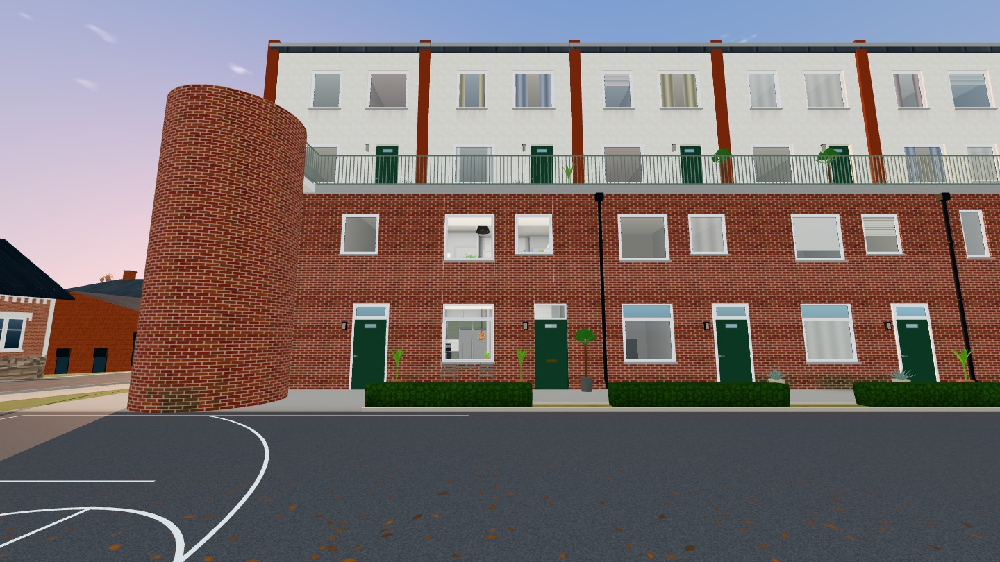
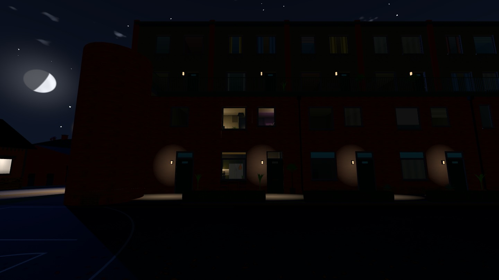
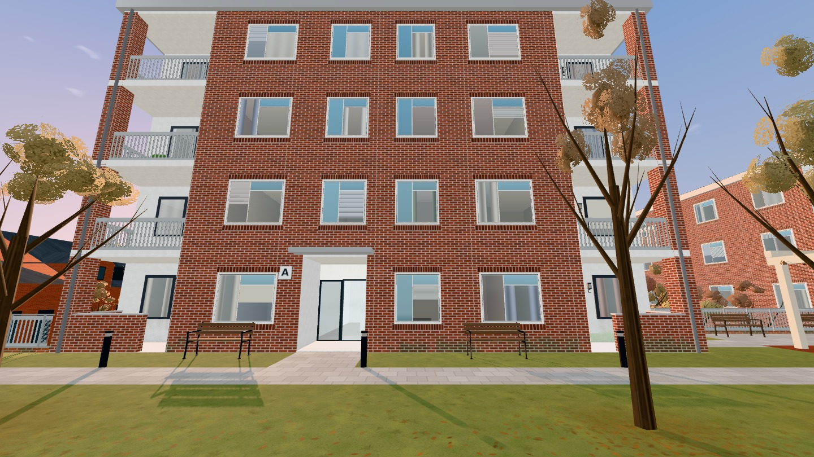
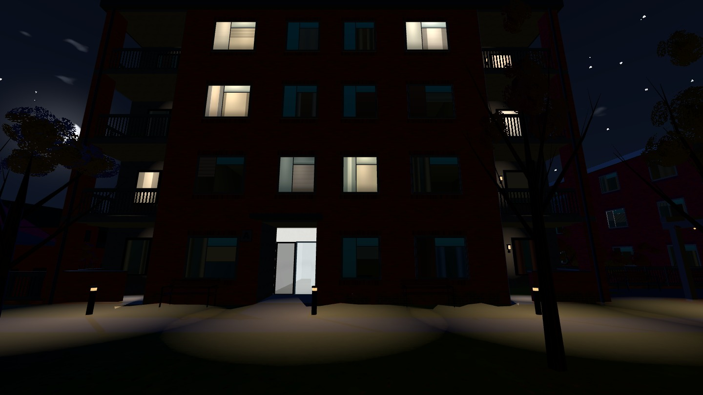
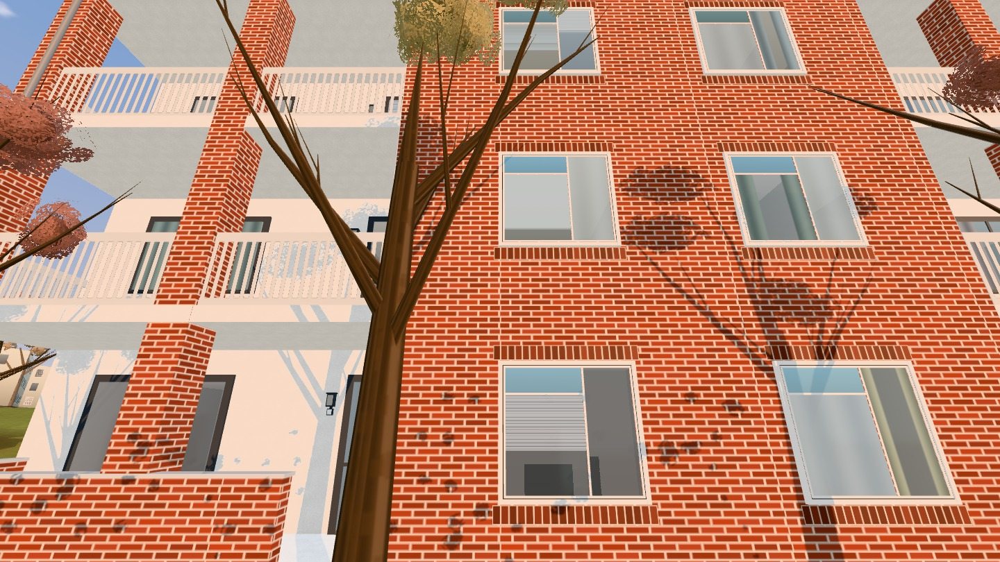
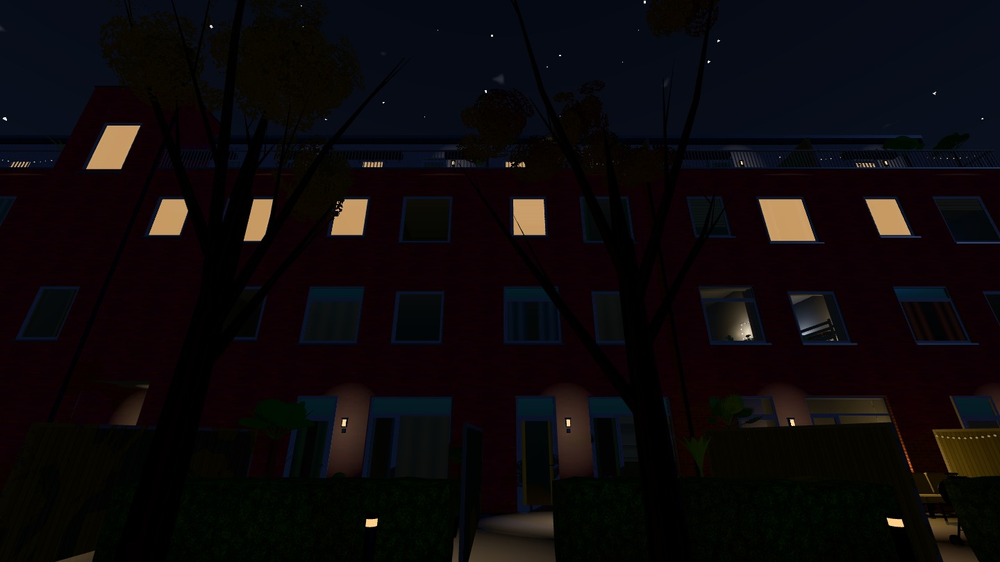

# Grannfönster och fasadlyktor i Hus L, A, B och C (#2324)

Webbreferenserna är tagna i den ordinarie [desktopscenen vid e72c5f55](https://github.com/solwation/lunden-3d-apartment/commit/e72c5f55c57ba0b574ee4ee94958ea96adb574cf) med klart väder den 16 november 2026. Samma kameror mäter eftermiddag kl. 14.00 och kväll kl. 18.15 från 1,62 m ögonhöjd, med 72° vertikalt synfält och 1440 × 810 pixlar. Klockan är fryst och spelet avgör vilka lampor som tänds. Fasaderna använder webbens fyra färdigtonade ljusmasker från entréer och loftgångar.

## Vad bilderna kontrollerar

START visar Hus L:s entrélykta, loftgång och grannrum från gatan. Hus L:s 14 grannrutor med kvällsljus vetter mot gården. En extra kvällsvy från gården visar därför både en tänd och en släckt ruta. Hus A, B och C har en kamera per byggnad vid båda klockslagen. Kameran vid Hus C står mellan södra fasaden och pergolan så att pergolans balkar och egna ljusslinga hamnar bakom kameran. En lykta och två närliggande rutor med olika kvällsscheman gör ljusväxlingen synlig på respektive fasad.

| Hus | Entré- eller loftgångslykta i Unreal-cm (X, Y, Z) | Tänd provruta vid skymning | Släckt provruta vid skymning |
| --- | --- | --- | --- |
| L, START | (209, −10, 190), loftgång (199, 146, 850) | gårdssidan nedan | (−170, 7, 473) |
| A | (−762, 3069, 495) | (−156, 2875, 440) | (−444, 2875, 440) |
| B | (−3960, 3519, 495) | (−3354, 3325, 440) | (−4033, 3523, 455) |
| C | (−6576, 3479, 195) | (−6249, 3673, 440) | (−5923, 3673, 440) |
| L, gård | (−679, 1090, 1141) | (−410, 1263, 795) | (−726, 1263, 785) |

Koordinaterna är avrundade mittpunkter från `site.facadeLighting` i den fullständiga exporten. I A/B/C räknades rutor med positiv RGB i webbens faktiska instansfärger. Kl. 14 var alla 649 släckta. Kl. 18.15 var 91 av 252 tända i A, 56 av 197 i B och 47 av 200 i C. Antalen omfattar de tre husens schemalagda rutor, inklusive rutor utanför bild. Hus L har en separat materialgrupp med 14 av 115 rumsrutor. Dess ljusemission växlade från 0 till 0,6. Både entréernas och loftgångarnas ljusmasker gick från 0 till 0,26 på väggen och 0,45 på marken.

Tabellen visar linjär relativ luminans i [de låsta bildutsnitten](../../../tools/unreal-engine/tests/facade-crops.json). Varje ruta anger kl. 14.00 / 18.15. Dagsljus och gardiner bidrar även när rummets kvällsbelysning är släckt.

| Vy | Lyktans lins | Fönster med kvällsljus | Fönster utan kvällsljus |
| --- | --- | --- | --- |
| L, START | 0,20758 / 0,59105 | — | 0,19970 / 0,00117 |
| A | 0,24033 / 0,47333 | 0,21936 / 0,44293 | 0,20212 / 0,00169 |
| B | 0,25354 / 0,45520 | 0,16971 / 0,70930 | 0,27638 / 0,00120 |
| C | 0,25969 / 0,73279 | 0,54929 / 0,71688 | 0,24280 / 0,00176 |
| L, gård | — / 0,17772 | — / 0,37356 | — / 0,00242 |

I START-vyn gav väggen under entrélyktan 0,09867 / 0,02936 och loftgångslyktans lins 0,33917 / 0,41396.

**START-bilderna.** Den tidigare dagsbilden är tagen i juni. Novemberbilden vid 14-tiden ligger nedan. För kl. 18.15 återanvänds [START-bilden från #2307](../2307/web-start-night.jpg). Dess fyra angivna utsnitt gav exakt samma uppmätta sRGB-medelvärden och linjära luminans som i den nya tagningen när ljusmaskerna stabiliserats. För jämförelseskriptet kan den kopieras till resultatkatalogen som `web-facade-l-dusk.jpg`.

| Vy | 14.00 | 18.15 |
| --- | --- | --- |
| START, Hus L |  |  |
| Hus A |  |  |
| Hus B |  |  |
| Hus C |  |  |



## Upprepa jämförelsen

[De gemensamma kamerorna och klockslagen](../../../tools/unreal-engine/tests/facade-views.json) använder START från projektets ordinarie kameralista. Följande kommandon använder samma uppsättning för webben och för UE. Ange katalogen för den aktuella fullständiga exporten i `export_dir` och använd en separat resultatkatalog `out`.

```sh
mkdir -p "$out"
export LUNDEN_CAPTURE_SHOTS="$PWD/tools/unreal-engine/tests/facade-views.json"
node tools/unreal-engine/pilot-scene.mjs "$export_dir/measurements.json" "$out/scene.json"
# Med webbprojektet serverat lokalt och Playwright och three tillgängliga som i Unreal-guiden
tools/browsertest.sh node tools/unreal-engine/tests/capture-web-lighting.cjs "$local_url" "$out"
```

På Windows används den byggda, kompletta `L_Lunden`. Kör `tests/test_facade_lighting.py` via projektets headless-körare och därefter den ordinarie GPU-bildkörningen `tests/capture_lighting.py <scene.json> <utkatalog> --exposure=game`. Varje bild använder sin egen tid och sitt datum ur `scene.json`. Körningen registrerar kameran, solens riktning, spelets exponering samt `WallOn` och `WallLevel` ur den verkliga fasadkontrollern. Använd samma filnamn med prefixet `unreal-` för de exporterade PNG-bilderna och lägg dem intill webbilderna för mätning. [Headless-bildkörningen](../../development/unreal.md)

```sh
tools/browsertest.sh node tools/unreal-engine/tests/crop-stats.cjs "$out" tools/unreal-engine/tests/facade-crops.json
```

Unreals fasadljusstyrka är uppskattad (*guess*). Native-bilder, uppmätta värden från dessa bilder och PIE-prov av skymning och strömavbrott återstår.
