# Hedge clumps, slatted rails, house letters and Höje å water in Unreal (#2325)

Unreal Editor 5.8.4 on Windows 11, 2026-11-21, headless (`-nullrhi` for the import and checks, `-RenderOffScreen` for
the pictures). A fresh Windows checkout of `469e6327` (`lunden-ue-wt/opus-2325`) with the Actions export
`unreal-export-885d9c273f4c39ce` (run 44931785409, sources of `c22d059e`, the same source hash as `469e6327`). The
export and material changes are Codex's `7284b06e`, `adc9e933` and `a3971a0b`; how they work:
[unreal.md, Courtyard rails, entrance letters and hedges](../../development/unreal.md#vegetation-trees-shrubs-and-hedges-2281)
and [Höje å water materials](../../development/unreal.md#höje-å-water-materials-2325).

## Checks

| Check | Result |
|---|---|
| `sync-import.ps1 -ExportFrom …` (fresh checkout, every step) | pass: `LUNDEN_SYNC_IMPORT_OK`; all ten zones imported, `M_LundenRiverFlow` (spec `5258c58e0252f08e`) and `M_LundenRiverEdge` (spec `ad682225d58bc864`) created by the import, every builder, `compose_world.py --check` and `import_world.py --check` (`LUNDEN_CHECK_OK`) passed |
| `tests/check_site_details.py` (new, commandlet) | pass: `LUNDEN_SITE_DETAILS_OK 14 nodes` ([`site-details-result.json`](site-details-result.json)) |
| `build_materials.py --check` | **fail, not #2325:** both river masters pass; `M_LundenGrass` is stale (spec hash `6cba5e6e9c20009d`, script `bd62f0fb77a92d1b`) since `16269409` (#2317) changed the grass graph without rebuilding the versioned asset |
| WSL `tests/river-water.test.mjs` on the same export | pass: 3,609 `bridges-water` vertices match the web's flow triangles (worst half-UV chainage error 3.81 mm); `edge-land` 54,789 vertices, 1,824 water, 52,965 land |
| WSL `tests/test_materials.py` on the same export | pass: `MATERIAL_COVERAGE_OK` |

`check_site_details.py` reads the material keys from `Import/*.glb` and fails when a surface falls back to another
material. Each node is looked up by its id in every level of `world-levels.json` (the derived interaction levels copy
the zone actors); the boxwood is foliage, so its `SM_Veg_hedge_*` copy is checked instead.

| Surface (key suffix) | Nodes drawn | What is required |
|---|---|---|
| Slatted rails: A/B/C loggias and the courtyard-edge fence (`_site_slatted_rail`) | 2 of 2 (`Level_kvarteret_interaction`) | Interchange's instance of the key, `bHasBaseColorTexture` on, a 128 × 64 Texture2D as in the GLB, masked, two-sided |
| House letters A, B, C (`_site_house_letters`) | 1 of 1 (`Level_kvarteret_interaction`) | the same, 192 × 64 atlas (one 64 px cell per house) |
| Patio hedges and boxwood (`std_78a64b_r95_m0_vc_tex`, `std_48733c_r92_m0_vc_tex`) | 9 of 9 (7 Hus L, L1007's, the boxwood foliage copy) | the same, 512 × 512 clump texture |
| Near river (`_river_flow`) and far water (`_river_edge`) | 1 + 1 (`Level_omgivning`, `Level_fond`) | the material `material-map.json` names: `M_LundenRiverFlow`, `M_LundenRiverEdge` |

Not run here: `tests/river-shaders.py` (needs Linux DXC and VkRunner, which this PC lacks; Codex's run in `a3971a0b`
compared 1,188 samples within 0.00005), and a negative run of `check_site_details.py` against a deliberately broken
material.

## Pictures

1440 × 810, 72° vertical, 21 June 14:00, clear ([`views.json`](views.json)). Web: `capture-web-views.cjs`, desktop
Ultra, SwiftShader ([`web-capture.json`](web-capture.json)). Unreal: `tests/capture_vegetation.py` on `L_Lunden` with
its own sky ([`unreal-capture.json`](unreal-capture.json); `LUNDEN_VEGETATION_CAPTURE_OK 6 views`, editor exit 1 from
a handled Chaos `ensure` in `BPC_LundenSeasons.ApplySeason`, not from the script). The issue's four views (patio,
courtyard twice, river) plus two close views: the A entrance and Höje å from the cycle bridge.

| Web | Unreal |
|---|---|
| 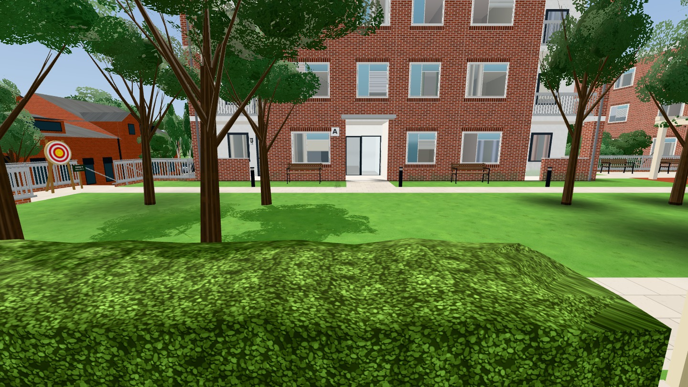 | 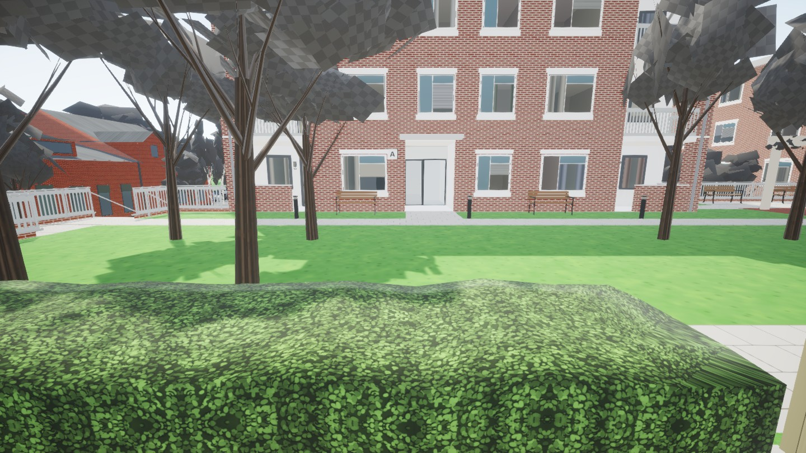 |
| 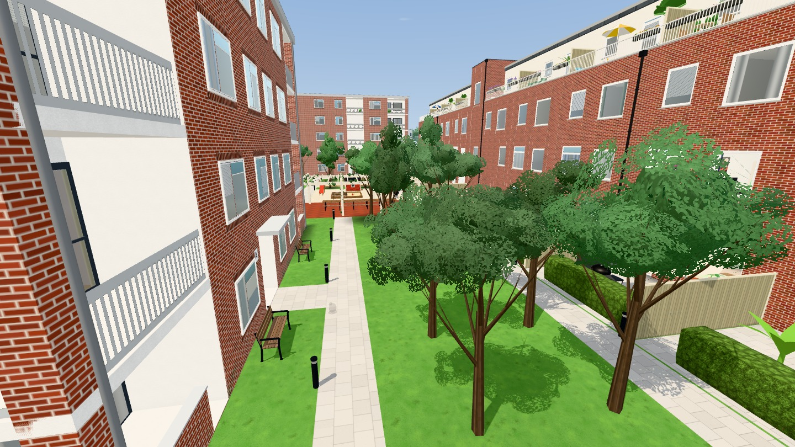 | 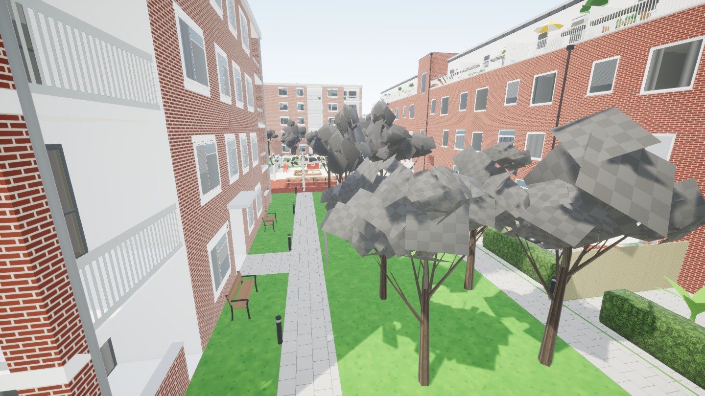 |
| 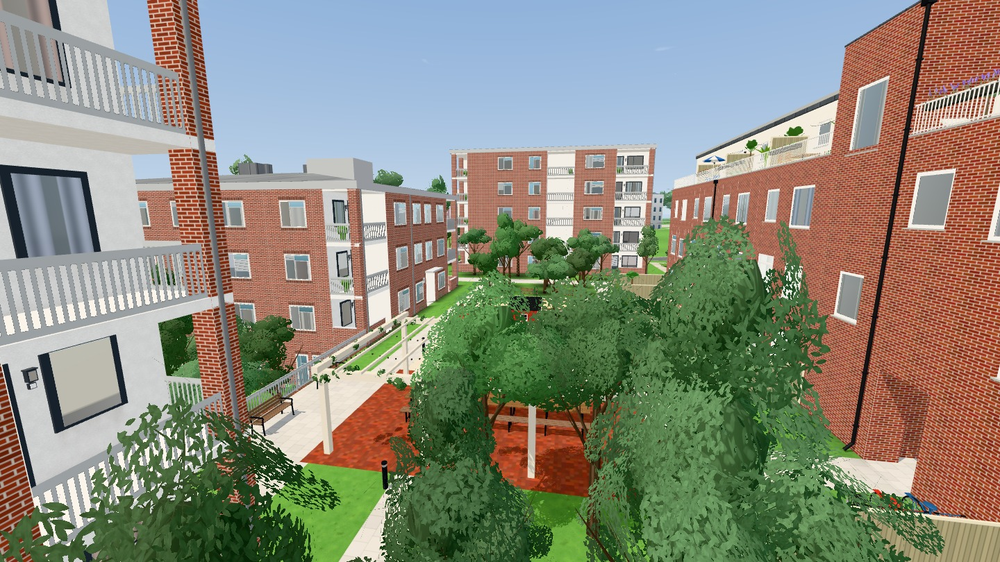 | 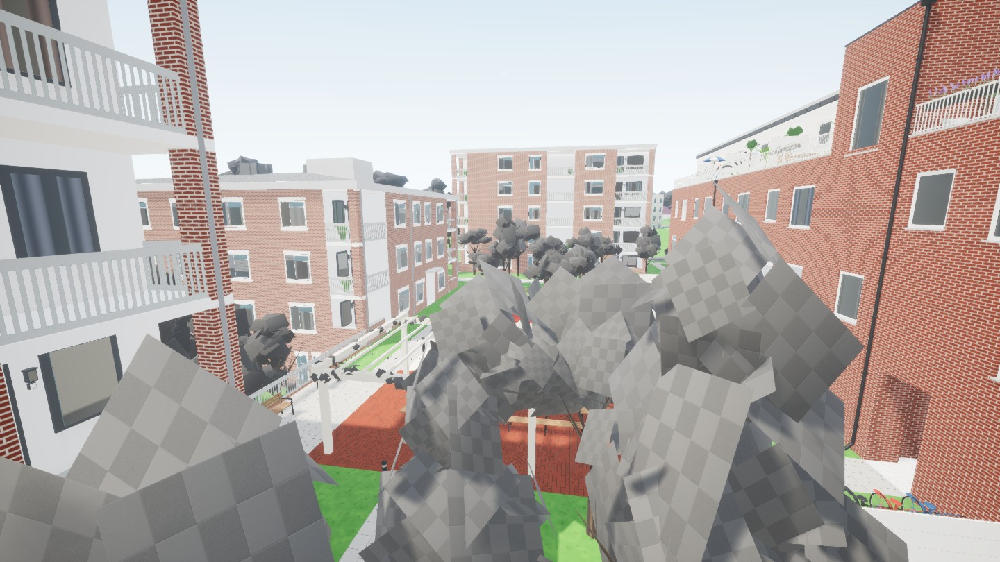 |
| 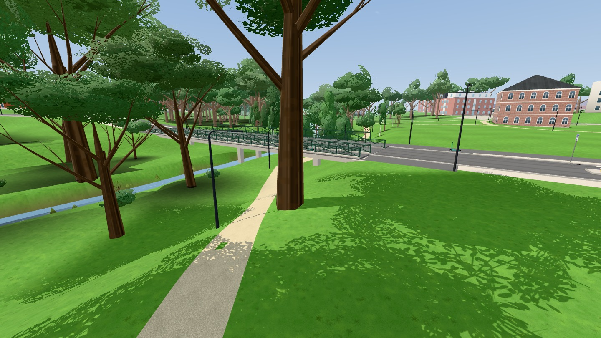 | 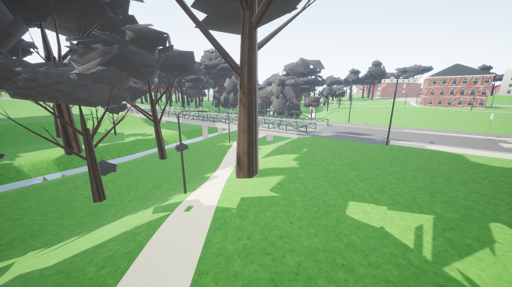 |
| 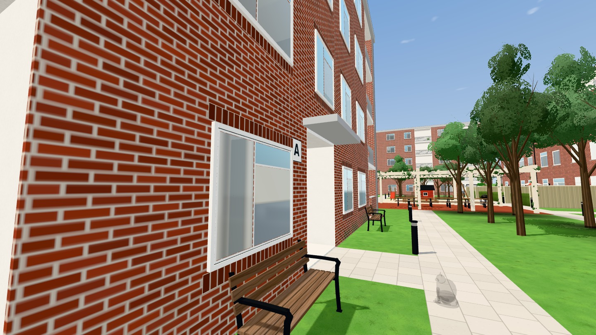 | 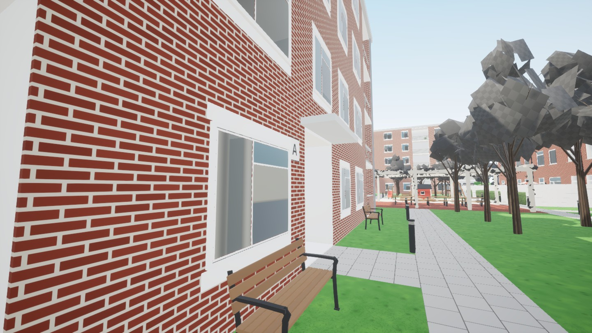 |
| 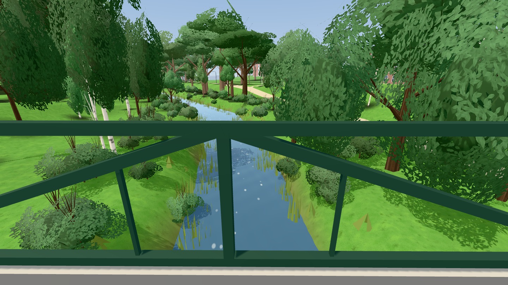 | 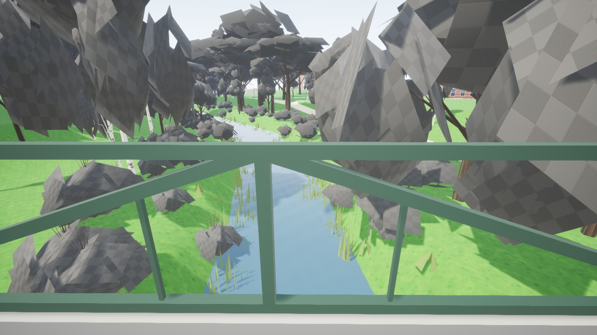 |

- **Patio:** L1007's hedge has the web's light and dark leaf clumps; the white fence on the left has slats with gaps;
  the "A" plate hangs beside Hus A's entrance.
- **Courtyard, both views:** the loggia rails of Hus A (left) and of the houses ahead are white slats with gaps; Hus
  L's patio hedges (right in the ramp-landing view) have the clump texture. Hus L's own rails are geometry and look as
  on the web.
- **Hus A's entrance:** the black "A" on its white plate at the web's place and size.
- **Höje å:** the water is blue, with the web's flow ripples close to the bridge.

Mean colours of matching crops ([`crops.json`](crops.json), `tests/crop-stats.cjs`, sRGB 0–255):

| View, crop | Web | Unreal | Unreal / web luminance |
|---|---|---|---:|
| river-bridge, water | 86, 126, 143 | 150, 184, 195 | 2.34 |
| river, far water strip | 89, 120, 120 | 140, 167, 168 | 1.99 |
| patio-lawn, hedge | 64, 94, 23 | 97, 124, 77 | 1.84 |
| patio-lawn, fence | 105, 99, 92 | 150, 147, 146 | 1.93 |
| entrance-a, letter plate | 157, 157, 156 | 208, 209, 210 | 1.46 |
| courtyard-loggias, rail | 163, 169, 174 | 183, 187, 189 | 1.26 |
| river-bridge, sky | 142, 175, 188 | 170, 173, 177 | 1.10 |

The water is blue in Unreal, but paler than on the web: 2.0–2.3 times the web's luminance where the hedge, fence and
plate are 1.5–1.9 times, so most of it is the scene's general daytime exposure, which is brighter and less saturated
in Unreal everywhere. The water's base colour (`#47657a`), roughness (0.15), metalness (0.2) and sky Fresnel are the
web's. No water number was tuned to close the rest: the web adds no environment reflection
(`scene.environment` is unset), so a further step would be a sourced change to how Unreal's sky light reflects on
the water, not a new calibration.

## Equivalent houses

The rails, letters and hedges come from shared builders, so every variant was checked at once:
the loggia rail mesh spans Hus A, B and C (x −70.5…9.4 m), the courtyard-edge fence is one mesh, the letter atlas holds
A, B and C, and all seven Hus L patio hedges, L1007's hedge and the entrance boxwood passed. Hus L's loftgång and
terrace balusters were already geometry (100 and 90 mm openings, see Codex's comment on #2325).

## Remaining differences in these pictures

- **Tree crowns, shrubs and the river-bank growth are grey checkerboards.** `M_LundenFoliage` at `469e6327` does not
  compile for SM6: `CollectionParameter has invalid parameter None` (twice), so the engine uses its default material.
  The versioned asset was rebuilt for #2383 (`8dd34253`), whose `--check` runs with `-nullrhi` and never compiles the
  shader. Belongs to #2383 (open).
- The general daytime exposure: sky paler and whiter, most surfaces 1.3–1.9 times brighter and less saturated (table
  above).
- The water has no sun glints and no darker mirror of the banks and trees as on the web (the web's bank tint and
  sparkles), and it is paler (above).
- The cycle bridge's railings are lighter green than on the web.
- The paths' paving is grey where the web's is cream (courtyard, entrance).
- The lawns use the versioned `M_LundenGrass` from before #2317's graph change (see Checks).
