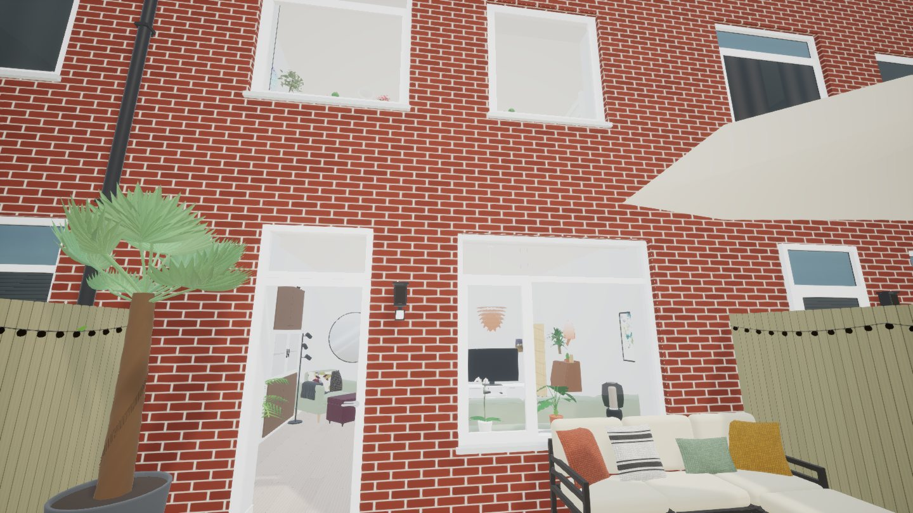
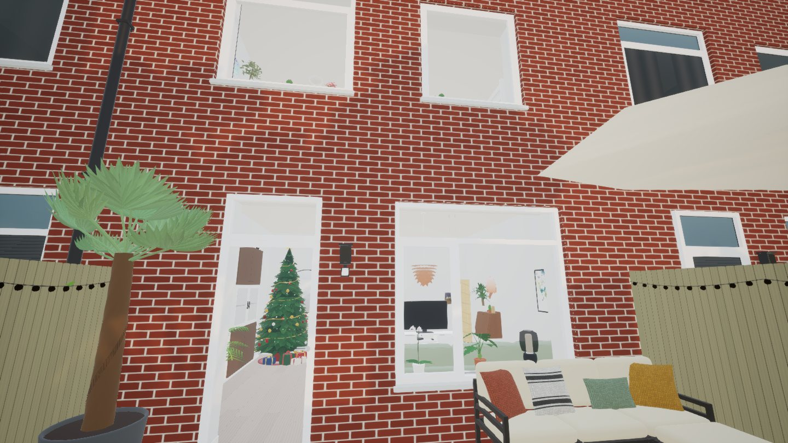
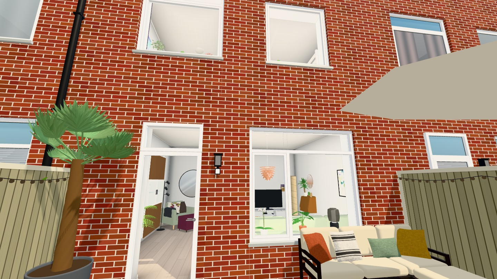
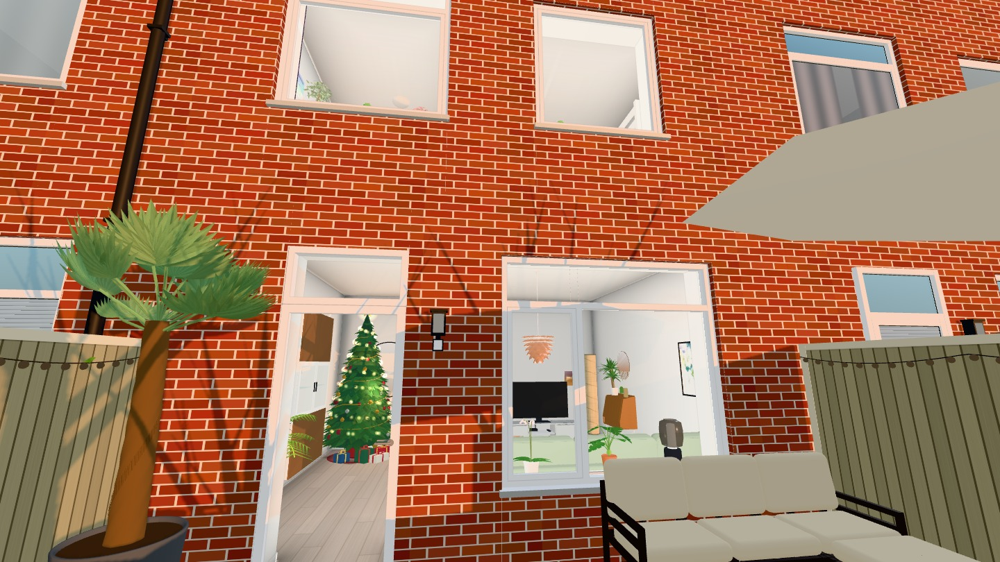
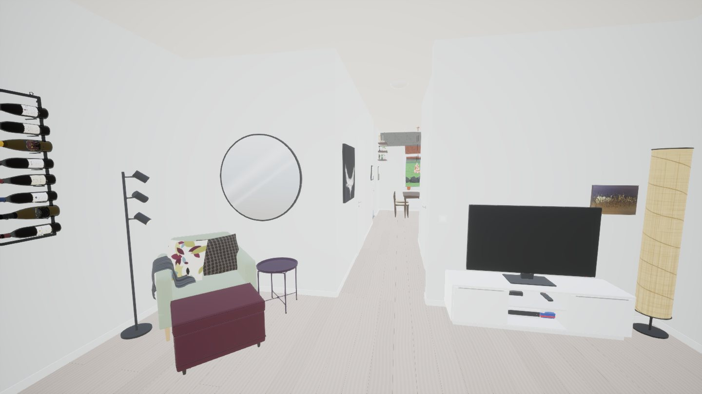
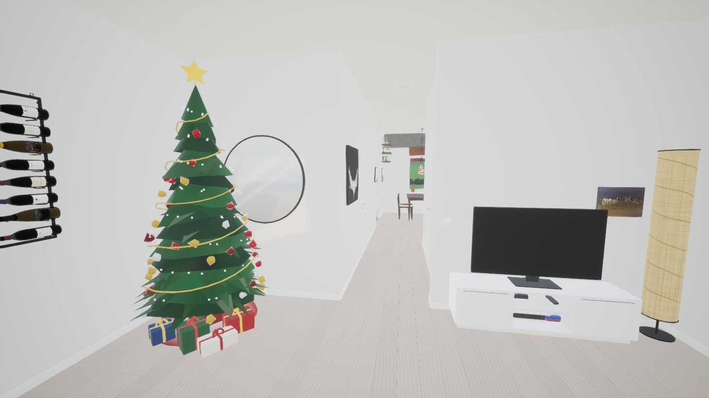
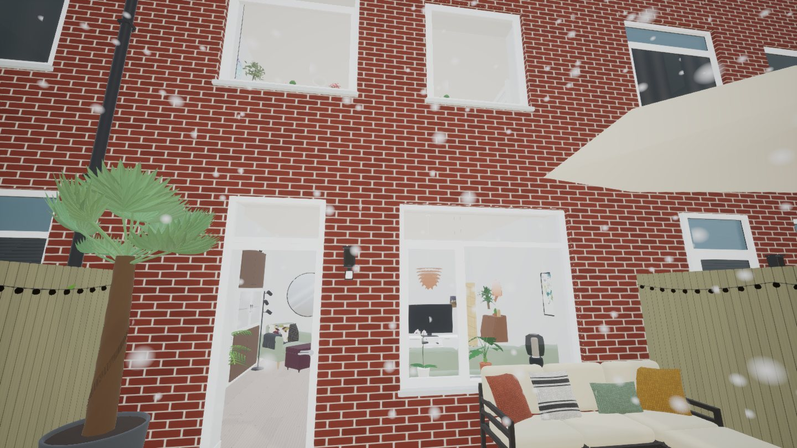
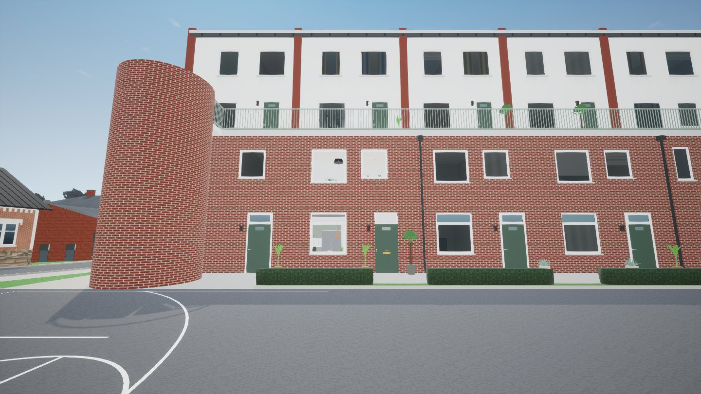
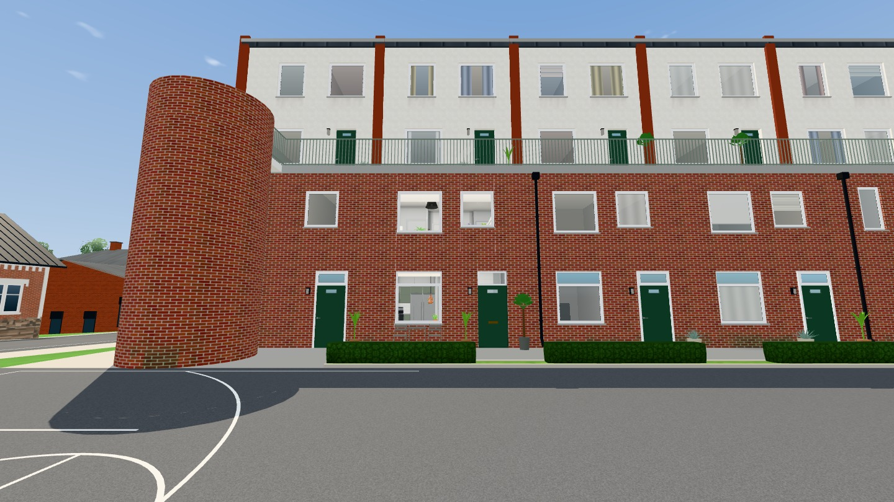

# Season-correct capture pictures (#2326)

Unreal: the warm Windows checkout at 469e6327 with the complete sync of export 885d9c27 (all 16 world levels loaded;
`capture_world.py` from e5cffa17 checks them before every picture), `capture_lighting.py` and `capture_seasons.py`,
headless (`-RenderOffScreen`). Web: `capture-web-lighting.cjs` with the same cameras and dates.

| Check | Result |
|---|---|
| Patio, 21 June 14:00: no Christmas tree through the hall, armchair corner shown | pass (Unreal and web) |
| Patio, 24 December 14:00: the tree through the hall, armchair corner hidden | pass (Unreal and web) |
| Patio in snow (21 June): no tree | pass |
| START 14:00: hedges, box plants and potted plants present | pass |
| Living room tree corner: 21 June tree hidden; 24 December tree shown, armchair, ottoman, floor lamp and tray table hidden (#2303) | pass, `LUNDEN_SEASONS_CAPTURE` 190 seasonal actors |

| | 21 June | 24 December |
|---|---|---|
| Unreal patio |  |  |
| Web patio |  |  |
| Unreal living room |  |  |

Snow on 21 June: 

START 14:00, Unreal and web:  

Differences that remain in these pairs:
- The tree crown behind the house left of START is solid dark grey in Unreal and green leaves on the web
  ([Unreal crop](unreal-start-day-crown.jpg), [web crop](web-start-day-crown.jpg)).
- On 24 December the web takes the patio sofa's cushions in; Unreal keeps them.
- The web's low December sun throws the plants' shadows on the patio wall; the Unreal picture shows none.
- The upper windows and curtains are darker in Unreal (#2324, #2322).
