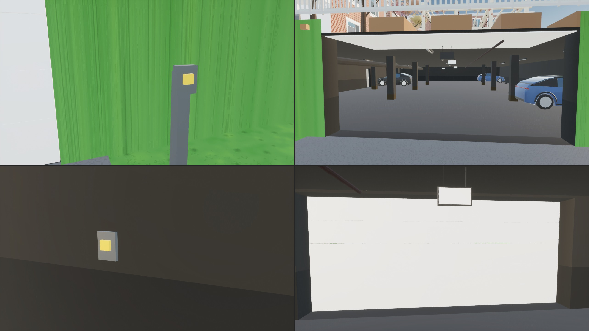

# Dörrar och portknappar i den sammansatta spelnivån

Bilderna kommer från spelvyn i Windows PIE på `L_Lunden`, Unreal Engine 5.8.4 (58902052), med den ordinarie spelbelysningen klockan 14.00 den 15 november 2026 i klart väder. Bildprovet använde gångjärn, dörrmått och knappositioner från [den provade exportrevisionen](https://github.com/solwation/lunden-3d-apartment/tree/bf9718ae3e862bda6d484050e49fc5381d6c2b6b).

## Trapphus

Hus A, B och C visas uppifrån och ned. Vänster bild visar dörren stängd och höger bild visar samma dörr efter ett tryck på E. Kameran står kvar på samma plats. I alla tre trapphusen syns både dörrbladets insida och utrymmet bakom öppningen.

## Garage

Uppifrån visas en ståldörr, en förrådsbur och en glasad parkdörr. Även här är dörren stängd till vänster och öppen till höger. Ståldörren lämnar fri sikt mot garaget och parkdörrens ram och glas svänger tillsammans. Förrådsbladet rör sig men dess nät ser ut som en tät vit skiva i Unreal. [Materialuppföljning #2399](https://github.com/solwation/lunden-3d-apartment/issues/2399)

## Garageportens knappar

Övre raden visar den gula uteknappen på sin stolpe och porten öppen efter knapptrycket. Nedre raden visar inneknappen på väggen och porten stängd efter nästa knapptryck. Båda knapptrycken kom via spelarens vanliga E-inmatning. Portvyerna är fotograferade från respektive knapps sida efter portens nio sekunders rörelse.

## Samma kamera i webben och Unreal

Webbreferensen togs i Chromium med ordinarie spelrenderer, klart väder och frusen klocka vid samma datum och tid. Spelarens öga och riktpunkt sattes till de omräknade PIE-koordinaterna. Webbens vertikala bildvinkel beräknades från Unreals horisontella 86° och bildformatet 16:9. Jämförelsebildernas utsnitt är 768 × 640 pixlar från vardera originalet på 1280 × 720, utan storleksändring.

På webben syns förrådet mellan nätets trådar även när dörren är stängd. Den verkliga 64 × 64-texturen hade 1 892 av 4 096 texlar under materialets alfagräns 0,5. I den testade `kvarteret.glb` består samma blad av 182 trianglar med UV-koordinater. Det är dubbelsidigt och använder ett enda material, `bas_ffffff_r100_m0_tex_ds`. Det saknar både `baseColorTexture` och `alphaMode`, vilket ger opak rendering. Det vita bladet syns redan i spelvyn med HUD bortvald. [Webbens materialkälla](https://github.com/solwation/lunden-3d-apartment/blob/554cd47e6200dbb4c03cea53a8521f52014e7745/src/garage.js#L1112) · [Uppföljning #2399](https://github.com/solwation/lunden-3d-apartment/issues/2399)

Nedre bildparet visar den öppna lägenhetsdörren A1004 i Hus A. I samma 48 × 48 pixlar på nischväggen var medelvärdet för Y′ 128,2 på webben och 179,2 i Unreal. På hallväggen bredvid var värdena 234,3 och 229,2. Nischen hade därmed 55 % av hallens ljushet på webben och 78 % i Unreal. Y′ beräknades som 0,2126 R + 0,7152 G + 0,0722 B från originalbilderna. Mätfältens övre vänstra hörn var (500, 240) och (290, 240), räknat från originalets övre vänstra hörn. Strålar genom fälten i samma GLB träffar två väggytor med bevarade vertexfärger. Triangelns linjära RGB var (0,2714, 0,2589, 0,2310) i nischen och (0,8849, 0,8849, 0,8516) i hallen. Bildparet mäter den återgivna kontrasten men isolerar inte effekten av ljus eller tonkurva. [Webbens nischgeometri](https://github.com/solwation/lunden-3d-apartment/blob/554cd47e6200dbb4c03cea53a8521f52014e7745/src/corehouse.js#L169)

Väggskylten till vänster om öppningen bär den blå texten A1004 på webben. I Unreal syns bara den ljusa skyltytan. En stråle genom skyltens text träffar skyltgeometrin cirka 4 mm framför väggen i GLB-filen. Skylten har UV-koordinater men materialet `bas_ffffff_r100_m0_tex` saknar `baseColorTexture`. Webbspelet använder en skyltatlas på denna yta. [Webbens skyltmaterial](https://github.com/solwation/lunden-3d-apartment/blob/554cd47e6200dbb4c03cea53a8521f52014e7745/src/corehouse.js#L273)

## Så verifierades bilderna

[Bildfixturen](../../../tools/unreal-engine/tests/capture_door_groups.py) valde en exporterad bottenvåningsdörr per hus, ett blad av varje garagetyp och båda portknapparna. För vart och ett av de sex dörrbladen jämförde den gångjärnet med exporten inom 1 cm och öppningsvinkeln inom 1°. Den kontrollerade också att `ChangeCount` ökade exakt ett steg per manöver och att knapparna på sina exporterade positioner satte porten i väntat läge.

Windowsprovet `Editor.Python.Lunden.test_door_groups_capture` slutade med `Success` och `LUNDEN_DOOR_PICTURES_OK 16`. Alla 16 PNG-original var 1280 × 720 pixlar och hade giltig CRC för varje PNG-block samt filslut direkt efter IEND. Bildparen här behåller hela spelvyn. De saknar HUD eftersom spelets `shot` kördes utan `showui`.

Som komplement till aktörsmätningen jämfördes mittentredjedelen av bildens bredd och mitthälften av höjden för de fasta kamerorna. Med varannan pixel i varje riktning gav det 38 520 provpunkter per dörrpar. Andelen där minst en RGB-kanal ändrades med mer än 24 av 255 var 91,6 % för Hus A, 94,3 % för B och 86,7 % för C. För stål-, förråds- och parkdörrarna var motsvarande andelar 73,5 %, 98,2 % och 81,5 %.

Vid bildleveransen återstod den separata ordinarie körningen av `test_interaction`, `test_exterior_route` och `test_facades` på den sammansatta nivån. Där hör de fullständiga dörrkontrakten, gångvägarna och portens automatiska stängning hemma. Nischens bildpar kan återanvändas vid kalibreringen av tonkurvan. [Tonkurva och exponering #2396](https://github.com/solwation/lunden-3d-apartment/issues/2396)

## Linuxkontroll 2026-11-27

På källrevision `19f6083016a36defd7973bca84296fed7b84bac6` kördes den verkliga sammansatta
`L_Lunden` i Unreal Engine 5.8.4 på WSL2/Ubuntu 24.04, med NullRHI för funktionsproven.
Detta är ingen ny Windowsmätning av färg, belysning, bildfrekvens eller release.

Den fullständiga exporten hade 9 402 noder i 10 zoner. De 315 exportkällorna verifierades mot
samma SHA-256 som CI-exporten från `a0e73607fe85144660d65aff9bfd5dbb79880a06`.
Samtliga 13 bygg- och kontrollsteg med Unreal i sync-import-ordningen kördes i en editorprocess,
efter skrivfria kontroller av filerna för belysning, årstider, växtmaterial och interaktionsklasser.
Generated byggdes på riktigt; inga tomma ersättningsnivåer skapades. Extra Nanite-spärr
vägrade materialändringar utanför Generated. Bygget tog 675,42 s och avslutades med exit 0.
Komplett sync-stämpel och `check-import.mjs` godkändes. Alla 246 versionerade Unreal-filer
förblev byte-identiska, även efter de tre separata Automation-processerna.

- `test_interaction`: godkänt på 297,50 s; 18 dörrar i L1007, 131 dörrar utanför, 6 fönsterblad,
  13 strömbrytare, 6 kranar, 1 garageport, 49 hissknappar och 401 korrekta ändringshändelser.
  E-inmatning, båda portknapparna, 25-sekundersregeln, hinder/backning och fordonshooken ingår.
- `test_exterior_route`: godkänt på 216,83 s; 22 kontrollpunkter inklusive Hus L:s trappa
  till garaget samt stängd/öppen Hus A-entré och garageport.
- `test_facades`: godkänt på 223,19 s; 16 fasadpunkter över Hus L/A/B/C och 2 avsiktligt
  öppna passager.

Varje oförändrat ordinarie prov registrerades tillfälligt i Content/Python och kördes
med Epic PythonAutomationTest-pluginen. Rapporterna hade vardera `succeededWithWarnings: 1`,
`failed: 0` och `notRun: 0`. Varningarna var motorns återkommande
`Querying IsUsingWayland before SDL is initialized` i headlessläget; de undertrycktes inte.
Aktuella renderade dörrvyer återstår. Tidigare Windowsbilder ovan är bevarad historisk
bildevidens och ska inte läsas som nya bilder från denna Linuxrevision.

[Sammanställda kördata](linux-verification.json), [interaktionsresultat](linux-interaction-result.json),
[gångvägsresultat](linux-exterior-route-result.json) och [fasadresultat](linux-facades-result.json).

Första CPU-bildförsöket sparade tio riktiga bilder men underkändes av pluginens interna
300 s latentgräns efter kall materialkompilering (motor exit 255, 562,55 s totalt).
Wrapperns 1800 s-gräns nåddes inte. Bildfixturen har nu stöd för en uttrycklig
`LUNDEN_DOOR_CAPTURE_TIMEOUT=900`; standarden är fortfarande 300 s. Endast bildfixturens
budget kan ändras; gångjärns-, vinkel-, knapp-, tidsregel- och händelseassertioner är oförändrade.

Editorvyns faktiska PNG-storlek var 1526 × 910 trots begärda 640 × 360;
[upplösningsfel #2469](https://github.com/solwation/lunden-3d-apartment/issues/2469).
Tunna färgpixlar vid den undre bildkanten följs i [#2470](../2470/README.md).
Dessa fel är inte avsedda grafikförenklingar. Lågprofilens avstängda Lumen/Nanite,
skuggor och reflektioner är däremot avsiktliga utvecklingsinställningar; bilderna
är ingen fullkvalitets- eller Windowsjämförelse.
