# #2366: the clear night sky at START against the web

Unreal Editor 5.8.4 on Windows 11, 2026-11-22, headless (`-nullrhi` for the sync, `-RenderOffScreen` for the
pictures), main ea08ec2d. How the night sky is set:
[unreal.md, Clear night sky](../../development/unreal.md#lighting-sky-and-weather-2283).

## What changed

Nothing in this pass. f428bff5 already lifts the clear astronomical night sky by +1.53 EV (*guess*) in
`M_LundenPrecipitation`. The later lighting rebuilds (#2381, #2386, #2396, #2408) carry it, and `build_lighting.py`
logged `assets unchanged, nothing saved` against the committed assets. #2396 measured the night sky at 1.22 × the web
after the new tone mapping; this pass renders it again on current main to settle the issue.

The +1.53 EV stays. The night sky lands inside 0.8–1.25, and the same value came out of two independent renders
(#2396 and this one). Trimming it to centre the sky near 1.0 would mean rebuilding `BP_LundenSky` and
`M_LundenPrecipitation` while #2394 holds the Lighting LFS locks, for no change to the acceptance.

## Checks

- `sync-import.ps1` on a warm checkout of ea08ec2d: exit 0. `build_lighting.py` logged `LUNDEN_LIGHTING assets
  unchanged, nothing saved` and `Level_lighting unchanged`.
- `check-lighting.py` on the hydrated `BP_LundenSky`: `Lunden.SpecHash matches current lighting inputs: 3e5a5504f90e…`.
- `capture_lighting.py --exposure=game` (7 shots, [`unreal-capture.json`](unreal-capture.json)), then
  `crop-stats.cjs <dir> crops.json --check-lighting` ([`crops.json`](crops.json), the #2396 crops of the lighting
  shots): passed. Full output in [`crop-stats.txt`](crop-stats.txt).

The web pictures are the committed references: #2313's (`capture-web-lighting.cjs`) and #2386's START by day. The web's
sky, lights and exposure code has not changed since, apart from renaming the sky shader's export (d6380c9a).

## Unreal ÷ web, mean luminance of the linear colour

| Shot | Crop | Ratio | R/B web | R/B Unreal |
|---|---|---:|---:|---:|
| START, night with the moon | sky | **1.22** | 0.62 | 0.39 |
| START, night with the moon | frame | 1.25 | 0.89 | 0.80 |
| START, 14:00 clear | sky | 1.13 | 0.73 | 0.70 |
| START, 14:00 rain | sky | 0.87 | 0.98 | 0.96 |
| living room, 22:00, all lamps | frame | 0.82 | 1.50 | 1.34 |
| upper floor, 22:00, all lamps | frame | 0.97 | 1.33 | 1.10 |
| living room, 22:00, dusk lamps | frame | 1.06 | 1.44 | 1.28 |
| living room, 14:00 clear | frame | 0.96 | 1.17 | 1.09 |

Before f428bff5 and #2396 the night sky was 0.59 × the web (#2313), and 0.58 on a fresh decode of the same pictures.

## Pictures (web left, Unreal right)

| Web | Unreal |
|---|---|
| 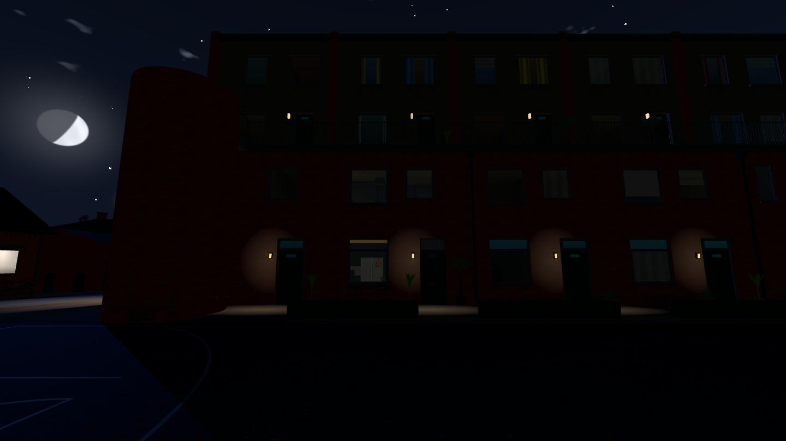 | 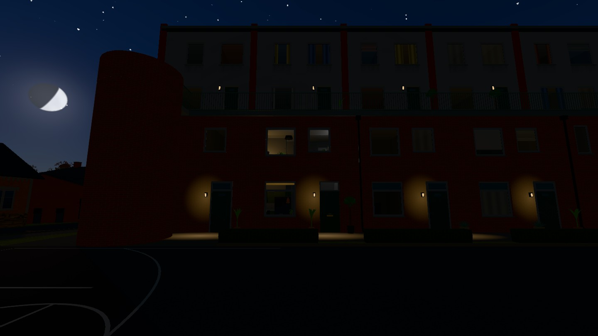 |
| 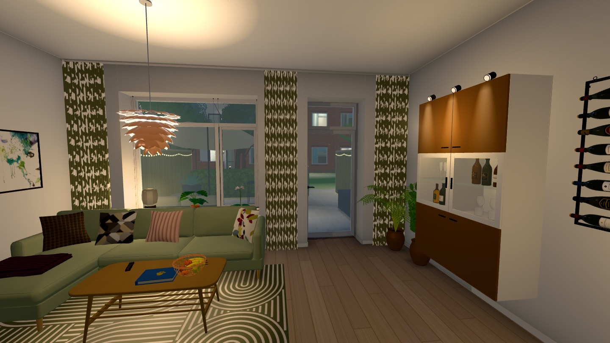 | 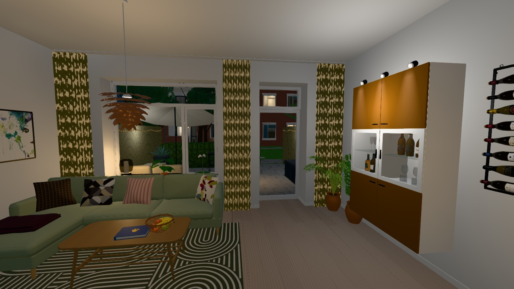 |
| 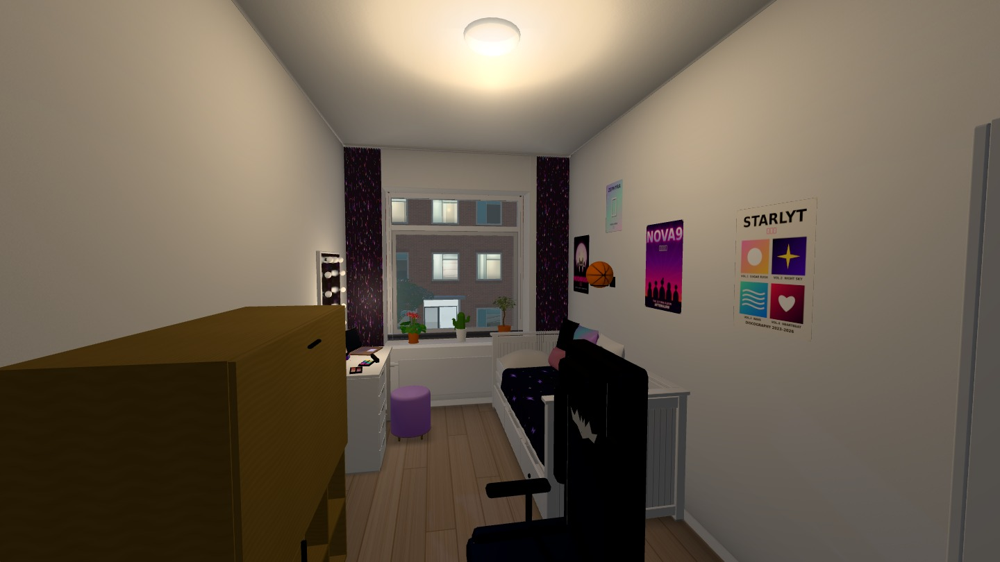 | 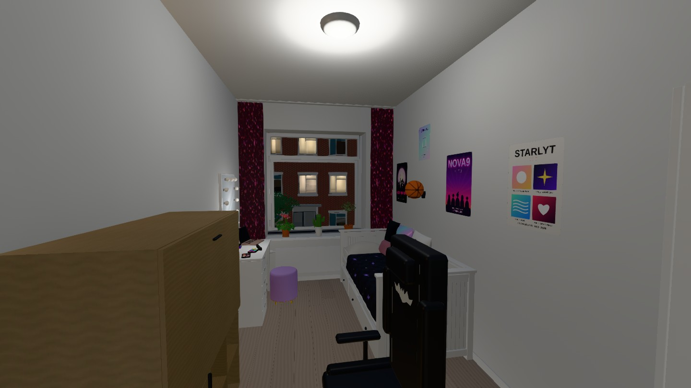 |
| 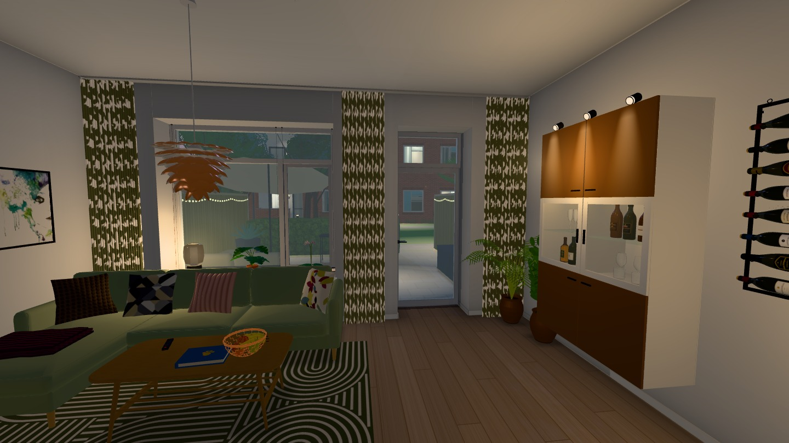 | 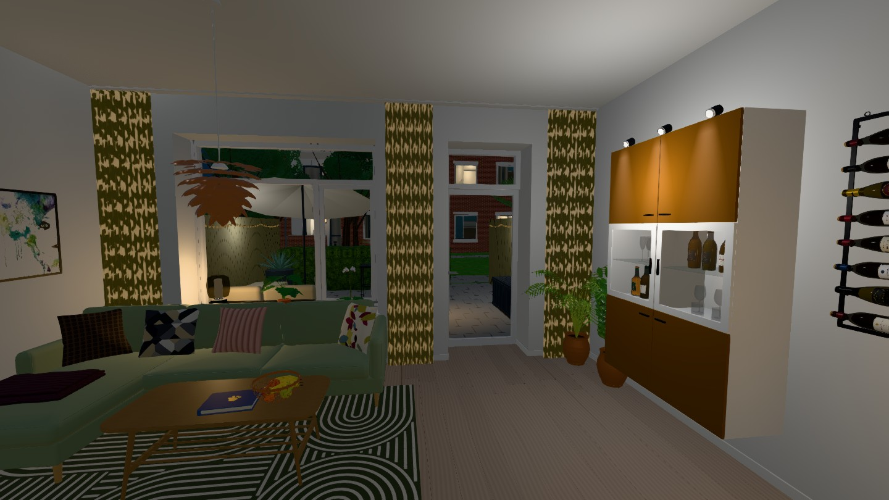 |
| 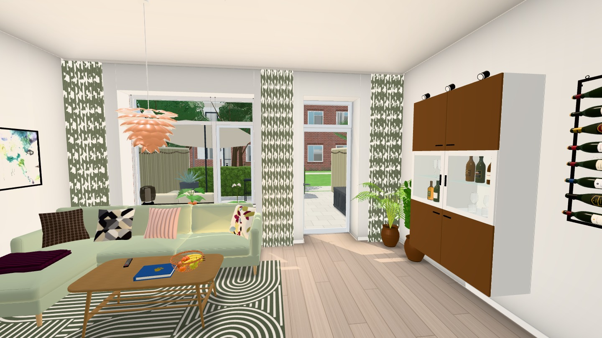 | 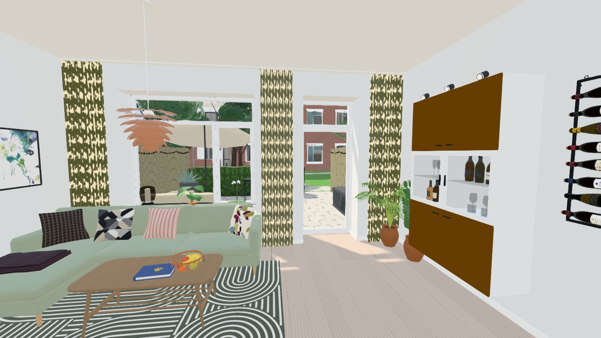 |
| 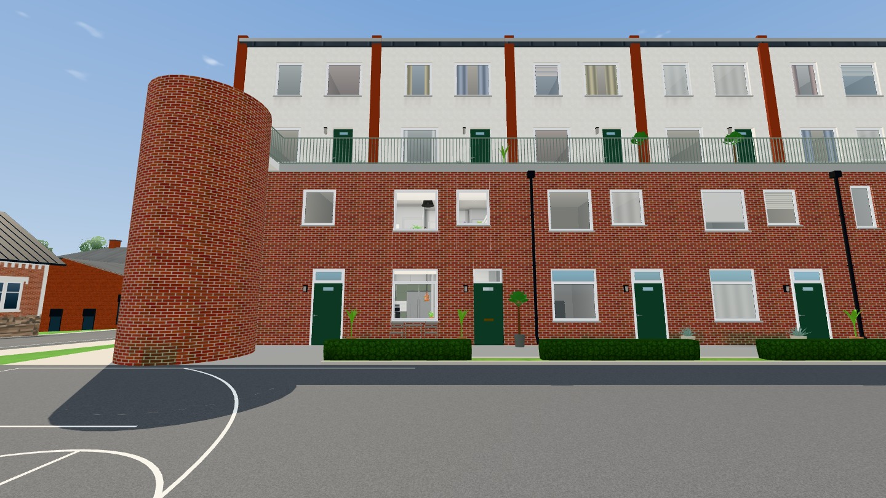 | 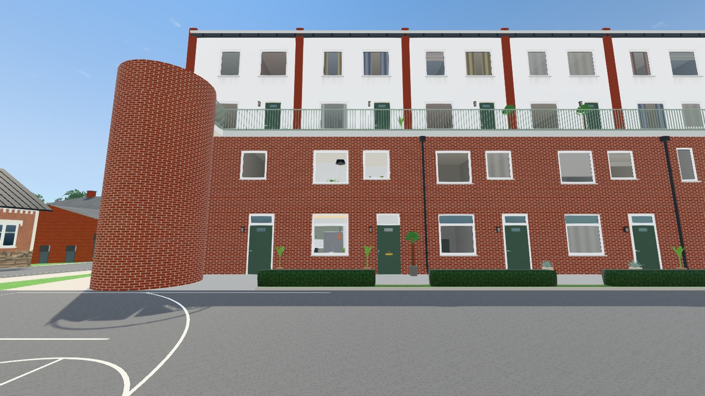 |
| 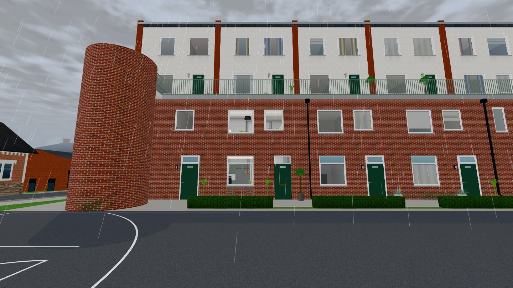 | 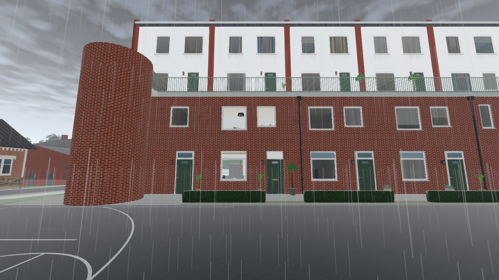 |

## Visible differences that remain

The sky's level matches; other differences remain, each mapped to an open issue:

- The night view at START: the sky is a more saturated blue (R/B 0.39 against 0.62), the light upper storey of Hus L
  stands out pale where the web's is dark, the court is grey where the web's is blue, the entrance lamps' pools are
  yellow where the web's are a dim brown-pink, and the neighbour's lit window on the left is dark. Follow-up: #2421.
- The thin cloud streaks of the web's clear night sky: #2371.
- The evening living room: the pendant's light pool on the ceiling and the bright, cold right-hand wall (#2372), the
  open parasol at night (#2403), the curtains' and floor's textures (#2322) and the cold cast (#2394).
- The daytime pairs are the same pictures as #2396's after-pairs, at the same ratios to within 0.01, and its open
  issues cover them.
