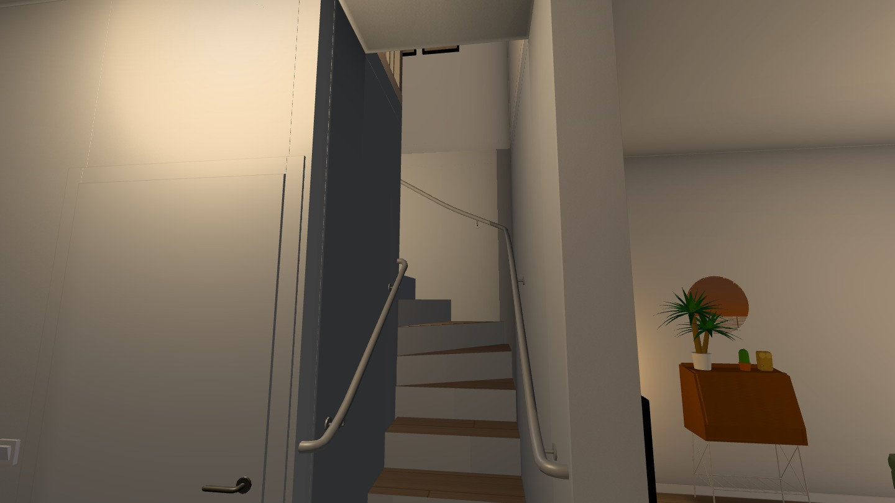

# L1007 stair lighting at 22:00

The archived stair pair from #2321 uses 21 June 2026, clear weather, all lamps on and a 1440 × 810 frame.
The camera is at (2.15, 1.62, 7.38) m in web axes, yaw −83°, pitch +8°, vertical FOV 72°. The original
native capture records the matching position and horizontal FOV 104.50°.
[Web stair](../2321/web-stairs.jpg) · [Unreal stair](../2321/unreal-stairs.jpg) · [Native pose](../2321/unreal-capture.json).

| Existing image pair | Web mean linear luminance | Unreal | Unreal / web |
|---|---:|---:|---:|
| Stair, full frame | 0.1746 | 0.2885 | 1.65 |
| Stair, shaft side wall | 0.0271 | 0.3176 | 11.72 |
| Stair, riser | 0.0341 | 0.1635 | 4.79 |
| Stair, tread | 0.0072 | 0.1350 | 18.75 |
| Stair, neighbouring hall door | 0.7048 | 0.7583 | 1.08 |
| Living room, 14:00, full frame (#2313) | 0.5073 | 0.5112 | 1.01 |
| Living room, 22:00, full frame (#2313) | 0.1647 | 0.1361 | 0.83 |
| Upper floor, 22:00, full frame (#2313) | 0.1684 | 0.2045 | 1.21 |

The living room, upper floor and sky calibrations remain those of the lighting builder. The stair photo includes
the adjacent hall passage. A division into left 33%, middle 30% and right 37% gives web/native means of
0.288/0.447, 0.091/0.290 and 0.141/0.147 respectively. The hall passage is the separate Hall region by the stairs
in `EXTRA_ROOMS`. Its lower-storey bounds come from the same 5 cm room map used by gameplay.

In the real L1007 geometry the lower closet lamp reaches the measured riser and tread through the inner wall. The side wall and the well-exposed surface by the hall
door share the same exported paint material, `std_f1f1ee_r85_m0`.
A living-room lamp reaches the shaft side wall through another wall and the upper-floor rattan lamp through the
floor slab. At the door, the near Hall ceiling lamp has a clear path and the bathroom lamp is behind a wall. The
web light pool selects the nearby Hall lamp at this pose. The web's other lamps illuminate the receiver only on
their own floor and within their angular visibility polygon. The prior Unreal rig lit these surfaces with all
nearby unshadowed point lights. It also used the 5 m small-lamp fallback for every room emitter. Reading the
web's `range` now gives the ordinary ceiling fixtures 6 m, wet-room spots 4 m and the standard pendant 5 m.

The generated native light functions evaluate the actual exported wash profiles at the receiving world point.
An unshaded light visible from the camera's storey (the player's standing-eye threshold) can keep its direct contribution, like a web pool light. This eligibility
test is conservative. The web additionally ranks the four slots, favours held lamps and fades them over 0.4 s.
The web camera test settles the slots across a teleport while keeping the date, sun and weather frozen. Capture metadata records their actual positions and fade shares. Shaded lamps always follow the wash cutoff.
Multiple anchors keep their intensity weights. The material affects local direct light in the shaft and the
lower approach. There is a 5 cm edge transition. Unreal exposure, material albedo and the sky rig retain their
existing settings.

## Frozen web reference after the light pool settles

The previous sampler gave the newly selected near Hall lamp a 0.0417 pool share when reading the frame.
A fresh capture with the original sampler reproduced 0.1746. With the same date, clock, weather and camera,
all three selected stair lights reach a share of 1. The tread lightens, the shaft side stays in shadow and the
hall door retains its warm highlight.

| Fresh web view | Pool slots at full strength | Mean linear luminance |
|---|---:|---:|
| Stair 22:00 | 3 | 0.1848 |
| Living room 14:00 | 0 | 0.5073 |
| Living room 22:00 | 4 | 0.1680 |
| Upper floor 22:00 | 2 | 0.1713 |

The fresh stair crops are 0.0271 for the shaft wall, 0.0766 for the riser, 0.0284 for the tread and 0.7082 for
the hall door. Against this settled reference the **archived** Unreal stair image is 1.56× over the full frame.



## Repeat the checks

After exporting L1007, run `node tools/unreal-engine/tests/stair-light-rays.mjs` for the rays through the real
GLB. Run `python3 tools/unreal-engine/tests/stair-lamp-shaders.py unreal/Lunden/Import/measurements.json` with
Linux `dxc` and `vkrunner` on PATH (or supply `--dxc` and `--runner`). It compiles the material functions to
SM6 DXIL and SPIR-V and reads a floating-point Vulkan attachment for the stair, door and control-room surfaces.

On the Windows build machine, regenerate and check the lighting level from the same export, then use the
ordinary headless `capture_lighting.py` and `capture-web-lighting.cjs` flow with
`stairs-evening,living-room-day,living-room-evening,upper-floor-evening`. Place the paired images in one directory
and run the four-frame acceptance gate.

```sh
node tools/unreal-engine/tests/crop-stats.cjs <pairs> tools/unreal-engine/tests/stair-lighting-crops.json --check-stairs
```

The four full-frame ratios must each be 0.8–1.25. The smaller crops diagnose the source of any remaining discrepancy.
A fresh native render with the generated light functions remains outstanding.
