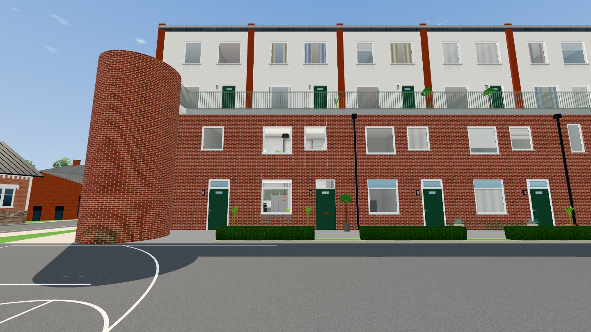
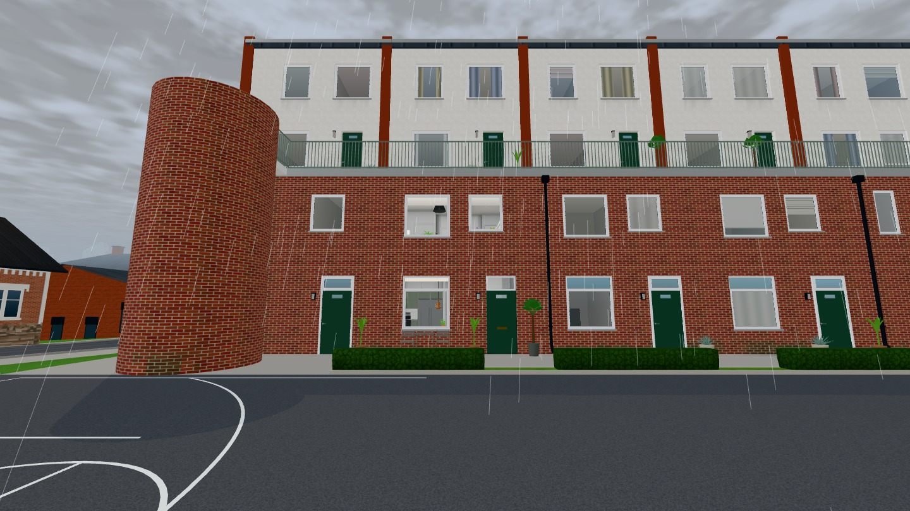

# Daylight clouds from START

Both web views use desktop Ultra at 1440 × 810, 21 June 2026 at 14:00. The eye is at (2.875, 1.62, −12) metres, yaw 180°, pitch 8° and vertical field of view 72°. The two captures use the same initial cloud offset, (0, 0) metres. This makes the cloud phase independent of asset loading time.

| Clear | Rain |
|---|---|
|  |  |

The clear reference shows short pale wisps in the upper-left sky. The rain reference has darker elongated cloud bands behind the rain streaks. In the #2313 crop, the new web means in linear Rec. 709 are 0.42200 and 0.34962. The archived Unreal images measure 0.50802 and 0.35017 respectively, before rebuilding the new sky.

## Cloud field and exposure

The lighting export now carries the colour palette, cloud field, deck altitude, wind and edge parameters from the web. The material projects the view ray onto the 1,200 m cloud plane in the web's horizontal axes. It samples three periodic value-noise octaves at a base cell size of 200 m plus two finer octaves at higher elevations. Threshold, softness, underside, sunward self-shadowing and the coverage floor in rain follow the desktop sky shader. The clear threshold is 0.92, the rain threshold is 0.36 and edge softness is 0.16. Snow reaches 70% of full overcast. The Blueprint integrates the wind in metres per game-world second independently of the daylight clock. Wind changes retain the accumulated phase and the 5,200 m period wraps on both horizontal axes.

The existing atmospheric and volumetric lights still illuminate the scene. The new layer runs on distant sky pixels in the existing precipitation material, before precipitation streaks, the moon and stars. It fades out at the horizon, through twilight, around the solar disc and above the web's high-flight deck. The night adjustment from #2366 still operates on its original sky colour.

The daytime colour comes from the web's linear clear/overcast gradient and cloud colour. For exposure, the material divides it by the luminance of that same gradient and deck at neutral density (the web noise mean of 0.5) and multiplies by the underlying atmospheric luminance. This is a calibration assumption (*guess*) using the existing game exposure from [#2313](../2313/README.md). It preserves directional lighting while allowing spatial variation within the cloud layer.

## Shader comparison

The scene exporter built the fixture zone and measured the full web world. Its measurements file had SHA-256 `309c4c73c7c63b732bf3007bc58564051ef8c4558a8c897f2b38c1257f4cc88e`. The test uses the web's actual desktop GLSL from `daycycle.js` and the material builder's HLSL, compiled independently with glslang and DXC. Both execute on Vulkan lavapipe. At each overcast value it compares coverage, thickness, sunward shading and three linear colour channels for 768 rays, including negative world positions and offsets across tile boundaries.

| Overcast | Coverage range | Maximum absolute linear RGB difference |
|---|---:|---:|
| 0 | 0–0.20839 | <0.0000001 |
| 0.125 | 0–0.97674 | <0.0000002 |
| 0.4 | 0–1 | <0.0000002 |
| 0.7 | 0–1 | <0.0000002 |
| 1 | 0–1 | <0.0000003 |

On 768 actual START rays inside the [#2313 sky crop](../2313/crops.json), the mean shader luminance multiplier is 1.00000 in clear weather and 1.06319 in rain (individual rain rays 0.80253–1.33666). Across the full START field of view before scene geometry, 11 of 5,184 clear-weather rays have more than 1% cover. A sample above the roofline reaches 0.442. Exact patch positions may vary across graphics drivers because the source hashes a floating-point sine. The same crop rays at night or above the deck preserve the incoming sky colour. The material also compiles as a complete Direct3D SM6 pixel shader. These are shader measurements before Unreal's tone mapper.

## Native verification

Re-export the scene and run the ordinary headless lighting build and world composition. The lighting builder’s `--check` verifies the saved sky shader and its four weather connections. Run `test_lighting.py` in PIE and pass its `lighting-result.json` to `check-sun.mjs` for the overcast threshold and integrated cloud offsets, including a wind change and calm interval. Capture `start-day`, `start-overcast` and `start-night` using `capture_lighting.py --exposure=game`. Compare the new clear and rainy images to the two references above and measure the sky with `crop-stats.cjs` and the #2313 rectangles. A new native render and the final 0.8–1.25 exposure ratios are pending.

To repeat the standalone shader comparison, run `python3 tools/unreal-engine/tests/sky-cloud-shaders.py unreal/Lunden/Import/measurements.json` with `dxc`, `glslangValidator` and `vkrunner` available. The script also accepts explicit paths to each tool.
