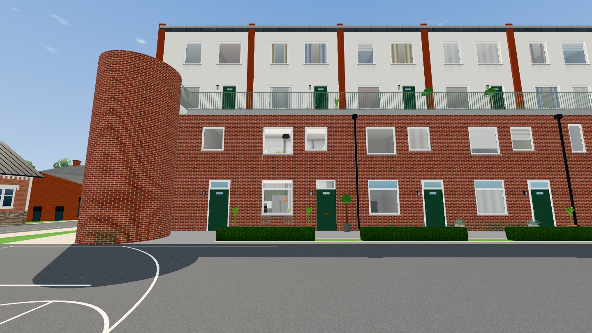
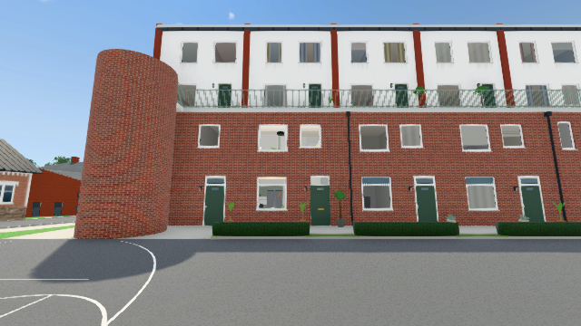
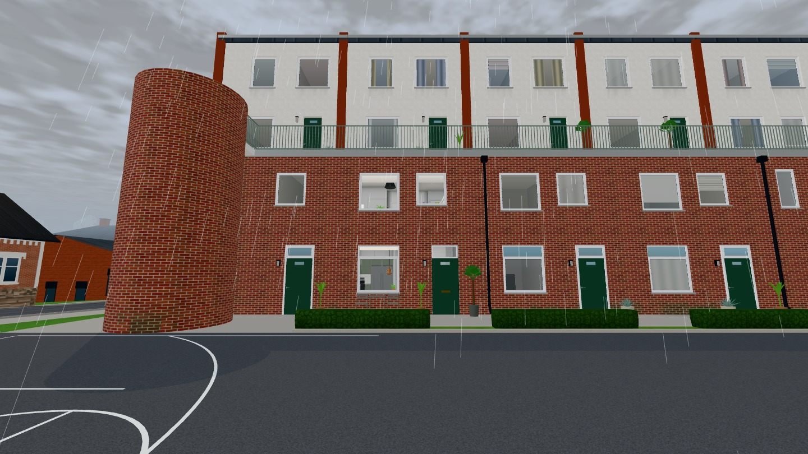
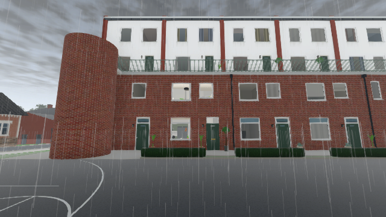
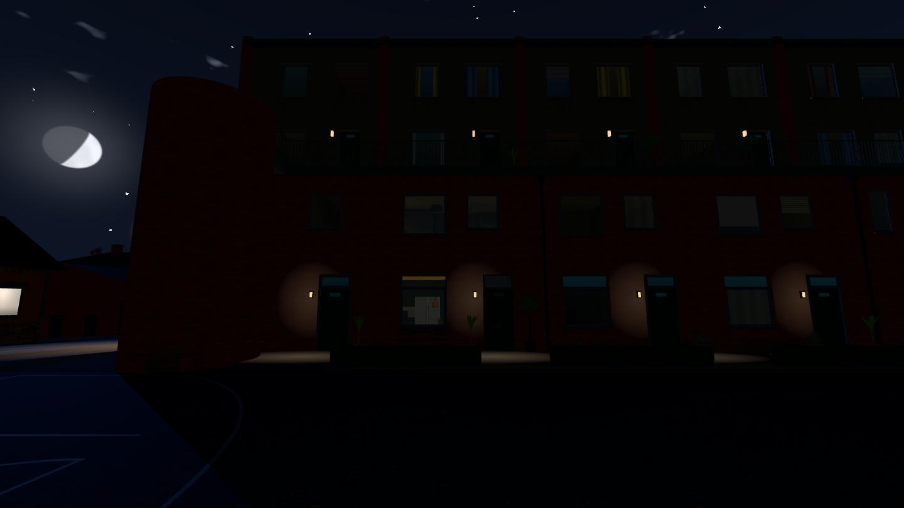
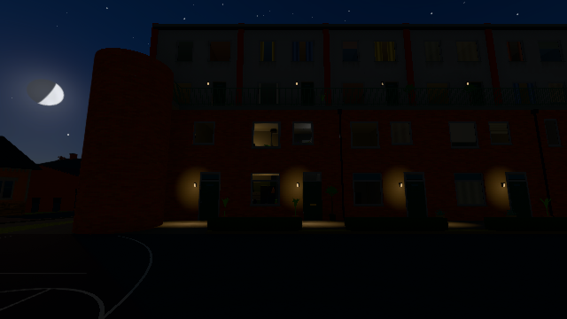

# #2371: actual daylight clouds at START

The existing daylight cloud implementation now has real native image evidence: clear weather shows pale wisps and rain shows a structured grey cloud deck. All three locked sky crops pass the existing 0.8–1.25 luminance band. This pass changes documentation only; the product implementation remains d6380c9a/a028792e.

Native UE 5.8.4 on `2e7e18fb65ce5de612046a9ad40ecd6342790dcc` returned **0** in **246.47 s**, with durable `passed:true`. The outer command returned **143**, leaving its launcher record incomplete; that separate failure remains [#2473](https://github.com/solwation/lunden-3d-apartment/issues/2473). These statuses are not interchangeable. Root's independent postflight proved all **247 authored packages byte- and mode-exact and read-only**. See [outcome.json](outcome.json).

## Matched conditions

START eye is web `(2.875,1.62,-12)` m / native `(287.5,-1200,162)` cm, yaw web 180° / native 90°, pitch 8°, vertical FOV 72°. The original web images are 1440×810; native targets are 640×360 with the same 16:9 aspect and 104.5049° horizontal FOV. No image was resized, cropped, retouched or re-encoded. All native PNG chunks pass CRC through IEND; original trailing bytes are retained. The actual camera readbacks match the locked pose.

Day/overcast are 21 June 2026 at 14:00; night is 16 November 2026 at 18:15. Each capture resets the cloud phase to `(0,0)` and uses the production sky's real `game_bias`, not a fitted capture exposure. Bias is −1.9650375 EV clear and −2.55 EV rain/night. Actual production Weather component identity, visibility and every material/weight were checked before each picture; no private blendable or MID was attached.

Linux diagnostic profile: CPU Vulkan/SM5, FXAA `r.AntiAliasingMethod=1`, `r.PostProcessAAQuality=0`, conventional ShadowQuality 3, SeparateTranslucency 1 and LightFunctionQuality 2. Lumen/Nanite are disabled. **`r.VolumetricCloud=0`**: this pass verifies the source-derived daylight field in the real production postprocess, not Epic's volumetric cloud rendering or the full Windows profile. Mesh Nanite fallback and season visibility are transient; no collision/physics or resource save is performed. Full Windows/PIE/release acceptance is not claimed here.

## Locked measurements

The #2313 sky rectangle remains `[0.02,0.02,0.2,0.3]` in each view. Day/rain references are the original #2371 images. The night reference is byte-identical to #2313/#2366, and its saved web metadata confirms camera/date/hour. Source audit confirms the web sky template, palette, cloud configuration/runtime and native shader are unchanged since a028792e. References and criteria were locked before inspecting these native images.

| Sky | Web linear Y | Native linear Y | Native/web | Existing band |
|---|---:|---:|---:|---|
| Clear14:00 |0.4220|0.4715|**1.1173**|PASS|
| Rain14:00 |0.3496|0.3405|**0.9740**|PASS|
| Clear night |0.0237|0.0278|**1.1730**|PASS|

The old reported rain value 1.43 is not reproduced. These are decoded display-image measurements, not the earlier standalone shader's pre-tonemap ratios. Exact cloud patches can differ between floating-point sine-hash implementations; the native originals visibly retain thin clear-weather wisps and dark/light rain bands rather than a flat gradient. Both Root and the worker inspected all six originals.

| Web original | Native original |
|---|---|
|||
|||
|||

## Wind and saved production bindings

Three actual compiled `BP_LundenSky.ReceiveTick` calls exercise 12 m/s at 90°, calm at 315°, then 30 m/s at 315°, starting across the 5200 m tile boundary. The expected values come from the actual web `stepCloudDrift`, including retained heading during calm. Native offsets match within 0.001 m and directions within 0.00001; the daylight clock remains frozen. Original capture wind is restored before images.

This is direct event dispatch, explicitly **not a PIE wall-clock timing test**. The canonical `check-sun.mjs` reads the actual native output and passes 20/20 sky/cloud/weather values and four sun/moon directions (worst 0.0000°). The read-only lighting check matches signature `3315df7afc5a3f4c9f61254f43e9d89da0e784a9293eebbb136b52652c73dc4b`; the existing freshness regression rejects changed clouds, source colours, lamp positions, damaged signature and wrong Blueprint ownership. No Lighting rebuild was needed.

Evidence: [native-state.json](native-state.json), [expected drift](expected-cloud-drift.json), [canonical comparison](check-sun.txt), [image measurements](crop-stats.json), [measurement output](crop-stats.txt), [sky gate](sky-gate.json), [locked contract](locked-contract.json), [source audit](source-audit.json), [PNG/camera integrity](png-camera-integrity.json), [byte manifest](manifest.json), and the [exact private capture harness](capture-clouds.py).

## Remaining whole-image differences

- **[#2421](https://github.com/solwation/lunden-3d-apartment/issues/2421)** is the same START night view: blue sky hue (R/B 0.388 versus web 0.621), yellow rather than pale brown/pink entrance light fields, ground colour, upper facade and dark neighbouring window. Passing sky luminance does not resolve these colour/details.
- **[#2451](https://github.com/solwation/lunden-3d-apartment/issues/2451)** covers missing evening/night cloud details in the November facade views. START is an additional reproduction of its missing thin-cloud component. The moon is visible here; no claim is made that #2451's other cameras or moon component pass. The daylight-only implementation deliberately retains its original night branch.
- **[#2428](https://github.com/solwation/lunden-3d-apartment/issues/2428)** covers the lighter, more mortar-heavy and lower-contrast distant brick. The captured daylight lower facade remains visibly different; this sky verification does not fix its material/filtering.
- **`RAIL_RASTER_ISSUE` — ROOT INSERTS THE OPEN ISSUE AFTER RAW-IMAGE PUBLICATION.** Native balcony railings show conspicuous alternating light/dark raster patterns at this distance. #2443 covers screen walls, not balcony rails; it must not be used as blanket coverage. Source, capture size/filtering and material causes are unproven here.

#2481 covers indoor lamp halos only. It is not used to cover outdoor lamp fields or the moon halo. No night colour, exterior halo or railing fix is hidden in this documentation pass. Any further halo-specific mismatch outside #2421/#2451 needs its own explicit scope before being declared covered.

Original Unreal-only: no public downstream change and no web-player changelog. All six images are results/source references; this issue directory contains no failing native before-picture to prune. Root posts permanent image links before closure and handles final duplicate/before-image cleanup in its resolving commit.
