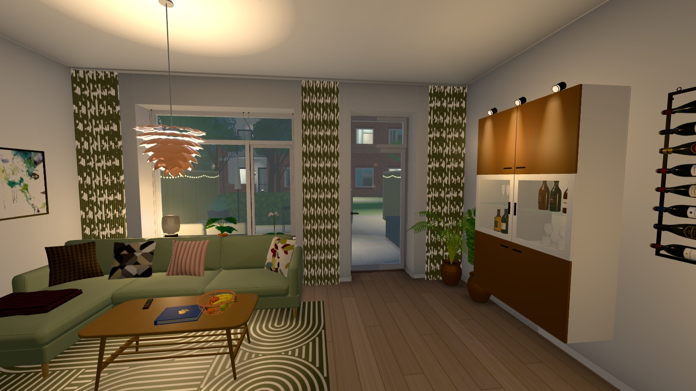
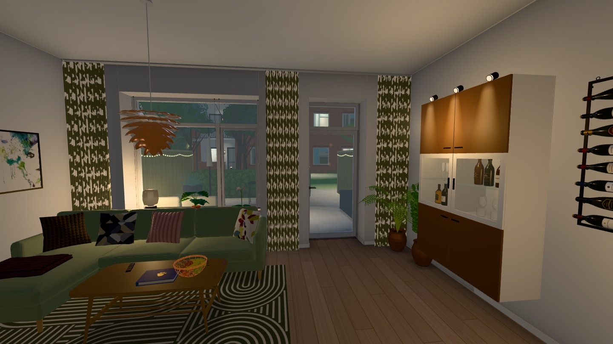
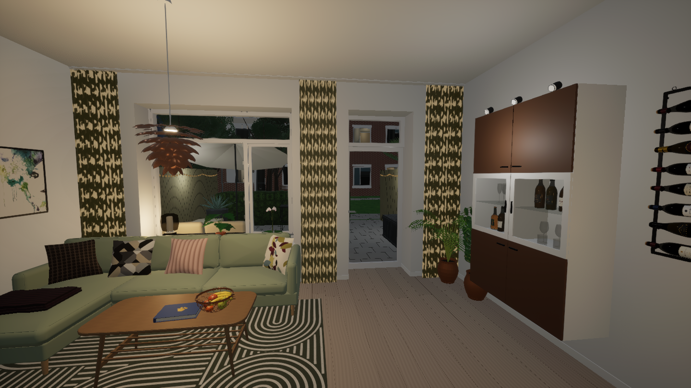
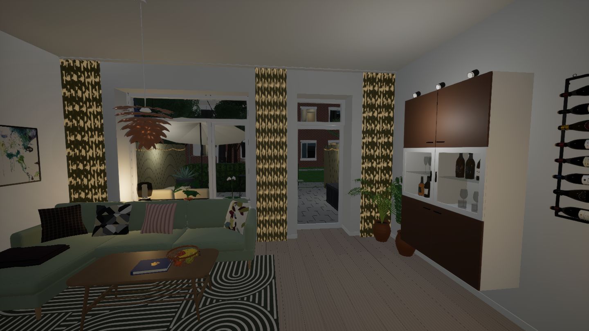
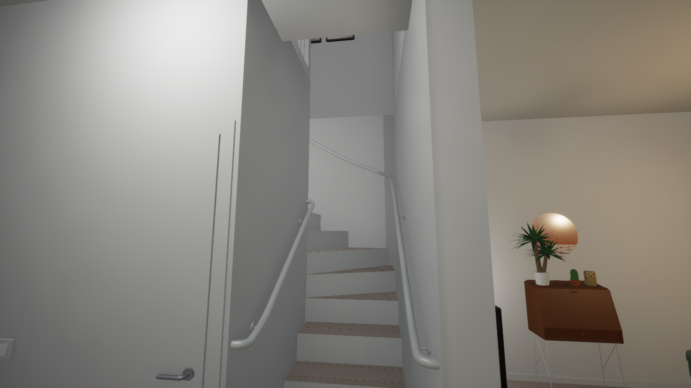
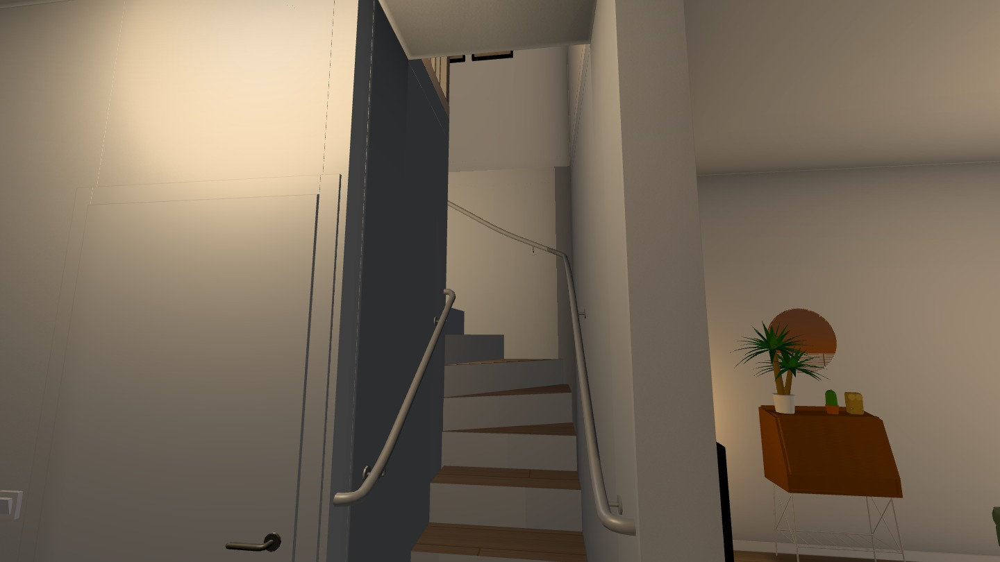

# Kvällsljuset på vardagsrumsväggen i L1007

Den kalibrerade kameran står vid (2,50, 1,62, 8,20) m, riktad 173° med −4° lutning och 72° vertikalt synfält. Bilderna visar den 21 juni 2026 kl. 22 i klart väder. Alla fyra valda punktljus har nått full styrka. Nio strålar genom den exporterade rumsmodellen träffar den målade östväggen i vänsterutsnittet, vid x = 5,5512 m. Väggmaterialet har basfärg #f1f1ee och roughness 0,85 i båda versionerna.

| Bild och belysning | Vänstra väggen | Taket över pendeln | Högra väggen |
|---|---:|---:|---:|
| Alla lampor tända | 0,2087 | 0,9586 | 0,1507 |
| Enbart Silvias rumsbrytare släckt | 0,1397 | 0,1480 | 0,1382 |
| Enbart det lokala fönsterljuset avstängt | 0,1379 | 0,9439 | 0,1292 |
| Enbart armaturernas additiva tak-/golvfläckar dolda | 0,2087 | 0,4855 | 0,1507 |
| Arkiverad Unreal-bild med alla lampor tända, före ändringen | 0,1408 | 0,2976 | 0,2139 |

Alla värden är medelluminans i linjärt ljus. Vänsterutsnittet är #2313:s ursprungliga rektangel, 0–8 % av bildbredden och 15–35 % av höjden. Högerutsnittet avser #2313:s kontroll vid skåpet. På den vänstra väggen är skillnaden 0,0690 när rumsbrytaren växlas och 0,0708 när fönsterljuset växlas. Den äldre Unreal-bilden ligger 0,0679 under den nya webbreferensen där. En ny körning av `crop-stats.cjs` ger kvoten 0,675 och stoppar vid gränsen 0,8. För de fyra delytorna, rad för rad, blir kvoterna 0,672, 0,757, 0,620 och 0,678. Den ursprungliga #2313-körningen avrundade den äldre Unreal-bildens luminans till 0,1409. Den äldre Unreal-bilden med skymningslampor ger 0,0853. Flera ljus kan skilja sig mellan det lampläget och den nya bilden med bara pendeln släckt.

| Alla lampor tända | Enbart pendeln släckt |
|---|---|
|  |  |

Silvias kopparskärm är 50 cm bred och 41 cm hög. Ljuspunkten ligger vid (3,64, 1,8255, 10,56) m i webbaxlarna. Webbens intensitet är 2,2, räckvidden 5 m och färgen #ffd9a8. Webbens skärmprofil anger radien 1,0 m på taket och 1,2 m på golvet. Den nya fönsterkällan avser den målade väggen. Takfläcken är en separat skillnad som syns i brytarprovet.

Under skymningen belyser den nya Unreal-källan denna vägg med webbens arealjus och varma återreflektion från fönstret. Exportören läser fönstermått, stängda dörrar och fönsterskydd ur den byggda scenen och samplar källfunktionen på väggytan. Den södra glasöppningen är 2,1098 × 2,00 m. Unreals punktljuskomponent står i glasets mitt vid (3,8464, 1,60, 12,5986) m i webbaxlarna. Dess ljusfunktion kompenserar punktljusets avstånds- och vinkelfall så att fältet följer den exporterade arealkällan. Den använder spelets `Daylight`, solriktning och nederbörd. När det vanliga direkta solljuset tar över tonas kvällsbidraget ut. En enda färg återger blandningen av himmelsljus och varm golvreflex. Vid mitten av utsnittet är dess linjära RGB (0,8662, 0,7840, 0,7349) per enhet ljus. Vid ytterproven skiljer varje kanal mindre än 0,4 % från den blandningen. Speglande ljus, dimspridning och indirekt vidarebelysning från denna extrakälla är avstängda.

## Kontroller i WSL

Slutexporten för L1007 har 2 634 unika noder och 893 194 trianglar. Den målade ytan löper från z = 7,80 till 12,2337 m och från golvet till 3,00 m. Alla nio kamerastrålar träffade rätt material, även den del av väggen som ligger efter planens delpunkt vid z = 11,639. Det exporterade fältet har 19 × 13 prov. På ett rutnät med nio direkta prov från webbscenen över samma utsnitt var största avvikelsen efter interpolation 0,69 %.

DXC kompilerade den genererade ljusfunktionen till DXIL och SPIR-V. Alla 22 Vulkanprov passerade för klart väder, regn, snö, skymningsövergången och mörker, inklusive inaktiva prov på skåpsväggen, övre plan och framför väggfärgen. Trappans sex siktstrålar och 672 Vulkanprov passerade också, liksom 14 webbtester för fönsterljus och lampskärmar.

## Upprepa provet

För webben, kör projektets vanliga `capture-web-lighting.cjs` med `living-room-evening,living-room-without-pendant`. Efter en export med zonen `l1007` testar följande kommando den genererade ljusfunktionen med DXC och VkRunner på sökvägen.

```sh
node tools/unreal-engine/tests/stair-light-rays.mjs unreal/Lunden/Import
python3 tools/unreal-engine/tests/living-wall-light.py unreal/Lunden/Import/measurements.json
```

För att upprepa Windows-provet, bygg och kontrollera belysningsnivån från samma export, komponera `L_Lunden` och kör `test_lighting.py` headless. Ta de två kamerabilderna från den uppdaterade kartan med `capture_lighting.py --exposure=game`. Lägg dem bredvid de två webbilderna och kör sedan följande.

```sh
node tools/unreal-engine/tests/crop-stats.cjs <bildkatalog> tools/unreal-engine/tests/pendant-lighting-crops.json --check-pendant
```

#2313:s vänsterutsnitt och dess fyra delytor ska var för sig ligga mellan 0,8 och 1,25 gånger webbens luminans. Väggens ökning av ljus nedåt kontrolleras i båda kolumnerna. Ta även de tre kontrollvyerna från #2369 för hela vardagsrummet dag och kväll samt övre plan på kvällen. Den verkliga [äldre Unreal-bilden](../2313/unreal-living-room-evening.jpg) och [den tidigare mätningen](../2313/crop-stats.txt) visar utgångsläget. De båda nya bilderna ovan kommer från webben.

## Eget Windows-prov den 21 november

UnrealEditor-Cmd 5.8.4-58902052 byggde och återöppnade belysningsnivån. Spelprovet på `L_Lunden` passerade med 38 lampor och noll varningar. Solriktningen stämde vid alla 20 provtillfällen. Samma kamera som i webbreferensen användes med spelets fasta exponering.

I den provade inställningen gav fönsterfältet och en Silvia-pendel på 16,632 cd följande medelluminans. Raderna avser samma kvällsbild med samtliga lampor tända.

| Utsnitt | Webb | Unreal | Unreal/webb |
|---|---:|---:|---:|
| Vänster vägg | 0,2087 | 0,2167 | 1,04 |
| Övre vänster | 0,1912 | 0,2088 | 1,09 |
| Övre höger | 0,1670 | 0,2033 | 1,22 |
| Nedre vänster | 0,2421 | 0,2267 | 0,94 |
| Nedre höger | 0,2337 | 0,2277 | 0,97 |

Båda kolumnerna blev ljusare nedåt och passerade formkravet i `crop-stats.cjs --check-pendant`. När Silvia släcktes sjönk vänsterväggens luminans med 0,0970 i Unreal och 0,0690 på webben. Kontrollerna för hela vardagsrummet dag och kväll samt övervåningen på kvällen gav 1,03, 0,88 och 1,04 gånger webbreferensen.

| Tänd Silvia | Släckt Silvia |
|---|---|
|  |  |
|  |  |

Den extra kontrollen från trappan gav 1,39 gånger webbens helbild, över projektgränsen 1,25. I en separat körning från samma kamera, med den tidigare pendelstyrkan och fönsterfältet avstängt, blev kvoten 1,20. Strålar genom L1007-exporten visar att den högra tredjedelen av trappbilden innehåller vardagsrummets tak, vägg och sekretär. Bilderna dokumenterar en uppmätt provinställning under fortsatt kalibrering.

| Trappkameran i Unreal | Webbreferens |
|---|---|
|  |  |
