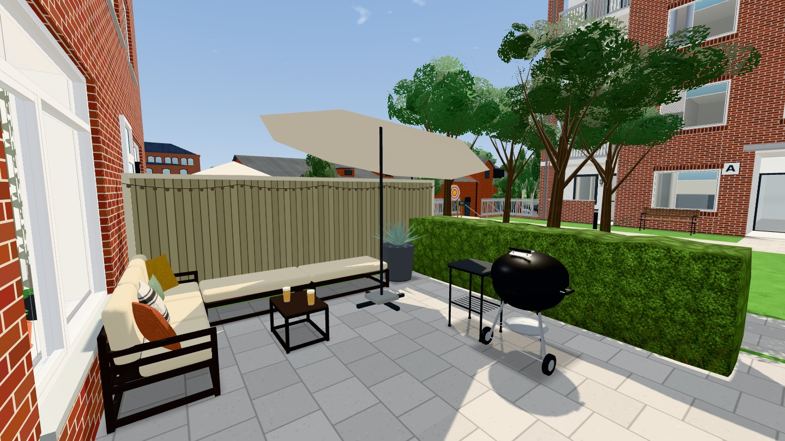
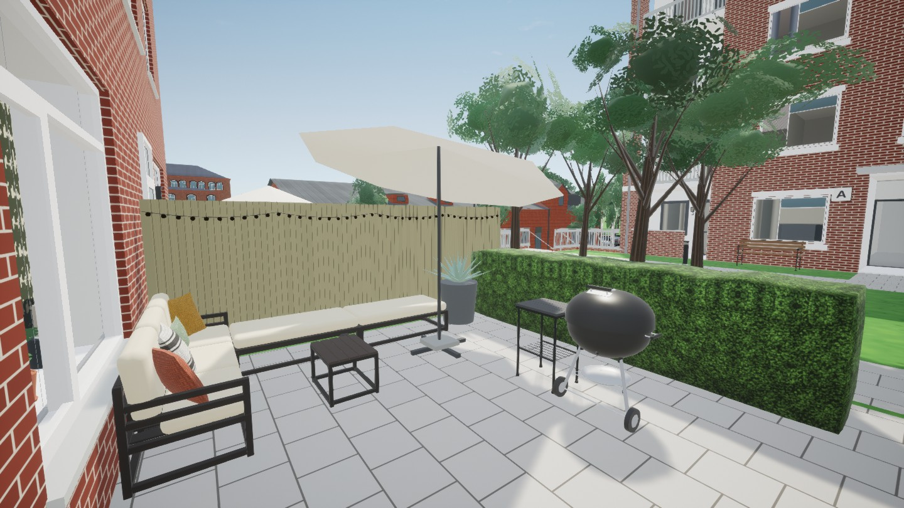
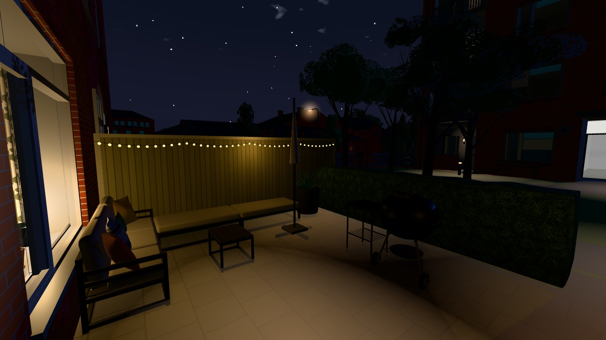
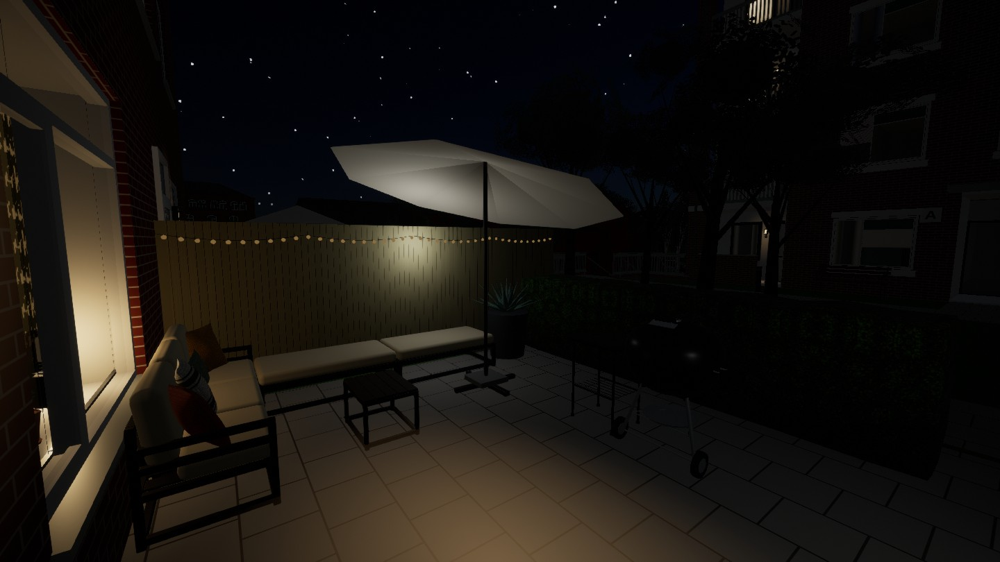

# Patio parasol and string lights in Unreal (#2373)

Unreal Editor 5.8.4 on Windows 11, 2026-11-21, headless. Warm Windows checkout at `b442c723` (the corrected capture
path of #2396) with the Actions export `unreal-export-1ab8cde6da7a7954`. The export side is Codex's `0ccb6bb7`,
`bc5fbf9a`, `8cfe9bd8`, `817802bc` and `82ea55fa`; how it works:
[unreal.md, Export → Patio parasol and string lights](../../development/unreal.md#export).

## Checks

| Check | Result |
|---|---|
| `sync-import.ps1` (incremental) | pass: `LUNDEN_SYNC_IMPORT_OK` |
| `test_patio_strings` (PIE on `L_Lunden`) | pass: `LUNDEN_PATIO_STRINGS_TEST_OK 82 bulbs and two pools across rain, dusk and a power cut`. Off at 14:00, off on a rainy 21:15, on at 23:30, scaled by a power cut and back, and off again at 14:00; all 82 bulbs share the driver's material and their colour follows the web's idle + boost × glow × supply |
| `test_furnishing` (editor world) | pass: 175 of 175 furnishing items within 0.005 cm of the web, worst turn 0.0007°; `furn_parasol_l0_x450_z1555` 0.00002 cm off in `Level_l1007-uteplats` and `L_Lunden`; 231 of 231 textured meshes |
| `test_fixture_material` | pass (same run: 3 passed, 0 failed, 0 not run) |

## Pictures

One camera at the patio's north-west corner, looking south-east at the parasol and the west fence's string, 1440 × 810,
72° vertical, 21 June ([`views.json`](views.json)): 14:00 and 23:30, clear. 23:30 is a time when the web's rule has the
strings on (raw daylight below `PATIO.stringLights.on` 0.3); the same hour is the "on" step of `test_patio_strings`.
The `dusk` preset was added to a local copy of `unreal/Lunden/Tests/views.json` only for these captures. Web:
`capture-web-views.cjs`, desktop Ultra, SwiftShader, each view in its own page load so the patio starts at that hour
([`web-capture.json`](web-capture.json)). Unreal: `tests/capture_vegetation.py` on `L_Lunden` at the game's exposure
(−1.97 EV at 14:00, −2.55 EV at 23:30; [`unreal-capture.json`](unreal-capture.json)), on the capture path of
`b442c723`.

| Web | Unreal |
|---|---|
|  |  |
|  |  |

- **14:00:** the parasol stands on its cross foot beside the sofa, open and tilted as on the web; the string hangs
  along the west fence, unlit.
- **23:30:** the string's bulbs are lit and the two pools of light fall on the fence and the paving, as on the web.

Mean crops ([`crops.json`](crops.json), `tests/crop-stats.cjs`, [`crop-stats.json`](crop-stats.json)):

| View, crop | Web sRGB | Unreal sRGB | Unreal / web luminance | R/B web, Unreal |
|---|---|---|---:|---|
| 14:00, canopy | 176, 170, 152 | 202, 200, 191 | 1.40 | 1.15, 1.06 |
| 14:00, fence | 114, 109, 78 | 145, 140, 110 | 1.67 | 1.46, 1.32 |
| 14:00, paving | 168, 168, 166 | 185, 185, 187 | 1.21 | 1.01, 0.99 |
| 23:30, bulb row | 71, 57, 21 | 60, 53, 35 | 0.70 | 3.44, 1.73 |
| 23:30, fence by the pool | 58, 41, 4 | 70, 66, 46 | 2.59 | 13.3, 1.51 |
| 23:30, paving | 87, 66, 42 | 70, 56, 40 | 0.71 | 2.06, 1.75 |

The day crops are 1.2–1.7 × the web, the outdoor daylight gap of #2390. At 23:30 the bulbs and the light on the fence
are much less yellow in Unreal (R/B 1.7 and 1.5 against 3.4 and 13). The string light's colour comes from the export
(`#ffcf8a`), so this is likely the display transform's desaturation of saturated light (#2396's tonemapper). It was
not tuned here.

## Remaining differences in these pictures

- **23:30: Unreal's parasol is open; the web folds it at night.** The export bakes the web's open summer pose and
  nothing in Unreal changes it at runtime: #2403.
- **14:00: the web has two beer glasses on the table (`src/patio.js`, summer afternoons); Unreal has none.**
- **23:30: the bulbs and the light on the fence are paler and less yellow in Unreal** (table above); probably #2396.
- **Daylight 1.2–1.7 × the web and the paler sky:** #2390, waiting for #2396.
