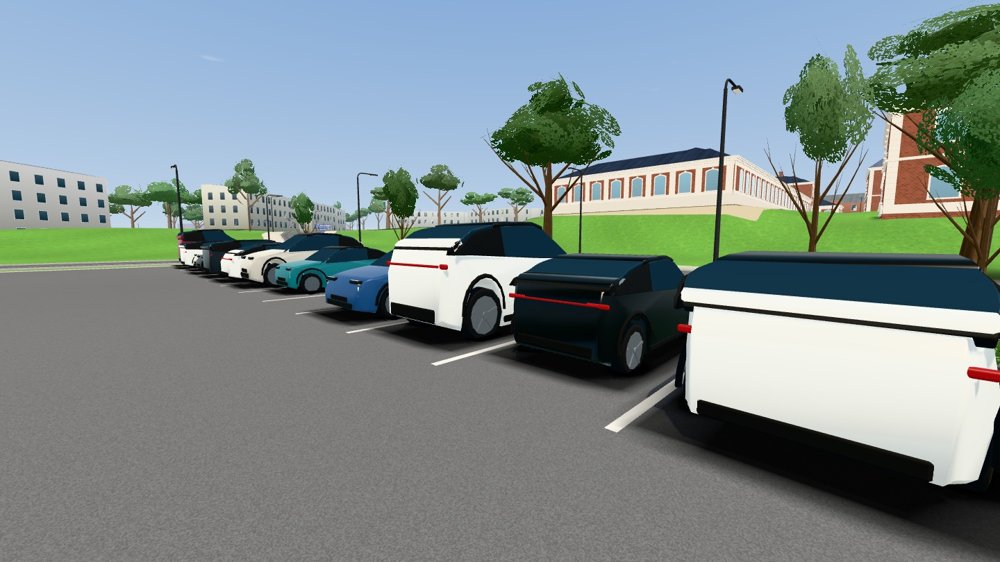

# Parkerade bilar och cyklar (#2374)

Den fullständiga exporten innehöll 68 parkerade bilar och 69 cyklar. Bilarna använder webbens kaross-, lack-, glas- och hjulgeometri. Cyklarna använder närmodellerna, med ekrarna ur webbens masktextur. Varje cykels egna vertexintervall finns kvar även där flera cyklar delar en mesh.

| Plats | Bilar | Cyklar | Gångkollision från webben |
| --- | ---: | ---: | --- |
| Gatuparkering och yttre cykelställ | 19 | 9 | 19 bilkonturer och 2 ställ |
| Östra parkeringarna | 26 | 0 | 26 bilkonturer |
| Innergården | 0 | 5 | 1 ställ |
| Garage | 23 | 44 | 23 bilkonturer och 11 ställ |
| Förråd | 0 | 11 | Befintliga burväggar och dörrar |

Webbens spelare stöter mot cykelstället. Cykeln har tom egen krockkontur på sin ursprungsplats. I förråden hanterar burarna passagen. För bilarna används den enskilda parkerade bilens fyra källhörn.

## Webb och exporterad geometri

Den vanliga tiozonsexporten i Chromium gav 9 356 unika nod-ID:n. Exportkontrollen godkände alla SHA-256-värden och 313 källfiler. Provet nedan läste de binära positionerna och nodernas transform i de tre berörda GLB-filerna. Det jämförde 1 146 modellpunkter med Three.js-scenen samt de åtta hörnen på var och en av 82 krockboxar med källkonturerna. Största uppmätta avvikelse var 0,00083 cm vid en gräns på 1 cm. Alla fyra cykelgrupper hade maskerade ekrar. Det ordinarie materialprovet gav noll omappade nycklar.

```sh
node tools/unreal-engine/check-export.mjs --dir "$export"
node tools/unreal-engine/tests/parked-vehicles.mjs "$export"
python3 tools/unreal-engine/tests/test_materials.py "$export"
```

Bilderna är tagna i spelet med Chromium i 1440 × 810, 72° vertikalt synfält, klart väder och fryst tid 21 juni 2026 kl. 14. Kamerorna ligger i [parked-views.json](../../../tools/unreal-engine/tests/parked-views.json).




## Återstår i Unreal 5.8.4

Windows-editorn kunde inte startas i denna WSL-session. Nästa Unreal-körning behöver importera samma export och köra `tools/unreal-engine/tests/test_parked_vehicles.py` med `measurements.json` via projektets headless-körare. Provet jämför de importerade LOD0-modellernas vertexpositioner med webbens punkter, läser Pawn-svaret på varje box och sveper en stående spelarkapsel mot en källkant i var och en av de sex kollisionsgrupperna.

Generera kameraunderlaget med följande kommando och rendera sedan den uppbyggda, sammansatta `L_Lunden` med `tests/capture_exterior.py <scene.json> <bildkatalog>` enligt [Unreal-guiden](../../development/unreal.md). De tre Unreal-bilderna ska granskas tillsammans med motsvarande webbilder före stängning.

```sh
LUNDEN_CAPTURE_VIEWS=tools/unreal-engine/tests/parked-views.json \
  node tools/unreal-engine/pilot-scene.mjs "$export/measurements.json" "$out/scene.json"
```
