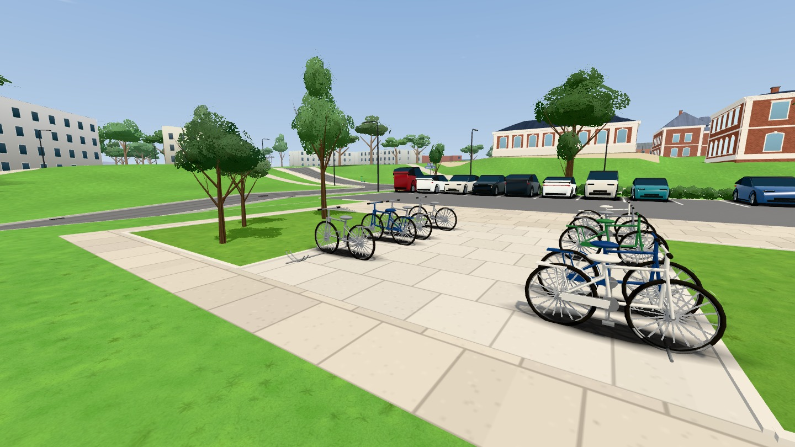
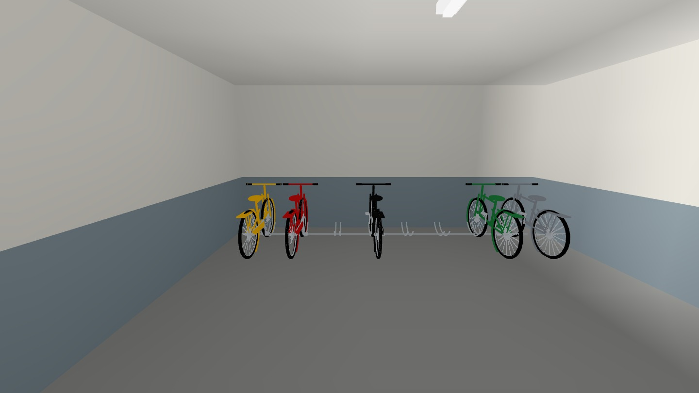
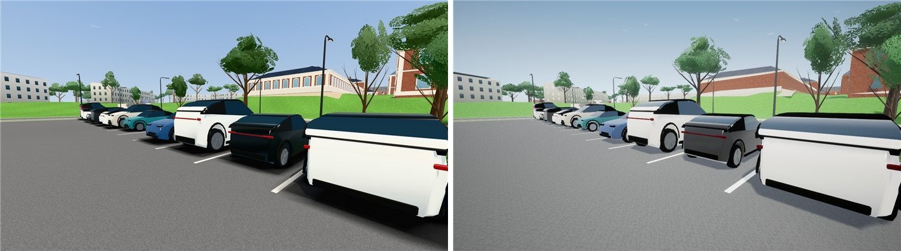
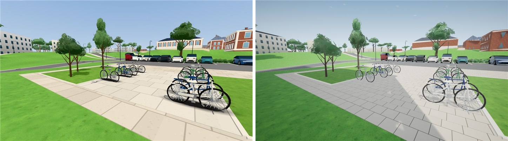
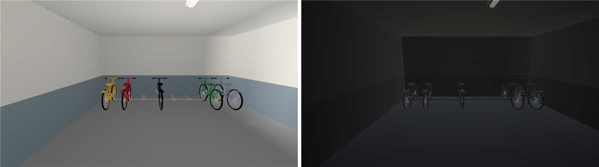

# Parkerade bilar och cyklar (#2374)

Den fullständiga exporten innehöll 68 parkerade bilar och 69 cyklar. Bilarna använder webbens kaross-, lack-, glas- och hjulgeometri. Cyklarna använder närmodellerna, med ekrarna ur webbens masktextur. Varje cykels egna vertexintervall finns kvar även där flera cyklar delar en mesh.

| Plats | Bilar | Cyklar | Gångkollision från webben |
| --- | ---: | ---: | --- |
| Gatuparkering och yttre cykelställ | 19 | 9 | 19 bilkonturer och 2 ställ |
| Östra parkeringarna | 26 | 0 | 26 bilkonturer |
| Innergården | 0 | 5 | 1 ställ |
| Garage | 23 | 44 | 23 bilkonturer och 11 ställ |
| Förråd | 0 | 11 | Befintliga burväggar och dörrar |

Webbens spelare stöter mot cykelstället. Cykeln har tom egen krockkontur på sin ursprungsplats. I förråden hanterar burarna passagen. För bilarna används den enskilda parkerade bilens fyra källhörn.

## Webb och exporterad geometri

Den vanliga tiozonsexporten i Chromium gav 9 356 unika nod-ID:n. Exportkontrollen godkände alla SHA-256-värden och 313 källfiler. Provet nedan läste de binära positionerna och nodernas transform i de tre berörda GLB-filerna. Det jämförde 1 146 modellpunkter med Three.js-scenen samt de åtta hörnen på var och en av 82 krockboxar med källkonturerna. Största uppmätta avvikelse var 0,00083 cm vid en gräns på 1 cm. Alla fyra cykelgrupper hade maskerade ekrar. Det ordinarie materialprovet gav noll omappade nycklar.

```sh
node tools/unreal-engine/check-export.mjs --dir "$export"
node tools/unreal-engine/tests/parked-vehicles.mjs "$export"
python3 tools/unreal-engine/tests/test_materials.py "$export"
```

Bilderna är tagna i spelet med Chromium i 1440 × 810, 72° vertikalt synfält, klart väder och fryst tid 21 juni 2026 kl. 14. Kamerorna ligger i [parked-views.json](../../../tools/unreal-engine/tests/parked-views.json).






## Unreal 5.8.4 på Windows

*`orkester: solwation-w11-opus-5.5-20261121`, 2026-11-21. Exporten från arbetsflödet för källorna i `9d978c9e`
(`unreal-export-1ab8cde6da7a7954`, samma parkerade fordon som `c22d059e`). `sync-import.ps1 -ExportFrom` gav
`LUNDEN_SYNC_IMPORT_OK`. Zonerna var redan importerade från samma GLB-filer, så inga paket ändrades.*

| Kontroll | Resultat |
| --- | --- |
| `node tools/unreal-engine/tests/parked-vehicles.mjs` på exporten | 68 bilar, 69 cyklar, 82 krockboxar, 1 146 punkter, största avvikelse 0,00083 cm ✓ |
| `sync-import.ps1` (export, import, alla byggsteg, `compose_world.py --check`, `import_world.py --check`) | `LUNDEN_SYNC_IMPORT_OK`, 82 krockboxar som dolda BlockAll-aktörer med en enkel box var ✓ |
| `test_parked_vehicles` (PIE, `run-tests.ps1`) | Webbens punkter mot LOD0: högst 0,0009 cm. 82 dolda BlockAll-boxar som blockerar Pawn. Stående kapsel mot en box per område och slag: kontakt 0,000 cm från webbens kant ✓ |
| Spelets egen spelare går rakt in i en gatubil, ett cykelställ på gatan och ett cykelställ i garaget | Stannar 0,100 cm utanför webbens stopplinje, det vill säga kanten plus `PLAYER.radius`. Avvikelse i sidled 0,00 cm ✓ |
| Ritanrop | 282 parkerade delaktörer på 94 meshar, alla med Nanite och ingen på rasterbanan ([`unreal-draw-groups.json`](unreal-draw-groups.json)). Ingen extra instansiering eller sammanslagning behövs ✓ |

Testet körde tidigare med `run-python.ps1`. Där spårar editorvärlden ingenting, eftersom kommandoleten saknar fysikscen, så det kör nu i Play In Editor. LOD0-punkterna läses ur meshbeskrivningen, eftersom `KismetProceduralMeshLibrary` inte finns i projektet. Zonnivåerna har ingen gångbar mark: den lägger `build_site.py` till i den sammansatta världen. Därför går spelaren på en platt testplatta i minnet, med ovansidan i boxens bas.

Unreal-bilderna är tagna med `tests/capture_exterior.py` på det sammansatta `L_Lunden` med samma kameror. Fångstvägen var `b442c723` (#2396, slutlig LDR-färg med visningsgamma), och Nanite var avstängt i minnet som i fångstskriptet. Bilder tagna på `48a7c75a` kastades. Webb till vänster, Unreal till höger:







Unreal-bilderna i full storlek är [parked-street-unreal.jpg](parked-street-unreal.jpg), [parked-bicycles-unreal.jpg](parked-bicycles-unreal.jpg) och [parked-garage-unreal.jpg](parked-garage-unreal.jpg).

**Lika:** varje bil och cykel står på sin plats. Det gäller bilmodellerna och deras ljusa lacker, bakljusen, hjulen, cyklarnas ramfärger och ställ samt de maskerade ekrarna.

**Skillnader, var och en med ett öppet ärende:**

- Bilglaset och den mörka lacken speglar himlen och blir ljusgrå i Unreal: #2405.
- Garaget saknar lampor och är nästan svart: #2404.
- Den ljusare och blekare marken och himlen i dagsljus: #2390.
