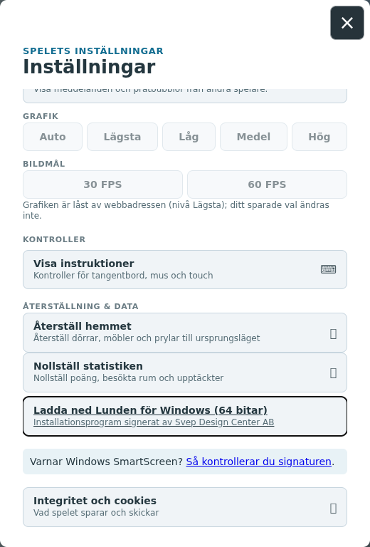
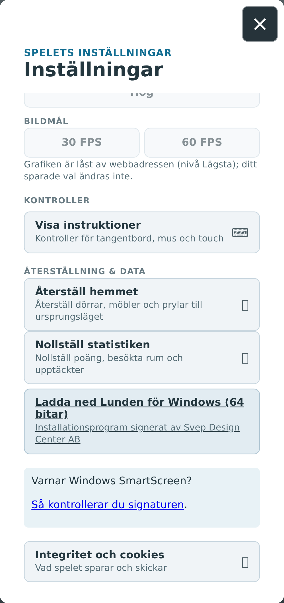

# Windowslänken i webbmenyn

Bilderna visar en lokal förhandsvisning med den syntetiska exempelversionen 0.0.0. Länkgeneratorn i `stable-download.mjs` fyllde markören i webbläsarens svar för den ordinarie sidan. Installationslänken pekade på `release-preview.invalid`. Före förhandsvisningen öppnade provet samma inställningsmeny och kontrollerade att både installationslänken och SmartScreen-hjälpen var dolda.

| Dator, tangentbordsfokus på installationslänken | Pixel 7, emulerad pekskärm |
| --- | --- |
|  |  |

`Ladda ned Lunden för Windows (64 bitar)` visar utgivaren Svep Design Center AB. Hjälplänken går till signaturkontrollen i README och öppnas i en egen flik. Datorprovet gick framåt och bakåt med Tab genom installationslänken, signaturhjälpen och Integritet och cookies. På Pixel 7 delades hjälplänken tidigare i två textfragment. En träff mitt i dess omslutande ruta på 237 × 36 CSS-pixlar hamnade mellan fragmenten. Hjälplänken har nu en sammanhängande pekyta. Telefonprovet rullade i dialogen med pekgester och tryckte mitt i hjälplänken. Båda kontrollerade att länkarna gick att träffa, att dialogen rymdes i bredd och att fokus återgick till menyknappen efter stängning.

| Mätning i CSS-pixlar | Dator (1280 × 800) | Pixel 7 (412 × 839) |
| --- | ---: | ---: |
| Installationslänk, bredd × höjd | 456 × 56 | 316 × 87 |
| Hjälplänk, bredd × höjd | 204 × 16 | 204 × 44 |
| Rullning i inställningslistan | 63 | 192 |
| Horisontellt överflöd | 0 | 0 |

Förhandsvisningens omprov använder projektets `test=lazy` för att begränsa 3D-renderingen bakom den ogenomskinliga menyn. Inställningsdialogen använder samma produktionskod och stilmall.

Kör en lokal server för samma checkout med `python3 tools/devserve.py 8137`. Kör sedan följande från projektroten med projektets vanliga Playwright-konfiguration.

```sh
tools/browsertest.sh node tools/unreal-engine/tests/stable-menu.cjs http://127.0.0.1:8137 docs/verification/2377
```

Provet blockerar externa anrop. Stabil publicering, signaturkontroll av den publicerade filen, installation och uppdatering verifieras av releaseägaren vid utgivningen.
